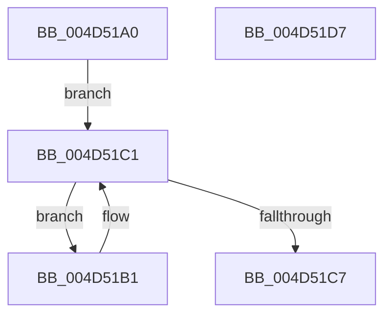

# TelemetryCoverageStringHashInternal

- RVA: `0x004D51A0`–`0x004D51D8` (길이 `56` bytes)
- VA: `0x00000001404D51A0`
- 실행 섹션: `.text`
- PDB 이름 있음: `예`; PDB Function 태그: `아니요`
- unwind 정보 RVA: `0x000DB714`
- 디코드: `18`개 명령, `56/56` bytes 표시
- 미해석 바이트: `0` (있으면 어셈블리에 `.byte`로 보존)

> 이 문서는 커널 이미지의 기계어와 PDB 기호를 분석해 생성했습니다. 4번과 5번은 함수 원형과 자료형을 바이너리 사용 방식에서 추정한 C 해석이며 원본 소스 복구 결과는 아닙니다.

## 1. Dependencies

- 직접 호출 지점: **0**; 고유 호출 대상: **0**
- 직접 호출자로 확인된 함수: **9**
- RIP 상대 이미지 참조: **0**

### Outgoing calls
- 직접 디코드된 call 명령이 없습니다.

### Direct callers
- [EtwpCoverageHighIrqlCPWorkItemCallback](../65/EtwpCoverageHighIrqlCPWorkItemCallback_function_00651B00.md) at `0x00651BB2`
- [EtwpCoverageEnsureContext](../../page/70/EtwpCoverageEnsureContext_function_007028E4.md) at `0x00702CFD`
- [EtwpCoverageEnsureContext](../../page/70/EtwpCoverageEnsureContext_function_007028E4.md) at `0x00702D47`
- [EtwpCoverageReset](../../page/7B/EtwpCoverageReset_function_007B9F4C.md) at `0x007B9FAF`
- [EtwpCoverageResetCP](../../page/7B/EtwpCoverageResetCP_function_007BA154.md) at `0x007BA1A9`
- [DbgkForwardException](../../page/8A/DbgkForwardException_function_008A2D60.md) at `0x008A3171`
- [PsSetProcessFaultInformation](../../page/A7/PsSetProcessFaultInformation_function_00A75400.md) at `0x00A755AD`
- [EtwpCoverageProvEnableCallback](../../page/A9/EtwpCoverageProvEnableCallback_function_00A9C6F0.md) at `0x00A9C83B`
- [PopTransitionTelemetryOsState](../../page/A9/PopTransitionTelemetryOsState_function_00A9DD40.md) at `0x00A9E0A0`
- [PopTransitionTelemetryOsState](../../page/A9/PopTransitionTelemetryOsState_function_00A9DD40.md) at `0x00A9E0E1`
- [PopTransitionTelemetryOsState](../../page/A9/PopTransitionTelemetryOsState_function_00A9DD40.md) at `0x00A9E122`
- [PopTransitionTelemetryOsState](../../page/A9/PopTransitionTelemetryOsState_function_00A9DD40.md) at `0x00A9E163`
- [PopTransitionTelemetryOsState](../../page/A9/PopTransitionTelemetryOsState_function_00A9DD40.md) at `0x00A9E1A4`
- [PopTransitionTelemetryOsState](../../page/A9/PopTransitionTelemetryOsState_function_00A9DD40.md) at `0x00A9E207`
- [sub_00B48B0A](../../page/B4/Unknown_function_00B48B0A.md) at `0x00B48B93`
- [sub_00B48B0A](../../page/B4/Unknown_function_00B48B0A.md) at `0x00B48BD7`
- [sub_00B48B0A](../../page/B4/Unknown_function_00B48B0A.md) at `0x00B48C1B`
- [sub_00B48B0A](../../page/B4/Unknown_function_00B48B0A.md) at `0x00B48C5F`
- [sub_00B48B0A](../../page/B4/Unknown_function_00B48B0A.md) at `0x00B48CAF`

### Static image references
- 디코드된 RIP-relative 메모리 참조가 없습니다.

## 2. Other-region calls and transfers

- 다른 실행 섹션으로 향하는 call: **0**
- 별도 외부 분기/꼬리 이동을 확인하지 못했습니다.

## 3. Assembly (complete function range)

```asm
004D51A0  41 B8 C5 9D 1C 81               mov r8d, 0x811c9dc5
004D51A6  4C 8B D1                        mov r10, rcx
004D51A9  41 B9 01 00 00 00               mov r9d, 1
004D51AF  EB 10                           jmp 0x1404d51c1
004D51B1  45 69 C0 93 01 00 01            imul r8d, r8d, 0x1000193
004D51B8  0F BE C0                        movsx eax, al
004D51BB  44 03 C0                        add r8d, eax
004D51BE  49 03 C9                        add rcx, r9
004D51C1  8A 01                           mov al, byte ptr [rcx]
004D51C3  84 C0                           test al, al
004D51C5  75 EA                           jne 0x1404d51b1
004D51C7  41 2B CA                        sub ecx, r10d
004D51CA  45 85 C0                        test r8d, r8d
004D51CD  89 0A                           mov dword ptr [rdx], ecx
004D51CF  45 0F 45 C8                     cmovne r9d, r8d
004D51D3  41 8B C1                        mov eax, r9d
004D51D6  C3                              ret
004D51D7  CC                              int3
```

## 4. C-style interpretation (structured pseudocode)

```c
__int64 __fastcall TelemetryCoverageStringHashInternal(__int64 a1, __int64 a2)
{
    goto loc_004D51C1;
loc_004D51B1:
    a3 = (unsigned int)(((unsigned int)(0x811C9DC5ULL)) * ((unsigned int)((unsigned int)(0x811C9DC5ULL))));
    a3 = (unsigned int)((a3) + ((unsigned int)((__int8)((unsigned __int8)(result)))));
    a1 = (a1) + (1);
loc_004D51C1:
    if ((unsigned __int8)(*(unsigned __int8 *)(a1)) != 0) goto loc_004D51B1;
    a1 = (unsigned int)((a1) - ((unsigned int)(a1)));
    *(unsigned int *)(a2) = (unsigned int)(a1);
    a4 = 1;
    if ((unsigned int)(a3) != 0) { a4 = (unsigned int)(a3); }
    return (unsigned int)((unsigned int)(a4));
}
```

## 5. (Beta) C Style

```c
int64_t TelemetryCoverageStringHashInternal(void *Arg1, void *Arg2)
{
    uint8_t *arg1 = (uint8_t *)Arg1;
    uint8_t *arg2 = (uint8_t *)Arg2;

    goto loc_004D51C1;
loc_004D51B1:
    a3 = (uint32_t)(((uint32_t)(0x811C9DC5ULL)) * ((uint32_t)((uint32_t)(0x811C9DC5ULL))));
    a3 = (uint32_t)((a3) + ((uint32_t)((int8_t)((uint8_t)(result)))));
    Arg1 = (Arg1) + (1);
loc_004D51C1:
    if ((uint8_t)(*(uint8_t *)(arg1)) != 0) goto loc_004D51B1;
    Arg1 = (uint32_t)((Arg1) - ((uint32_t)(Arg1)));
    *(uint32_t *)(arg2) = (uint32_t)(Arg1);
    a4 = 1;
    if ((uint32_t)(a3) != 0) { a4 = (uint32_t)(a3); }
    return (uint32_t)((uint32_t)(a4));
}
```

### 관측된 메모리 오프셋

구조체 형식이 확인되지 않은 접근은 인자 기준의 오프셋으로만 기록했습니다.

| 기준 인자 | 오프셋 표현 | 폭 (bit) | 접근 |
|---|---:|---:|---|
| `Arg1` | `+ 0x0` | `8` | `R` |
| `Arg2` | `+ 0x0` | `32` | `W` |

## 6. Execution-region graph

[열기: 2D/3D 그래프와 함수 탐색 컨트롤 패널](../../../control-panel.html?section=text&rva=0x004D51A0&view=graph)

- 2D 그래프는 위에서 아래로 흐르고, 3D 그래프는 빈 공간을 드래그해 회전합니다. Shift+드래그는 이동, 휠은 확대·축소, 함수 노드 선택은 대상 보고서 이동입니다.

### Static fallback


