# VmpMergeMemoryRanges

- RVA: `0x004D9EDC`–`0x004DA19B` (길이 `703` bytes)
- VA: `0x00000001404D9EDC`
- 실행 섹션: `.text`
- PDB 이름 있음: `예`; PDB Function 태그: `아니요`
- unwind 정보 RVA: `0x0008C2BC`
- 디코드: `205`개 명령, `703/703` bytes 표시
- 미해석 바이트: `0` (있으면 어셈블리에 `.byte`로 보존)

> 이 문서는 커널 이미지의 기계어와 PDB 기호를 분석해 생성했습니다. 4번과 5번은 함수 원형과 자료형을 바이너리 사용 방식에서 추정한 C 해석이며 원본 소스 복구 결과는 아닙니다.

## 1. Dependencies

- 직접 호출 지점: **13**; 고유 호출 대상: **8**
- 직접 호출자로 확인된 함수: **1**
- RIP 상대 이미지 참조: **0**

### Outgoing calls
- `0x004D9F08` → [VmpProcessContextLockExclusive](../31/VmpProcessContextLockExclusive_function_003147A4.md) (function, `0x003147A4`)
- `0x004D9F8E` → [VmpVaMemoryRangeGetNext](../4A/VmpVaMemoryRangeGetNext_function_004ACEEC.md) (function, `0x004ACEEC`)
- `0x004D9FA8` → [VmpVaRangeNumberOfGpaRanges](../42/VmpVaRangeNumberOfGpaRanges_function_00429E34.md) (function, `0x00429E34`)
- `0x004D9FB3` → [VmpVaRangeNumberOfGpaRanges](../42/VmpVaRangeNumberOfGpaRanges_function_00429E34.md) (function, `0x00429E34`)
- `0x004DA03A` → [VmpProcessContextUnlockExclusive](../48/VmpProcessContextUnlockExclusive_function_004894C8.md) (function, `0x004894C8`)
- `0x004DA062` → [VmpSecureMemoryForPin](../../page/7A/VmpSecureMemoryForPin_function_007ADED4.md) (function, `0x007ADED4`)
- `0x004DA095` → [VmpUnsecureMemoryForPin](../../page/7A/VmpUnsecureMemoryForPin_function_007AE05C.md) (function, `0x007AE05C`)
- `0x004DA0BE` → [VmpUnsecureMemoryForPin](../../page/7A/VmpUnsecureMemoryForPin_function_007AE05C.md) (function, `0x007AE05C`)
- `0x004DA0C6` → [VmpProcessContextLockExclusive](../31/VmpProcessContextLockExclusive_function_003147A4.md) (function, `0x003147A4`)
- `0x004DA107` → [RtlRbRemoveNode](../2E/RtlRbRemoveNode_function_002E4C10.md) (function, `0x002E4C10`)
- `0x004DA13B` → [RtlRbRemoveNode](../2E/RtlRbRemoveNode_function_002E4C10.md) (function, `0x002E4C10`)
- `0x004DA169` → [VmpProcessContextUnlockExclusive](../48/VmpProcessContextUnlockExclusive_function_004894C8.md) (function, `0x004894C8`)
- `0x004DA176` → [VmpFreeMemoryRanges](../../page/A7/VmpFreeMemoryRanges_function_00A75744.md) (function, `0x00A75744`)

### Direct callers
- [VmMergeMemoryRanges](../../page/A9/VmMergeMemoryRanges_function_00A94AE0.md) at `0x00A94BB1`

### Static image references
- 디코드된 RIP-relative 메모리 참조가 없습니다.

## 2. Other-region calls and transfers

- 다른 실행 섹션으로 향하는 call: **4**
  - `0x004DA062` → [VmpSecureMemoryForPin](../../page/7A/VmpSecureMemoryForPin_function_007ADED4.md) (`.text` → `PAGE`)
  - `0x004DA095` → [VmpUnsecureMemoryForPin](../../page/7A/VmpUnsecureMemoryForPin_function_007AE05C.md) (`.text` → `PAGE`)
  - `0x004DA0BE` → [VmpUnsecureMemoryForPin](../../page/7A/VmpUnsecureMemoryForPin_function_007AE05C.md) (`.text` → `PAGE`)
  - `0x004DA176` → [VmpFreeMemoryRanges](../../page/A7/VmpFreeMemoryRanges_function_00A75744.md) (`.text` → `PAGE`)
- 별도 외부 분기/꼬리 이동을 확인하지 못했습니다.

## 3. Assembly (complete function range)

```asm
004D9EDC  48 8B C4                        mov rax, rsp
004D9EDF  48 89 58 10                     mov qword ptr [rax + 0x10], rbx
004D9EE3  48 89 68 18                     mov qword ptr [rax + 0x18], rbp
004D9EE7  48 89 70 20                     mov qword ptr [rax + 0x20], rsi
004D9EEB  57                              push rdi
004D9EEC  41 54                           push r12
004D9EEE  41 55                           push r13
004D9EF0  41 56                           push r14
004D9EF2  41 57                           push r15
004D9EF4  48 83 EC 30                     sub rsp, 0x30
004D9EF8  45 33 F6                        xor r14d, r14d
004D9EFB  49 8B D8                        mov rbx, r8
004D9EFE  4C 21 70 08                     and qword ptr [rax + 8], r14
004D9F02  48 8B FA                        mov rdi, rdx
004D9F05  48 8B E9                        mov rbp, rcx
004D9F08  E8 97 A8 E3 FF                  call 0x1403147a4
004D9F0D  4C 8B E8                        mov r13, rax
004D9F10  48 39 5D 68                     cmp qword ptr [rbp + 0x68], rbx
004D9F14  74 0A                           je 0x1404d9f20
004D9F16  BF 19 07 00 C0                  mov edi, 0xc0000719
004D9F1B  E9 3D 02 00 00                  jmp 0x1404da15d
004D9F20  48 8D 4D 18                     lea rcx, [rbp + 0x18]
004D9F24  F6 41 08 01                     test byte ptr [rcx + 8], 1
004D9F28  48 8B 19                        mov rbx, qword ptr [rcx]
004D9F2B  74 08                           je 0x1404d9f35
004D9F2D  48 85 DB                        test rbx, rbx
004D9F30  74 03                           je 0x1404d9f35
004D9F32  48 33 D9                        xor rbx, rcx
004D9F35  0F B6 41 08                     movzx eax, byte ptr [rcx + 8]
004D9F39  83 E0 01                        and eax, 1
004D9F3C  EB 26                           jmp 0x1404d9f64
004D9F3E  48 3B 7B 20                     cmp rdi, qword ptr [rbx + 0x20]
004D9F42  76 06                           jbe 0x1404d9f4a
004D9F44  48 8B 4B 08                     mov rcx, qword ptr [rbx + 8]
004D9F48  EB 09                           jmp 0x1404d9f53
004D9F4A  48 3B 7B 18                     cmp rdi, qword ptr [rbx + 0x18]
004D9F4E  73 19                           jae 0x1404d9f69
004D9F50  48 8B 0B                        mov rcx, qword ptr [rbx]
004D9F53  85 C0                           test eax, eax
004D9F55  74 0A                           je 0x1404d9f61
004D9F57  48 85 C9                        test rcx, rcx
004D9F5A  74 05                           je 0x1404d9f61
004D9F5C  48 33 D9                        xor rbx, rcx
004D9F5F  EB 03                           jmp 0x1404d9f64
004D9F61  48 8B D9                        mov rbx, rcx
004D9F64  48 85 DB                        test rbx, rbx
004D9F67  75 D5                           jne 0x1404d9f3e
004D9F69  48 85 DB                        test rbx, rbx
004D9F6C  75 0A                           jne 0x1404d9f78
004D9F6E  BF 8C 02 00 C0                  mov edi, 0xc000028c
004D9F73  E9 E5 01 00 00                  jmp 0x1404da15d
004D9F78  48 39 7B 20                     cmp qword ptr [rbx + 0x20], rdi
004D9F7C  74 0A                           je 0x1404d9f88
004D9F7E  BF 41 01 00 C0                  mov edi, 0xc0000141
004D9F83  E9 D5 01 00 00                  jmp 0x1404da15d
004D9F88  48 8B D3                        mov rdx, rbx
004D9F8B  48 8B CD                        mov rcx, rbp
004D9F8E  E8 59 2F FD FF                  call 0x1404aceec
004D9F93  48 8B F0                        mov rsi, rax
004D9F96  48 85 C0                        test rax, rax
004D9F99  74 E3                           je 0x1404d9f7e
004D9F9B  48 8D 47 01                     lea rax, [rdi + 1]
004D9F9F  48 39 46 18                     cmp qword ptr [rsi + 0x18], rax
004D9FA3  75 D9                           jne 0x1404d9f7e
004D9FA5  48 8B CB                        mov rcx, rbx
004D9FA8  E8 87 FE F4 FF                  call 0x140429e34
004D9FAD  48 8B CE                        mov rcx, rsi
004D9FB0  4C 8B C0                        mov r8, rax
004D9FB3  E8 7C FE F4 FF                  call 0x140429e34
004D9FB8  4C 3B C0                        cmp r8, rax
004D9FBB  0F 85 97 01 00 00               jne 0x1404da158
004D9FC1  4C 8B 43 38                     mov r8, qword ptr [rbx + 0x38]
004D9FC5  4D 85 C0                        test r8, r8
004D9FC8  74 15                           je 0x1404d9fdf
004D9FCA  4C 39 76 38                     cmp qword ptr [rsi + 0x38], r14
004D9FCE  74 0F                           je 0x1404d9fdf
004D9FD0  8B 4B 48                        mov ecx, dword ptr [rbx + 0x48]
004D9FD3  33 4E 48                        xor ecx, dword ptr [rsi + 0x48]
004D9FD6  F6 C1 01                        test cl, 1
004D9FD9  0F 85 79 01 00 00               jne 0x1404da158
004D9FDF  8B 4B 48                        mov ecx, dword ptr [rbx + 0x48]
004D9FE2  33 4E 48                        xor ecx, dword ptr [rsi + 0x48]
004D9FE5  F6 C1 02                        test cl, 2
004D9FE8  0F 85 6A 01 00 00               jne 0x1404da158
004D9FEE  48 8B 56 28                     mov rdx, qword ptr [rsi + 0x28]
004D9FF2  4C 8D 53 28                     lea r10, [rbx + 0x28]
004D9FF6  49 8B 0A                        mov rcx, qword ptr [r10]
004D9FF9  48 8B 41 38                     mov rax, qword ptr [rcx + 0x38]
004D9FFD  4C 8D 48 01                     lea r9, [rax + 1]
004DA001  4C 3B C8                        cmp r9, rax
004DA004  0F 82 4E 01 00 00               jb 0x1404da158
004DA00A  4C 3B 4A 30                     cmp r9, qword ptr [rdx + 0x30]
004DA00E  0F 85 44 01 00 00               jne 0x1404da158
004DA014  48 8B 09                        mov rcx, qword ptr [rcx]
004DA017  48 8B 12                        mov rdx, qword ptr [rdx]
004DA01A  49 3B CA                        cmp rcx, r10
004DA01D  75 DA                           jne 0x1404d9ff9
004DA01F  41 BF FE FF FF FF               mov r15d, 0xfffffffe
004DA025  4D 85 C0                        test r8, r8
004DA028  75 0A                           jne 0x1404da034
004DA02A  4C 39 76 38                     cmp qword ptr [rsi + 0x38], r14
004DA02E  0F 84 BF 00 00 00               je 0x1404da0f3
004DA034  49 8B D5                        mov rdx, r13
004DA037  48 8B CD                        mov rcx, rbp
004DA03A  E8 89 F4 FA FF                  call 0x1404894c8
004DA03F  8B 4E 48                        mov ecx, dword ptr [rsi + 0x48]
004DA042  4C 8D 4C 24 60                  lea r9, [rsp + 0x60]
004DA047  0B 4B 48                        or ecx, dword ptr [rbx + 0x48]
004DA04A  48 8B 53 18                     mov rdx, qword ptr [rbx + 0x18]
004DA04E  F6 C1 01                        test cl, 1
004DA051  4C 8B 46 20                     mov r8, qword ptr [rsi + 0x20]
004DA055  48 8B CD                        mov rcx, rbp
004DA058  41 0F 94 C6                     sete r14b
004DA05C  4C 2B C2                        sub r8, rdx
004DA05F  49 FF C0                        inc r8
004DA062  E8 6D 3E 2D 00                  call 0x1407aded4
004DA067  8B F8                           mov edi, eax
004DA069  85 C0                           test eax, eax
004DA06B  0F 88 0A 01 00 00               js 0x1404da17b
004DA071  48 8B 56 38                     mov rdx, qword ptr [rsi + 0x38]
004DA075  48 85 D2                        test rdx, rdx
004DA078  74 20                           je 0x1404da09a
004DA07A  4C 8B 46 18                     mov r8, qword ptr [rsi + 0x18]
004DA07E  48 8B CD                        mov rcx, rbp
004DA081  4C 8B 4E 20                     mov r9, qword ptr [rsi + 0x20]
004DA085  4D 2B C8                        sub r9, r8
004DA088  49 FF C1                        inc r9
004DA08B  4C 89 4C 24 28                  mov qword ptr [rsp + 0x28], r9
004DA090  4C 89 44 24 20                  mov qword ptr [rsp + 0x20], r8
004DA095  E8 C2 3F 2D 00                  call 0x1407ae05c
004DA09A  48 8B 53 38                     mov rdx, qword ptr [rbx + 0x38]
004DA09E  48 85 D2                        test rdx, rdx
004DA0A1  74 20                           je 0x1404da0c3
004DA0A3  4C 8B 43 18                     mov r8, qword ptr [rbx + 0x18]
004DA0A7  48 8B CD                        mov rcx, rbp
004DA0AA  4C 8B 4B 20                     mov r9, qword ptr [rbx + 0x20]
004DA0AE  4D 2B C8                        sub r9, r8
004DA0B1  49 FF C1                        inc r9
004DA0B4  4C 89 4C 24 28                  mov qword ptr [rsp + 0x28], r9
004DA0B9  4C 89 44 24 20                  mov qword ptr [rsp + 0x20], r8
004DA0BE  E8 99 3F 2D 00                  call 0x1407ae05c
004DA0C3  48 8B CD                        mov rcx, rbp
004DA0C6  E8 D9 A6 E3 FF                  call 0x1403147a4
004DA0CB  8B 4B 48                        mov ecx, dword ptr [rbx + 0x48]
004DA0CE  4C 8B E8                        mov r13, rax
004DA0D1  48 8B 44 24 60                  mov rax, qword ptr [rsp + 0x60]
004DA0D6  41 23 CF                        and ecx, r15d
004DA0D9  48 89 43 38                     mov qword ptr [rbx + 0x38], rax
004DA0DD  33 C0                           xor eax, eax
004DA0DF  45 84 F6                        test r14b, r14b
004DA0E2  0F 94 C0                        sete al
004DA0E5  0B C8                           or ecx, eax
004DA0E7  89 4B 48                        mov dword ptr [rbx + 0x48], ecx
004DA0EA  48 83 66 38 00                  and qword ptr [rsi + 0x38], 0
004DA0EF  44 21 7E 48                     and dword ptr [rsi + 0x48], r15d
004DA0F3  4C 8B 73 28                     mov r14, qword ptr [rbx + 0x28]
004DA0F7  4C 8D 7B 28                     lea r15, [rbx + 0x28]
004DA0FB  48 8B 7E 28                     mov rdi, qword ptr [rsi + 0x28]
004DA0FF  48 8D 57 18                     lea rdx, [rdi + 0x18]
004DA103  48 8D 4D 08                     lea rcx, [rbp + 8]
004DA107  E8 04 AB E0 FF                  call 0x1402e4c10
004DA10C  48 8B 47 38                     mov rax, qword ptr [rdi + 0x38]
004DA110  48 83 4F 28 FF                  or qword ptr [rdi + 0x28], 0xffffffffffffffff
004DA115  49 89 46 38                     mov qword ptr [r14 + 0x38], rax
004DA119  8B 47 40                        mov eax, dword ptr [rdi + 0x40]
004DA11C  A8 01                           test al, 1
004DA11E  74 09                           je 0x1404da129
004DA120  41 83 4E 40 01                  or dword ptr [r14 + 0x40], 1
004DA125  83 67 40 FE                     and dword ptr [rdi + 0x40], 0xfffffffe
004DA129  4D 8B 36                        mov r14, qword ptr [r14]
004DA12C  48 8B 3F                        mov rdi, qword ptr [rdi]
004DA12F  4D 3B F7                        cmp r14, r15
004DA132  75 CB                           jne 0x1404da0ff
004DA134  48 8D 4D 18                     lea rcx, [rbp + 0x18]
004DA138  48 8B D6                        mov rdx, rsi
004DA13B  E8 D0 AA E0 FF                  call 0x1402e4c10
004DA140  48 83 4E 10 FF                  or qword ptr [rsi + 0x10], 0xffffffffffffffff
004DA145  4C 8B F6                        mov r14, rsi
004DA148  48 8B 46 20                     mov rax, qword ptr [rsi + 0x20]
004DA14C  48 89 43 20                     mov qword ptr [rbx + 0x20], rax
004DA150  48 FF 45 48                     inc qword ptr [rbp + 0x48]
004DA154  33 FF                           xor edi, edi
004DA156  EB 05                           jmp 0x1404da15d
004DA158  BF 82 02 00 C0                  mov edi, 0xc0000282
004DA15D  49 83 FD FF                     cmp r13, -1
004DA161  74 0B                           je 0x1404da16e
004DA163  49 8B D5                        mov rdx, r13
004DA166  48 8B CD                        mov rcx, rbp
004DA169  E8 5A F3 FA FF                  call 0x1404894c8
004DA16E  4D 85 F6                        test r14, r14
004DA171  74 08                           je 0x1404da17b
004DA173  49 8B CE                        mov rcx, r14
004DA176  E8 C9 B5 59 00                  call 0x140a75744
004DA17B  48 8B 5C 24 68                  mov rbx, qword ptr [rsp + 0x68]
004DA180  8B C7                           mov eax, edi
004DA182  48 8B 6C 24 70                  mov rbp, qword ptr [rsp + 0x70]
004DA187  48 8B 74 24 78                  mov rsi, qword ptr [rsp + 0x78]
004DA18C  48 83 C4 30                     add rsp, 0x30
004DA190  41 5F                           pop r15
004DA192  41 5E                           pop r14
004DA194  41 5D                           pop r13
004DA196  41 5C                           pop r12
004DA198  5F                              pop rdi
004DA199  C3                              ret
004DA19A  CC                              int3
```

## 4. C-style interpretation (structured pseudocode)

```c
__int64 __fastcall VmpMergeMemoryRanges(__int64 a1, __int64 a2, __int64 a3)
{
    __int64 result;
    __int64 v_r14;
    __int64 v_rbx;
    __int64 v_rdi;
    __int64 v_rsp;
    unsigned __int64 v_stack_m30;
    unsigned __int64 v_stack_m38;
    unsigned __int64 v_stack_p10;
    unsigned __int64 v_stack_p18;
    unsigned __int64 v_stack_p20;
    unsigned __int64 v_stack_p8;

    *(unsigned __int64 *)(v_rsp + 16) = v_rbx;
    *(unsigned __int64 *)(v_rsp + 24) = v_rbp;
    *(unsigned __int64 *)(v_rsp + 32) = v_rsi;
    v_rsp = (v_rsp) - (48);
    v_r14 = 0;
    result = VmpProcessContextLockExclusive(a1, a2, a3, a4);
    if ((*(unsigned __int64 *)(a1 + 104)) == a3) goto loc_004D9F20;
    goto loc_004DA15D;
loc_004D9F20:
    if (((*(unsigned __int8 *)(a1 + 24 + 8)) & (1)) == 0) goto loc_004D9F35;
    v_rbx = *(unsigned __int64 *)(a1 + 24);
    if (*(unsigned __int64 *)(a1 + 24) != 0) {
        v_rbx = (*(unsigned __int64 *)(a1 + 24)) ^ (a1 + 24);
    }
    result = (unsigned int)((*(unsigned __int8 *)(a1 + 24 + 8)) & (1));
    goto loc_004D9F64;
loc_004D9F3E:
    if (((unsigned int)(0xC0000719ULL)) <= (*(unsigned __int64 *)(v_rbx + 32))) goto loc_004D9F4A;
    goto loc_004D9F53;
loc_004D9F4A:
    if (((unsigned int)(0xC0000719ULL)) >= (*(unsigned __int64 *)(v_rbx + 24))) goto loc_004D9F69;
loc_004D9F53:
    if ((unsigned int)(result) == 0) goto loc_004D9F61;
    if (*(unsigned __int64 *)(v_rbx) == 0) goto loc_004D9F61;
    v_rbx = (v_rbx) ^ (*(unsigned __int64 *)(v_rbx));
    goto loc_004D9F64;
loc_004D9F61:
loc_004D9F64:
    if (*(unsigned __int64 *)(v_rbx) != 0) goto loc_004D9F3E;
loc_004D9F69:
    if (*(unsigned __int64 *)(v_rbx) != 0) goto loc_004D9F78;
    goto loc_004DA15D;
loc_004D9F78:
    if ((*(unsigned __int64 *)(*(unsigned __int64 *)(v_rbx) + 32)) == ((unsigned int)(0xC000028CULL))) goto loc_004D9F88;
loc_004D9F7E:
    goto loc_004DA15D;
loc_004D9F88:
    result = VmpVaMemoryRangeGetNext(a1, *(unsigned __int64 *)(v_rbx), a3, a4);
    if (result == 0) goto loc_004D9F7E;
    if ((*(unsigned __int64 *)(result + 24)) != ((unsigned int)(0xC0000141ULL) + 1)) goto loc_004D9F7E;
    result = VmpVaRangeNumberOfGpaRanges(*(unsigned __int64 *)(v_rbx), *(unsigned __int64 *)(v_rbx), a3, a4);
    result = VmpVaRangeNumberOfGpaRanges(result, *(unsigned __int64 *)(v_rbx), result, a4);
    if (result != result) goto loc_004DA158;
    if (*(unsigned __int64 *)(*(unsigned __int64 *)(v_rbx) + 56) == 0) goto loc_004D9FDF;
    if ((*(unsigned __int64 *)(result + 56)) == 0) goto loc_004D9FDF;
    a1 = (unsigned int)(((unsigned int)(*(unsigned int *)(*(unsigned __int64 *)(v_rbx) + 72))) ^ (*(unsigned int *)(result + 72)));
    if ((((unsigned __int8)(a1)) & (1)) != 0) goto loc_004DA158;
loc_004D9FDF:
    a1 = (unsigned int)(((unsigned int)(*(unsigned int *)(*(unsigned __int64 *)(v_rbx) + 72))) ^ (*(unsigned int *)(result + 72)));
    if ((((unsigned __int8)(a1)) & (2)) != 0) goto loc_004DA158;
loc_004D9FF9:
    if ((*(unsigned __int64 *)(*(unsigned __int64 *)(*(unsigned __int64 *)(v_rbx) + 40) + 56) + 1) < (*(unsigned __int64 *)(*(unsigned __int64 *)(*(unsigned __int64 *)(v_rbx) + 40) + 56))) goto loc_004DA158;
    if ((*(unsigned __int64 *)(*(unsigned __int64 *)(*(unsigned __int64 *)(v_rbx) + 40) + 56) + 1) != (*(unsigned __int64 *)(*(unsigned __int64 *)(result + 40) + 48))) goto loc_004DA158;
    if ((*(unsigned __int64 *)(*(unsigned __int64 *)(*(unsigned __int64 *)(v_rbx) + 40))) != (*(unsigned __int64 *)(v_rbx) + 40)) goto loc_004D9FF9;
    if (*(unsigned __int64 *)(*(unsigned __int64 *)(v_rbx) + 56) != 0) goto loc_004DA034;
    if ((*(unsigned __int64 *)(result + 56)) == 0) goto loc_004DA0F3;
loc_004DA034:
    result = VmpProcessContextUnlockExclusive(a1, result, *(unsigned __int64 *)(*(unsigned __int64 *)(v_rbx) + 56), *(unsigned __int64 *)(*(unsigned __int64 *)(*(unsigned __int64 *)(v_rbx) + 40) + 56) + 1);
    a1 = (unsigned int)(((unsigned int)(*(unsigned int *)(result + 72))) | (*(unsigned int *)(*(unsigned __int64 *)(v_rbx) + 72)));
    v_r14 = ((((unsigned __int8)(a1)) & (1)) == 0) ? 1 : 0;
    a3 = (*(unsigned __int64 *)(result + 32)) - (*(unsigned __int64 *)(*(unsigned __int64 *)(v_rbx) + 24));
    a3 = (a3) + 1;
    result = VmpSecureMemoryForPin(a1, *(unsigned __int64 *)(*(unsigned __int64 *)(v_rbx) + 24), a3, v_stack_p8);
    if (sign_flag) goto loc_004DA17B;
    if (*(unsigned __int64 *)(result + 56) != 0) {
        a3 = *(unsigned __int64 *)(result + 24);
        a1 = a1;
        a4 = *(unsigned __int64 *)(result + 32);
        a4 = (a4) - (a3);
        a4 = (a4) + 1;
        v_stack_m30 = a4;
        v_stack_m38 = a3;
        result = VmpUnsecureMemoryForPin(a1, *(unsigned __int64 *)(result + 56), a3, a4);
    }
    if (*(unsigned __int64 *)(*(unsigned __int64 *)(v_rbx) + 56) != 0) {
        a3 = *(unsigned __int64 *)(*(unsigned __int64 *)(v_rbx) + 24);
        a1 = a1;
        a4 = *(unsigned __int64 *)(*(unsigned __int64 *)(v_rbx) + 32);
        a4 = (a4) - (a3);
        a4 = (a4) + 1;
        v_stack_m30 = a4;
        v_stack_m38 = a3;
        result = VmpUnsecureMemoryForPin(a1, *(unsigned __int64 *)(*(unsigned __int64 *)(v_rbx) + 56), a3, a4);
    }
    result = VmpProcessContextLockExclusive(a1, *(unsigned __int64 *)(*(unsigned __int64 *)(v_rbx) + 56), a3, a4);
    a1 = (unsigned int)(((unsigned int)(*(unsigned int *)(*(unsigned __int64 *)(v_rbx) + 72))) & ((unsigned int)((unsigned int)(0xFFFFFFFEULL))));
    *(unsigned __int64 *)(*(unsigned __int64 *)(v_rbx) + 56) = v_stack_p8;
    result = 0;
    result = ((unsigned __int8)(v_r14) == 0) ? 1 : 0;
    a1 = (unsigned int)((a1) | ((unsigned int)(result)));
    *(unsigned int *)(*(unsigned __int64 *)(v_rbx) + 72) = (unsigned int)(a1);
loc_004DA0F3:
loc_004DA0FF:
    result = RtlRbRemoveNode(a1 + 8, *(unsigned __int64 *)(result + 40) + 24, a3, a4);
    *(unsigned __int64 *)(*(unsigned __int64 *)(*(unsigned __int64 *)(v_rbx) + 40) + 56) = *(unsigned __int64 *)(*(unsigned __int64 *)(result + 40) + 56);
    if ((((unsigned __int8)((unsigned int)(*(unsigned int *)(*(unsigned __int64 *)(result + 40) + 64)))) & (1)) != 0) {
    }
    if ((*(unsigned __int64 *)(*(unsigned __int64 *)(*(unsigned __int64 *)(v_rbx) + 40))) != (*(unsigned __int64 *)(v_rbx) + 40)) goto loc_004DA0FF;
    result = RtlRbRemoveNode(a1 + 24, result, a3, a4);
    *(unsigned __int64 *)(*(unsigned __int64 *)(v_rbx) + 32) = *(unsigned __int64 *)(result + 32);
    v_rdi = 0;
    goto loc_004DA15D;
loc_004DA158:
loc_004DA15D:
    result = *(unsigned __int64 *)(result + 32);
    if (result != -1) {
        a2 = result;
        a1 = a1;
        result = VmpProcessContextUnlockExclusive(a1, a2, a3, a4);
    }
    if (result != 0) {
        a1 = result;
        result = VmpFreeMemoryRanges(a1, a2, a3, a4);
    }
    v_rsp = (v_rsp) + (48);
    return (unsigned int)((unsigned int)((unsigned int)(0xC0000282ULL)));
}
```

## 5. (Beta) C Style

```c
int64_t VmpMergeMemoryRanges(void *Arg1, int64_t Arg2, int64_t Arg3)
{
    uint8_t *arg1 = (uint8_t *)Arg1;

    int64_t result;
    int64_t local_r14;
    int64_t local_rbx;
    int64_t local_rdi;
    int64_t local_rsp;
    uint64_t v_stack_m30;
    uint64_t v_stack_m38;
    uint64_t v_stack_p10;
    uint64_t v_stack_p18;
    uint64_t v_stack_p20;
    uint64_t v_stack_p8;

    *(uint64_t *)(local_rsp + 0x10) = local_rbx;
    *(uint64_t *)(local_rsp + 0x18) = local_rbp;
    *(uint64_t *)(local_rsp + 0x20) = local_rsi;
    local_rsp = (local_rsp) - (48);
    local_r14 = 0;
    result = VmpProcessContextLockExclusive(Arg1, Arg2, Arg3, a4);
    if ((*(uint64_t *)(arg1 + 0x68)) == Arg3) goto loc_004D9F20;
    goto loc_004DA15D;
loc_004D9F20:
    if (((*(uint8_t *)(arg1 + 0x18 + 0x8)) & (1)) == 0) goto loc_004D9F35;
    local_rbx = *(uint64_t *)(arg1 + 0x18);
    if (*(uint64_t *)(arg1 + 0x18) != 0) {
        local_rbx = (*(uint64_t *)(arg1 + 0x18)) ^ (Arg1 + 24);
    }
    result = (uint32_t)((*(uint8_t *)(arg1 + 0x18 + 0x8)) & (1));
    goto loc_004D9F64;
loc_004D9F3E:
    if (((uint32_t)(0xC0000719ULL)) <= (*(uint64_t *)(local_rbx + 0x20))) goto loc_004D9F4A;
    goto loc_004D9F53;
loc_004D9F4A:
    if (((uint32_t)(0xC0000719ULL)) >= (*(uint64_t *)(local_rbx + 0x18))) goto loc_004D9F69;
loc_004D9F53:
    if ((uint32_t)(result) == 0) goto loc_004D9F61;
    if (*(uint64_t *)(local_rbx) == 0) goto loc_004D9F61;
    local_rbx = (local_rbx) ^ (*(uint64_t *)(local_rbx));
    goto loc_004D9F64;
loc_004D9F61:
loc_004D9F64:
    if (*(uint64_t *)(local_rbx) != 0) goto loc_004D9F3E;
loc_004D9F69:
    if (*(uint64_t *)(local_rbx) != 0) goto loc_004D9F78;
    goto loc_004DA15D;
loc_004D9F78:
    if ((*(uint64_t *)(*(uint64_t *)(local_rbx) + 0x20)) == ((uint32_t)(0xC000028CULL))) goto loc_004D9F88;
loc_004D9F7E:
    goto loc_004DA15D;
loc_004D9F88:
    result = VmpVaMemoryRangeGetNext(Arg1, *(uint64_t *)(local_rbx), Arg3, a4);
    if (result == 0) goto loc_004D9F7E;
    if ((*(uint64_t *)(result + 0x18)) != ((uint32_t)(0xC0000141ULL) + 1)) goto loc_004D9F7E;
    result = VmpVaRangeNumberOfGpaRanges(*(uint64_t *)(local_rbx), *(uint64_t *)(local_rbx), Arg3, a4);
    result = VmpVaRangeNumberOfGpaRanges(result, *(uint64_t *)(local_rbx), result, a4);
    if (result != result) goto loc_004DA158;
    if (*(uint64_t *)(*(uint64_t *)(local_rbx) + 0x38) == 0) goto loc_004D9FDF;
    if ((*(uint64_t *)(result + 0x38)) == 0) goto loc_004D9FDF;
    Arg1 = (uint32_t)(((uint32_t)(*(uint32_t *)(*(uint64_t *)(local_rbx) + 0x48))) ^ (*(uint32_t *)(result + 0x48)));
    if ((((uint8_t)(Arg1)) & (1)) != 0) goto loc_004DA158;
loc_004D9FDF:
    Arg1 = (uint32_t)(((uint32_t)(*(uint32_t *)(*(uint64_t *)(local_rbx) + 0x48))) ^ (*(uint32_t *)(result + 0x48)));
    if ((((uint8_t)(Arg1)) & (2)) != 0) goto loc_004DA158;
loc_004D9FF9:
    if ((*(uint64_t *)(*(uint64_t *)(*(uint64_t *)(local_rbx) + 0x28) + 0x38) + 1) < (*(uint64_t *)(*(uint64_t *)(*(uint64_t *)(local_rbx) + 0x28) + 0x38))) goto loc_004DA158;
    if ((*(uint64_t *)(*(uint64_t *)(*(uint64_t *)(local_rbx) + 0x28) + 0x38) + 1) != (*(uint64_t *)(*(uint64_t *)(result + 0x28) + 0x30))) goto loc_004DA158;
    if ((*(uint64_t *)(*(uint64_t *)(*(uint64_t *)(local_rbx) + 0x28))) != (*(uint64_t *)(local_rbx) + 40)) goto loc_004D9FF9;
    if (*(uint64_t *)(*(uint64_t *)(local_rbx) + 0x38) != 0) goto loc_004DA034;
    if ((*(uint64_t *)(result + 0x38)) == 0) goto loc_004DA0F3;
loc_004DA034:
    result = VmpProcessContextUnlockExclusive(Arg1, result, *(uint64_t *)(*(uint64_t *)(local_rbx) + 0x38), *(uint64_t *)(*(uint64_t *)(*(uint64_t *)(local_rbx) + 0x28) + 0x38) + 1);
    Arg1 = (uint32_t)(((uint32_t)(*(uint32_t *)(result + 0x48))) | (*(uint32_t *)(*(uint64_t *)(local_rbx) + 0x48)));
    local_r14 = ((((uint8_t)(Arg1)) & (1)) == 0) ? 1 : 0;
    Arg3 = (*(uint64_t *)(result + 0x20)) - (*(uint64_t *)(*(uint64_t *)(local_rbx) + 0x18));
    Arg3 = (Arg3) + 1;
    result = VmpSecureMemoryForPin(Arg1, *(uint64_t *)(*(uint64_t *)(local_rbx) + 0x18), Arg3, v_stack_p8);
    if (sign_flag) goto loc_004DA17B;
    if (*(uint64_t *)(result + 0x38) != 0) {
        Arg3 = *(uint64_t *)(result + 0x18);
        Arg1 = Arg1;
        a4 = *(uint64_t *)(result + 0x20);
        a4 = (a4) - (Arg3);
        a4 = (a4) + 1;
        v_stack_m30 = a4;
        v_stack_m38 = Arg3;
        result = VmpUnsecureMemoryForPin(Arg1, *(uint64_t *)(result + 0x38), Arg3, a4);
    }
    if (*(uint64_t *)(*(uint64_t *)(local_rbx) + 0x38) != 0) {
        Arg3 = *(uint64_t *)(*(uint64_t *)(local_rbx) + 0x18);
        Arg1 = Arg1;
        a4 = *(uint64_t *)(*(uint64_t *)(local_rbx) + 0x20);
        a4 = (a4) - (Arg3);
        a4 = (a4) + 1;
        v_stack_m30 = a4;
        v_stack_m38 = Arg3;
        result = VmpUnsecureMemoryForPin(Arg1, *(uint64_t *)(*(uint64_t *)(local_rbx) + 0x38), Arg3, a4);
    }
    result = VmpProcessContextLockExclusive(Arg1, *(uint64_t *)(*(uint64_t *)(local_rbx) + 0x38), Arg3, a4);
    Arg1 = (uint32_t)(((uint32_t)(*(uint32_t *)(*(uint64_t *)(local_rbx) + 0x48))) & ((uint32_t)((uint32_t)(0xFFFFFFFEULL))));
    *(uint64_t *)(*(uint64_t *)(local_rbx) + 0x38) = v_stack_p8;
    result = 0;
    result = ((uint8_t)(local_r14) == 0) ? 1 : 0;
    Arg1 = (uint32_t)((Arg1) | ((uint32_t)(result)));
    *(uint32_t *)(*(uint64_t *)(local_rbx) + 0x48) = (uint32_t)(Arg1);
loc_004DA0F3:
loc_004DA0FF:
    result = RtlRbRemoveNode(Arg1 + 8, *(uint64_t *)(result + 0x28) + 24, Arg3, a4);
    *(uint64_t *)(*(uint64_t *)(*(uint64_t *)(local_rbx) + 0x28) + 0x38) = *(uint64_t *)(*(uint64_t *)(result + 0x28) + 0x38);
    if ((((uint8_t)((uint32_t)(*(uint32_t *)(*(uint64_t *)(result + 0x28) + 0x40)))) & (1)) != 0) {
    }
    if ((*(uint64_t *)(*(uint64_t *)(*(uint64_t *)(local_rbx) + 0x28))) != (*(uint64_t *)(local_rbx) + 40)) goto loc_004DA0FF;
    result = RtlRbRemoveNode(Arg1 + 24, result, Arg3, a4);
    *(uint64_t *)(*(uint64_t *)(local_rbx) + 0x20) = *(uint64_t *)(result + 0x20);
    local_rdi = 0;
    goto loc_004DA15D;
loc_004DA158:
loc_004DA15D:
    result = *(uint64_t *)(result + 0x20);
    if (result != -1) {
        Arg2 = result;
        Arg1 = Arg1;
        result = VmpProcessContextUnlockExclusive(Arg1, Arg2, Arg3, a4);
    }
    if (result != 0) {
        Arg1 = result;
        result = VmpFreeMemoryRanges(Arg1, Arg2, Arg3, a4);
    }
    local_rsp = (local_rsp) + (48);
    return (uint32_t)((uint32_t)((uint32_t)(0xC0000282ULL)));
}
```

### 관측된 메모리 오프셋

구조체 형식이 확인되지 않은 접근은 인자 기준의 오프셋으로만 기록했습니다.

| 기준 인자 | 오프셋 표현 | 폭 (bit) | 접근 |
|---|---:|---:|---|
| `Arg1` | `+ 0x0` | `64` | `R` |
| `Arg1` | `+ 0x8` | `8` | `R` |
| `Arg1` | `+ 0x8` | `64` | `R` |
| `Arg1` | `+ 0x18` | `64` | `R` |
| `Arg1` | `+ 0x48` | `64` | `R/W` |
| `Arg1` | `+ 0x68` | `64` | `R` |

## 6. Execution-region graph

[열기: 2D/3D 그래프와 함수 탐색 컨트롤 패널](../../../control-panel.html?section=text&rva=0x004D9EDC&view=graph)

- 2D 그래프는 위에서 아래로 흐르고, 3D 그래프는 빈 공간을 드래그해 회전합니다. Shift+드래그는 이동, 휠은 확대·축소, 함수 노드 선택은 대상 보고서 이동입니다.

### Static fallback

```mermaid
flowchart TD
  bb_004D9EDC[BB_004D9EDC]
  bb_004D9F16[BB_004D9F16]
  bb_004D9F20[BB_004D9F20]
  bb_004D9F2D[BB_004D9F2D]
  bb_004D9F32[BB_004D9F32]
  bb_004D9F35[BB_004D9F35]
  bb_004D9F3E[BB_004D9F3E]
  bb_004D9F44[BB_004D9F44]
  bb_004D9F4A[BB_004D9F4A]
  bb_004D9F50[BB_004D9F50]
  bb_004D9F53[BB_004D9F53]
  bb_004D9F57[BB_004D9F57]
  bb_004D9F5C[BB_004D9F5C]
  bb_004D9F61[BB_004D9F61]
  bb_004D9F64[BB_004D9F64]
  bb_004D9F69[BB_004D9F69]
  bb_004D9F6E[BB_004D9F6E]
  bb_004D9F78[BB_004D9F78]
  bb_004D9F7E[BB_004D9F7E]
  bb_004D9F88[BB_004D9F88]
  bb_004D9F9B[BB_004D9F9B]
  bb_004D9FA5[BB_004D9FA5]
  bb_004D9FC1[BB_004D9FC1]
  bb_004D9FCA[BB_004D9FCA]
  bb_004D9FD0[BB_004D9FD0]
  bb_004D9FDF[BB_004D9FDF]
  bb_004D9FEE[BB_004D9FEE]
  bb_004D9FF9[BB_004D9FF9]
  bb_004DA00A[BB_004DA00A]
  bb_004DA014[BB_004DA014]
  bb_004DA01F[BB_004DA01F]
  bb_004DA02A[BB_004DA02A]
  bb_004DA034[BB_004DA034]
  bb_004DA071[BB_004DA071]
  bb_004DA07A[BB_004DA07A]
  bb_004DA09A[BB_004DA09A]
  bb_004DA0A3[BB_004DA0A3]
  bb_004DA0C3[BB_004DA0C3]
  bb_004DA0F3[BB_004DA0F3]
  bb_004DA0FF[BB_004DA0FF]
  bb_004DA120[BB_004DA120]
  bb_004DA129[BB_004DA129]
  bb_004DA134[BB_004DA134]
  bb_004DA158[BB_004DA158]
  bb_004DA15D[BB_004DA15D]
  bb_004DA163[BB_004DA163]
  bb_004DA16E[BB_004DA16E]
  bb_004DA173[BB_004DA173]
  bb_004DA17B[BB_004DA17B]
  bb_004DA19A[BB_004DA19A]
  bb_004D9EDC -->|branch| bb_004D9F20
  bb_004D9EDC -->|fallthrough| bb_004D9F16
  bb_004D9F16 -->|branch| bb_004DA15D
  bb_004D9F20 -->|branch| bb_004D9F35
  bb_004D9F20 -->|fallthrough| bb_004D9F2D
  bb_004D9F2D -->|branch| bb_004D9F35
  bb_004D9F2D -->|fallthrough| bb_004D9F32
  bb_004D9F32 -->|flow| bb_004D9F35
  bb_004D9F35 -->|branch| bb_004D9F64
  bb_004D9F3E -->|branch| bb_004D9F4A
  bb_004D9F3E -->|fallthrough| bb_004D9F44
  bb_004D9F44 -->|branch| bb_004D9F53
  bb_004D9F4A -->|branch| bb_004D9F69
  bb_004D9F4A -->|fallthrough| bb_004D9F50
  bb_004D9F50 -->|flow| bb_004D9F53
  bb_004D9F53 -->|branch| bb_004D9F61
  bb_004D9F53 -->|fallthrough| bb_004D9F57
  bb_004D9F57 -->|branch| bb_004D9F61
  bb_004D9F57 -->|fallthrough| bb_004D9F5C
  bb_004D9F5C -->|branch| bb_004D9F64
  bb_004D9F61 -->|flow| bb_004D9F64
  bb_004D9F64 -->|branch| bb_004D9F3E
  bb_004D9F64 -->|fallthrough| bb_004D9F69
  bb_004D9F69 -->|branch| bb_004D9F78
  bb_004D9F69 -->|fallthrough| bb_004D9F6E
  bb_004D9F6E -->|branch| bb_004DA15D
  bb_004D9F78 -->|branch| bb_004D9F88
  bb_004D9F78 -->|fallthrough| bb_004D9F7E
  bb_004D9F7E -->|branch| bb_004DA15D
  bb_004D9F88 -->|branch| bb_004D9F7E
  bb_004D9F88 -->|fallthrough| bb_004D9F9B
  bb_004D9F9B -->|branch| bb_004D9F7E
  bb_004D9F9B -->|fallthrough| bb_004D9FA5
  bb_004D9FA5 -->|branch| bb_004DA158
  bb_004D9FA5 -->|fallthrough| bb_004D9FC1
  bb_004D9FC1 -->|branch| bb_004D9FDF
  bb_004D9FC1 -->|fallthrough| bb_004D9FCA
  bb_004D9FCA -->|branch| bb_004D9FDF
  bb_004D9FCA -->|fallthrough| bb_004D9FD0
  bb_004D9FD0 -->|branch| bb_004DA158
  bb_004D9FD0 -->|fallthrough| bb_004D9FDF
  bb_004D9FDF -->|branch| bb_004DA158
  bb_004D9FDF -->|fallthrough| bb_004D9FEE
  bb_004D9FEE -->|flow| bb_004D9FF9
  bb_004D9FF9 -->|branch| bb_004DA158
  bb_004D9FF9 -->|fallthrough| bb_004DA00A
  bb_004DA00A -->|branch| bb_004DA158
  bb_004DA00A -->|fallthrough| bb_004DA014
  bb_004DA014 -->|branch| bb_004D9FF9
  bb_004DA014 -->|fallthrough| bb_004DA01F
  bb_004DA01F -->|branch| bb_004DA034
  bb_004DA01F -->|fallthrough| bb_004DA02A
  bb_004DA02A -->|branch| bb_004DA0F3
  bb_004DA02A -->|fallthrough| bb_004DA034
  bb_004DA034 -->|branch| bb_004DA17B
  bb_004DA034 -->|fallthrough| bb_004DA071
  bb_004DA071 -->|branch| bb_004DA09A
  bb_004DA071 -->|fallthrough| bb_004DA07A
  bb_004DA07A -->|flow| bb_004DA09A
  bb_004DA09A -->|branch| bb_004DA0C3
  bb_004DA09A -->|fallthrough| bb_004DA0A3
  bb_004DA0A3 -->|flow| bb_004DA0C3
  bb_004DA0C3 -->|flow| bb_004DA0F3
  bb_004DA0F3 -->|flow| bb_004DA0FF
  bb_004DA0FF -->|branch| bb_004DA129
  bb_004DA0FF -->|fallthrough| bb_004DA120
  bb_004DA120 -->|flow| bb_004DA129
  bb_004DA129 -->|branch| bb_004DA0FF
  bb_004DA129 -->|fallthrough| bb_004DA134
  bb_004DA134 -->|branch| bb_004DA15D
  bb_004DA158 -->|flow| bb_004DA15D
  bb_004DA15D -->|branch| bb_004DA16E
  bb_004DA15D -->|fallthrough| bb_004DA163
  bb_004DA163 -->|flow| bb_004DA16E
  bb_004DA16E -->|branch| bb_004DA17B
  bb_004DA16E -->|fallthrough| bb_004DA173
  bb_004DA173 -->|flow| bb_004DA17B
```


