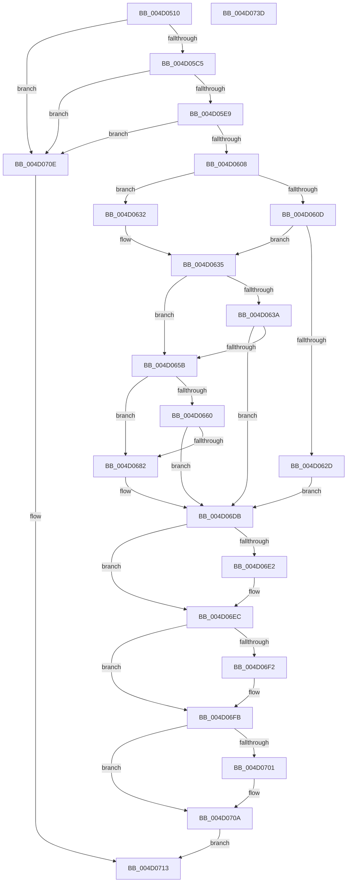

# VslPrepareSecureImageRelocations

- RVA: `0x004D0510`–`0x004D073E` (길이 `558` bytes)
- VA: `0x00000001404D0510`
- 실행 섹션: `.text`
- PDB 이름 있음: `예`; PDB Function 태그: `아니요`
- unwind 정보 RVA: `0x000BDC68`
- 디코드: `148`개 명령, `558/558` bytes 표시
- 미해석 바이트: `0` (있으면 어셈블리에 `.byte`로 보존)

> 이 문서는 커널 이미지의 기계어와 PDB 기호를 분석해 생성했습니다. 4번과 5번은 함수 원형과 자료형을 바이너리 사용 방식에서 추정한 C 해석이며 원본 소스 복구 결과는 아닙니다.

## 1. Dependencies

- 직접 호출 지점: **12**; 고유 호출 대상: **5**
- 직접 호출자로 확인된 함수: **0**
- RIP 상대 이미지 참조: **1**

### Outgoing calls
- `0x004D0568` → [memset](../6C/memset_function_006C6C40.md) (function, `0x006C6C40`)
- `0x004D057B` → [memset](../6C/memset_function_006C6C40.md) (function, `0x006C6C40`)
- `0x004D0589` → [memset](../6C/memset_function_006C6C40.md) (function, `0x006C6C40`)
- `0x004D0598` → [memset](../6C/memset_function_006C6C40.md) (function, `0x006C6C40`)
- `0x004D061F` → [VslpLockPagesForTransfer](../29/VslpLockPagesForTransfer_function_0029E0FC.md) (function, `0x0029E0FC`)
- `0x004D064C` → [VslpLockPagesForTransfer](../29/VslpLockPagesForTransfer_function_0029E0FC.md) (function, `0x0029E0FC`)
- `0x004D0677` → [VslpLockPagesForTransfer](../29/VslpLockPagesForTransfer_function_0029E0FC.md) (function, `0x0029E0FC`)
- `0x004D06D4` → [VslpEnterIumSecureMode](../23/VslpEnterIumSecureMode_function_00235E50.md) (function, `0x00235E50`)
- `0x004D06E7` → [VslpUnlockPagesForTransfer](../29/VslpUnlockPagesForTransfer_function_0029EE4C.md) (function, `0x0029EE4C`)
- `0x004D06F6` → [VslpUnlockPagesForTransfer](../29/VslpUnlockPagesForTransfer_function_0029EE4C.md) (function, `0x0029EE4C`)
- `0x004D0705` → [VslpUnlockPagesForTransfer](../29/VslpUnlockPagesForTransfer_function_0029EE4C.md) (function, `0x0029EE4C`)
- `0x004D071D` → [_security_check_cookie](../6A/_security_check_cookie_function_006AC640.md) (function, `0x006AC640`)

### Direct callers
- 이 함수 시작 RVA로 연결되는 직접 call은 확인되지 않았습니다. 간접 호출은 완전히 역산할 수 없습니다.

### Static image references
- `0x004D052F` → RVA `0x00E0A740` (`.data`; read)

## 2. Other-region calls and transfers

- 다른 실행 섹션으로 향하는 call: **0**
- 별도 외부 분기/꼬리 이동을 확인하지 못했습니다.

## 3. Assembly (complete function range)

```asm
004D0510  48 89 5C 24 08                  mov qword ptr [rsp + 8], rbx
004D0515  55                              push rbp
004D0516  56                              push rsi
004D0517  57                              push rdi
004D0518  41 54                           push r12
004D051A  41 55                           push r13
004D051C  41 56                           push r14
004D051E  41 57                           push r15
004D0520  48 8D AC 24 50 FF FF FF         lea rbp, [rsp - 0xb0]
004D0528  48 81 EC B0 01 00 00            sub rsp, 0x1b0
004D052F  48 8B 05 0A A2 93 00            mov rax, qword ptr [rip + 0x93a20a]
004D0536  48 33 C4                        xor rax, rsp
004D0539  48 89 85 A0 00 00 00            mov qword ptr [rbp + 0xa0], rax
004D0540  4C 8B A5 10 01 00 00            mov r12, qword ptr [rbp + 0x110]
004D0547  49 8B D8                        mov rbx, r8
004D054A  4C 8B BD 20 01 00 00            mov r15, qword ptr [rbp + 0x120]
004D0551  4D 8B E9                        mov r13, r9
004D0554  48 89 54 24 38                  mov qword ptr [rsp + 0x38], rdx
004D0559  33 D2                           xor edx, edx
004D055B  48 89 4C 24 30                  mov qword ptr [rsp + 0x30], rcx
004D0560  48 8D 4D 30                     lea rcx, [rbp + 0x30]
004D0564  44 8D 42 68                     lea r8d, [rdx + 0x68]
004D0568  E8 D3 66 1F 00                  call 0x1406c6c40
004D056D  BF 48 00 00 00                  mov edi, 0x48
004D0572  48 8D 4D E0                     lea rcx, [rbp - 0x20]
004D0576  44 8B C7                        mov r8d, edi
004D0579  33 D2                           xor edx, edx
004D057B  E8 C0 66 1F 00                  call 0x1406c6c40
004D0580  44 8B C7                        mov r8d, edi
004D0583  48 8D 4D 90                     lea rcx, [rbp - 0x70]
004D0587  33 D2                           xor edx, edx
004D0589  E8 B2 66 1F 00                  call 0x1406c6c40
004D058E  44 8B C7                        mov r8d, edi
004D0591  48 8D 4C 24 40                  lea rcx, [rsp + 0x40]
004D0596  33 D2                           xor edx, edx
004D0598  E8 A3 66 1F 00                  call 0x1406c6c40
004D059D  48 8B C3                        mov rax, rbx
004D05A0  4D 8D 8D FF 0F 00 00            lea r9, [r13 + 0xfff]
004D05A7  BA FF 0F 00 00                  mov edx, 0xfff
004D05AC  41 B8 FA 01 00 00               mov r8d, 0x1fa
004D05B2  48 23 C2                        and rax, rdx
004D05B5  4C 03 C8                        add r9, rax
004D05B8  49 C1 E9 0C                     shr r9, 0xc
004D05BC  4D 3B C8                        cmp r9, r8
004D05BF  0F 87 49 01 00 00               ja 0x1404d070e
004D05C5  4C 8B B5 28 01 00 00            mov r14, qword ptr [rbp + 0x128]
004D05CC  49 8B C7                        mov rax, r15
004D05CF  48 23 C2                        and rax, rdx
004D05D2  49 8D BE FF 0F 00 00            lea rdi, [r14 + 0xfff]
004D05D9  48 03 F8                        add rdi, rax
004D05DC  48 C1 EF 0C                     shr rdi, 0xc
004D05E0  49 3B F8                        cmp rdi, r8
004D05E3  0F 87 25 01 00 00               ja 0x1404d070e
004D05E9  8B B5 18 01 00 00               mov esi, dword ptr [rbp + 0x118]
004D05EF  49 8B CC                        mov rcx, r12
004D05F2  48 03 F2                        add rsi, rdx
004D05F5  48 23 CA                        and rcx, rdx
004D05F8  48 03 F1                        add rsi, rcx
004D05FB  48 C1 EE 0C                     shr rsi, 0xc
004D05FF  49 3B F0                        cmp rsi, r8
004D0602  0F 87 06 01 00 00               ja 0x1404d070e
004D0608  4D 85 C9                        test r9, r9
004D060B  74 25                           je 0x1404d0632
004D060D  83 64 24 20 00                  and dword ptr [rsp + 0x20], 0
004D0612  48 8D 4D E0                     lea rcx, [rbp - 0x20]
004D0616  45 33 C9                        xor r9d, r9d
004D0619  45 8B C5                        mov r8d, r13d
004D061C  48 8B D3                        mov rdx, rbx
004D061F  E8 D8 DA DC FF                  call 0x14029e0fc
004D0624  45 33 ED                        xor r13d, r13d
004D0627  8B D8                           mov ebx, eax
004D0629  85 C0                           test eax, eax
004D062B  79 08                           jns 0x1404d0635
004D062D  E9 A9 00 00 00                  jmp 0x1404d06db
004D0632  45 33 ED                        xor r13d, r13d
004D0635  48 85 FF                        test rdi, rdi
004D0638  74 21                           je 0x1404d065b
004D063A  45 33 C9                        xor r9d, r9d
004D063D  44 89 6C 24 20                  mov dword ptr [rsp + 0x20], r13d
004D0642  45 8B C6                        mov r8d, r14d
004D0645  48 8D 4D 90                     lea rcx, [rbp - 0x70]
004D0649  49 8B D7                        mov rdx, r15
004D064C  E8 AB DA DC FF                  call 0x14029e0fc
004D0651  8B D8                           mov ebx, eax
004D0653  85 C0                           test eax, eax
004D0655  0F 88 80 00 00 00               js 0x1404d06db
004D065B  48 85 F6                        test rsi, rsi
004D065E  74 22                           je 0x1404d0682
004D0660  44 8B 85 18 01 00 00            mov r8d, dword ptr [rbp + 0x118]
004D0667  48 8D 4C 24 40                  lea rcx, [rsp + 0x40]
004D066C  45 33 C9                        xor r9d, r9d
004D066F  44 89 6C 24 20                  mov dword ptr [rsp + 0x20], r13d
004D0674  49 8B D4                        mov rdx, r12
004D0677  E8 80 DA DC FF                  call 0x14029e0fc
004D067C  8B D8                           mov ebx, eax
004D067E  85 C0                           test eax, eax
004D0680  78 59                           js 0x1404d06db
004D0682  48 8B 44 24 30                  mov rax, qword ptr [rsp + 0x30]
004D0687  4C 8D 4D 30                     lea r9, [rbp + 0x30]
004D068B  48 89 45 38                     mov qword ptr [rbp + 0x38], rax
004D068F  BA 1D 00 00 00                  mov edx, 0x1d
004D0694  48 8B 44 24 38                  mov rax, qword ptr [rsp + 0x38]
004D0699  45 33 C0                        xor r8d, r8d
004D069C  48 89 45 40                     mov qword ptr [rbp + 0x40], rax
004D06A0  B1 02                           mov cl, 2
004D06A2  48 8B 45 E0                     mov rax, qword ptr [rbp - 0x20]
004D06A6  48 89 45 48                     mov qword ptr [rbp + 0x48], rax
004D06AA  48 8B 45 18                     mov rax, qword ptr [rbp + 0x18]
004D06AE  48 89 45 50                     mov qword ptr [rbp + 0x50], rax
004D06B2  48 8B 44 24 40                  mov rax, qword ptr [rsp + 0x40]
004D06B7  48 89 45 58                     mov qword ptr [rbp + 0x58], rax
004D06BB  48 8B 44 24 78                  mov rax, qword ptr [rsp + 0x78]
004D06C0  48 89 45 60                     mov qword ptr [rbp + 0x60], rax
004D06C4  48 8B 45 90                     mov rax, qword ptr [rbp - 0x70]
004D06C8  48 89 45 68                     mov qword ptr [rbp + 0x68], rax
004D06CC  48 8B 45 C8                     mov rax, qword ptr [rbp - 0x38]
004D06D0  48 89 45 70                     mov qword ptr [rbp + 0x70], rax
004D06D4  E8 77 57 D6 FF                  call 0x140235e50
004D06D9  8B D8                           mov ebx, eax
004D06DB  4C 39 6C 24 40                  cmp qword ptr [rsp + 0x40], r13
004D06E0  74 0A                           je 0x1404d06ec
004D06E2  48 8D 4C 24 40                  lea rcx, [rsp + 0x40]
004D06E7  E8 60 E7 DC FF                  call 0x14029ee4c
004D06EC  4C 39 6D 90                     cmp qword ptr [rbp - 0x70], r13
004D06F0  74 09                           je 0x1404d06fb
004D06F2  48 8D 4D 90                     lea rcx, [rbp - 0x70]
004D06F6  E8 51 E7 DC FF                  call 0x14029ee4c
004D06FB  4C 39 6D E0                     cmp qword ptr [rbp - 0x20], r13
004D06FF  74 09                           je 0x1404d070a
004D0701  48 8D 4D E0                     lea rcx, [rbp - 0x20]
004D0705  E8 42 E7 DC FF                  call 0x14029ee4c
004D070A  8B C3                           mov eax, ebx
004D070C  EB 05                           jmp 0x1404d0713
004D070E  B8 0D 00 00 C0                  mov eax, 0xc000000d
004D0713  48 8B 8D A0 00 00 00            mov rcx, qword ptr [rbp + 0xa0]
004D071A  48 33 CC                        xor rcx, rsp
004D071D  E8 1E BF 1D 00                  call 0x1406ac640
004D0722  48 8B 9C 24 F0 01 00 00         mov rbx, qword ptr [rsp + 0x1f0]
004D072A  48 81 C4 B0 01 00 00            add rsp, 0x1b0
004D0731  41 5F                           pop r15
004D0733  41 5E                           pop r14
004D0735  41 5D                           pop r13
004D0737  41 5C                           pop r12
004D0739  5F                              pop rdi
004D073A  5E                              pop rsi
004D073B  5D                              pop rbp
004D073C  C3                              ret
004D073D  CC                              int3
```

## 4. C-style interpretation (structured pseudocode)

```c
__int64 __fastcall VslPrepareSecureImageRelocations(__int64 a1, __int64 a2, __int64 a3, __int64 a4, __int64 a5, unsigned int a6, __int64 a7, __int64 a8)
{
    __int64 result;
    __int64 v_r13;
    __int64 v_rbx;
    __int64 v_rdi;
    __int64 v_rsi;
    __int64 v_rsp;
    unsigned __int64 v_stack_m108;
    unsigned __int64 v_stack_m120;
    unsigned __int64 v_stack_m158;
    unsigned __int64 v_stack_m170;
    unsigned __int64 v_stack_m1A8;
    unsigned __int64 v_stack_m1B0;
    unsigned __int64 v_stack_m1B8;
    unsigned int v_stack_m1C8;
    unsigned __int64 v_stack_m48;
    unsigned __int64 v_stack_m78;
    unsigned __int64 v_stack_m80;
    unsigned __int64 v_stack_m88;
    unsigned __int64 v_stack_m90;
    unsigned __int64 v_stack_m98;
    unsigned __int64 v_stack_mA0;
    unsigned __int64 v_stack_mA8;
    unsigned __int64 v_stack_mB0;
    unsigned __int64 v_stack_mB8;
    unsigned __int64 v_stack_mD0;
    unsigned __int64 v_stack_mE8;
    unsigned __int64 v_stack_p8;

    v_stack_p8 = v_rbx;
    v_rsp = (v_rsp) - (432);
    result = (*(unsigned __int64 *)(v_rip + 9675274)) ^ (v_rsp);
    v_stack_m48 = result;
    v_stack_m1B0 = a2;
    a2 = 0;
    v_stack_m1B8 = a1;
    result = memset(v_stack_mB8, a2, a2 + 104, a4);
    a2 = 0;
    result = memset(v_stack_m108, a2, 72, a4);
    a2 = 0;
    result = memset(v_stack_m158, a2, 72, a4);
    a2 = 0;
    result = memset(v_stack_m1A8, a2, 72, a4);
    result = (a3) & ((unsigned int)(0xFFFULL));
    a4 = (a4 + 4095) + (result);
    a4 = (a4) >> (12);
    if (a4 > 506) goto loc_004D070E;
    result = (a7) & ((unsigned int)(0xFFFULL));
    v_rdi = (a8 + 4095) + (result);
    v_rdi = (v_rdi) >> (12);
    if (v_rdi > 506) goto loc_004D070E;
    v_rsi = ((unsigned int)(a6)) + ((unsigned int)(0xFFFULL));
    a1 = (a5) & ((unsigned int)(0xFFFULL));
    v_rsi = (v_rsi) + (a1);
    v_rsi = (v_rsi) >> (12);
    if (v_rsi > 506) goto loc_004D070E;
    if (a4 == 0) goto loc_004D0632;
    a4 = 0;
    result = VslpLockPagesForTransfer(v_stack_m108, a3, 0, a4);
    v_r13 = 0;
    if (!sign_flag) goto loc_004D0635;
    goto loc_004D06DB;
loc_004D0632:
    v_r13 = 0;
loc_004D0635:
    if (v_rdi == 0) goto loc_004D065B;
    a4 = 0;
    v_stack_m1C8 = 0;
    result = VslpLockPagesForTransfer(v_stack_m158, a7, (unsigned int)((unsigned int)(a8)), a4);
    if (sign_flag) goto loc_004D06DB;
loc_004D065B:
    if (v_rsi == 0) goto loc_004D0682;
    a4 = 0;
    v_stack_m1C8 = 0;
    result = VslpLockPagesForTransfer(v_stack_m1A8, a5, (unsigned int)(a6), a4);
    v_rbx = (unsigned int)((unsigned int)(result));
    if (!(sign_flag)) {
        result = v_stack_m1B8;
        a4 = v_stack_mB8;
        v_stack_mB0 = result;
        a2 = 29;
        result = v_stack_m1B0;
        a3 = 0;
        v_stack_mA8 = result;
        a1 = 2;
        result = v_stack_m108;
        v_stack_mA0 = result;
        result = v_stack_mD0;
        v_stack_m98 = result;
        result = v_stack_m1A8;
        v_stack_m90 = result;
        result = v_stack_m170;
        v_stack_m88 = result;
        result = v_stack_m158;
        v_stack_m80 = result;
        result = v_stack_m120;
        v_stack_m78 = result;
        result = VslpEnterIumSecureMode(a1, a2, a3, a4);
        v_rbx = (unsigned int)(result);
    }
    if (v_stack_m1A8 != 0) {
        a1 = v_stack_m1A8;
        result = VslpUnlockPagesForTransfer(a1, a2, a3, a4);
    }
    if (v_stack_m158 != 0) {
        a1 = v_stack_m158;
        result = VslpUnlockPagesForTransfer(a1, a2, a3, a4);
    }
    if (v_stack_m108 != 0) {
        a1 = v_stack_m108;
        result = VslpUnlockPagesForTransfer(a1, a2, a3, a4);
    }
    goto loc_004D0713;
loc_004D070E:
loc_004D0713:
    a1 = (v_stack_m48) ^ (v_rsp);
    result = _security_check_cookie(a1, a2, a3, a4);
    v_rsp = (v_rsp) + (432);
    return result;
}
```

## 5. (Beta) C Style

```c
int64_t VslPrepareSecureImageRelocations(int64_t Arg1, int64_t Arg2, int64_t Arg3, void *Arg4, int64_t Arg5, uint32_t Arg6, int64_t Arg7, void *Arg8)
{
    uint8_t *arg4 = (uint8_t *)Arg4;
    uint8_t *arg8 = (uint8_t *)Arg8;

    int64_t result;
    int64_t local_r13;
    int64_t local_rbx;
    int64_t local_rdi;
    int64_t local_rsi;
    int64_t local_rsp;
    uint64_t v_stack_m108;
    uint64_t v_stack_m120;
    uint64_t v_stack_m158;
    uint64_t v_stack_m170;
    uint64_t v_stack_m1A8;
    uint64_t v_stack_m1B0;
    uint64_t v_stack_m1B8;
    uint32_t v_stack_m1C8;
    uint64_t v_stack_m48;
    uint64_t v_stack_m78;
    uint64_t v_stack_m80;
    uint64_t v_stack_m88;
    uint64_t v_stack_m90;
    uint64_t v_stack_m98;
    uint64_t v_stack_mA0;
    uint64_t v_stack_mA8;
    uint64_t v_stack_mB0;
    uint64_t v_stack_mB8;
    uint64_t v_stack_mD0;
    uint64_t v_stack_mE8;
    uint64_t v_stack_p8;

    v_stack_p8 = local_rbx;
    local_rsp = (local_rsp) - (432);
    result = (*(uint64_t *)(v_rip + 0x93A20A)) ^ (local_rsp);
    v_stack_m48 = result;
    v_stack_m1B0 = Arg2;
    Arg2 = 0;
    v_stack_m1B8 = Arg1;
    result = memset(v_stack_mB8, Arg2, Arg2 + 104, Arg4);
    Arg2 = 0;
    result = memset(v_stack_m108, Arg2, 72, Arg4);
    Arg2 = 0;
    result = memset(v_stack_m158, Arg2, 72, Arg4);
    Arg2 = 0;
    result = memset(v_stack_m1A8, Arg2, 72, Arg4);
    result = (Arg3) & ((uint32_t)(0xFFFULL));
    Arg4 = (Arg4 + 4095) + (result);
    Arg4 = (Arg4) >> (12);
    if (Arg4 > 506) goto loc_004D070E;
    result = (Arg7) & ((uint32_t)(0xFFFULL));
    local_rdi = (Arg8 + 4095) + (result);
    local_rdi = (local_rdi) >> (12);
    if (local_rdi > 506) goto loc_004D070E;
    local_rsi = ((uint32_t)(Arg6)) + ((uint32_t)(0xFFFULL));
    Arg1 = (Arg5) & ((uint32_t)(0xFFFULL));
    local_rsi = (local_rsi) + (Arg1);
    local_rsi = (local_rsi) >> (12);
    if (local_rsi > 506) goto loc_004D070E;
    if (Arg4 == NULL) goto loc_004D0632;
    Arg4 = 0;
    result = VslpLockPagesForTransfer(v_stack_m108, Arg3, 0, Arg4);
    local_r13 = 0;
    if (!sign_flag) goto loc_004D0635;
    goto loc_004D06DB;
loc_004D0632:
    local_r13 = 0;
loc_004D0635:
    if (local_rdi == 0) goto loc_004D065B;
    Arg4 = 0;
    v_stack_m1C8 = 0;
    result = VslpLockPagesForTransfer(v_stack_m158, Arg7, (uint32_t)((uint32_t)(Arg8)), Arg4);
    if (sign_flag) goto loc_004D06DB;
loc_004D065B:
    if (local_rsi == 0) goto loc_004D0682;
    Arg4 = 0;
    v_stack_m1C8 = 0;
    result = VslpLockPagesForTransfer(v_stack_m1A8, Arg5, (uint32_t)(Arg6), Arg4);
    local_rbx = (uint32_t)((uint32_t)(result));
    if (!(sign_flag)) {
        result = v_stack_m1B8;
        Arg4 = v_stack_mB8;
        v_stack_mB0 = result;
        Arg2 = 29;
        result = v_stack_m1B0;
        Arg3 = 0;
        v_stack_mA8 = result;
        Arg1 = 2;
        result = v_stack_m108;
        v_stack_mA0 = result;
        result = v_stack_mD0;
        v_stack_m98 = result;
        result = v_stack_m1A8;
        v_stack_m90 = result;
        result = v_stack_m170;
        v_stack_m88 = result;
        result = v_stack_m158;
        v_stack_m80 = result;
        result = v_stack_m120;
        v_stack_m78 = result;
        result = VslpEnterIumSecureMode(Arg1, Arg2, Arg3, Arg4);
        local_rbx = (uint32_t)(result);
    }
    if (v_stack_m1A8 != 0) {
        Arg1 = v_stack_m1A8;
        result = VslpUnlockPagesForTransfer(Arg1, Arg2, Arg3, Arg4);
    }
    if (v_stack_m158 != 0) {
        Arg1 = v_stack_m158;
        result = VslpUnlockPagesForTransfer(Arg1, Arg2, Arg3, Arg4);
    }
    if (v_stack_m108 != 0) {
        Arg1 = v_stack_m108;
        result = VslpUnlockPagesForTransfer(Arg1, Arg2, Arg3, Arg4);
    }
    goto loc_004D0713;
loc_004D070E:
loc_004D0713:
    Arg1 = (v_stack_m48) ^ (local_rsp);
    result = _security_check_cookie(Arg1, Arg2, Arg3, Arg4);
    local_rsp = (local_rsp) + (432);
    return result;
}
```

### 관측된 메모리 오프셋

구조체 형식이 확인되지 않은 접근은 인자 기준의 오프셋으로만 기록했습니다.

| 기준 인자 | 오프셋 표현 | 폭 (bit) | 접근 |
|---|---:|---:|---|
| `Arg4` | `+ 0xFFF` | `64` | `R` |
| `Arg8` | `+ 0xFFF` | `64` | `R` |

## 6. Execution-region graph

[열기: 2D/3D 그래프와 함수 탐색 컨트롤 패널](../../../control-panel.html?section=text&rva=0x004D0510&view=graph)

- 2D 그래프는 위에서 아래로 흐르고, 3D 그래프는 빈 공간을 드래그해 회전합니다. Shift+드래그는 이동, 휠은 확대·축소, 함수 노드 선택은 대상 보고서 이동입니다.

### Static fallback


