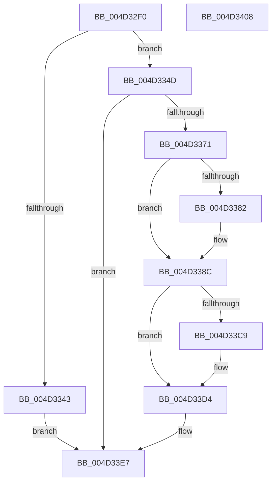

# VslRegisterLogPages

- RVA: `0x004D32F0`–`0x004D3409` (길이 `281` bytes)
- VA: `0x00000001404D32F0`
- 실행 섹션: `.text`
- PDB 이름 있음: `예`; PDB Function 태그: `아니요`
- unwind 정보 RVA: `0x000BDF2C`
- 디코드: `63`개 명령, `281/281` bytes 표시
- 미해석 바이트: `0` (있으면 어셈블리에 `.byte`로 보존)

> 이 문서는 커널 이미지의 기계어와 PDB 기호를 분석해 생성했습니다. 4번과 5번은 함수 원형과 자료형을 바이너리 사용 방식에서 추정한 C 해석이며 원본 소스 복구 결과는 아닙니다.

## 1. Dependencies

- 직접 호출 지점: **8**; 고유 호출 대상: **7**
- 직접 호출자로 확인된 함수: **1**
- RIP 상대 이미지 참조: **4**

### Outgoing calls
- `0x004D3324` → [memset](../6C/memset_function_006C6C40.md) (function, `0x006C6C40`)
- `0x004D3334` → [memset](../6C/memset_function_006C6C40.md) (function, `0x006C6C40`)
- `0x004D3368` → [VslpLockPagesForTransfer](../29/VslpLockPagesForTransfer_function_0029E0FC.md) (function, `0x0029E0FC`)
- `0x004D3387` → [KiRaiseIrqlProcessIrqlFlags](../4F/KiRaiseIrqlProcessIrqlFlags_function_004F56FC.md) (function, `0x004F56FC`)
- `0x004D33B9` → [VslpEnterIumSecureMode](../23/VslpEnterIumSecureMode_function_00235E50.md) (function, `0x00235E50`)
- `0x004D33CF` → [KiLowerIrqlProcessIrqlFlags](../4F/KiLowerIrqlProcessIrqlFlags_function_004F5698.md) (function, `0x004F5698`)
- `0x004D33E0` → [VslpUnlockPagesForTransfer](../29/VslpUnlockPagesForTransfer_function_0029EE4C.md) (function, `0x0029EE4C`)
- `0x004D33F2` → [_security_check_cookie](../6A/_security_check_cookie_function_006AC640.md) (function, `0x006AC640`)

### Direct callers
- [PspIumInitialize](../../init/C4/PspIumInitialize_function_00C467A8.md) at `0x00C46821`

### Static image references
- `0x004D32FD` → RVA `0x00E0A740` (`.data`; read)
- `0x004D330F` → RVA `0x00FC6D08` (`ALMOSTRO`; read)
- `0x004D3339` → RVA `0x01201860` (`CFGRO`; read)
- `0x004D3379` → RVA `0x00FC6D20` (`ALMOSTRO`; read)

## 2. Other-region calls and transfers

- 다른 실행 섹션으로 향하는 call: **0**
- 별도 외부 분기/꼬리 이동을 확인하지 못했습니다.

## 3. Assembly (complete function range)

```asm
004D32F0  48 89 5C 24 08                  mov qword ptr [rsp + 8], rbx
004D32F5  57                              push rdi
004D32F6  48 81 EC 00 01 00 00            sub rsp, 0x100
004D32FD  48 8B 05 3C 74 93 00            mov rax, qword ptr [rip + 0x93743c]
004D3304  48 33 C4                        xor rax, rsp
004D3307  48 89 84 24 F0 00 00 00         mov qword ptr [rsp + 0xf0], rax
004D330F  48 8B 1D F2 39 AF 00            mov rbx, qword ptr [rip + 0xaf39f2]
004D3316  48 8D 8C 24 80 00 00 00         lea rcx, [rsp + 0x80]
004D331E  33 D2                           xor edx, edx
004D3320  44 8D 42 68                     lea r8d, [rdx + 0x68]
004D3324  E8 17 39 1F 00                  call 0x1406c6c40
004D3329  33 D2                           xor edx, edx
004D332B  48 8D 4C 24 30                  lea rcx, [rsp + 0x30]
004D3330  44 8D 42 48                     lea r8d, [rdx + 0x48]
004D3334  E8 07 39 1F 00                  call 0x1406c6c40
004D3339  48 83 3D 1F E5 D2 00 00         cmp qword ptr [rip + 0xd2e51f], 0
004D3341  75 0A                           jne 0x1404d334d
004D3343  B8 9D 00 00 C0                  mov eax, 0xc000009d
004D3348  E9 9A 00 00 00                  jmp 0x1404d33e7
004D334D  BF 02 00 00 00                  mov edi, 2
004D3352  48 8D 4C 24 30                  lea rcx, [rsp + 0x30]
004D3357  41 B8 00 20 00 00               mov r8d, 0x2000
004D335D  89 7C 24 20                     mov dword ptr [rsp + 0x20], edi
004D3361  48 8B D3                        mov rdx, rbx
004D3364  44 8D 4F FF                     lea r9d, [rdi - 1]
004D3368  E8 8F AD DC FF                  call 0x14029e0fc
004D336D  85 C0                           test eax, eax
004D336F  78 76                           js 0x1404d33e7
004D3371  44 0F 20 C3                     mov rbx, cr8
004D3375  44 0F 22 C7                     mov cr8, rdi
004D3379  83 3D A0 39 AF 00 00            cmp dword ptr [rip + 0xaf39a0], 0
004D3380  74 0A                           je 0x1404d338c
004D3382  40 8A D7                        mov dl, dil
004D3385  8A CB                           mov cl, bl
004D3387  E8 70 23 02 00                  call 0x1404f56fc
004D338C  48 8B 44 24 30                  mov rax, qword ptr [rsp + 0x30]
004D3391  4C 8D 8C 24 80 00 00 00         lea r9, [rsp + 0x80]
004D3399  48 89 84 24 88 00 00 00         mov qword ptr [rsp + 0x88], rax
004D33A1  BA FE 00 00 00                  mov edx, 0xfe
004D33A6  48 8B 44 24 68                  mov rax, qword ptr [rsp + 0x68]
004D33AB  45 33 C0                        xor r8d, r8d
004D33AE  40 8A CF                        mov cl, dil
004D33B1  48 89 84 24 90 00 00 00         mov qword ptr [rsp + 0x90], rax
004D33B9  E8 92 2A D6 FF                  call 0x140235e50
004D33BE  83 3D 5B 39 AF 00 00            cmp dword ptr [rip + 0xaf395b], 0
004D33C5  8B F8                           mov edi, eax
004D33C7  74 0B                           je 0x1404d33d4
004D33C9  44 0F 20 C1                     mov rcx, cr8
004D33CD  8A D3                           mov dl, bl
004D33CF  E8 C4 22 02 00                  call 0x1404f5698
004D33D4  0F B6 CB                        movzx ecx, bl
004D33D7  44 0F 22 C1                     mov cr8, rcx
004D33DB  48 8D 4C 24 30                  lea rcx, [rsp + 0x30]
004D33E0  E8 67 BA DC FF                  call 0x14029ee4c
004D33E5  8B C7                           mov eax, edi
004D33E7  48 8B 8C 24 F0 00 00 00         mov rcx, qword ptr [rsp + 0xf0]
004D33EF  48 33 CC                        xor rcx, rsp
004D33F2  E8 49 92 1D 00                  call 0x1406ac640
004D33F7  48 8B 9C 24 10 01 00 00         mov rbx, qword ptr [rsp + 0x110]
004D33FF  48 81 C4 00 01 00 00            add rsp, 0x100
004D3406  5F                              pop rdi
004D3407  C3                              ret
004D3408  CC                              int3
```

## 4. C-style interpretation (structured pseudocode)

```c
__int64 __fastcall VslRegisterLogPages(__int64 a1, int a2)
{
    __int64 result;
    __int64 v_rsp;
    unsigned __int64 v_stack_m18;
    unsigned __int64 v_stack_m78;
    unsigned __int64 v_stack_m80;
    unsigned __int64 v_stack_m88;
    unsigned __int64 v_stack_mA0;
    unsigned __int64 v_stack_mD8;
    unsigned int v_stack_mE8;
    unsigned __int64 v_stack_p8;

    v_stack_p8 = v_rbx;
    v_rsp = (v_rsp) - (256);
    result = (*(unsigned __int64 *)(v_rip + 9663548)) ^ (v_rsp);
    v_stack_m18 = result;
    a2 = 0;
    result = memset(v_stack_m88, a2, a2 + 104, a4);
    a2 = 0;
    result = memset(v_stack_mD8, a2, a2 + 72, a4);
    if ((*(unsigned __int64 *)(v_rip + 13821215)) != 0) goto loc_004D334D;
    goto loc_004D33E7;
loc_004D334D:
    v_stack_mE8 = 2;
    result = VslpLockPagesForTransfer(v_stack_mD8, *(unsigned __int64 *)(v_rip + 11483634), (unsigned int)(0x2000ULL), 2 - 1);
    if (sign_flag) goto loc_004D33E7;
    if ((*(unsigned int *)(v_rip + 11483552)) != 0) {
        a2 = 2;
        a1 = (unsigned __int8)(v_cr8);
        result = KiRaiseIrqlProcessIrqlFlags(a1, a2, (unsigned int)(0x2000ULL), 2 - 1);
    }
    v_stack_m80 = v_stack_mD8;
    a3 = 0;
    v_stack_m78 = v_stack_mA0;
    result = VslpEnterIumSecureMode(2, 254, a3, v_stack_m88);
    if ((*(unsigned int *)(v_rip + 11483483)) != 0) {
        a1 = 2;
        a2 = (unsigned __int8)(v_cr8);
        result = KiLowerIrqlProcessIrqlFlags(a1, a2, a3, v_stack_m88);
    }
    result = VslpUnlockPagesForTransfer(v_stack_mD8, a2, a3, v_stack_m88);
loc_004D33E7:
    a1 = (v_stack_m18) ^ (v_rsp);
    result = _security_check_cookie(a1, a2, a3, v_stack_m88);
    v_rsp = (v_rsp) + (256);
    return result;
}
```

## 5. (Beta) C Style

```c
int64_t VslRegisterLogPages(int64_t Arg1, int32_t Arg2)
{
    int64_t result;
    int64_t local_rsp;
    uint64_t v_stack_m18;
    uint64_t v_stack_m78;
    uint64_t v_stack_m80;
    uint64_t v_stack_m88;
    uint64_t v_stack_mA0;
    uint64_t v_stack_mD8;
    uint32_t v_stack_mE8;
    uint64_t v_stack_p8;

    v_stack_p8 = local_rbx;
    local_rsp = (local_rsp) - (256);
    result = (*(uint64_t *)(v_rip + 0x93743C)) ^ (local_rsp);
    v_stack_m18 = result;
    Arg2 = 0;
    result = memset(v_stack_m88, Arg2, Arg2 + 104, a4);
    Arg2 = 0;
    result = memset(v_stack_mD8, Arg2, Arg2 + 72, a4);
    if ((*(uint64_t *)(v_rip + 0xD2E51F)) != 0) goto loc_004D334D;
    goto loc_004D33E7;
loc_004D334D:
    v_stack_mE8 = 2;
    result = VslpLockPagesForTransfer(v_stack_mD8, *(uint64_t *)(v_rip + 0xAF39F2), (uint32_t)(0x2000ULL), 2 - 1);
    if (sign_flag) goto loc_004D33E7;
    if ((*(uint32_t *)(v_rip + 0xAF39A0)) != 0) {
        Arg2 = 2;
        Arg1 = (uint8_t)(v_cr8);
        result = KiRaiseIrqlProcessIrqlFlags(Arg1, Arg2, (uint32_t)(0x2000ULL), 2 - 1);
    }
    v_stack_m80 = v_stack_mD8;
    a3 = 0;
    v_stack_m78 = v_stack_mA0;
    result = VslpEnterIumSecureMode(2, 254, a3, v_stack_m88);
    if ((*(uint32_t *)(v_rip + 0xAF395B)) != 0) {
        Arg1 = 2;
        Arg2 = (uint8_t)(v_cr8);
        result = KiLowerIrqlProcessIrqlFlags(Arg1, Arg2, a3, v_stack_m88);
    }
    result = VslpUnlockPagesForTransfer(v_stack_mD8, Arg2, a3, v_stack_m88);
loc_004D33E7:
    Arg1 = (v_stack_m18) ^ (local_rsp);
    result = _security_check_cookie(Arg1, Arg2, a3, v_stack_m88);
    local_rsp = (local_rsp) + (256);
    return result;
}
```

## 6. Execution-region graph

[열기: 2D/3D 그래프와 함수 탐색 컨트롤 패널](../../../control-panel.html?section=text&rva=0x004D32F0&view=graph)

- 2D 그래프는 위에서 아래로 흐르고, 3D 그래프는 빈 공간을 드래그해 회전합니다. Shift+드래그는 이동, 휠은 확대·축소, 함수 노드 선택은 대상 보고서 이동입니다.

### Static fallback


