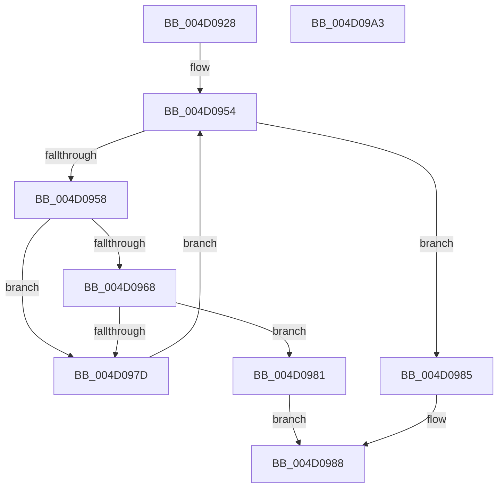

# WdInstrExecuteAction

- RVA: `0x004D0928`–`0x004D09A4` (길이 `124` bytes)
- VA: `0x00000001404D0928`
- 실행 섹션: `.text`
- PDB 이름 있음: `예`; PDB Function 태그: `아니요`
- unwind 정보 RVA: `0x0005E6B4`
- 디코드: `40`개 명령, `124/124` bytes 표시
- 미해석 바이트: `0` (있으면 어셈블리에 `.byte`로 보존)

> 이 문서는 커널 이미지의 기계어와 PDB 기호를 분석해 생성했습니다. 4번과 5번은 함수 원형과 자료형을 바이너리 사용 방식에서 추정한 C 해석이며 원본 소스 복구 결과는 아닙니다.

## 1. Dependencies

- 직접 호출 지점: **1**; 고유 호출 대상: **1**
- 직접 호출자로 확인된 함수: **2**
- RIP 상대 이미지 참조: **0**

### Outgoing calls
- `0x004D096E` → [WdInstrExecuteInstruction](../56/WdInstrExecuteInstruction_function_0056DF44.md) (function, `0x0056DF44`)

### Direct callers
- [HalpWdatArmTimer](../4C/HalpWdatArmTimer_function_004CBF40.md) at `0x004CBFD8`
- [HalpWdatArmTimer](../4C/HalpWdatArmTimer_function_004CBF40.md) at `0x004CBFF6`
- [HalpWdatArmTimer](../4C/HalpWdatArmTimer_function_004CBF40.md) at `0x004CC012`
- [HalpWdatArmTimer](../4C/HalpWdatArmTimer_function_004CBF40.md) at `0x004CC02C`
- [HalpWdatStop](../56/HalpWdatStop_function_00561080.md) at `0x00561097`

### Static image references
- 디코드된 RIP-relative 메모리 참조가 없습니다.

## 2. Other-region calls and transfers

- 다른 실행 섹션으로 향하는 call: **0**
- 별도 외부 분기/꼬리 이동을 확인하지 못했습니다.

## 3. Assembly (complete function range)

```asm
004D0928  48 8B C4                        mov rax, rsp
004D092B  48 89 58 08                     mov qword ptr [rax + 8], rbx
004D092F  48 89 68 10                     mov qword ptr [rax + 0x10], rbp
004D0933  48 89 70 18                     mov qword ptr [rax + 0x18], rsi
004D0937  48 89 78 20                     mov qword ptr [rax + 0x20], rdi
004D093B  41 56                           push r14
004D093D  48 83 EC 20                     sub rsp, 0x20
004D0941  45 8B F1                        mov r14d, r9d
004D0944  41 8B F0                        mov esi, r8d
004D0947  8B FA                           mov edi, edx
004D0949  48 8B E9                        mov rbp, rcx
004D094C  33 DB                           xor ebx, ebx
004D094E  41 BA 02 00 00 C0               mov r10d, 0xc0000002
004D0954  3B DF                           cmp ebx, edi
004D0956  73 2D                           jae 0x1404d0985
004D0958  8B CB                           mov ecx, ebx
004D095A  48 C1 E1 06                     shl rcx, 6
004D095E  48 03 CD                        add rcx, rbp
004D0961  0F B6 01                        movzx eax, byte ptr [rcx]
004D0964  3B C6                           cmp eax, esi
004D0966  75 15                           jne 0x1404d097d
004D0968  45 33 C0                        xor r8d, r8d
004D096B  41 8B D6                        mov edx, r14d
004D096E  E8 D1 D5 09 00                  call 0x14056df44
004D0973  44 8B D0                        mov r10d, eax
004D0976  3D 01 00 00 C0                  cmp eax, 0xc0000001
004D097B  74 04                           je 0x1404d0981
004D097D  FF C3                           inc ebx
004D097F  EB D3                           jmp 0x1404d0954
004D0981  33 C0                           xor eax, eax
004D0983  EB 03                           jmp 0x1404d0988
004D0985  41 8B C2                        mov eax, r10d
004D0988  48 8B 5C 24 30                  mov rbx, qword ptr [rsp + 0x30]
004D098D  48 8B 6C 24 38                  mov rbp, qword ptr [rsp + 0x38]
004D0992  48 8B 74 24 40                  mov rsi, qword ptr [rsp + 0x40]
004D0997  48 8B 7C 24 48                  mov rdi, qword ptr [rsp + 0x48]
004D099C  48 83 C4 20                     add rsp, 0x20
004D09A0  41 5E                           pop r14
004D09A2  C3                              ret
004D09A3  CC                              int3
```

## 4. C-style interpretation (structured pseudocode)

```c
__int64 __fastcall WdInstrExecuteAction(__int64 a1, int a2, int a3, int a4)
{
    __int64 result;
    __int64 v_rbx;
    __int64 v_rsp;
    unsigned __int64 v_stack_p10;
    unsigned __int64 v_stack_p18;
    unsigned __int64 v_stack_p20;
    unsigned __int64 v_stack_p8;

    *(unsigned __int64 *)(v_rsp + 8) = v_rbx;
    *(unsigned __int64 *)(v_rsp + 16) = v_rbp;
    *(unsigned __int64 *)(v_rsp + 24) = v_rsi;
    *(unsigned __int64 *)(v_rsp + 32) = v_rdi;
    v_rsp = (v_rsp) - (32);
    v_rbx = 0;
loc_004D0954:
    if (0 >= ((unsigned int)((unsigned int)(a2)))) goto loc_004D0985;
    a1 = (0) << (6);
    a1 = (a1) + (a1);
    if (((unsigned int)(*(unsigned __int8 *)(a1))) != ((unsigned int)((unsigned int)(a3)))) goto loc_004D097D;
    a3 = 0;
    result = WdInstrExecuteInstruction(a1, (unsigned int)((unsigned int)((unsigned int)(a4))), a3, a4);
    if (((unsigned int)(result)) == 0xC0000001ULL) goto loc_004D0981;
loc_004D097D:
    v_rbx = (unsigned int)((v_rbx) + 1);
    goto loc_004D0954;
loc_004D0981:
    result = 0;
    goto loc_004D0988;
loc_004D0985:
loc_004D0988:
    v_rsp = (v_rsp) + (32);
    return (unsigned int)((unsigned int)((unsigned int)((unsigned int)(result))));
}
```

## 5. (Beta) C Style

```c
int64_t WdInstrExecuteAction(int64_t Arg1, int32_t Arg2, int32_t Arg3, int32_t Arg4)
{
    int64_t result;
    int64_t local_rbx;
    int64_t local_rsp;
    uint64_t v_stack_p10;
    uint64_t v_stack_p18;
    uint64_t v_stack_p20;
    uint64_t v_stack_p8;

    *(uint64_t *)(local_rsp + 0x8) = local_rbx;
    *(uint64_t *)(local_rsp + 0x10) = local_rbp;
    *(uint64_t *)(local_rsp + 0x18) = local_rsi;
    *(uint64_t *)(local_rsp + 0x20) = local_rdi;
    local_rsp = (local_rsp) - (32);
    local_rbx = 0;
loc_004D0954:
    if (0 >= ((uint32_t)((uint32_t)(Arg2)))) goto loc_004D0985;
    Arg1 = (0) << (6);
    Arg1 = (Arg1) + (Arg1);
    if (((uint32_t)(*(uint8_t *)(Arg1))) != ((uint32_t)((uint32_t)(Arg3)))) goto loc_004D097D;
    Arg3 = 0;
    result = WdInstrExecuteInstruction(Arg1, (uint32_t)((uint32_t)((uint32_t)(Arg4))), Arg3, Arg4);
    if (((uint32_t)(result)) == 0xC0000001ULL) goto loc_004D0981;
loc_004D097D:
    local_rbx = (uint32_t)((local_rbx) + 1);
    goto loc_004D0954;
loc_004D0981:
    result = 0;
    goto loc_004D0988;
loc_004D0985:
loc_004D0988:
    local_rsp = (local_rsp) + (32);
    return (uint32_t)((uint32_t)((uint32_t)((uint32_t)(result))));
}
```

## 6. Execution-region graph

[열기: 2D/3D 그래프와 함수 탐색 컨트롤 패널](../../../control-panel.html?section=text&rva=0x004D0928&view=graph)

- 2D 그래프는 위에서 아래로 흐르고, 3D 그래프는 빈 공간을 드래그해 회전합니다. Shift+드래그는 이동, 휠은 확대·축소, 함수 노드 선택은 대상 보고서 이동입니다.

### Static fallback


