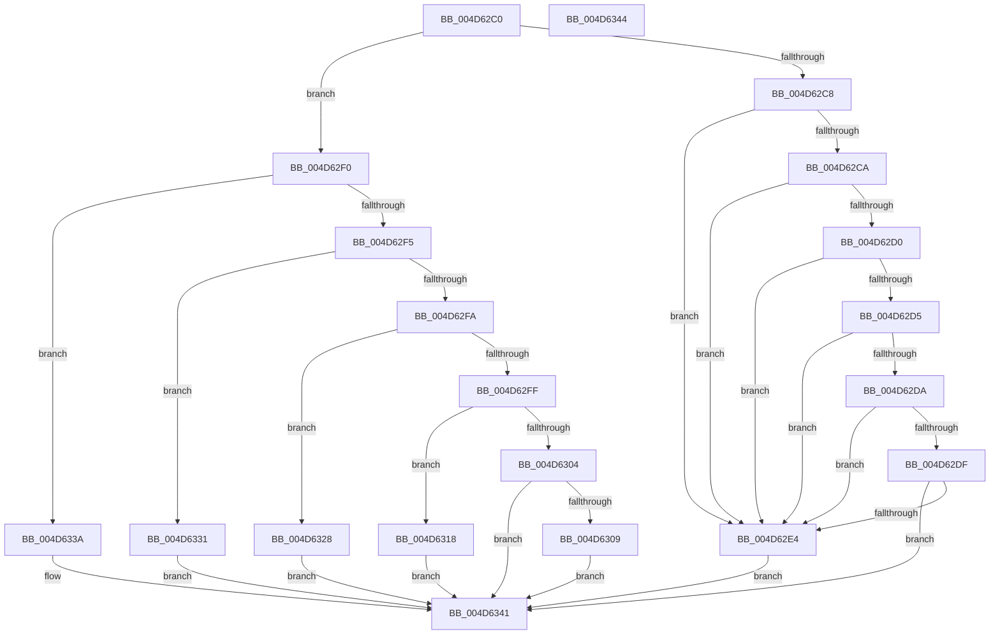

# XmPrefixOpcode

- RVA: `0x004D62C0`–`0x004D6345` (길이 `133` bytes)
- VA: `0x00000001404D62C0`
- 실행 섹션: `.text`
- PDB 이름 있음: `예`; PDB Function 태그: `아니요`
- unwind 정보 RVA: `0x000DB714`
- 디코드: `42`개 명령, `133/133` bytes 표시
- 미해석 바이트: `0` (있으면 어셈블리에 `.byte`로 보존)

> 이 문서는 커널 이미지의 기계어와 PDB 기호를 분석해 생성했습니다. 4번과 5번은 함수 원형과 자료형을 바이너리 사용 방식에서 추정한 C 해석이며 원본 소스 복구 결과는 아닙니다.

## 1. Dependencies

- 직접 호출 지점: **0**; 고유 호출 대상: **0**
- 직접 호출자로 확인된 함수: **0**
- RIP 상대 이미지 참조: **0**

### Outgoing calls
- 직접 디코드된 call 명령이 없습니다.

### Direct callers
- 이 함수 시작 RVA로 연결되는 직접 call은 확인되지 않았습니다. 간접 호출은 완전히 역산할 수 없습니다.

### Static image references
- 디코드된 RIP-relative 메모리 참조가 없습니다.

## 2. Other-region calls and transfers

- 다른 실행 섹션으로 향하는 call: **0**
- 별도 외부 분기/꼬리 이동을 확인하지 못했습니다.

## 3. Assembly (complete function range)

```asm
004D62C0  8B 41 7C                        mov eax, dword ptr [rcx + 0x7c]
004D62C3  83 F8 05                        cmp eax, 5
004D62C6  77 28                           ja 0x1404d62f0
004D62C8  74 1A                           je 0x1404d62e4
004D62CA  8B D0                           mov edx, eax
004D62CC  85 C0                           test eax, eax
004D62CE  74 14                           je 0x1404d62e4
004D62D0  83 EA 01                        sub edx, 1
004D62D3  74 0F                           je 0x1404d62e4
004D62D5  83 EA 01                        sub edx, 1
004D62D8  74 0A                           je 0x1404d62e4
004D62DA  83 EA 01                        sub edx, 1
004D62DD  74 05                           je 0x1404d62e4
004D62DF  83 FA 01                        cmp edx, 1
004D62E2  75 5D                           jne 0x1404d6341
004D62E4  C6 81 8C 00 00 00 01            mov byte ptr [rcx + 0x8c], 1
004D62EB  89 41 74                        mov dword ptr [rcx + 0x74], eax
004D62EE  EB 51                           jmp 0x1404d6341
004D62F0  83 E8 06                        sub eax, 6
004D62F3  74 45                           je 0x1404d633a
004D62F5  83 E8 01                        sub eax, 1
004D62F8  74 37                           je 0x1404d6331
004D62FA  83 E8 01                        sub eax, 1
004D62FD  74 29                           je 0x1404d6328
004D62FF  83 E8 01                        sub eax, 1
004D6302  74 14                           je 0x1404d6318
004D6304  83 F8 01                        cmp eax, 1
004D6307  75 38                           jne 0x1404d6341
004D6309  88 81 8B 00 00 00               mov byte ptr [rcx + 0x8b], al
004D630F  C6 81 8D 00 00 00 00            mov byte ptr [rcx + 0x8d], 0
004D6316  EB 29                           jmp 0x1404d6341
004D6318  C6 81 8B 00 00 00 01            mov byte ptr [rcx + 0x8b], 1
004D631F  C6 81 8D 00 00 00 01            mov byte ptr [rcx + 0x8d], 1
004D6326  EB 19                           jmp 0x1404d6341
004D6328  C6 81 8A 00 00 00 01            mov byte ptr [rcx + 0x8a], 1
004D632F  EB 10                           jmp 0x1404d6341
004D6331  C6 81 89 00 00 00 01            mov byte ptr [rcx + 0x89], 1
004D6338  EB 07                           jmp 0x1404d6341
004D633A  C6 81 88 00 00 00 01            mov byte ptr [rcx + 0x88], 1
004D6341  33 C0                           xor eax, eax
004D6343  C3                              ret
004D6344  CC                              int3
```

## 4. C-style interpretation (structured pseudocode)

```c
__int64 __fastcall XmPrefixOpcode(__int64 a1)
{
    __int64 result;

    if (((unsigned int)((unsigned int)(*(unsigned int *)(a1 + 124)))) > 5) goto loc_004D62F0;
    if (((unsigned int)((unsigned int)(*(unsigned int *)(a1 + 124)))) == 5) goto loc_004D62E4;
    if ((unsigned int)((unsigned int)(*(unsigned int *)(a1 + 124))) == 0) goto loc_004D62E4;
    a2 = (unsigned int)(((unsigned int)((unsigned int)((unsigned int)(*(unsigned int *)(a1 + 124))))) - (1));
    if (condition_is_equal) goto loc_004D62E4;
    a2 = (unsigned int)((a2) - (1));
    if (condition_is_equal) goto loc_004D62E4;
    a2 = (unsigned int)((a2) - (1));
    if (condition_is_equal) goto loc_004D62E4;
    if (((unsigned int)(a2)) != 1) goto loc_004D6341;
loc_004D62E4:
    *(unsigned __int8 *)(a1 + 140) = 1;
    *(unsigned int *)(a1 + 116) = (unsigned int)((unsigned int)(*(unsigned int *)(a1 + 124)));
    goto loc_004D6341;
loc_004D62F0:
    result = (unsigned int)(((unsigned int)(*(unsigned int *)(a1 + 124))) - (6));
    if (condition_is_equal) goto loc_004D633A;
    result = (unsigned int)((result) - (1));
    if (condition_is_equal) goto loc_004D6331;
    result = (unsigned int)((result) - (1));
    if (condition_is_equal) goto loc_004D6328;
    result = (unsigned int)((result) - (1));
    if (condition_is_equal) goto loc_004D6318;
    if (((unsigned int)(result)) != 1) goto loc_004D6341;
    *(unsigned __int8 *)(a1 + 139) = (unsigned __int8)(result);
    *(unsigned __int8 *)(a1 + 141) = 0;
    goto loc_004D6341;
loc_004D6318:
    *(unsigned __int8 *)(a1 + 139) = 1;
    *(unsigned __int8 *)(a1 + 141) = 1;
    goto loc_004D6341;
loc_004D6328:
    *(unsigned __int8 *)(a1 + 138) = 1;
    goto loc_004D6341;
loc_004D6331:
    *(unsigned __int8 *)(a1 + 137) = 1;
    goto loc_004D6341;
loc_004D633A:
    *(unsigned __int8 *)(a1 + 136) = 1;
loc_004D6341:
    result = 0;
    return result;
}
```

## 5. (Beta) C Style

```c
int64_t XmPrefixOpcode(void *Arg1)
{
    uint8_t *arg1 = (uint8_t *)Arg1;

    int64_t result;

    if (((uint32_t)((uint32_t)(*(uint32_t *)(arg1 + 0x7C)))) > 5) goto loc_004D62F0;
    if (((uint32_t)((uint32_t)(*(uint32_t *)(arg1 + 0x7C)))) == 5) goto loc_004D62E4;
    if ((uint32_t)((uint32_t)(*(uint32_t *)(arg1 + 0x7C))) == 0) goto loc_004D62E4;
    a2 = (uint32_t)(((uint32_t)((uint32_t)((uint32_t)(*(uint32_t *)(arg1 + 0x7C))))) - (1));
    if (condition_is_equal) goto loc_004D62E4;
    a2 = (uint32_t)((a2) - (1));
    if (condition_is_equal) goto loc_004D62E4;
    a2 = (uint32_t)((a2) - (1));
    if (condition_is_equal) goto loc_004D62E4;
    if (((uint32_t)(a2)) != 1) goto loc_004D6341;
loc_004D62E4:
    *(uint8_t *)(arg1 + 0x8C) = 1;
    *(uint32_t *)(arg1 + 0x74) = (uint32_t)((uint32_t)(*(uint32_t *)(arg1 + 0x7C)));
    goto loc_004D6341;
loc_004D62F0:
    result = (uint32_t)(((uint32_t)(*(uint32_t *)(arg1 + 0x7C))) - (6));
    if (condition_is_equal) goto loc_004D633A;
    result = (uint32_t)((result) - (1));
    if (condition_is_equal) goto loc_004D6331;
    result = (uint32_t)((result) - (1));
    if (condition_is_equal) goto loc_004D6328;
    result = (uint32_t)((result) - (1));
    if (condition_is_equal) goto loc_004D6318;
    if (((uint32_t)(result)) != 1) goto loc_004D6341;
    *(uint8_t *)(arg1 + 0x8B) = (uint8_t)(result);
    *(uint8_t *)(arg1 + 0x8D) = 0;
    goto loc_004D6341;
loc_004D6318:
    *(uint8_t *)(arg1 + 0x8B) = 1;
    *(uint8_t *)(arg1 + 0x8D) = 1;
    goto loc_004D6341;
loc_004D6328:
    *(uint8_t *)(arg1 + 0x8A) = 1;
    goto loc_004D6341;
loc_004D6331:
    *(uint8_t *)(arg1 + 0x89) = 1;
    goto loc_004D6341;
loc_004D633A:
    *(uint8_t *)(arg1 + 0x88) = 1;
loc_004D6341:
    result = 0;
    return result;
}
```

### 관측된 메모리 오프셋

구조체 형식이 확인되지 않은 접근은 인자 기준의 오프셋으로만 기록했습니다.

| 기준 인자 | 오프셋 표현 | 폭 (bit) | 접근 |
|---|---:|---:|---|
| `Arg1` | `+ 0x74` | `32` | `W` |
| `Arg1` | `+ 0x7C` | `32` | `R` |
| `Arg1` | `+ 0x88` | `8` | `W` |
| `Arg1` | `+ 0x89` | `8` | `W` |
| `Arg1` | `+ 0x8A` | `8` | `W` |
| `Arg1` | `+ 0x8B` | `8` | `W` |
| `Arg1` | `+ 0x8C` | `8` | `W` |
| `Arg1` | `+ 0x8D` | `8` | `W` |

## 6. Execution-region graph

[열기: 2D/3D 그래프와 함수 탐색 컨트롤 패널](../../../control-panel.html?section=text&rva=0x004D62C0&view=graph)

- 2D 그래프는 위에서 아래로 흐르고, 3D 그래프는 빈 공간을 드래그해 회전합니다. Shift+드래그는 이동, 휠은 확대·축소, 함수 노드 선택은 대상 보고서 이동입니다.

### Static fallback


