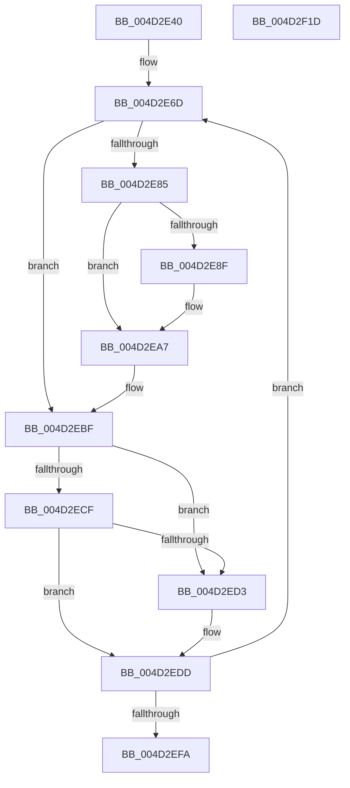

# wil_details_FeatureReporting_IncrementOpportunityInCache

- RVA: `0x004D2E40`–`0x004D2F1E` (길이 `222` bytes)
- VA: `0x00000001404D2E40`
- 실행 섹션: `.text`
- PDB 이름 있음: `예`; PDB Function 태그: `아니요`
- unwind 정보 RVA: `0x000A5A38`
- 디코드: `69`개 명령, `222/222` bytes 표시
- 미해석 바이트: `0` (있으면 어셈블리에 `.byte`로 보존)

> 이 문서는 커널 이미지의 기계어와 PDB 기호를 분석해 생성했습니다. 4번과 5번은 함수 원형과 자료형을 바이너리 사용 방식에서 추정한 C 해석이며 원본 소스 복구 결과는 아닙니다.

## 1. Dependencies

- 직접 호출 지점: **0**; 고유 호출 대상: **0**
- 직접 호출자로 확인된 함수: **1**
- RIP 상대 이미지 참조: **0**

### Outgoing calls
- 직접 디코드된 call 명령이 없습니다.

### Direct callers
- [sub_006E4192](../6E/Unknown_function_006E4192.md) at `0x006E423B`

### Static image references
- 디코드된 RIP-relative 메모리 참조가 없습니다.

## 2. Other-region calls and transfers

- 다른 실행 섹션으로 향하는 call: **0**
- 별도 외부 분기/꼬리 이동을 확인하지 못했습니다.

## 3. Assembly (complete function range)

```asm
004D2E40  48 8B C4                        mov rax, rsp
004D2E43  48 89 58 08                     mov qword ptr [rax + 8], rbx
004D2E47  48 89 68 10                     mov qword ptr [rax + 0x10], rbp
004D2E4B  48 89 70 18                     mov qword ptr [rax + 0x18], rsi
004D2E4F  48 89 78 20                     mov qword ptr [rax + 0x20], rdi
004D2E53  44 8B 11                        mov r10d, dword ptr [rcx]
004D2E56  33 FF                           xor edi, edi
004D2E58  83 FA 05                        cmp edx, 5
004D2E5B  41 8B D8                        mov ebx, r8d
004D2E5E  44 8B DA                        mov r11d, edx
004D2E61  48 8B F1                        mov rsi, rcx
004D2E64  40 0F 94 C7                     sete dil
004D2E68  BD 01 00 00 00                  mov ebp, 1
004D2E6D  41 83 61 04 00                  and dword ptr [r9 + 4], 0
004D2E72  41 8B C2                        mov eax, r10d
004D2E75  0B C5                           or eax, ebp
004D2E77  45 8B C2                        mov r8d, r10d
004D2E7A  8B C8                           mov ecx, eax
004D2E7C  C1 E9 16                        shr ecx, 0x16
004D2E7F  23 CD                           and ecx, ebp
004D2E81  3B CF                           cmp ecx, edi
004D2E83  74 3A                           je 0x1404d2ebf
004D2E85  8B D0                           mov edx, eax
004D2E87  C1 EA 0F                        shr edx, 0xf
004D2E8A  83 E2 7F                        and edx, 0x7f
004D2E8D  76 18                           jbe 0x1404d2ea7
004D2E8F  44 3B DD                        cmp r11d, ebp
004D2E92  41 89 51 04                     mov dword ptr [r9 + 4], edx
004D2E96  B9 05 00 00 00                  mov ecx, 5
004D2E9B  0F 45 CD                        cmovne ecx, ebp
004D2E9E  25 FF 7F C0 FF                  and eax, 0xffc07fff
004D2EA3  41 89 49 08                     mov dword ptr [r9 + 8], ecx
004D2EA7  33 D2                           xor edx, edx
004D2EA9  B9 00 00 40 00                  mov ecx, 0x400000
004D2EAE  41 83 FB 05                     cmp r11d, 5
004D2EB2  0F 44 D1                        cmove edx, ecx
004D2EB5  8B C8                           mov ecx, eax
004D2EB7  0F BA F1 16                     btr ecx, 0x16
004D2EBB  8B C2                           mov eax, edx
004D2EBD  0B C1                           or eax, ecx
004D2EBF  8B C8                           mov ecx, eax
004D2EC1  C1 E9 0F                        shr ecx, 0xf
004D2EC4  83 E1 7F                        and ecx, 0x7f
004D2EC7  8D 14 19                        lea edx, [rcx + rbx]
004D2ECA  83 FA 7F                        cmp edx, 0x7f
004D2ECD  77 04                           ja 0x1404d2ed3
004D2ECF  3B D1                           cmp edx, ecx
004D2ED1  73 0A                           jae 0x1404d2edd
004D2ED3  8B D3                           mov edx, ebx
004D2ED5  45 89 59 08                     mov dword ptr [r9 + 8], r11d
004D2ED9  41 89 49 04                     mov dword ptr [r9 + 4], ecx
004D2EDD  C1 E2 0F                        shl edx, 0xf
004D2EE0  33 D0                           xor edx, eax
004D2EE2  81 E2 00 80 3F 00               and edx, 0x3f8000
004D2EE8  33 D0                           xor edx, eax
004D2EEA  41 8B C2                        mov eax, r10d
004D2EED  F0 0F B1 16                     lock cmpxchg dword ptr [rsi], edx
004D2EF1  44 8B D0                        mov r10d, eax
004D2EF4  0F 85 73 FF FF FF               jne 0x1404d2e6d
004D2EFA  41 83 61 10 00                  and dword ptr [r9 + 0x10], 0
004D2EFF  41 F7 D0                        not r8d
004D2F02  48 8B 5C 24 08                  mov rbx, qword ptr [rsp + 8]
004D2F07  44 23 C5                        and r8d, ebp
004D2F0A  48 8B 6C 24 10                  mov rbp, qword ptr [rsp + 0x10]
004D2F0F  48 8B 74 24 18                  mov rsi, qword ptr [rsp + 0x18]
004D2F14  48 8B 7C 24 20                  mov rdi, qword ptr [rsp + 0x20]
004D2F19  45 89 01                        mov dword ptr [r9], r8d
004D2F1C  C3                              ret
004D2F1D  CC                              int3
```

## 4. C-style interpretation (structured pseudocode)

```c
__int64 __fastcall wil_details_FeatureReporting_IncrementOpportunityInCache(__int64 a1, int a2, int a3, __int64 a4)
{
    __int64 result;
    __int64 v_rdi;
    unsigned __int64 v_stack_p10;
    unsigned __int64 v_stack_p18;
    unsigned __int64 v_stack_p20;
    unsigned __int64 v_stack_p8;

    *(unsigned __int64 *)(v_rsp + 8) = v_rbx;
    *(unsigned __int64 *)(v_rsp + 16) = v_rbp;
    *(unsigned __int64 *)(v_rsp + 24) = v_rsi;
    *(unsigned __int64 *)(v_rsp + 32) = v_rdi;
    v_rdi = 0;
    v_rdi = (a2 == 5) ? 1 : 0;
loc_004D2E6D:
    result = (unsigned int)(((unsigned int)((unsigned int)((unsigned int)(*(unsigned int *)(a1))))) | (1));
    a1 = (unsigned int)(((unsigned int)((unsigned int)(result))) >> (22));
    a1 = (unsigned int)((a1) & (1));
    if (((unsigned int)(a1)) == ((unsigned int)(v_rdi))) goto loc_004D2EBF;
    a2 = (unsigned int)(((unsigned int)((unsigned int)(result))) >> (15));
    a2 = (unsigned int)((a2) & (127));
    if (!(condition_is_below_or_equal)) {
        *(unsigned int *)(a4 + 4) = a2;
        a1 = 5;
        if (((unsigned int)((unsigned int)(a2))) != 1) { a1 = 1; }
        result = (unsigned int)((result) & (0xFFC07FFFULL));
        *(unsigned int *)(a4 + 8) = (unsigned int)(a1);
    }
    a2 = 0;
    if (((unsigned int)((unsigned int)(a2))) == 5) { a2 = (unsigned int)((unsigned int)(0x400000ULL)); }
    result = (unsigned int)(((unsigned int)(a2)) | ((unsigned int)((unsigned int)((unsigned int)(result)))));
loc_004D2EBF:
    a1 = (unsigned int)(((unsigned int)((unsigned int)(result))) >> (15));
    a1 = (unsigned int)((a1) & (127));
    if (((unsigned int)(a1 + (unsigned int)(a3) * 1)) > 127) goto loc_004D2ED3;
    if (((unsigned int)(a1 + (unsigned int)(a3) * 1)) < ((unsigned int)(a1))) {
        a2 = (unsigned int)((unsigned int)(a3));
        *(unsigned int *)(a4 + 8) = (unsigned int)((unsigned int)(a2));
        *(unsigned int *)(a4 + 4) = (unsigned int)(a1);
    }
    a2 = (unsigned int)((a2) << (15));
    a2 = (unsigned int)((a2) ^ ((unsigned int)(result)));
    a2 = (unsigned int)((a2) & (0x3F8000ULL));
    a2 = (unsigned int)((a2) ^ ((unsigned int)(result)));
    if (condition_is_not_equal) goto loc_004D2E6D;
    a3 = (unsigned int)(~((unsigned int)((unsigned int)((unsigned int)(*(unsigned int *)(a1))))));
    a3 = (unsigned int)((a3) & (1));
    *(unsigned int *)(a4) = a3;
    return (unsigned int)((unsigned int)((unsigned int)(*(unsigned int *)(a1))));
}
```

## 5. (Beta) C Style

```c
int64_t wil_details_FeatureReporting_IncrementOpportunityInCache(void *Arg1, int32_t Arg2, int32_t Arg3, void *Arg4)
{
    uint8_t *arg1 = (uint8_t *)Arg1;
    uint8_t *arg4 = (uint8_t *)Arg4;

    int64_t result;
    int64_t local_rdi;
    uint64_t v_stack_p10;
    uint64_t v_stack_p18;
    uint64_t v_stack_p20;
    uint64_t v_stack_p8;

    *(uint64_t *)(local_rsp + 0x8) = local_rbx;
    *(uint64_t *)(local_rsp + 0x10) = local_rbp;
    *(uint64_t *)(local_rsp + 0x18) = local_rsi;
    *(uint64_t *)(local_rsp + 0x20) = local_rdi;
    local_rdi = 0;
    local_rdi = (Arg2 == 5) ? 1 : 0;
loc_004D2E6D:
    result = (uint32_t)(((uint32_t)((uint32_t)((uint32_t)(*(uint32_t *)(arg1))))) | (1));
    Arg1 = (uint32_t)(((uint32_t)((uint32_t)(result))) >> (22));
    Arg1 = (uint32_t)((Arg1) & (1));
    if (((uint32_t)(Arg1)) == ((uint32_t)(local_rdi))) goto loc_004D2EBF;
    Arg2 = (uint32_t)(((uint32_t)((uint32_t)(result))) >> (15));
    Arg2 = (uint32_t)((Arg2) & (127));
    if (!(condition_is_below_or_equal)) {
        *(uint32_t *)(arg4 + 0x4) = Arg2;
        Arg1 = 5;
        if (((uint32_t)((uint32_t)(Arg2))) != 1) { Arg1 = 1; }
        result = (uint32_t)((result) & (0xFFC07FFFULL));
        *(uint32_t *)(arg4 + 0x8) = (uint32_t)(Arg1);
    }
    Arg2 = 0;
    if (((uint32_t)((uint32_t)(Arg2))) == 5) { Arg2 = (uint32_t)((uint32_t)(0x400000ULL)); }
    result = (uint32_t)(((uint32_t)(Arg2)) | ((uint32_t)((uint32_t)((uint32_t)(result)))));
loc_004D2EBF:
    Arg1 = (uint32_t)(((uint32_t)((uint32_t)(result))) >> (15));
    Arg1 = (uint32_t)((Arg1) & (127));
    if (((uint32_t)(Arg1 + (uint32_t)(Arg3) * 1)) > 127) goto loc_004D2ED3;
    if (((uint32_t)(Arg1 + (uint32_t)(Arg3) * 1)) < ((uint32_t)(Arg1))) {
        Arg2 = (uint32_t)((uint32_t)(Arg3));
        *(uint32_t *)(arg4 + 0x8) = (uint32_t)((uint32_t)(Arg2));
        *(uint32_t *)(arg4 + 0x4) = (uint32_t)(Arg1);
    }
    Arg2 = (uint32_t)((Arg2) << (15));
    Arg2 = (uint32_t)((Arg2) ^ ((uint32_t)(result)));
    Arg2 = (uint32_t)((Arg2) & (0x3F8000ULL));
    Arg2 = (uint32_t)((Arg2) ^ ((uint32_t)(result)));
    if (condition_is_not_equal) goto loc_004D2E6D;
    Arg3 = (uint32_t)(~((uint32_t)((uint32_t)((uint32_t)(*(uint32_t *)(arg1))))));
    Arg3 = (uint32_t)((Arg3) & (1));
    *(uint32_t *)(arg4) = Arg3;
    return (uint32_t)((uint32_t)((uint32_t)(*(uint32_t *)(arg1))));
}
```

### 관측된 메모리 오프셋

구조체 형식이 확인되지 않은 접근은 인자 기준의 오프셋으로만 기록했습니다.

| 기준 인자 | 오프셋 표현 | 폭 (bit) | 접근 |
|---|---:|---:|---|
| `Arg1` | `+ 0x0` | `32` | `R` |
| `Arg4` | `+ 0x0` | `32` | `W` |
| `Arg4` | `+ 0x4` | `32` | `R/W` |
| `Arg4` | `+ 0x4` | `32` | `W` |
| `Arg4` | `+ 0x8` | `32` | `W` |
| `Arg4` | `+ 0x10` | `32` | `R/W` |

## 6. Execution-region graph

[열기: 2D/3D 그래프와 함수 탐색 컨트롤 패널](../../../control-panel.html?section=text&rva=0x004D2E40&view=graph)

- 2D 그래프는 위에서 아래로 흐르고, 3D 그래프는 빈 공간을 드래그해 회전합니다. Shift+드래그는 이동, 휠은 확대·축소, 함수 노드 선택은 대상 보고서 이동입니다.

### Static fallback


