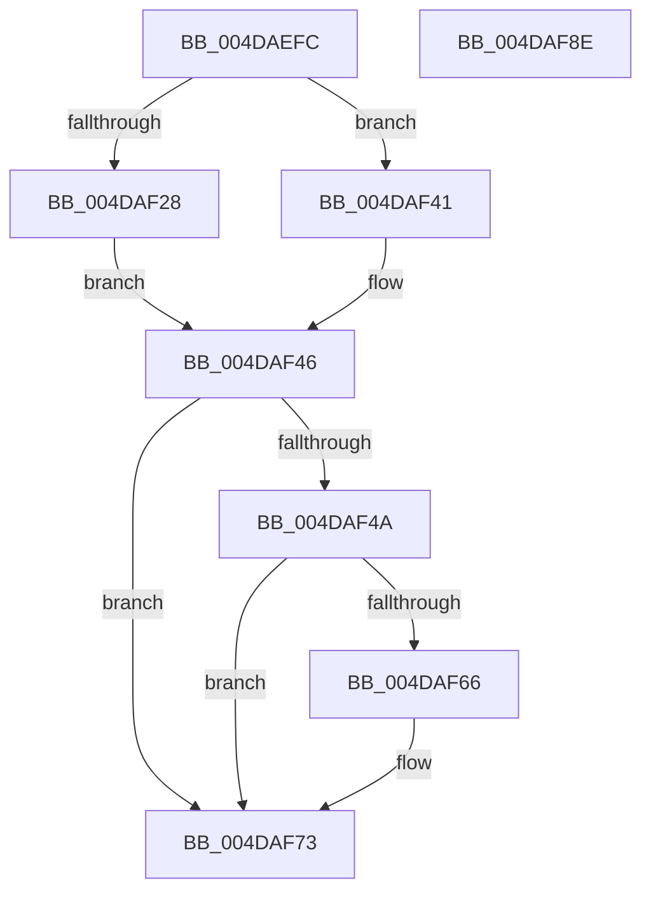

# wil_details_IsEnabledFallback

- RVA: `0x004DAEFC`–`0x004DAF8F` (길이 `147` bytes)
- VA: `0x00000001404DAEFC`
- 실행 섹션: `.text`
- PDB 이름 있음: `예`; PDB Function 태그: `아니요`
- unwind 정보 RVA: `0x000A85B0`
- 디코드: `43`개 명령, `147/147` bytes 표시
- 미해석 바이트: `0` (있으면 어셈블리에 `.byte`로 보존)

> 이 문서는 커널 이미지의 기계어와 PDB 기호를 분석해 생성했습니다. 4번과 5번은 함수 원형과 자료형을 바이너리 사용 방식에서 추정한 C 해석이며 원본 소스 복구 결과는 아닙니다.

## 1. Dependencies

- 직접 호출 지점: **3**; 고유 호출 대상: **3**
- 직접 호출자로 확인된 함수: **231**
- RIP 상대 이미지 참조: **0**

### Outgoing calls
- `0x004DAF2E` → [wil_details_FeatureStateCache_ReevaluateCachedFeatureEnabledState](../3F/wil_details_FeatureStateCache_ReevaluateCachedFeatureEnabledState_function_003FE988.md) (function, `0x003FE988`)
- `0x004DAF59` → [wil_details_FeatureReporting_ReportUsageToService](../53/wil_details_FeatureReporting_ReportUsageToService_function_0053E6E4.md) (function, `0x0053E6E4`)
- `0x004DAF6E` → [wil_details_FeatureStateCache_TryEnableDeviceUsageFastPath](../53/wil_details_FeatureStateCache_TryEnableDeviceUsageFastPath_function_0053E774.md) (function, `0x0053E774`)

### Direct callers
- [Feature_EtwThreadStackRundownPriority__private_IsEnabledFallback](../4F/Feature_EtwThreadStackRundownPriority__private_IsEnabledFallback_function_004F3B94.md) at `0x004F3B9F`
- [Feature_DisableUserPresenceQosByPolicy__private_IsEnabledFallback](../4F/Feature_DisableUserPresenceQosByPolicy__private_IsEnabledFallback_function_004F4324.md) at `0x004F432F`
- [Feature_KernelPnP_InterfaceListFilterUpdates__private_IsEnabledFallback](../4F/Feature_KernelPnP_InterfaceListFilterUpdates__private_IsEnabledFallback_function_004F4378.md) at `0x004F4383`
- [Feature_871661881__private_IsEnabledFallback](../4F/Feature_871661881__private_IsEnabledFallback_function_004F4D5C.md) at `0x004F4D67`
- [Feature_UnparkPCoresOnUnimportantUtility__private_IsEnabledFallback](../4F/Feature_UnparkPCoresOnUnimportantUtility__private_IsEnabledFallback_function_004F4E54.md) at `0x004F4E5F`
- [Feature_Sx_PEP_Notification_Synchronization__private_IsEnabledFallback](../4F/Feature_Sx_PEP_Notification_Synchronization__private_IsEnabledFallback_function_004F4EA8.md) at `0x004F4EB3`
- [Feature_CopyFileChunk_BufferAlignment__private_IsEnabledFallback](../4F/Feature_CopyFileChunk_BufferAlignment__private_IsEnabledFallback_function_004F4EFC.md) at `0x004F4F07`
- [Feature_Servicing_LowPriPoolGC__private_IsEnabledFallback](../4F/Feature_Servicing_LowPriPoolGC__private_IsEnabledFallback_function_004F4F50.md) at `0x004F4F5B`
- [Feature_Servicing_PDCActivationsAVL__private_IsEnabledFallback](../4F/Feature_Servicing_PDCActivationsAVL__private_IsEnabledFallback_function_004F4FA4.md) at `0x004F4FAF`
- [Feature_KernelPnP_DeviceListFilterUpdates__private_IsEnabledFallback](../4F/Feature_KernelPnP_DeviceListFilterUpdates__private_IsEnabledFallback_function_004F57A4.md) at `0x004F57AF`
- [Feature_KernelPnP_CheckDeviceInstancePath__private_IsEnabledFallback](../4F/Feature_KernelPnP_CheckDeviceInstancePath__private_IsEnabledFallback_function_004F58FC.md) at `0x004F5907`
- [Feature_CodeIntegrity_TrustedLaunchPolicy__private_IsEnabledFallback](../4F/Feature_CodeIntegrity_TrustedLaunchPolicy__private_IsEnabledFallback_function_004F59A0.md) at `0x004F59AB`
- [Feature_1045423416__private_IsEnabledFallback](../4F/Feature_1045423416__private_IsEnabledFallback_function_004F5B40.md) at `0x004F5B4B`
- [Feature_AntiStarvationThreadBoostCountVariable__private_IsEnabledFallback](../4F/Feature_AntiStarvationThreadBoostCountVariable__private_IsEnabledFallback_function_004F5CDC.md) at `0x004F5CE7`
- [Feature_AntiStarvationScanPeriodVariable__private_IsEnabledFallback](../4F/Feature_AntiStarvationScanPeriodVariable__private_IsEnabledFallback_function_004F5CF8.md) at `0x004F5D03`
- [Feature_AntiStarvationReadyPeriodVariable__private_IsEnabledFallback](../4F/Feature_AntiStarvationReadyPeriodVariable__private_IsEnabledFallback_function_004F5D14.md) at `0x004F5D1F`
- [Feature_AntiStarvationThreadScanCountVariable__private_IsEnabledFallback](../4F/Feature_AntiStarvationThreadScanCountVariable__private_IsEnabledFallback_function_004F5D30.md) at `0x004F5D3B`
- [Feature_58333519__private_IsEnabledFallback](../4F/Feature_58333519__private_IsEnabledFallback_function_004F5D84.md) at `0x004F5D8F`
- [Feature_Servicing_PDCAgentSessions__private_IsEnabledFallback](../4F/Feature_Servicing_PDCAgentSessions__private_IsEnabledFallback_function_004F5DD8.md) at `0x004F5DE3`
- [Feature_Servicing_WaitForOutstandingWritesToComplete__private_IsEnabledFallback](../4F/Feature_Servicing_WaitForOutstandingWritesToComplete__private_IsEnabledFallback_function_004F5F14.md) at `0x004F5F1F`
- [Feature_Servicing_AutoBoostEtwEventingFixes__private_IsEnabledFallback](../4F/Feature_Servicing_AutoBoostEtwEventingFixes__private_IsEnabledFallback_function_004F6A4C.md) at `0x004F6A57`
- [Feature_Test52061194__private_IsEnabledFallback](../4F/Feature_Test52061194__private_IsEnabledFallback_function_004F750C.md) at `0x004F7517`
- [Feature_ThreatintDeadlockFix__private_IsEnabledFallback](../4F/Feature_ThreatintDeadlockFix__private_IsEnabledFallback_function_004F782C.md) at `0x004F7837`
- [Feature_Servicing_PassiveInterrupt_ForceIdle__private_IsEnabledFallback](../4F/Feature_Servicing_PassiveInterrupt_ForceIdle__private_IsEnabledFallback_function_004F7880.md) at `0x004F788B`
- [Feature_ForceIdleReschedulingFix__private_IsEnabledFallback](../4F/Feature_ForceIdleReschedulingFix__private_IsEnabledFallback_function_004F78D4.md) at `0x004F78DF`
- [Feature_AdaptiveHibernateEnhancements__private_IsEnabledFallback](../4F/Feature_AdaptiveHibernateEnhancements__private_IsEnabledFallback_function_004F7928.md) at `0x004F7933`
- [Feature_KernelPnP_LogBlockedDrivers__private_IsEnabledFallback](../4F/Feature_KernelPnP_LogBlockedDrivers__private_IsEnabledFallback_function_004F797C.md) at `0x004F7987`
- [Feature_EffectivePriorityNotAlwaysRankBiased__private_IsEnabledFallback](../4F/Feature_EffectivePriorityNotAlwaysRankBiased__private_IsEnabledFallback_function_004F79D0.md) at `0x004F79DB`
- [Feature_CLFS_Signing__private_IsEnabledFallback](../4F/Feature_CLFS_Signing__private_IsEnabledFallback_function_004F7A24.md) at `0x004F7A2F`
- [Feature_IldeLatencyAwareStandbyStealing__private_IsEnabledFallback](../4F/Feature_IldeLatencyAwareStandbyStealing__private_IsEnabledFallback_function_004F7A78.md) at `0x004F7A83`
- [Feature_Servicing_AvoidSmtGroupings__private_IsEnabledFallback](../4F/Feature_Servicing_AvoidSmtGroupings__private_IsEnabledFallback_function_004F7ACC.md) at `0x004F7AD7`
- [Feature_ExpandSTEIgnoreReasons__private_IsEnabledFallback](../4F/Feature_ExpandSTEIgnoreReasons__private_IsEnabledFallback_function_004F7B20.md) at `0x004F7B2B`
- [Feature_Servicing_SharedReadyQueueLock__private_IsEnabledFallback](../4F/Feature_Servicing_SharedReadyQueueLock__private_IsEnabledFallback_function_004F7B74.md) at `0x004F7B7F`
- [Feature_Test57481295__private_IsEnabledFallback](../4F/Feature_Test57481295__private_IsEnabledFallback_function_004F7BC8.md) at `0x004F7BD3`
- [Feature_PpmDynamicHintAdjust__private_IsEnabledFallback](../4F/Feature_PpmDynamicHintAdjust__private_IsEnabledFallback_function_004FC210.md) at `0x004FC21B`
- [Feature_Servicing_Kernel_ClockTickIdleEstimateFix__private_IsEnabledFallback](../4F/Feature_Servicing_Kernel_ClockTickIdleEstimateFix__private_IsEnabledFallback_function_004FC904.md) at `0x004FC90F`
- [Feature_HeteroRescheduleFixes__private_IsEnabledFallback](../4F/Feature_HeteroRescheduleFixes__private_IsEnabledFallback_function_004FD14C.md) at `0x004FD157`
- [Feature_RestrictKernelAddressLeaks__private_IsEnabledFallback](../4F/Feature_RestrictKernelAddressLeaks__private_IsEnabledFallback_function_004FD168.md) at `0x004FD173`
- [Feature_ETWStackExpandedStackwalks__private_IsEnabledFallback](../4F/Feature_ETWStackExpandedStackwalks__private_IsEnabledFallback_function_004FD184.md) at `0x004FD18F`
- [Feature_Servicing_EtwLostEventsFlags__private_IsEnabledFallback](../4F/Feature_Servicing_EtwLostEventsFlags__private_IsEnabledFallback_function_004FD1A0.md) at `0x004FD1AB`
- [Feature_ShadowAdmin__private_IsEnabledFallback](../4F/Feature_ShadowAdmin__private_IsEnabledFallback_function_004FD1BC.md) at `0x004FD1C7`
- [Feature_FasterCrc32__private_IsEnabledFallback](../4F/Feature_FasterCrc32__private_IsEnabledFallback_function_004FD1D8.md) at `0x004FD1E3`
- [Feature_Servicing_PnpBootWaitForAsyncBusRelations__private_IsEnabledFallback](../4F/Feature_Servicing_PnpBootWaitForAsyncBusRelations__private_IsEnabledFallback_function_004FD1F4.md) at `0x004FD1FF`
- [Feature_UserPresenceThrottling__private_IsEnabledFallback](../4F/Feature_UserPresenceThrottling__private_IsEnabledFallback_function_004FD210.md) at `0x004FD21B`
- [Feature_PrefetchQueueWorkerProactivelyForProcessExit__private_IsEnabledFallback](../4F/Feature_PrefetchQueueWorkerProactivelyForProcessExit__private_IsEnabledFallback_function_004FD22C.md) at `0x004FD237`
- [Feature_ProcessorStartupCacheFlushOptimization__private_IsEnabledFallback](../54/Feature_ProcessorStartupCacheFlushOptimization__private_IsEnabledFallback_function_00543D3C.md) at `0x00543D47`
- [Feature_CvmDmaBouncing__private_IsEnabledFallback](../54/Feature_CvmDmaBouncing__private_IsEnabledFallback_function_0054C9A4.md) at `0x0054C9AF`
- [Feature_Servicing_PrmBootPhaseRestore__private_IsEnabledFallback](../54/Feature_Servicing_PrmBootPhaseRestore__private_IsEnabledFallback_function_0054E1A4.md) at `0x0054E1AF`
- [Feature_Servicing_PrmSaveRestoreS4__private_IsEnabledFallback](../54/Feature_Servicing_PrmSaveRestoreS4__private_IsEnabledFallback_function_0054E1F8.md) at `0x0054E203`
- [Feature_DmaAdapterStage1DirectAttach__private_IsEnabledFallback](../54/Feature_DmaAdapterStage1DirectAttach__private_IsEnabledFallback_function_0054EB70.md) at `0x0054EB7B`
- [Feature_CvmMasterAdapterBounceFix__private_IsEnabledFallback](../55/Feature_CvmMasterAdapterBounceFix__private_IsEnabledFallback_function_005506A0.md) at `0x005506AB`
- [Feature_DmarptCleanupOutOfBoundsFix__private_IsEnabledFallback](../56/Feature_DmarptCleanupOutOfBoundsFix__private_IsEnabledFallback_function_00568AAC.md) at `0x00568AB7`
- [Feature_3273361723__private_IsEnabledFallback](../58/Feature_3273361723__private_IsEnabledFallback_function_005817D0.md) at `0x005817DB`
- [Feature_3244801339__private_IsEnabledFallback](../58/Feature_3244801339__private_IsEnabledFallback_function_00581CC0.md) at `0x00581CCB`
- [Feature_3528882490__private_IsEnabledFallback](../58/Feature_3528882490__private_IsEnabledFallback_function_00581D14.md) at `0x00581D1F`
- [Feature_3609177402__private_IsEnabledFallback](../58/Feature_3609177402__private_IsEnabledFallback_function_00581D68.md) at `0x00581D73`
- [Feature_697728313__private_IsEnabledFallback](../58/Feature_697728313__private_IsEnabledFallback_function_00581DBC.md) at `0x00581DC7`
- [Feature_Servicing_CloseOplockTimeoutGap__private_IsEnabledFallback](../58/Feature_Servicing_CloseOplockTimeoutGap__private_IsEnabledFallback_function_00581E10.md) at `0x00581E1B`
- [Feature_4131803451__private_IsEnabledFallback](../58/Feature_4131803451__private_IsEnabledFallback_function_005833A4.md) at `0x005833AF`
- [Feature_OfflineDumpRedaction__private_IsEnabledFallback](../58/Feature_OfflineDumpRedaction__private_IsEnabledFallback_function_0058AF30.md) at `0x0058AF3B`
- [Feature_Servicing_CompressSecureHiberdata__private_IsEnabledFallback](../58/Feature_Servicing_CompressSecureHiberdata__private_IsEnabledFallback_function_0058DE48.md) at `0x0058DE53`
- [Feature_14FBugcheckMinidumpDiagnostics__private_IsEnabledFallback](../59/Feature_14FBugcheckMinidumpDiagnostics__private_IsEnabledFallback_function_00591A04.md) at `0x00591A0F`
- [Feature_3043197241__private_IsEnabledFallback](../59/Feature_3043197241__private_IsEnabledFallback_function_00596C70.md) at `0x00596C7B`
- [Feature_4056573243__private_IsEnabledFallback](../59/Feature_4056573243__private_IsEnabledFallback_function_00596CC4.md) at `0x00596CCF`
- [Feature_1565498680__private_IsEnabledFallback](../59/Feature_1565498680__private_IsEnabledFallback_function_0059781C.md) at `0x00597827`
- [Feature_3458701627__private_IsEnabledFallback](../59/Feature_3458701627__private_IsEnabledFallback_function_00597870.md) at `0x0059787B`
- [Feature_AppContainerVolumeDeviceAccess__private_IsEnabledFallback](../59/Feature_AppContainerVolumeDeviceAccess__private_IsEnabledFallback_function_005978C4.md) at `0x005978CF`
- [Feature_1042264378__private_IsEnabledFallback](../59/Feature_1042264378__private_IsEnabledFallback_function_005989F4.md) at `0x005989FF`
- [Feature_3741482297__private_IsEnabledFallback](../59/Feature_3741482297__private_IsEnabledFallback_function_00598A48.md) at `0x00598A53`
- [Feature_KernelPnP_ConvertDevpropcompkeyArrayToString__private_IsEnabledFallback](../5A/Feature_KernelPnP_ConvertDevpropcompkeyArrayToString__private_IsEnabledFallback_function_005A68DC.md) at `0x005A68E7`
- [Feature_KernelPnP_ActionDoubleDequeueFix__private_IsEnabledFallback](../5A/Feature_KernelPnP_ActionDoubleDequeueFix__private_IsEnabledFallback_function_005A6BDC.md) at `0x005A6BE7`
- [Feature_2986240315__private_IsEnabledFallback](../5A/Feature_2986240315__private_IsEnabledFallback_function_005A7254.md) at `0x005A725F`
- [Feature_KernelPnP_ObjectNameUpdates__private_IsEnabledFallback](../5A/Feature_KernelPnP_ObjectNameUpdates__private_IsEnabledFallback_function_005A9EF0.md) at `0x005A9EFB`
- [Feature_Servicing_SyscallProviderWin32kMetadata__private_IsEnabledFallback](../5B/Feature_Servicing_SyscallProviderWin32kMetadata__private_IsEnabledFallback_function_005B1490.md) at `0x005B149B`
- [Feature_TriageDumpDataExtension__private_IsEnabledFallback](../5B/Feature_TriageDumpDataExtension__private_IsEnabledFallback_function_005B2690.md) at `0x005B269B`
- [Feature_PpmParkEx__private_IsEnabledFallback](../5B/Feature_PpmParkEx__private_IsEnabledFallback_function_005B613C.md) at `0x005B6147`
- [Feature_Servicing_ISRStatsInTriageDumps__private_IsEnabledFallback](../5B/Feature_Servicing_ISRStatsInTriageDumps__private_IsEnabledFallback_function_005B6190.md) at `0x005B619B`
- [Feature_Servicing_Kernel_ServerTimerDeadlineCancelFix__private_IsEnabledFallback](../5B/Feature_Servicing_Kernel_ServerTimerDeadlineCancelFix__private_IsEnabledFallback_function_005BA294.md) at `0x005BA29F`
- [Feature_3669964091__private_IsEnabledFallback](../5B/Feature_3669964091__private_IsEnabledFallback_function_005BE758.md) at `0x005BE763`
- [Feature_2875967801__private_IsEnabledFallback](../5C/Feature_2875967801__private_IsEnabledFallback_function_005C16B0.md) at `0x005C16BB`
- [Feature_SuspendThread2__private_IsEnabledFallback](../5C/Feature_SuspendThread2__private_IsEnabledFallback_function_005C3560.md) at `0x005C356B`
- [Feature_Servicing_InlinePreWakeupPriorityBoosting__private_IsEnabledFallback](../5C/Feature_Servicing_InlinePreWakeupPriorityBoosting__private_IsEnabledFallback_function_005C5160.md) at `0x005C516B`
- [Feature_Servicing_KeIntSteerProcessorIndex__private_IsEnabledFallback](../5C/Feature_Servicing_KeIntSteerProcessorIndex__private_IsEnabledFallback_function_005C5618.md) at `0x005C5623`
- [Feature_StackingDecayBoosts__private_IsEnabledFallback](../5C/Feature_StackingDecayBoosts__private_IsEnabledFallback_function_005C65E8.md) at `0x005C65F3`
- [Feature_679186747__private_IsEnabledFallback](../5C/Feature_679186747__private_IsEnabledFallback_function_005CD850.md) at `0x005CD85B`
- [Feature_Servicing_Alpc_LockOrdering__private_IsEnabledFallback](../5C/Feature_Servicing_Alpc_LockOrdering__private_IsEnabledFallback_function_005CD8A4.md) at `0x005CD8AF`
- [Feature_2366787898__private_IsEnabledFallback](../5C/Feature_2366787898__private_IsEnabledFallback_function_005CD8F8.md) at `0x005CD903`
- [Feature_2735186232__private_IsEnabledFallback](../5C/Feature_2735186232__private_IsEnabledFallback_function_005CD94C.md) at `0x005CD957`
- [Feature_OutsideInProtection__private_IsEnabledFallback](../5C/Feature_OutsideInProtection__private_IsEnabledFallback_function_005CD9A0.md) at `0x005CD9AB`
- [Feature_Servicing_GamingHandheldPowBtnFilter__private_IsEnabledFallback](../5C/Feature_Servicing_GamingHandheldPowBtnFilter__private_IsEnabledFallback_function_005CE32C.md) at `0x005CE337`
- [Feature_VpciVscBootDiskHibernation__private_IsEnabledFallback](../5C/Feature_VpciVscBootDiskHibernation__private_IsEnabledFallback_function_005CE380.md) at `0x005CE38B`
- [Feature_2315151673__private_IsEnabledFallback](../5C/Feature_2315151673__private_IsEnabledFallback_function_005CF154.md) at `0x005CF15F`
- [Feature_Servicing_CoolingFrameworkDeviceCleanupFix__private_IsEnabledFallback](../5D/Feature_Servicing_CoolingFrameworkDeviceCleanupFix__private_IsEnabledFallback_function_005D103C.md) at `0x005D1047`
- [Feature_Servicing_BatteryTestExempt__private_IsEnabledFallback](../5D/Feature_Servicing_BatteryTestExempt__private_IsEnabledFallback_function_005D1310.md) at `0x005D131B`
- [Feature_Servicing_PowersnapCyclesFix__private_IsEnabledFallback](../5D/Feature_Servicing_PowersnapCyclesFix__private_IsEnabledFallback_function_005D402C.md) at `0x005D4037`
- [Feature_CrashDumpOneMBTransferSize__private_IsEnabledFallback](../5D/Feature_CrashDumpOneMBTransferSize__private_IsEnabledFallback_function_005D4A40.md) at `0x005D4A4B`
- [Feature_PlutonDynamicUpgradeStxTpmEnabledFix__private_IsEnabledFallback](../5D/Feature_PlutonDynamicUpgradeStxTpmEnabledFix__private_IsEnabledFallback_function_005D4A94.md) at `0x005D4A9F`
- [Feature_PlutonDynamicUpgrade__private_IsEnabledFallback](../5D/Feature_PlutonDynamicUpgrade__private_IsEnabledFallback_function_005D4AE8.md) at `0x005D4AF3`
- [Feature_PlutonMdsMeasurement__private_IsEnabledFallback](../5D/Feature_PlutonMdsMeasurement__private_IsEnabledFallback_function_005D4B3C.md) at `0x005D4B47`
- [Feature_PlutonNvidiaDriver__private_IsEnabledFallback](../5D/Feature_PlutonNvidiaDriver__private_IsEnabledFallback_function_005D4B90.md) at `0x005D4B9B`
- [Feature_PlutonNvidiaN1c__private_IsEnabledFallback](../5D/Feature_PlutonNvidiaN1c__private_IsEnabledFallback_function_005D4BE4.md) at `0x005D4BEF`
- [Feature_Servicing_ARM64_LLVMHibernate__private_IsEnabledFallback](../5D/Feature_Servicing_ARM64_LLVMHibernate__private_IsEnabledFallback_function_005D4C38.md) at `0x005D4C43`
- [Feature_Servicing_ThermalSxExitRereadZones__private_IsEnabledFallback](../5D/Feature_Servicing_ThermalSxExitRereadZones__private_IsEnabledFallback_function_005D542C.md) at `0x005D5437`
- [Feature_2845206840__private_IsEnabledFallback](../5D/Feature_2845206840__private_IsEnabledFallback_function_005D5B9C.md) at `0x005D5BA7`
- [Feature_WpsExtendedFamilyContainment__private_IsEnabledFallback](../5D/Feature_WpsExtendedFamilyContainment__private_IsEnabledFallback_function_005D8650.md) at `0x005D865B`
- [Feature_WpsHybridToNoneZoneFix__private_IsEnabledFallback](../5D/Feature_WpsHybridToNoneZoneFix__private_IsEnabledFallback_function_005D86A4.md) at `0x005D86AF`
- [Feature_BatteryChargeLimitV2Support__private_IsEnabledFallback](../5D/Feature_BatteryChargeLimitV2Support__private_IsEnabledFallback_function_005D94BC.md) at `0x005D94C7`
- [Feature_SustainabilityFixes_FY26Q2__private_IsEnabledFallback](../5D/Feature_SustainabilityFixes_FY26Q2__private_IsEnabledFallback_function_005D9FFC.md) at `0x005DA007`
- [Feature_PpmFixContainmentCandidateListInitialization__private_IsEnabledFallback](../5D/Feature_PpmFixContainmentCandidateListInitialization__private_IsEnabledFallback_function_005DFBC4.md) at `0x005DFBCF`
- [Feature_ProcessDefaultQosNotifications__private_IsEnabledFallback](../5E/Feature_ProcessDefaultQosNotifications__private_IsEnabledFallback_function_005E24EC.md) at `0x005E24F7`
- [Feature_2056154424__private_IsEnabledFallback](../5E/Feature_2056154424__private_IsEnabledFallback_function_005E27A4.md) at `0x005E27AF`
- [Feature_ThreadLockGuardedRegion__private_IsEnabledFallback](../5E/Feature_ThreadLockGuardedRegion__private_IsEnabledFallback_function_005E2D24.md) at `0x005E2D2F`
- [Feature_ForegroundBoost_ApiRemoval__private_IsEnabledFallback](../5E/Feature_ForegroundBoost_ApiRemoval__private_IsEnabledFallback_function_005E31F4.md) at `0x005E31FF`
- [Feature_LearningModeLoggingPsConvertToGuiThread__private_IsEnabledFallback](../5E/Feature_LearningModeLoggingPsConvertToGuiThread__private_IsEnabledFallback_function_005E3248.md) at `0x005E3253`
- [Feature_ProcesDirectSwap__private_IsEnabledFallback](../5E/Feature_ProcesDirectSwap__private_IsEnabledFallback_function_005E329C.md) at `0x005E32A7`
- [Feature_CreateProcessSegmentHeapEnablement__private_IsEnabledFallback](../5E/Feature_CreateProcessSegmentHeapEnablement__private_IsEnabledFallback_function_005E33F8.md) at `0x005E3403`
- [Feature_DecoupleAppContainerAndIntegrityLevel__private_IsEnabledFallback](../5E/Feature_DecoupleAppContainerAndIntegrityLevel__private_IsEnabledFallback_function_005E3414.md) at `0x005E341F`
- [Feature_TrustedLaunchHosts__private_IsEnabledFallback](../5E/Feature_TrustedLaunchHosts__private_IsEnabledFallback_function_005E3468.md) at `0x005E3473`
- [Feature_3033771320__private_IsEnabledFallback](../5E/Feature_3033771320__private_IsEnabledFallback_function_005E3768.md) at `0x005E3773`
- [Feature_689067323__private_IsEnabledFallback](../5E/Feature_689067323__private_IsEnabledFallback_function_005E4F20.md) at `0x005E4F2B`
- [Feature_RAW_Sector_Alignment_Fix__private_IsEnabledFallback](../5E/Feature_RAW_Sector_Alignment_Fix__private_IsEnabledFallback_function_005E5104.md) at `0x005E510F`
- [Feature_AgenticAppContainerBfsSupport__private_IsEnabledFallback](../60/Feature_AgenticAppContainerBfsSupport__private_IsEnabledFallback_function_00606214.md) at `0x0060621F`
- [Feature_3055530299__private_IsEnabledFallback](../60/Feature_3055530299__private_IsEnabledFallback_function_00606630.md) at `0x0060663B`
- [Feature_2045735225__private_IsEnabledFallback](../60/Feature_2045735225__private_IsEnabledFallback_function_006066B0.md) at `0x006066BB`
- [Feature_AgentId2__private_IsEnabledFallback](../60/Feature_AgentId2__private_IsEnabledFallback_function_00606704.md) at `0x0060670F`
- [Feature_ShadowAdminAppCompat__private_IsEnabledFallback](../60/Feature_ShadowAdminAppCompat__private_IsEnabledFallback_function_00606720.md) at `0x0060672B`
- [Feature_TrustedLaunchCiClaim__private_IsEnabledFallback](../60/Feature_TrustedLaunchCiClaim__private_IsEnabledFallback_function_00607574.md) at `0x0060757F`
- [Feature_LearningModeViolationLogWithSids__private_IsEnabledFallback](../60/Feature_LearningModeViolationLogWithSids__private_IsEnabledFallback_function_00608AF4.md) at `0x00608AFF`
- [Feature_2077227322__private_IsEnabledFallback](../60/Feature_2077227322__private_IsEnabledFallback_function_0060941C.md) at `0x00609427`
- [Feature_829055289__private_IsEnabledFallback](../60/Feature_829055289__private_IsEnabledFallback_function_00609584.md) at `0x0060958F`
- [Feature_Servicing_DbxRaceCondition__private_IsEnabledFallback](../60/Feature_Servicing_DbxRaceCondition__private_IsEnabledFallback_function_00609B58.md) at `0x00609B63`
- [Feature_LowBoxNumberEntryReferenceIssue__private_IsEnabledFallback](../60/Feature_LowBoxNumberEntryReferenceIssue__private_IsEnabledFallback_function_00609FD0.md) at `0x00609FDB`
- [Feature_AddMemInfoToBootTrace__private_IsEnabledFallback](../64/Feature_AddMemInfoToBootTrace__private_IsEnabledFallback_function_0064E324.md) at `0x0064E32F`
- [Feature_2327208251__private_IsEnabledFallback](../64/Feature_2327208251__private_IsEnabledFallback_function_0064E4EC.md) at `0x0064E4F7`
- [Feature_1899207995__private_IsEnabledFallback](../64/Feature_1899207995__private_IsEnabledFallback_function_0064F3D0.md) at `0x0064F3DB`
- [Feature_218004792__private_IsEnabledFallback](../64/Feature_218004792__private_IsEnabledFallback_function_0064F424.md) at `0x0064F42F`
- [Feature_1224463674__private_IsEnabledFallback](../65/Feature_1224463674__private_IsEnabledFallback_function_0065129C.md) at `0x006512A7`
- [Feature_AffinityLogSkipEmptyAffinity__private_IsEnabledFallback](../65/Feature_AffinityLogSkipEmptyAffinity__private_IsEnabledFallback_function_006512F0.md) at `0x006512FB`
- [Feature_1345841464__private_IsEnabledFallback](../65/Feature_1345841464__private_IsEnabledFallback_function_00651538.md) at `0x00651543`
- [Feature_UtilitySession__private_IsEnabledFallback](../65/Feature_UtilitySession__private_IsEnabledFallback_function_0065466C.md) at `0x00654677`
- [Feature_1855570234__private_IsEnabledFallback](../65/Feature_1855570234__private_IsEnabledFallback_function_00655530.md) at `0x0065553B`
- [Feature_3379165498__private_IsEnabledFallback](../65/Feature_3379165498__private_IsEnabledFallback_function_00655584.md) at `0x0065558F`
- [Feature_3714213176__private_IsEnabledFallback](../65/Feature_3714213176__private_IsEnabledFallback_function_00655D64.md) at `0x00655D6F`
- [Feature_Servicing_PoolQueryLimitFix__private_IsEnabledFallback](../65/Feature_Servicing_PoolQueryLimitFix__private_IsEnabledFallback_function_006575E0.md) at `0x006575EB`
- [Feature_Servicing_DisallowSharedLockImplicitUpgrade__private_IsEnabledFallback](../65/Feature_Servicing_DisallowSharedLockImplicitUpgrade__private_IsEnabledFallback_function_00658100.md) at `0x0065810B`
- [Feature_WorkQueueShardingWithinNodes__private_IsEnabledFallback](../65/Feature_WorkQueueShardingWithinNodes__private_IsEnabledFallback_function_0065AA6C.md) at `0x0065AA77`
- [Feature_3980109113__private_IsEnabledFallback](../65/Feature_3980109113__private_IsEnabledFallback_function_0065CE64.md) at `0x0065CE6F`
- [Feature_Servicing_WheaLiveDumpBertSizeFix__private_IsEnabledFallback](../65/Feature_Servicing_WheaLiveDumpBertSizeFix__private_IsEnabledFallback_function_0065DC14.md) at `0x0065DC1F`
- [Feature_DriverSetup_ReofferFingerprinting_v2__private_IsEnabledFallback](../66/Feature_DriverSetup_ReofferFingerprinting_v2__private_IsEnabledFallback_function_006648FC.md) at `0x00664907`
- [Feature_LearningModeTraceService__private_IsEnabledFallback](../66/Feature_LearningModeTraceService__private_IsEnabledFallback_function_00664950.md) at `0x0066495B`
- [Feature_ProjectTessera_CreateProcessInSandbox__private_IsEnabledFallback](../66/Feature_ProjectTessera_CreateProcessInSandbox__private_IsEnabledFallback_function_006649A4.md) at `0x006649AF`
- [Feature_Microcode_Client_CD__private_IsEnabledFallback](../66/Feature_Microcode_Client_CD__private_IsEnabledFallback_function_00666A50.md) at `0x00666A5B`
- [Feature_Servicing_CmpRegistryLockToCacheAwarePushlock__private_IsEnabledFallback](../66/Feature_Servicing_CmpRegistryLockToCacheAwarePushlock__private_IsEnabledFallback_function_0066A3CC.md) at `0x0066A3D7`
- [Feature_2602282298__private_IsEnabledFallback](../66/Feature_2602282298__private_IsEnabledFallback_function_0066A420.md) at `0x0066A42B`
- [Feature_2045482299__private_IsEnabledFallback](../66/Feature_2045482299__private_IsEnabledFallback_function_0066A56C.md) at `0x0066A577`
- [Feature_CmFcCallback__private_IsEnabledFallback](../66/Feature_CmFcCallback__private_IsEnabledFallback_function_0066AA90.md) at `0x0066AA9B`
- [Feature_Servicing_FixWarmRebootIssueOnLowCoreCPUs__private_IsEnabledFallback](../66/Feature_Servicing_FixWarmRebootIssueOnLowCoreCPUs__private_IsEnabledFallback_function_0066B6C4.md) at `0x0066B6CF`
- [Feature_ConfAccImp__private_IsEnabledFallback](../66/Feature_ConfAccImp__private_IsEnabledFallback_function_0066BCE8.md) at `0x0066BCF3`
- [Feature_ExpToc__private_IsEnabledFallback](../66/Feature_ExpToc__private_IsEnabledFallback_function_0066BE58.md) at `0x0066BE63`
- [Feature_LocPerfVal__private_IsEnabledFallback](../66/Feature_LocPerfVal__private_IsEnabledFallback_function_0066C188.md) at `0x0066C193`
- [Feature_TestCurrentBundleOn_Flag__private_IsEnabledFallback](../66/Feature_TestCurrentBundleOn_Flag__private_IsEnabledFallback_function_0066C938.md) at `0x0066C943`
- [Feature_TestReadyFlag__private_IsEnabledFallback](../66/Feature_TestReadyFlag__private_IsEnabledFallback_function_0066CDE8.md) at `0x0066CDF3`
- [Feature_TestUxGate__private_IsEnabledFallback](../66/Feature_TestUxGate__private_IsEnabledFallback_function_0066D0B8.md) at `0x0066D0C3`
- [Feature_UxAccOptimization__private_IsEnabledFallback](../66/Feature_UxAccOptimization__private_IsEnabledFallback_function_0066D3E8.md) at `0x0066D3F3`
- [Feature_ValUxPerf2__private_IsEnabledFallback](../66/Feature_ValUxPerf2__private_IsEnabledFallback_function_0066DB78.md) at `0x0066DB83`
- [Feature_Servicing_RemoveAlignmentFreeBinFromList__private_IsEnabledFallback](../66/Feature_Servicing_RemoveAlignmentFreeBinFromList__private_IsEnabledFallback_function_0066DE5C.md) at `0x0066DE67`
- [Feature_Servicing_RemainingPathForLocalKeyName__private_IsEnabledFallback](../66/Feature_Servicing_RemainingPathForLocalKeyName__private_IsEnabledFallback_function_0066E070.md) at `0x0066E07B`
- [Feature_2429262139__private_IsEnabledFallback](../66/Feature_2429262139__private_IsEnabledFallback_function_0066E08C.md) at `0x0066E097`
- [Feature_ARM64_ASLR_AddressSpace_128MB__private_IsEnabledFallback](../67/Feature_ARM64_ASLR_AddressSpace_128MB__private_IsEnabledFallback_function_006713AC.md) at `0x006713B7`
- [Feature_1992713530__private_IsEnabledFallback](../67/Feature_1992713530__private_IsEnabledFallback_function_006779E0.md) at `0x006779EB`
- [Feature_Servicing_SecImageNoExecuteFlag__private_IsEnabledFallback](../67/Feature_Servicing_SecImageNoExecuteFlag__private_IsEnabledFallback_function_00678F34.md) at `0x00678F3F`
- [Feature_Servicing_Mm_TrimSharedPageFix__private_IsEnabledFallback](../67/Feature_Servicing_Mm_TrimSharedPageFix__private_IsEnabledFallback_function_0067F1C8.md) at `0x0067F1D3`
- [Feature_Servicing_HotpatchLoaderFixes__private_IsEnabledFallback](../68/Feature_Servicing_HotpatchLoaderFixes__private_IsEnabledFallback_function_00682F74.md) at `0x00682F7F`
- [Feature_4234569016__private_IsEnabledFallback](../68/Feature_4234569016__private_IsEnabledFallback_function_00686CFC.md) at `0x00686D07`
- [Feature_605966648__private_IsEnabledFallback](../68/Feature_605966648__private_IsEnabledFallback_function_006872E4.md) at `0x006872EF`
- [Feature_Servicing_Mm_AweLazyFlushOptIn__private_IsEnabledFallback](../68/Feature_Servicing_Mm_AweLazyFlushOptIn__private_IsEnabledFallback_function_006879AC.md) at `0x006879B7`
- [Feature_Servicing_Mm_LocateCombineBlockFix__private_IsEnabledFallback](../68/Feature_Servicing_Mm_LocateCombineBlockFix__private_IsEnabledFallback_function_0068B980.md) at `0x0068B98B`
- [Feature_573990203__private_IsEnabledFallback](../69/Feature_573990203__private_IsEnabledFallback_function_0069AD80.md) at `0x0069AD8B`
- [Feature_4168769850__private_IsEnabledFallback](../69/Feature_4168769850__private_IsEnabledFallback_function_0069BFD4.md) at `0x0069BFDF`
- [Feature_4095108409__private_IsEnabledFallback](../69/Feature_4095108409__private_IsEnabledFallback_function_0069C028.md) at `0x0069C033`
- [Feature_SdbValidateRootTagsOnOpen__private_IsEnabledFallback](../69/Feature_SdbValidateRootTagsOnOpen__private_IsEnabledFallback_function_0069C044.md) at `0x0069C04F`
- [Feature_CompatMatchingContainment__private_IsEnabledFallback](../69/Feature_CompatMatchingContainment__private_IsEnabledFallback_function_0069C098.md) at `0x0069C0A3`
- [Feature_CompatPreallocatedVelocity55922052__private_IsEnabledFallback](../69/Feature_CompatPreallocatedVelocity55922052__private_IsEnabledFallback_function_0069C0EC.md) at `0x0069C0F7`
- [Feature_CompatPreallocatedVelocity55922053__private_IsEnabledFallback](../69/Feature_CompatPreallocatedVelocity55922053__private_IsEnabledFallback_function_0069C140.md) at `0x0069C14B`
- [Feature_CompatPreallocatedVelocity55922054__private_IsEnabledFallback](../69/Feature_CompatPreallocatedVelocity55922054__private_IsEnabledFallback_function_0069C194.md) at `0x0069C19F`
- [Feature_CompatPreallocatedVelocity55922055__private_IsEnabledFallback](../69/Feature_CompatPreallocatedVelocity55922055__private_IsEnabledFallback_function_0069C1E8.md) at `0x0069C1F3`
- [Feature_CompatPreallocatedVelocity55922056__private_IsEnabledFallback](../69/Feature_CompatPreallocatedVelocity55922056__private_IsEnabledFallback_function_0069C23C.md) at `0x0069C247`
- [Feature_CompatPreallocatedVelocity55922057__private_IsEnabledFallback](../69/Feature_CompatPreallocatedVelocity55922057__private_IsEnabledFallback_function_0069C290.md) at `0x0069C29B`
- [Feature_CompatPreallocatedVelocity55922058__private_IsEnabledFallback](../69/Feature_CompatPreallocatedVelocity55922058__private_IsEnabledFallback_function_0069C2E4.md) at `0x0069C2EF`
- [Feature_CompatPreallocatedVelocity55922060__private_IsEnabledFallback](../69/Feature_CompatPreallocatedVelocity55922060__private_IsEnabledFallback_function_0069C338.md) at `0x0069C343`
- [Feature_CompatPreallocatedVelocity55922061__private_IsEnabledFallback](../69/Feature_CompatPreallocatedVelocity55922061__private_IsEnabledFallback_function_0069C38C.md) at `0x0069C397`
- [Feature_CompatPreallocatedVelocity55922062__private_IsEnabledFallback](../69/Feature_CompatPreallocatedVelocity55922062__private_IsEnabledFallback_function_0069C3E0.md) at `0x0069C3EB`
- [Feature_CompatPreallocatedVelocity55922063__private_IsEnabledFallback](../69/Feature_CompatPreallocatedVelocity55922063__private_IsEnabledFallback_function_0069C434.md) at `0x0069C43F`
- [Feature_CompatPreallocatedVelocity55922064__private_IsEnabledFallback](../69/Feature_CompatPreallocatedVelocity55922064__private_IsEnabledFallback_function_0069C488.md) at `0x0069C493`
- [Feature_CompatPreallocatedVelocity55922065__private_IsEnabledFallback](../69/Feature_CompatPreallocatedVelocity55922065__private_IsEnabledFallback_function_0069C4DC.md) at `0x0069C4E7`
- [Feature_CompatPreallocatedVelocity55922067__private_IsEnabledFallback](../69/Feature_CompatPreallocatedVelocity55922067__private_IsEnabledFallback_function_0069C530.md) at `0x0069C53B`
- [Feature_CompatPreallocatedVelocity55922068__private_IsEnabledFallback](../69/Feature_CompatPreallocatedVelocity55922068__private_IsEnabledFallback_function_0069C584.md) at `0x0069C58F`
- [Feature_CompatPreallocatedVelocity55922069__private_IsEnabledFallback](../69/Feature_CompatPreallocatedVelocity55922069__private_IsEnabledFallback_function_0069C5D8.md) at `0x0069C5E3`
- [Feature_CompatPreallocatedVelocity55922070__private_IsEnabledFallback](../69/Feature_CompatPreallocatedVelocity55922070__private_IsEnabledFallback_function_0069C62C.md) at `0x0069C637`
- [Feature_CompatPreallocatedVelocity55922071__private_IsEnabledFallback](../69/Feature_CompatPreallocatedVelocity55922071__private_IsEnabledFallback_function_0069C680.md) at `0x0069C68B`
- [Feature_CompatPreallocatedVelocity55922072__private_IsEnabledFallback](../69/Feature_CompatPreallocatedVelocity55922072__private_IsEnabledFallback_function_0069C6D4.md) at `0x0069C6DF`
- [Feature_CompatPreallocatedVelocity55922073__private_IsEnabledFallback](../69/Feature_CompatPreallocatedVelocity55922073__private_IsEnabledFallback_function_0069C728.md) at `0x0069C733`
- [Feature_CompatPreallocatedVelocity55922074__private_IsEnabledFallback](../69/Feature_CompatPreallocatedVelocity55922074__private_IsEnabledFallback_function_0069C77C.md) at `0x0069C787`
- [Feature_CompatPreallocatedVelocity55922075__private_IsEnabledFallback](../69/Feature_CompatPreallocatedVelocity55922075__private_IsEnabledFallback_function_0069C7D0.md) at `0x0069C7DB`
- [Feature_CompatPreallocatedVelocity55922076__private_IsEnabledFallback](../69/Feature_CompatPreallocatedVelocity55922076__private_IsEnabledFallback_function_0069C824.md) at `0x0069C82F`
- [Feature_CompatPreallocatedVelocity55922077__private_IsEnabledFallback](../69/Feature_CompatPreallocatedVelocity55922077__private_IsEnabledFallback_function_0069C878.md) at `0x0069C883`
- [Feature_CompatPreallocatedVelocity55922078__private_IsEnabledFallback](../69/Feature_CompatPreallocatedVelocity55922078__private_IsEnabledFallback_function_0069C8CC.md) at `0x0069C8D7`
- [Feature_MissingMatcherBehaviorIgnoreAndDoNotCache__private_IsEnabledFallback](../69/Feature_MissingMatcherBehaviorIgnoreAndDoNotCache__private_IsEnabledFallback_function_0069C920.md) at `0x0069C92B`
- [Feature_Servicing_MSRC131691__private_IsEnabledFallback](../69/Feature_Servicing_MSRC131691__private_IsEnabledFallback_function_0069D02C.md) at `0x0069D037`
- [Feature_261863737__private_IsEnabledFallback](../69/Feature_261863737__private_IsEnabledFallback_function_0069D4A4.md) at `0x0069D4AF`
- [Feature_Arm64XMatching__private_IsEnabledFallback](../69/Feature_Arm64XMatching__private_IsEnabledFallback_function_0069D4F8.md) at `0x0069D503`
- [Feature_DisableCrcChecksumBoot__private_IsEnabledFallback](../69/Feature_DisableCrcChecksumBoot__private_IsEnabledFallback_function_0069D54C.md) at `0x0069D557`
- [Feature_Netsec_WFP_Audit_Event_Enrichment__private_IsEnabledFallback](../69/Feature_Netsec_WFP_Audit_Event_Enrichment__private_IsEnabledFallback_function_0069D8D8.md) at `0x0069D8E3`
- [Feature_Servicing_EnhancedAuditingForKerberosEtypes__private_IsEnabledFallback](../69/Feature_Servicing_EnhancedAuditingForKerberosEtypes__private_IsEnabledFallback_function_0069D92C.md) at `0x0069D937`
- [Feature_Servicing_RpcBufferAuditing__private_IsEnabledFallback](../69/Feature_Servicing_RpcBufferAuditing__private_IsEnabledFallback_function_0069D980.md) at `0x0069D98B`
- [Feature_1322225978__private_IsEnabledFallback](../69/Feature_1322225978__private_IsEnabledFallback_function_0069E0DC.md) at `0x0069E0E7`
- [Feature_1406898491__private_IsEnabledFallback](../69/Feature_1406898491__private_IsEnabledFallback_function_0069E130.md) at `0x0069E13B`
- [Feature_1741132088__private_IsEnabledFallback](../69/Feature_1741132088__private_IsEnabledFallback_function_0069E184.md) at `0x0069E18F`
- [Feature_1807454522__private_IsEnabledFallback](../69/Feature_1807454522__private_IsEnabledFallback_function_0069E1D8.md) at `0x0069E1E3`
- [Feature_2209321273__private_IsEnabledFallback](../69/Feature_2209321273__private_IsEnabledFallback_function_0069E22C.md) at `0x0069E237`
- [Feature_255824187__private_IsEnabledFallback](../69/Feature_255824187__private_IsEnabledFallback_function_0069E280.md) at `0x0069E28B`
- [Feature_2746716474__private_IsEnabledFallback](../69/Feature_2746716474__private_IsEnabledFallback_function_0069E2D4.md) at `0x0069E2DF`
- [Feature_2947256635__private_IsEnabledFallback](../69/Feature_2947256635__private_IsEnabledFallback_function_0069E328.md) at `0x0069E333`
- [Feature_3201012024__private_IsEnabledFallback](../69/Feature_3201012024__private_IsEnabledFallback_function_0069E37C.md) at `0x0069E387`
- [Feature_3887567162__private_IsEnabledFallback](../69/Feature_3887567162__private_IsEnabledFallback_function_0069E3D0.md) at `0x0069E3DB`
- [Feature_50070238__private_IsEnabledFallback](../6A/Feature_50070238__private_IsEnabledFallback_function_006A186C.md) at `0x006A1877`
- [Feature_KernelPnP_FilterListMerging__private_IsEnabledFallback](../6A/Feature_KernelPnP_FilterListMerging__private_IsEnabledFallback_function_006A2E20.md) at `0x006A2E2B`
- [Feature_DeviceFilter_FilterConvertToString__private_IsEnabledFallback](../6A/Feature_DeviceFilter_FilterConvertToString__private_IsEnabledFallback_function_006A3134.md) at `0x006A313F`
- [Feature_KernelPnP_DevfilterLogging__private_IsEnabledFallback](../6A/Feature_KernelPnP_DevfilterLogging__private_IsEnabledFallback_function_006A3188.md) at `0x006A3193`
- [Feature_3266732347__private_IsEnabledFallback](../6A/Feature_3266732347__private_IsEnabledFallback_function_006A4EA8.md) at `0x006A4EB3`
- [Feature_CodeIntegrity_EccSupport__private_IsEnabledFallback](../6A/Feature_CodeIntegrity_EccSupport__private_IsEnabledFallback_function_006A5EE8.md) at `0x006A5EF3`

### Static image references
- 디코드된 RIP-relative 메모리 참조가 없습니다.

## 2. Other-region calls and transfers

- 다른 실행 섹션으로 향하는 call: **0**
- 별도 외부 분기/꼬리 이동을 확인하지 못했습니다.

## 3. Assembly (complete function range)

```asm
004DAEFC  48 89 5C 24 10                  mov qword ptr [rsp + 0x10], rbx
004DAF01  48 89 74 24 18                  mov qword ptr [rsp + 0x18], rsi
004DAF06  48 89 7C 24 20                  mov qword ptr [rsp + 0x20], rdi
004DAF0B  41 56                           push r14
004DAF0D  48 83 EC 20                     sub rsp, 0x20
004DAF11  48 83 64 24 30 00               and qword ptr [rsp + 0x30], 0
004DAF17  4D 8B F0                        mov r14, r8
004DAF1A  89 4C 24 30                     mov dword ptr [rsp + 0x30], ecx
004DAF1E  8B F2                           mov esi, edx
004DAF20  48 8B D9                        mov rbx, rcx
004DAF23  F6 C1 02                        test cl, 2
004DAF26  75 19                           jne 0x1404daf41
004DAF28  48 8B D1                        mov rdx, rcx
004DAF2B  49 8B 08                        mov rcx, qword ptr [r8]
004DAF2E  E8 55 3A F2 FF                  call 0x1403fe988
004DAF33  48 89 44 24 30                  mov qword ptr [rsp + 0x30], rax
004DAF38  48 8B F8                        mov rdi, rax
004DAF3B  8B 5C 24 30                     mov ebx, dword ptr [rsp + 0x30]
004DAF3F  EB 05                           jmp 0x1404daf46
004DAF41  48 8B 7C 24 30                  mov rdi, qword ptr [rsp + 0x30]
004DAF46  85 F6                           test esi, esi
004DAF48  74 29                           je 0x1404daf73
004DAF4A  41 B9 01 00 00 00               mov r9d, 1
004DAF50  44 8B C6                        mov r8d, esi
004DAF53  48 8B D7                        mov rdx, rdi
004DAF56  49 8B CE                        mov rcx, r14
004DAF59  E8 86 37 06 00                  call 0x14053e6e4
004DAF5E  8D 46 FD                        lea eax, [rsi - 3]
004DAF61  83 F8 01                        cmp eax, 1
004DAF64  77 0D                           ja 0x1404daf73
004DAF66  4D 8B C6                        mov r8, r14
004DAF69  8B D6                           mov edx, esi
004DAF6B  48 8B CF                        mov rcx, rdi
004DAF6E  E8 01 38 06 00                  call 0x14053e774
004DAF73  48 8B 74 24 40                  mov rsi, qword ptr [rsp + 0x40]
004DAF78  83 E3 01                        and ebx, 1
004DAF7B  48 8B 7C 24 48                  mov rdi, qword ptr [rsp + 0x48]
004DAF80  8B C3                           mov eax, ebx
004DAF82  48 8B 5C 24 38                  mov rbx, qword ptr [rsp + 0x38]
004DAF87  48 83 C4 20                     add rsp, 0x20
004DAF8B  41 5E                           pop r14
004DAF8D  C3                              ret
004DAF8E  CC                              int3
```

## 4. C-style interpretation (structured pseudocode)

```c
__int64 __fastcall wil_details_IsEnabledFallback(__int64 a1, int a2, __int64 a3)
{
    __int64 result;
    __int64 v_rbx;
    __int64 v_rsp;
    unsigned __int64 v_stack_p10;
    unsigned __int64 v_stack_p18;
    unsigned __int64 v_stack_p20;
    unsigned __int64 v_stack_p8;

    v_stack_p10 = v_rbx;
    v_stack_p18 = v_rsi;
    v_stack_p20 = v_rdi;
    v_rsp = (v_rsp) - (32);
    v_stack_p8 = (unsigned int)(a1);
    if ((((unsigned __int8)(a1)) & (2)) != 0) goto loc_004DAF41;
    result = wil_details_FeatureStateCache_ReevaluateCachedFeatureEnabledState(*(unsigned __int64 *)(a3), a1, a3, a4);
    v_stack_p8 = result;
    goto loc_004DAF46;
loc_004DAF41:
loc_004DAF46:
    if ((unsigned int)((unsigned int)(a2)) == 0) goto loc_004DAF73;
    result = wil_details_FeatureReporting_ReportUsageToService(a3, v_stack_p8, (unsigned int)((unsigned int)((unsigned int)(a2))), 1);
    result = (unsigned int)(a2) - 3;
    if (((unsigned int)((unsigned int)(a2) - 3)) <= 1) {
        a3 = a3;
        a2 = (unsigned int)((unsigned int)(a2));
        a1 = v_stack_p8;
        result = wil_details_FeatureStateCache_TryEnableDeviceUsageFastPath(a1, a2, a3, 1);
    }
    v_rbx = (unsigned int)(((unsigned int)(v_stack_p8)) & (1));
    v_rsp = (v_rsp) + (32);
    return (unsigned int)((unsigned int)(v_rbx));
}
```

## 5. (Beta) C Style

```c
int64_t wil_details_IsEnabledFallback(int64_t Arg1, int32_t Arg2, void *Arg3)
{
    uint8_t *arg3 = (uint8_t *)Arg3;

    int64_t result;
    int64_t local_rbx;
    int64_t local_rsp;
    uint64_t v_stack_p10;
    uint64_t v_stack_p18;
    uint64_t v_stack_p20;
    uint64_t v_stack_p8;

    v_stack_p10 = local_rbx;
    v_stack_p18 = local_rsi;
    v_stack_p20 = local_rdi;
    local_rsp = (local_rsp) - (32);
    v_stack_p8 = (uint32_t)(Arg1);
    if ((((uint8_t)(Arg1)) & (2)) != 0) goto loc_004DAF41;
    result = wil_details_FeatureStateCache_ReevaluateCachedFeatureEnabledState(*(uint64_t *)(arg3), Arg1, Arg3, a4);
    v_stack_p8 = result;
    goto loc_004DAF46;
loc_004DAF41:
loc_004DAF46:
    if ((uint32_t)((uint32_t)(Arg2)) == 0) goto loc_004DAF73;
    result = wil_details_FeatureReporting_ReportUsageToService(Arg3, v_stack_p8, (uint32_t)((uint32_t)((uint32_t)(Arg2))), 1);
    result = (uint32_t)(Arg2) - 3;
    if (((uint32_t)((uint32_t)(Arg2) - 3)) <= 1) {
        Arg3 = Arg3;
        Arg2 = (uint32_t)((uint32_t)(Arg2));
        Arg1 = v_stack_p8;
        result = wil_details_FeatureStateCache_TryEnableDeviceUsageFastPath(Arg1, Arg2, Arg3, 1);
    }
    local_rbx = (uint32_t)(((uint32_t)(v_stack_p8)) & (1));
    local_rsp = (local_rsp) + (32);
    return (uint32_t)((uint32_t)(local_rbx));
}
```

### 관측된 메모리 오프셋

구조체 형식이 확인되지 않은 접근은 인자 기준의 오프셋으로만 기록했습니다.

| 기준 인자 | 오프셋 표현 | 폭 (bit) | 접근 |
|---|---:|---:|---|
| `Arg3` | `+ 0x0` | `64` | `R` |

## 6. Execution-region graph

[열기: 2D/3D 그래프와 함수 탐색 컨트롤 패널](../../../control-panel.html?section=text&rva=0x004DAEFC&view=graph)

- 2D 그래프는 위에서 아래로 흐르고, 3D 그래프는 빈 공간을 드래그해 회전합니다. Shift+드래그는 이동, 휠은 확대·축소, 함수 노드 선택은 대상 보고서 이동입니다.

### Static fallback


