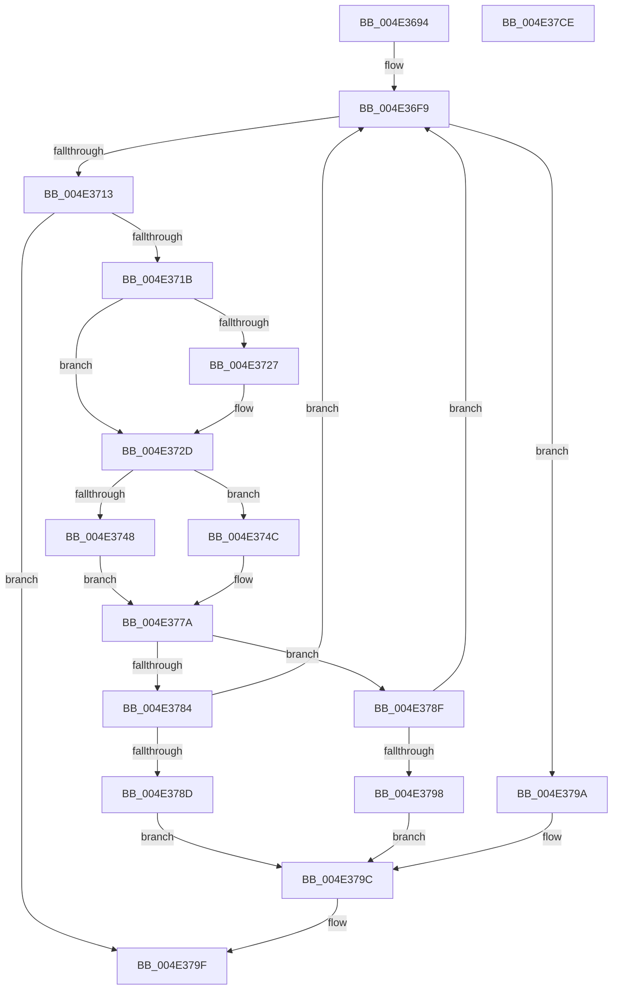

# AuthzBasepDeviceMemberOf

- RVA: `0x004E3694`–`0x004E37CF` (길이 `315` bytes)
- VA: `0x00000001404E3694`
- 실행 섹션: `.text`
- PDB 이름 있음: `예`; PDB Function 태그: `아니요`
- unwind 정보 RVA: `0x000BF474`
- 디코드: `82`개 명령, `315/315` bytes 표시
- 미해석 바이트: `0` (있으면 어셈블리에 `.byte`로 보존)

> 이 문서는 커널 이미지의 기계어와 PDB 기호를 분석해 생성했습니다. 4번과 5번은 함수 원형과 자료형을 바이너리 사용 방식에서 추정한 C 해석이며 원본 소스 복구 결과는 아닙니다.

## 1. Dependencies

- 직접 호출 지점: **4**; 고유 호출 대상: **4**
- 직접 호출자로 확인된 함수: **1**
- RIP 상대 이미지 참조: **1**

### Outgoing calls
- `0x004E3701` → [AuthzBasepGetNextValue](../30/AuthzBasepGetNextValue_function_003007E0.md) (function, `0x003007E0`)
- `0x004E3737` → [memcpy](../6C/memcpy_function_006C6840.md) (function, `0x006C6840`)
- `0x004E3775` → [SepSidInTokenSidHash](../3C/SepSidInTokenSidHash_function_003C85E0.md) (function, `0x003C85E0`)
- `0x004E37AC` → [_security_check_cookie](../6A/_security_check_cookie_function_006AC640.md) (function, `0x006AC640`)

### Direct callers
- [AuthzBasepEvaluateAceCondition](../2F/AuthzBasepEvaluateAceCondition_function_002FEBD0.md) at `0x002FFACA`

### Static image references
- `0x004E36AE` → RVA `0x00E0A740` (`.data`; read)

## 2. Other-region calls and transfers

- 다른 실행 섹션으로 향하는 call: **0**
- 별도 외부 분기/꼬리 이동을 확인하지 못했습니다.

## 3. Assembly (complete function range)

```asm
004E3694  48 89 5C 24 18                  mov qword ptr [rsp + 0x18], rbx
004E3699  48 89 74 24 20                  mov qword ptr [rsp + 0x20], rsi
004E369E  57                              push rdi
004E369F  41 54                           push r12
004E36A1  41 55                           push r13
004E36A3  41 56                           push r14
004E36A5  41 57                           push r15
004E36A7  48 81 EC C0 00 00 00            sub rsp, 0xc0
004E36AE  48 8B 05 8B 70 92 00            mov rax, qword ptr [rip + 0x92708b]
004E36B5  48 33 C4                        xor rax, rsp
004E36B8  48 89 84 24 B0 00 00 00         mov qword ptr [rsp + 0xb0], rax
004E36C0  48 8B B4 24 18 01 00 00         mov rsi, qword ptr [rsp + 0x118]
004E36C8  33 C0                           xor eax, eax
004E36CA  38 84 24 10 01 00 00            cmp byte ptr [rsp + 0x110], al
004E36D1  0F 57 C0                        xorps xmm0, xmm0
004E36D4  45 8A F9                        mov r15b, r9b
004E36D7  89 44 24 50                     mov dword ptr [rsp + 0x50], eax
004E36DB  40 0F 95 C7                     setne dil
004E36DF  66 89 44 24 54                  mov word ptr [rsp + 0x54], ax
004E36E4  88 06                           mov byte ptr [rsi], al
004E36E6  45 8A E0                        mov r12b, r8b
004E36E9  4C 8B EA                        mov r13, rdx
004E36EC  4C 8B F1                        mov r14, rcx
004E36EF  0F 11 44 24 30                  movups xmmword ptr [rsp + 0x30], xmm0
004E36F4  0F 11 44 24 40                  movups xmmword ptr [rsp + 0x40], xmm0
004E36F9  48 8D 54 24 30                  lea rdx, [rsp + 0x30]
004E36FE  49 8B CE                        mov rcx, r14
004E3701  E8 DA D0 E1 FF                  call 0x1403007e0
004E3706  8B D8                           mov ebx, eax
004E3708  3D 1A 00 00 80                  cmp eax, 0x8000001a
004E370D  0F 84 87 00 00 00               je 0x1404e379a
004E3713  85 C0                           test eax, eax
004E3715  0F 88 84 00 00 00               js 0x1404e379f
004E371B  83 7C 24 48 44                  cmp dword ptr [rsp + 0x48], 0x44
004E3720  44 8B 44 24 48                  mov r8d, dword ptr [rsp + 0x48]
004E3725  72 06                           jb 0x1404e372d
004E3727  41 B8 44 00 00 00               mov r8d, 0x44
004E372D  48 8B 54 24 50                  mov rdx, qword ptr [rsp + 0x50]
004E3732  48 8D 4C 24 60                  lea rcx, [rsp + 0x60]
004E3737  E8 04 31 1E 00                  call 0x1406c6840
004E373C  49 8B 95 48 04 00 00            mov rdx, qword ptr [r13 + 0x448]
004E3743  48 85 D2                        test rdx, rdx
004E3746  75 04                           jne 0x1404e374c
004E3748  32 C0                           xor al, al
004E374A  EB 2E                           jmp 0x1404e377a
004E374C  41 8A C7                        mov al, r15b
004E374F  C6 44 24 28 00                  mov byte ptr [rsp + 0x28], 0
004E3754  F6 D8                           neg al
004E3756  44 88 7C 24 20                  mov byte ptr [rsp + 0x20], r15b
004E375B  45 8A CC                        mov r9b, r12b
004E375E  4C 8D 44 24 60                  lea r8, [rsp + 0x60]
004E3763  48 1B C9                        sbb rcx, rcx
004E3766  48 83 C2 20                     add rdx, 0x20
004E376A  81 E1 10 01 00 00               and ecx, 0x110
004E3770  48 03 CA                        add rcx, rdx
004E3773  33 D2                           xor edx, edx
004E3775  E8 66 4E EE FF                  call 0x1403c85e0
004E377A  80 BC 24 10 01 00 00 00         cmp byte ptr [rsp + 0x110], 0
004E3782  74 0B                           je 0x1404e378f
004E3784  40 22 F8                        and dil, al
004E3787  0F 85 6C FF FF FF               jne 0x1404e36f9
004E378D  EB 0D                           jmp 0x1404e379c
004E378F  40 0A F8                        or dil, al
004E3792  0F 84 61 FF FF FF               je 0x1404e36f9
004E3798  EB 02                           jmp 0x1404e379c
004E379A  33 DB                           xor ebx, ebx
004E379C  40 88 3E                        mov byte ptr [rsi], dil
004E379F  8B C3                           mov eax, ebx
004E37A1  48 8B 8C 24 B0 00 00 00         mov rcx, qword ptr [rsp + 0xb0]
004E37A9  48 33 CC                        xor rcx, rsp
004E37AC  E8 8F 8E 1C 00                  call 0x1406ac640
004E37B1  4C 8D 9C 24 C0 00 00 00         lea r11, [rsp + 0xc0]
004E37B9  49 8B 5B 40                     mov rbx, qword ptr [r11 + 0x40]
004E37BD  49 8B 73 48                     mov rsi, qword ptr [r11 + 0x48]
004E37C1  49 8B E3                        mov rsp, r11
004E37C4  41 5F                           pop r15
004E37C6  41 5E                           pop r14
004E37C8  41 5D                           pop r13
004E37CA  41 5C                           pop r12
004E37CC  5F                              pop rdi
004E37CD  C3                              ret
004E37CE  CC                              int3
```

## 4. C-style interpretation (structured pseudocode)

```c
__int64 __fastcall AuthzBasepDeviceMemberOf(__int64 a1, __int64 a2, unsigned __int8 a3, unsigned __int8 a4, unsigned __int8 a5, __int64 a6)
{
    __int64 result;
    __int64 v_rbx;
    __int64 v_rdi;
    __int64 v_rsp;
    unsigned __int64 v_stack_m28;
    unsigned __int64 v_stack_m38;
    unsigned __int64 v_stack_m88;
    unsigned __int16 v_stack_m94;
    unsigned int v_stack_m98;
    unsigned int v_stack_mA0;
    unsigned __int64 v_stack_mA8;
    unsigned __int64 v_stack_mB8;
    unsigned __int8 v_stack_mC0;
    unsigned __int8 v_stack_mC8;
    unsigned __int64 v_stack_p18;
    unsigned __int64 v_stack_p20;

    v_stack_p18 = v_rbx;
    v_stack_p20 = v_rsi;
    v_rsp = (v_rsp) - (192);
    result = (*(unsigned __int64 *)(v_rip + 9597067)) ^ (v_rsp);
    v_stack_m38 = result;
    result = 0;
    v_stack_m98 = 0;
    v_rdi = (a5 != 0) ? 1 : 0;
    v_stack_m94 = 0;
    *(unsigned __int8 *)(a6) = 0;
    v_stack_mB8 = v_xmm0;
    v_stack_mA8 = v_xmm0;
loc_004E36F9:
    result = AuthzBasepGetNextValue(a1, v_stack_mB8, a3, a4);
    if (((unsigned int)(result)) == 0x8000001AULL) goto loc_004E379A;
    if (sign_flag) goto loc_004E379F;
    if (v_stack_mA0 >= 68) {
        a3 = 68;
    }
    result = memcpy(v_stack_m88, v_stack_m98, a3, a4);
    if (*(unsigned __int64 *)(a2 + 1096) != 0) goto loc_004E374C;
    result = 0;
    goto loc_004E377A;
loc_004E374C:
    v_stack_mC0 = 0;
    result = (unsigned __int8)(-(a4));
    v_stack_mC8 = a4;
    a2 = (*(unsigned __int64 *)(a2 + 1096)) + (32);
    a1 = (unsigned int)((v_stack_m88) & (272));
    a1 = (a1) + (a2);
    a2 = 0;
    result = SepSidInTokenSidHash(a1, a2, v_stack_m88, a3);
loc_004E377A:
    if (a5 == 0) goto loc_004E378F;
    v_rdi = (unsigned __int8)((v_rdi) & ((unsigned __int8)(result)));
    if (condition_is_not_equal) goto loc_004E36F9;
    goto loc_004E379C;
loc_004E378F:
    v_rdi = (unsigned __int8)((v_rdi) | ((unsigned __int8)(result)));
    if (condition_is_equal) goto loc_004E36F9;
    goto loc_004E379C;
loc_004E379A:
    v_rbx = 0;
loc_004E379C:
    *(unsigned __int8 *)(a6) = (unsigned __int8)(v_rdi);
loc_004E379F:
    a1 = (v_stack_m38) ^ (v_rsp);
    result = _security_check_cookie(a1, a2, v_stack_m88, a3);
    return result;
}
```

## 5. (Beta) C Style

```c
int64_t AuthzBasepDeviceMemberOf(int64_t Arg1, void *Arg2, uint8_t Arg3, uint8_t Arg4, uint8_t Arg5, void *Arg6)
{
    uint8_t *arg2 = (uint8_t *)Arg2;
    uint8_t *arg6 = (uint8_t *)Arg6;

    int64_t result;
    int64_t local_rbx;
    int64_t local_rdi;
    int64_t local_rsp;
    uint64_t v_stack_m28;
    uint64_t v_stack_m38;
    uint64_t v_stack_m88;
    uint16_t v_stack_m94;
    uint32_t v_stack_m98;
    uint32_t v_stack_mA0;
    uint64_t v_stack_mA8;
    uint64_t v_stack_mB8;
    uint8_t v_stack_mC0;
    uint8_t v_stack_mC8;
    uint64_t v_stack_p18;
    uint64_t v_stack_p20;

    v_stack_p18 = local_rbx;
    v_stack_p20 = local_rsi;
    local_rsp = (local_rsp) - (192);
    result = (*(uint64_t *)(v_rip + 0x92708B)) ^ (local_rsp);
    v_stack_m38 = result;
    result = 0;
    v_stack_m98 = 0;
    local_rdi = (Arg5 != 0) ? 1 : 0;
    v_stack_m94 = 0;
    *(uint8_t *)(arg6) = 0;
    v_stack_mB8 = v_xmm0;
    v_stack_mA8 = v_xmm0;
loc_004E36F9:
    result = AuthzBasepGetNextValue(Arg1, v_stack_mB8, Arg3, Arg4);
    if (((uint32_t)(result)) == 0x8000001AULL) goto loc_004E379A;
    if (sign_flag) goto loc_004E379F;
    if (v_stack_mA0 >= 68) {
        Arg3 = 68;
    }
    result = memcpy(v_stack_m88, v_stack_m98, Arg3, Arg4);
    if (*(uint64_t *)(arg2 + 0x448) != 0) goto loc_004E374C;
    result = 0;
    goto loc_004E377A;
loc_004E374C:
    v_stack_mC0 = 0;
    result = (uint8_t)(-(Arg4));
    v_stack_mC8 = Arg4;
    Arg2 = (*(uint64_t *)(arg2 + 0x448)) + (32);
    Arg1 = (uint32_t)((v_stack_m88) & (272));
    Arg1 = (Arg1) + (Arg2);
    Arg2 = 0;
    result = SepSidInTokenSidHash(Arg1, Arg2, v_stack_m88, Arg3);
loc_004E377A:
    if (Arg5 == 0) goto loc_004E378F;
    local_rdi = (uint8_t)((local_rdi) & ((uint8_t)(result)));
    if (condition_is_not_equal) goto loc_004E36F9;
    goto loc_004E379C;
loc_004E378F:
    local_rdi = (uint8_t)((local_rdi) | ((uint8_t)(result)));
    if (condition_is_equal) goto loc_004E36F9;
    goto loc_004E379C;
loc_004E379A:
    local_rbx = 0;
loc_004E379C:
    *(uint8_t *)(arg6) = (uint8_t)(local_rdi);
loc_004E379F:
    Arg1 = (v_stack_m38) ^ (local_rsp);
    result = _security_check_cookie(Arg1, Arg2, v_stack_m88, Arg3);
    return result;
}
```

### 관측된 메모리 오프셋

구조체 형식이 확인되지 않은 접근은 인자 기준의 오프셋으로만 기록했습니다.

| 기준 인자 | 오프셋 표현 | 폭 (bit) | 접근 |
|---|---:|---:|---|
| `Arg2` | `+ 0x448` | `64` | `R` |
| `Arg6` | `+ 0x0` | `8` | `W` |

## 6. Execution-region graph

[열기: 2D/3D 그래프와 함수 탐색 컨트롤 패널](../../../control-panel.html?section=text&rva=0x004E3694&view=graph)

- 2D 그래프는 위에서 아래로 흐르고, 3D 그래프는 빈 공간을 드래그해 회전합니다. Shift+드래그는 이동, 휠은 확대·축소, 함수 노드 선택은 대상 보고서 이동입니다.

### Static fallback


