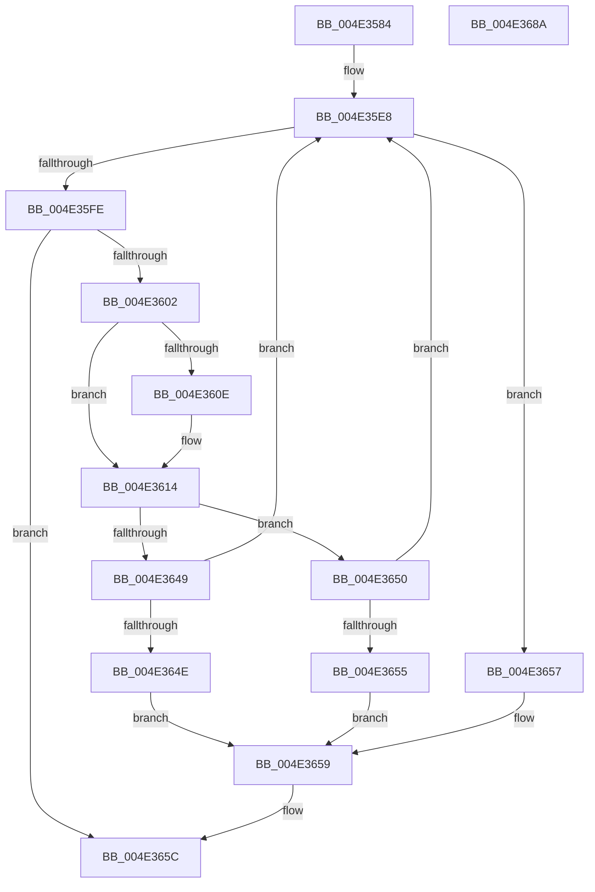

# AuthzBasepMemberOf

- RVA: `0x004E3584`–`0x004E368B` (길이 `263` bytes)
- VA: `0x00000001404E3584`
- 실행 섹션: `.text`
- PDB 이름 있음: `예`; PDB Function 태그: `아니요`
- unwind 정보 RVA: `0x000BF44C`
- 디코드: `72`개 명령, `263/263` bytes 표시
- 미해석 바이트: `0` (있으면 어셈블리에 `.byte`로 보존)

> 이 문서는 커널 이미지의 기계어와 PDB 기호를 분석해 생성했습니다. 4번과 5번은 함수 원형과 자료형을 바이너리 사용 방식에서 추정한 C 해석이며 원본 소스 복구 결과는 아닙니다.

## 1. Dependencies

- 직접 호출 지점: **4**; 고유 호출 대상: **4**
- 직접 호출자로 확인된 함수: **1**
- RIP 상대 이미지 참조: **1**

### Outgoing calls
- `0x004E35F0` → [AuthzBasepGetNextValue](../30/AuthzBasepGetNextValue_function_003007E0.md) (function, `0x003007E0`)
- `0x004E361E` → [memcpy](../6C/memcpy_function_006C6840.md) (function, `0x006C6840`)
- `0x004E363A` → [SepSidInToken](../3D/SepSidInToken_function_003D0430.md) (function, `0x003D0430`)
- `0x004E3669` → [_security_check_cookie](../6A/_security_check_cookie_function_006AC640.md) (function, `0x006AC640`)

### Direct callers
- [AuthzBasepEvaluateAceCondition](../2F/AuthzBasepEvaluateAceCondition_function_002FEBD0.md) at `0x002FFA65`

### Static image references
- `0x004E359D` → RVA `0x00E0A740` (`.data`; read)

## 2. Other-region calls and transfers

- 다른 실행 섹션으로 향하는 call: **0**
- 별도 외부 분기/꼬리 이동을 확인하지 못했습니다.

## 3. Assembly (complete function range)

```asm
004E3584  48 89 5C 24 18                  mov qword ptr [rsp + 0x18], rbx
004E3589  48 89 6C 24 20                  mov qword ptr [rsp + 0x20], rbp
004E358E  56                              push rsi
004E358F  57                              push rdi
004E3590  41 54                           push r12
004E3592  41 55                           push r13
004E3594  41 57                           push r15
004E3596  48 81 EC C0 00 00 00            sub rsp, 0xc0
004E359D  48 8B 05 9C 71 92 00            mov rax, qword ptr [rip + 0x92719c]
004E35A4  48 33 C4                        xor rax, rsp
004E35A7  48 89 84 24 B0 00 00 00         mov qword ptr [rsp + 0xb0], rax
004E35AF  48 8B B4 24 18 01 00 00         mov rsi, qword ptr [rsp + 0x118]
004E35B7  33 C0                           xor eax, eax
004E35B9  38 84 24 10 01 00 00            cmp byte ptr [rsp + 0x110], al
004E35C0  0F 57 C0                        xorps xmm0, xmm0
004E35C3  45 8A F9                        mov r15b, r9b
004E35C6  89 44 24 50                     mov dword ptr [rsp + 0x50], eax
004E35CA  40 0F 95 C7                     setne dil
004E35CE  66 89 44 24 54                  mov word ptr [rsp + 0x54], ax
004E35D3  88 06                           mov byte ptr [rsi], al
004E35D5  45 8A E0                        mov r12b, r8b
004E35D8  4C 8B EA                        mov r13, rdx
004E35DB  48 8B E9                        mov rbp, rcx
004E35DE  0F 11 44 24 30                  movups xmmword ptr [rsp + 0x30], xmm0
004E35E3  0F 11 44 24 40                  movups xmmword ptr [rsp + 0x40], xmm0
004E35E8  48 8D 54 24 30                  lea rdx, [rsp + 0x30]
004E35ED  48 8B CD                        mov rcx, rbp
004E35F0  E8 EB D1 E1 FF                  call 0x1403007e0
004E35F5  8B D8                           mov ebx, eax
004E35F7  3D 1A 00 00 80                  cmp eax, 0x8000001a
004E35FC  74 59                           je 0x1404e3657
004E35FE  85 C0                           test eax, eax
004E3600  78 5A                           js 0x1404e365c
004E3602  83 7C 24 48 44                  cmp dword ptr [rsp + 0x48], 0x44
004E3607  44 8B 44 24 48                  mov r8d, dword ptr [rsp + 0x48]
004E360C  72 06                           jb 0x1404e3614
004E360E  41 B8 44 00 00 00               mov r8d, 0x44
004E3614  48 8B 54 24 50                  mov rdx, qword ptr [rsp + 0x50]
004E3619  48 8D 4C 24 60                  lea rcx, [rsp + 0x60]
004E361E  E8 1D 32 1E 00                  call 0x1406c6840
004E3623  45 8A CC                        mov r9b, r12b
004E3626  C6 44 24 28 00                  mov byte ptr [rsp + 0x28], 0
004E362B  4C 8D 44 24 60                  lea r8, [rsp + 0x60]
004E3630  44 88 7C 24 20                  mov byte ptr [rsp + 0x20], r15b
004E3635  33 D2                           xor edx, edx
004E3637  49 8B CD                        mov rcx, r13
004E363A  E8 F1 CD EE FF                  call 0x1403d0430
004E363F  80 BC 24 10 01 00 00 00         cmp byte ptr [rsp + 0x110], 0
004E3647  74 07                           je 0x1404e3650
004E3649  40 22 F8                        and dil, al
004E364C  75 9A                           jne 0x1404e35e8
004E364E  EB 09                           jmp 0x1404e3659
004E3650  40 0A F8                        or dil, al
004E3653  74 93                           je 0x1404e35e8
004E3655  EB 02                           jmp 0x1404e3659
004E3657  33 DB                           xor ebx, ebx
004E3659  40 88 3E                        mov byte ptr [rsi], dil
004E365C  8B C3                           mov eax, ebx
004E365E  48 8B 8C 24 B0 00 00 00         mov rcx, qword ptr [rsp + 0xb0]
004E3666  48 33 CC                        xor rcx, rsp
004E3669  E8 D2 8F 1C 00                  call 0x1406ac640
004E366E  4C 8D 9C 24 C0 00 00 00         lea r11, [rsp + 0xc0]
004E3676  49 8B 5B 40                     mov rbx, qword ptr [r11 + 0x40]
004E367A  49 8B 6B 48                     mov rbp, qword ptr [r11 + 0x48]
004E367E  49 8B E3                        mov rsp, r11
004E3681  41 5F                           pop r15
004E3683  41 5D                           pop r13
004E3685  41 5C                           pop r12
004E3687  5F                              pop rdi
004E3688  5E                              pop rsi
004E3689  C3                              ret
004E368A  CC                              int3
```

## 4. C-style interpretation (structured pseudocode)

```c
__int64 __fastcall AuthzBasepMemberOf(__int64 a1, __int64 a2, unsigned __int8 a3, unsigned __int8 a4, unsigned __int8 a5, __int64 a6)
{
    __int64 result;
    __int64 v_rbx;
    __int64 v_rdi;
    __int64 v_rsp;
    unsigned __int64 v_stack_m28;
    unsigned __int64 v_stack_m38;
    unsigned __int64 v_stack_m88;
    unsigned __int16 v_stack_m94;
    unsigned int v_stack_m98;
    unsigned int v_stack_mA0;
    unsigned __int64 v_stack_mA8;
    unsigned __int64 v_stack_mB8;
    unsigned __int8 v_stack_mC0;
    unsigned __int8 v_stack_mC8;
    unsigned __int64 v_stack_p18;
    unsigned __int64 v_stack_p20;

    v_stack_p18 = v_rbx;
    v_stack_p20 = v_rbp;
    v_rsp = (v_rsp) - (192);
    result = (*(unsigned __int64 *)(v_rip + 9597340)) ^ (v_rsp);
    v_stack_m38 = result;
    result = 0;
    v_stack_m98 = 0;
    v_rdi = (a5 != 0) ? 1 : 0;
    v_stack_m94 = 0;
    *(unsigned __int8 *)(a6) = 0;
    v_stack_mB8 = v_xmm0;
    v_stack_mA8 = v_xmm0;
loc_004E35E8:
    result = AuthzBasepGetNextValue(a1, v_stack_mB8, a3, a4);
    if (((unsigned int)(result)) == 0x8000001AULL) goto loc_004E3657;
    if (sign_flag) goto loc_004E365C;
    if (v_stack_mA0 >= 68) {
        a3 = 68;
    }
    result = memcpy(v_stack_m88, v_stack_m98, a3, a4);
    v_stack_mC0 = 0;
    v_stack_mC8 = a4;
    a2 = 0;
    result = SepSidInToken(0, a2, v_stack_m88, a3);
    if (a5 == 0) goto loc_004E3650;
    v_rdi = (unsigned __int8)((v_rdi) & ((unsigned __int8)(result)));
    if (condition_is_not_equal) goto loc_004E35E8;
    goto loc_004E3659;
loc_004E3650:
    v_rdi = (unsigned __int8)((v_rdi) | ((unsigned __int8)(result)));
    if (condition_is_equal) goto loc_004E35E8;
    goto loc_004E3659;
loc_004E3657:
    v_rbx = 0;
loc_004E3659:
    *(unsigned __int8 *)(a6) = (unsigned __int8)(v_rdi);
loc_004E365C:
    a1 = (v_stack_m38) ^ (v_rsp);
    result = _security_check_cookie(a1, a2, v_stack_m88, a3);
    return result;
}
```

## 5. (Beta) C Style

```c
int64_t AuthzBasepMemberOf(int64_t Arg1, int64_t Arg2, uint8_t Arg3, uint8_t Arg4, uint8_t Arg5, void *Arg6)
{
    uint8_t *arg6 = (uint8_t *)Arg6;

    int64_t result;
    int64_t local_rbx;
    int64_t local_rdi;
    int64_t local_rsp;
    uint64_t v_stack_m28;
    uint64_t v_stack_m38;
    uint64_t v_stack_m88;
    uint16_t v_stack_m94;
    uint32_t v_stack_m98;
    uint32_t v_stack_mA0;
    uint64_t v_stack_mA8;
    uint64_t v_stack_mB8;
    uint8_t v_stack_mC0;
    uint8_t v_stack_mC8;
    uint64_t v_stack_p18;
    uint64_t v_stack_p20;

    v_stack_p18 = local_rbx;
    v_stack_p20 = local_rbp;
    local_rsp = (local_rsp) - (192);
    result = (*(uint64_t *)(v_rip + 0x92719C)) ^ (local_rsp);
    v_stack_m38 = result;
    result = 0;
    v_stack_m98 = 0;
    local_rdi = (Arg5 != 0) ? 1 : 0;
    v_stack_m94 = 0;
    *(uint8_t *)(arg6) = 0;
    v_stack_mB8 = v_xmm0;
    v_stack_mA8 = v_xmm0;
loc_004E35E8:
    result = AuthzBasepGetNextValue(Arg1, v_stack_mB8, Arg3, Arg4);
    if (((uint32_t)(result)) == 0x8000001AULL) goto loc_004E3657;
    if (sign_flag) goto loc_004E365C;
    if (v_stack_mA0 >= 68) {
        Arg3 = 68;
    }
    result = memcpy(v_stack_m88, v_stack_m98, Arg3, Arg4);
    v_stack_mC0 = 0;
    v_stack_mC8 = Arg4;
    Arg2 = 0;
    result = SepSidInToken(0, Arg2, v_stack_m88, Arg3);
    if (Arg5 == 0) goto loc_004E3650;
    local_rdi = (uint8_t)((local_rdi) & ((uint8_t)(result)));
    if (condition_is_not_equal) goto loc_004E35E8;
    goto loc_004E3659;
loc_004E3650:
    local_rdi = (uint8_t)((local_rdi) | ((uint8_t)(result)));
    if (condition_is_equal) goto loc_004E35E8;
    goto loc_004E3659;
loc_004E3657:
    local_rbx = 0;
loc_004E3659:
    *(uint8_t *)(arg6) = (uint8_t)(local_rdi);
loc_004E365C:
    Arg1 = (v_stack_m38) ^ (local_rsp);
    result = _security_check_cookie(Arg1, Arg2, v_stack_m88, Arg3);
    return result;
}
```

### 관측된 메모리 오프셋

구조체 형식이 확인되지 않은 접근은 인자 기준의 오프셋으로만 기록했습니다.

| 기준 인자 | 오프셋 표현 | 폭 (bit) | 접근 |
|---|---:|---:|---|
| `Arg6` | `+ 0x0` | `8` | `W` |

## 6. Execution-region graph

[열기: 2D/3D 그래프와 함수 탐색 컨트롤 패널](../../../control-panel.html?section=text&rva=0x004E3584&view=graph)

- 2D 그래프는 위에서 아래로 흐르고, 3D 그래프는 빈 공간을 드래그해 회전합니다. Shift+드래그는 이동, 휠은 확대·축소, 함수 노드 선택은 대상 보고서 이동입니다.

### Static fallback


