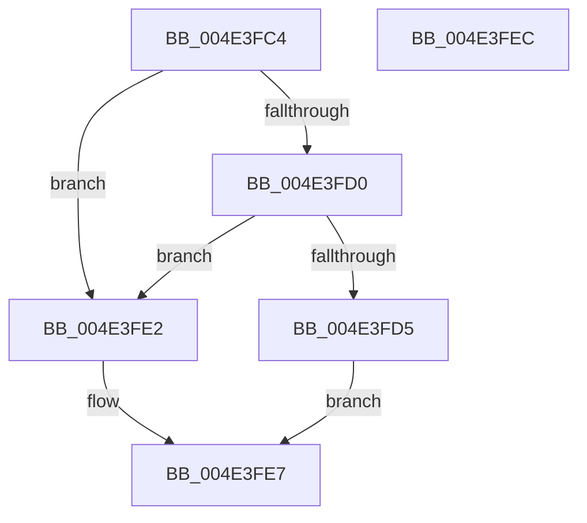

# BgpFoGetTextMetrics

- RVA: `0x004E3FC4`–`0x004E3FED` (길이 `41` bytes)
- VA: `0x00000001404E3FC4`
- 실행 섹션: `.text`
- PDB 이름 있음: `예`; PDB Function 태그: `아니요`
- unwind 정보 RVA: `0x0005C788`
- 디코드: `14`개 명령, `41/41` bytes 표시
- 미해석 바이트: `0` (있으면 어셈블리에 `.byte`로 보존)

> 이 문서는 커널 이미지의 기계어와 PDB 기호를 분석해 생성했습니다. 4번과 5번은 함수 원형과 자료형을 바이너리 사용 방식에서 추정한 C 해석이며 원본 소스 복구 결과는 아닙니다.

## 1. Dependencies

- 직접 호출 지점: **1**; 고유 호출 대상: **1**
- 직접 호출자로 확인된 함수: **4**
- RIP 상대 이미지 참조: **0**

### Outgoing calls
- `0x004E3FD9` → [BgpRasGetGlyphTextCellDimensions](../6A/BgpRasGetGlyphTextCellDimensions_function_006A18D8.md) (function, `0x006A18D8`)

### Direct callers
- [BgpConsoleSetPointSize](../69/BgpConsoleSetPointSize_function_0069ECB0.md) at `0x0069ED06`
- [BgpConsoleSetPointSize](../69/BgpConsoleSetPointSize_function_0069ECB0.md) at `0x0069ED60`
- [BgpTxtCreateRegion](../../pagebgfx/BC/BgpTxtCreateRegion_function_00BC2908.md) at `0x00BC2A2C`
- [BgpTxtDisplayString](../../pagebgfx/BC/BgpTxtDisplayString_function_00BC2BB0.md) at `0x00BC2C7A`
- [BgpFoDetermineFontInformation](../../init/C8/BgpFoDetermineFontInformation_function_00C805DC.md) at `0x00C80644`
- [BgpFoDetermineFontInformation](../../init/C8/BgpFoDetermineFontInformation_function_00C805DC.md) at `0x00C80670`

### Static image references
- 디코드된 RIP-relative 메모리 참조가 없습니다.

## 2. Other-region calls and transfers

- 다른 실행 섹션으로 향하는 call: **0**
- 별도 외부 분기/꼬리 이동을 확인하지 못했습니다.

## 3. Assembly (complete function range)

```asm
004E3FC4  48 83 EC 28                     sub rsp, 0x28
004E3FC8  4C 8B C2                        mov r8, rdx
004E3FCB  48 85 C9                        test rcx, rcx
004E3FCE  74 12                           je 0x1404e3fe2
004E3FD0  48 85 D2                        test rdx, rdx
004E3FD3  74 0D                           je 0x1404e3fe2
004E3FD5  48 83 C2 04                     add rdx, 4
004E3FD9  E8 FA D8 1B 00                  call 0x1406a18d8
004E3FDE  33 C0                           xor eax, eax
004E3FE0  EB 05                           jmp 0x1404e3fe7
004E3FE2  B8 0D 00 00 C0                  mov eax, 0xc000000d
004E3FE7  48 83 C4 28                     add rsp, 0x28
004E3FEB  C3                              ret
004E3FEC  CC                              int3
```

## 4. C-style interpretation (structured pseudocode)

```c
__int64 __fastcall BgpFoGetTextMetrics(__int64 a1, __int64 a2)
{
    __int64 result;
    __int64 v_rsp;

    v_rsp = (v_rsp) - (40);
    if (a1 == 0) goto loc_004E3FE2;
    if (a2 == 0) goto loc_004E3FE2;
    a2 = (a2) + (4);
    result = BgpRasGetGlyphTextCellDimensions(a1, a2, a2, a4);
    result = 0;
    goto loc_004E3FE7;
loc_004E3FE2:
loc_004E3FE7:
    v_rsp = (v_rsp) + (40);
    return (unsigned int)(0xC000000DULL);
}
```

## 5. (Beta) C Style

```c
int64_t BgpFoGetTextMetrics(int64_t Arg1, int64_t Arg2)
{
    int64_t result;
    int64_t local_rsp;

    local_rsp = (local_rsp) - (40);
    if (Arg1 == 0) goto loc_004E3FE2;
    if (Arg2 == 0) goto loc_004E3FE2;
    Arg2 = (Arg2) + (4);
    result = BgpRasGetGlyphTextCellDimensions(Arg1, Arg2, Arg2, a4);
    result = 0;
    goto loc_004E3FE7;
loc_004E3FE2:
loc_004E3FE7:
    local_rsp = (local_rsp) + (40);
    return (uint32_t)(0xC000000DULL);
}
```

## 6. Execution-region graph

[열기: 2D/3D 그래프와 함수 탐색 컨트롤 패널](../../../control-panel.html?section=text&rva=0x004E3FC4&view=graph)

- 2D 그래프는 위에서 아래로 흐르고, 3D 그래프는 빈 공간을 드래그해 회전합니다. Shift+드래그는 이동, 휠은 확대·축소, 함수 노드 선택은 대상 보고서 이동입니다.

### Static fallback


