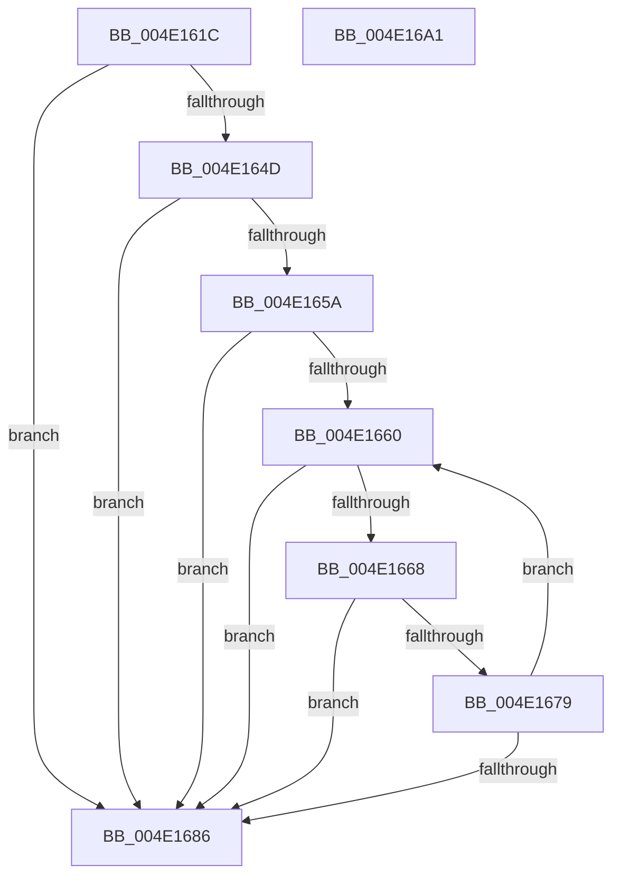

# CcBuildUpHighPriorityMappings

- RVA: `0x004E161C`–`0x004E16A2` (길이 `134` bytes)
- VA: `0x00000001404E161C`
- 실행 섹션: `.text`
- PDB 이름 있음: `예`; PDB Function 태그: `아니요`
- unwind 정보 RVA: `0x0005E6B4`
- 디코드: `41`개 명령, `134/134` bytes 표시
- 미해석 바이트: `0` (있으면 어셈블리에 `.byte`로 보존)

> 이 문서는 커널 이미지의 기계어와 PDB 기호를 분석해 생성했습니다. 4번과 5번은 함수 원형과 자료형을 바이너리 사용 방식에서 추정한 C 해석이며 원본 소스 복구 결과는 아닙니다.

## 1. Dependencies

- 직접 호출 지점: **1**; 고유 호출 대상: **1**
- 직접 호출자로 확인된 함수: **1**
- RIP 상대 이미지 참조: **1**

### Outgoing calls
- `0x004E166C` → [MmReserveViewInSystemCache](../../page/7F/MmReserveViewInSystemCache_function_007FE368.md) (function, `0x007FE368`)

### Direct callers
- [CcGetVirtualAddress](../34/CcGetVirtualAddress_function_00340C9C.md) at `0x00340D38`

### Static image references
- `0x004E163F` → RVA `0x00F8F498` (`.data`; read)

## 2. Other-region calls and transfers

- 다른 실행 섹션으로 향하는 call: **1**
  - `0x004E166C` → [MmReserveViewInSystemCache](../../page/7F/MmReserveViewInSystemCache_function_007FE368.md) (`.text` → `PAGE`)
- 별도 외부 분기/꼬리 이동을 확인하지 못했습니다.

## 3. Assembly (complete function range)

```asm
004E161C  48 8B C4                        mov rax, rsp
004E161F  48 89 58 08                     mov qword ptr [rax + 8], rbx
004E1623  48 89 68 10                     mov qword ptr [rax + 0x10], rbp
004E1627  48 89 70 18                     mov qword ptr [rax + 0x18], rsi
004E162B  48 89 78 20                     mov qword ptr [rax + 0x20], rdi
004E162F  41 56                           push r14
004E1631  48 83 EC 20                     sub rsp, 0x20
004E1635  44 8B 81 E0 04 00 00            mov r8d, dword ptr [rcx + 0x4e0]
004E163C  48 8B F2                        mov rsi, rdx
004E163F  8B 05 53 DE AA 00               mov eax, dword ptr [rip + 0xaade53]
004E1645  48 8B E9                        mov rbp, rcx
004E1648  44 3B C0                        cmp r8d, eax
004E164B  73 39                           jae 0x1404e1686
004E164D  8B D8                           mov ebx, eax
004E164F  4C 8D 72 10                     lea r14, [rdx + 0x10]
004E1653  41 2B D8                        sub ebx, r8d
004E1656  3B D8                           cmp ebx, eax
004E1658  77 2C                           ja 0x1404e1686
004E165A  33 FF                           xor edi, edi
004E165C  85 DB                           test ebx, ebx
004E165E  74 26                           je 0x1404e1686
004E1660  81 FF CC 0C 00 00               cmp edi, 0xccc
004E1666  73 1E                           jae 0x1404e1686
004E1668  48 8B 4D 08                     mov rcx, qword ptr [rbp + 8]
004E166C  E8 F7 CC 31 00                  call 0x1407fe368
004E1671  49 89 06                        mov qword ptr [r14], rax
004E1674  48 85 C0                        test rax, rax
004E1677  74 0D                           je 0x1404e1686
004E1679  FF 46 04                        inc dword ptr [rsi + 4]
004E167C  FF C7                           inc edi
004E167E  49 83 C6 28                     add r14, 0x28
004E1682  3B FB                           cmp edi, ebx
004E1684  72 DA                           jb 0x1404e1660
004E1686  48 8B 5C 24 30                  mov rbx, qword ptr [rsp + 0x30]
004E168B  48 8B 6C 24 38                  mov rbp, qword ptr [rsp + 0x38]
004E1690  48 8B 74 24 40                  mov rsi, qword ptr [rsp + 0x40]
004E1695  48 8B 7C 24 48                  mov rdi, qword ptr [rsp + 0x48]
004E169A  48 83 C4 20                     add rsp, 0x20
004E169E  41 5E                           pop r14
004E16A0  C3                              ret
004E16A1  CC                              int3
```

## 4. C-style interpretation (structured pseudocode)

```c
__int64 __fastcall CcBuildUpHighPriorityMappings(__int64 a1, __int64 a2)
{
    __int64 result;
    __int64 v_r14;
    __int64 v_rbx;
    __int64 v_rdi;
    __int64 v_rsp;
    unsigned __int64 v_stack_p10;
    unsigned __int64 v_stack_p18;
    unsigned __int64 v_stack_p20;
    unsigned __int64 v_stack_p8;

    *(unsigned __int64 *)(v_rsp + 8) = v_rbx;
    *(unsigned __int64 *)(v_rsp + 16) = v_rbp;
    *(unsigned __int64 *)(v_rsp + 24) = v_rsi;
    *(unsigned __int64 *)(v_rsp + 32) = v_rdi;
    v_rsp = (v_rsp) - (32);
    if (((unsigned int)((unsigned int)(*(unsigned int *)(a1 + 1248)))) >= ((unsigned int)((unsigned int)(*(unsigned int *)(v_rip + 11198035))))) goto loc_004E1686;
    v_rbx = (unsigned int)(((unsigned int)((unsigned int)((unsigned int)(*(unsigned int *)(v_rip + 11198035))))) - ((unsigned int)((unsigned int)(*(unsigned int *)(a1 + 1248)))));
    if (((unsigned int)(v_rbx)) > ((unsigned int)((unsigned int)(*(unsigned int *)(v_rip + 11198035))))) goto loc_004E1686;
    v_rdi = 0;
    if ((unsigned int)(v_rbx) == 0) goto loc_004E1686;
loc_004E1660:
    if (0 >= 0xCCCULL) goto loc_004E1686;
    result = MmReserveViewInSystemCache(*(unsigned __int64 *)(a1 + 8), a2, (unsigned int)(*(unsigned int *)(a1 + 1248)), a4);
    *(unsigned __int64 *)(a2 + 16) = result;
    if (result == 0) goto loc_004E1686;
    v_rdi = (unsigned int)((v_rdi) + 1);
    v_r14 = (a2 + 16) + (40);
    if (((unsigned int)(v_rdi)) < ((unsigned int)(v_rbx))) goto loc_004E1660;
loc_004E1686:
    v_rsp = (v_rsp) + (32);
    return result;
}
```

## 5. (Beta) C Style

```c
int64_t CcBuildUpHighPriorityMappings(void *Arg1, void *Arg2)
{
    uint8_t *arg1 = (uint8_t *)Arg1;
    uint8_t *arg2 = (uint8_t *)Arg2;

    int64_t result;
    int64_t local_r14;
    int64_t local_rbx;
    int64_t local_rdi;
    int64_t local_rsp;
    uint64_t v_stack_p10;
    uint64_t v_stack_p18;
    uint64_t v_stack_p20;
    uint64_t v_stack_p8;

    *(uint64_t *)(local_rsp + 0x8) = local_rbx;
    *(uint64_t *)(local_rsp + 0x10) = local_rbp;
    *(uint64_t *)(local_rsp + 0x18) = local_rsi;
    *(uint64_t *)(local_rsp + 0x20) = local_rdi;
    local_rsp = (local_rsp) - (32);
    if (((uint32_t)((uint32_t)(*(uint32_t *)(arg1 + 0x4E0)))) >= ((uint32_t)((uint32_t)(*(uint32_t *)(v_rip + 0xAADE53))))) goto loc_004E1686;
    local_rbx = (uint32_t)(((uint32_t)((uint32_t)((uint32_t)(*(uint32_t *)(v_rip + 0xAADE53))))) - ((uint32_t)((uint32_t)(*(uint32_t *)(arg1 + 0x4E0)))));
    if (((uint32_t)(local_rbx)) > ((uint32_t)((uint32_t)(*(uint32_t *)(v_rip + 0xAADE53))))) goto loc_004E1686;
    local_rdi = 0;
    if ((uint32_t)(local_rbx) == 0) goto loc_004E1686;
loc_004E1660:
    if (0 >= 0xCCCULL) goto loc_004E1686;
    result = MmReserveViewInSystemCache(*(uint64_t *)(arg1 + 0x8), Arg2, (uint32_t)(*(uint32_t *)(arg1 + 0x4E0)), a4);
    *(uint64_t *)(arg2 + 0x10) = result;
    if (result == 0) goto loc_004E1686;
    local_rdi = (uint32_t)((local_rdi) + 1);
    local_r14 = (Arg2 + 16) + (40);
    if (((uint32_t)(local_rdi)) < ((uint32_t)(local_rbx))) goto loc_004E1660;
loc_004E1686:
    local_rsp = (local_rsp) + (32);
    return result;
}
```

### 관측된 메모리 오프셋

구조체 형식이 확인되지 않은 접근은 인자 기준의 오프셋으로만 기록했습니다.

| 기준 인자 | 오프셋 표현 | 폭 (bit) | 접근 |
|---|---:|---:|---|
| `Arg1` | `+ 0x8` | `64` | `R` |
| `Arg1` | `+ 0x4E0` | `32` | `R` |
| `Arg2` | `+ 0x0` | `64` | `W` |
| `Arg2` | `+ 0x4` | `32` | `R/W` |
| `Arg2` | `+ 0x10` | `64` | `R` |

## 6. Execution-region graph

[열기: 2D/3D 그래프와 함수 탐색 컨트롤 패널](../../../control-panel.html?section=text&rva=0x004E161C&view=graph)

- 2D 그래프는 위에서 아래로 흐르고, 3D 그래프는 빈 공간을 드래그해 회전합니다. Shift+드래그는 이동, 휠은 확대·축소, 함수 노드 선택은 대상 보고서 이동입니다.

### Static fallback


