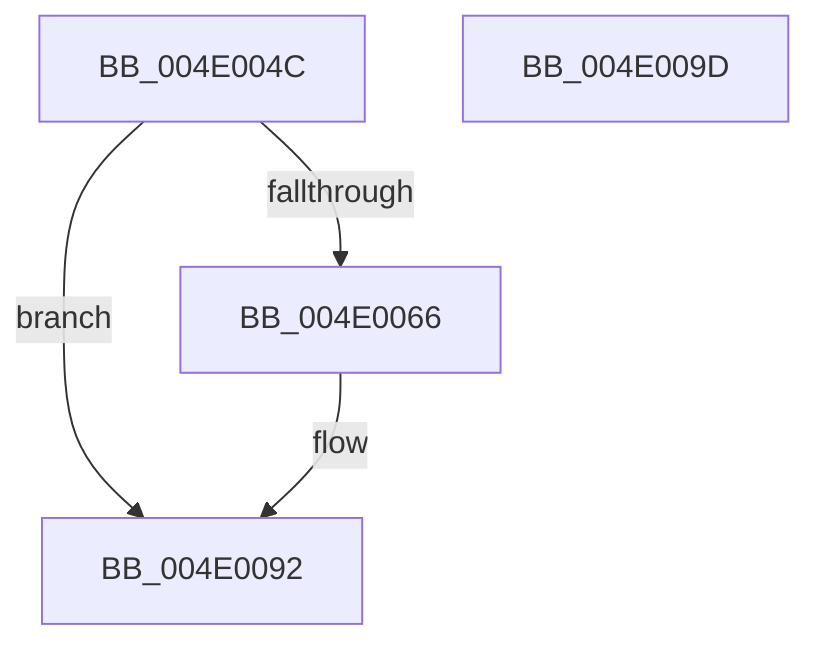

# CcDereferenceFileOffset

- RVA: `0x004E004C`–`0x004E009E` (길이 `82` bytes)
- VA: `0x00000001404E004C`
- 실행 섹션: `.text`
- PDB 이름 있음: `예`; PDB Function 태그: `아니요`
- unwind 정보 RVA: `0x0005CAAC`
- 디코드: `23`개 명령, `82/82` bytes 표시
- 미해석 바이트: `0` (있으면 어셈블리에 `.byte`로 보존)

> 이 문서는 커널 이미지의 기계어와 PDB 기호를 분석해 생성했습니다. 4번과 5번은 함수 원형과 자료형을 바이너리 사용 방식에서 추정한 C 해석이며 원본 소스 복구 결과는 아닙니다.

## 1. Dependencies

- 직접 호출 지점: **3**; 고유 호출 대상: **3**
- 직접 호출자로 확인된 함수: **1**
- RIP 상대 이미지 참조: **0**

### Outgoing calls
- `0x004E006E` → [CcAcquireBcbLockAndVacbLock](../26/CcAcquireBcbLockAndVacbLock_function_0026FC58.md) (function, `0x0026FC58`)
- `0x004E0080` → [SetVacb](../27/SetVacb_function_00273340.md) (function, `0x00273340`)
- `0x004E008D` → [CcReleaseBcbLockAndVacbLock](../2D/CcReleaseBcbLockAndVacbLock_function_002DFDF0.md) (function, `0x002DFDF0`)

### Direct callers
- [CcPinFileData$fin$0](../6D/CcPinFileData_fin_0_function_006D20B0.md) at `0x006D212C`

### Static image references
- 디코드된 RIP-relative 메모리 참조가 없습니다.

## 2. Other-region calls and transfers

- 다른 실행 섹션으로 향하는 call: **0**
- 별도 외부 분기/꼬리 이동을 확인하지 못했습니다.

## 3. Assembly (complete function range)

```asm
004E004C  48 89 5C 24 08                  mov qword ptr [rsp + 8], rbx
004E0051  57                              push rdi
004E0052  48 83 EC 20                     sub rsp, 0x20
004E0056  48 81 79 20 00 00 00 02         cmp qword ptr [rcx + 0x20], 0x2000000
004E005E  48 8B DA                        mov rbx, rdx
004E0061  48 8B F9                        mov rdi, rcx
004E0064  7E 2C                           jle 0x1404e0092
004E0066  48 8B D1                        mov rdx, rcx
004E0069  B9 01 00 00 00                  mov ecx, 1
004E006E  E8 E5 FB D8 FF                  call 0x14026fc58
004E0073  45 33 C9                        xor r9d, r9d
004E0076  48 8B D3                        mov rdx, rbx
004E0079  48 8B CF                        mov rcx, rdi
004E007C  4D 8D 41 FE                     lea r8, [r9 - 2]
004E0080  E8 BB 32 D9 FF                  call 0x140273340
004E0085  48 8B D7                        mov rdx, rdi
004E0088  B9 01 00 00 00                  mov ecx, 1
004E008D  E8 5E FD DF FF                  call 0x1402dfdf0
004E0092  48 8B 5C 24 30                  mov rbx, qword ptr [rsp + 0x30]
004E0097  48 83 C4 20                     add rsp, 0x20
004E009B  5F                              pop rdi
004E009C  C3                              ret
004E009D  CC                              int3
```

## 4. C-style interpretation (structured pseudocode)

```c
__int64 __fastcall CcDereferenceFileOffset(__int64 a1, __int64 a2, __int64 a3, int a4)
{
    __int64 result;
    __int64 v_rsp;
    unsigned __int64 v_stack_p8;

    v_stack_p8 = v_rbx;
    v_rsp = (v_rsp) - (32);
    if ((*(unsigned __int64 *)(a1 + 32)) >= = 0x2000000ULL) {
        a2 = a1;
        a1 = 1;
        result = CcAcquireBcbLockAndVacbLock(a1, a2, a3, a4);
        a4 = 0;
        a2 = a2;
        a1 = a1;
        a3 = a4 - 2;
        result = SetVacb(a1, a2, a3, a4);
        a2 = a1;
        a1 = 1;
        result = CcReleaseBcbLockAndVacbLock(a1, a2, a3, a4);
    }
    v_rsp = (v_rsp) + (32);
    return result;
}
```

## 5. (Beta) C Style

```c
int64_t CcDereferenceFileOffset(void *Arg1, int64_t Arg2, int64_t Arg3, int32_t Arg4)
{
    uint8_t *arg1 = (uint8_t *)Arg1;

    int64_t result;
    int64_t local_rsp;
    uint64_t v_stack_p8;

    v_stack_p8 = local_rbx;
    local_rsp = (local_rsp) - (32);
    if ((*(uint64_t *)(arg1 + 0x20)) >= = 0x2000000ULL) {
        Arg2 = Arg1;
        Arg1 = 1;
        result = CcAcquireBcbLockAndVacbLock(Arg1, Arg2, Arg3, Arg4);
        Arg4 = 0;
        Arg2 = Arg2;
        Arg1 = Arg1;
        Arg3 = Arg4 - 2;
        result = SetVacb(Arg1, Arg2, Arg3, Arg4);
        Arg2 = Arg1;
        Arg1 = 1;
        result = CcReleaseBcbLockAndVacbLock(Arg1, Arg2, Arg3, Arg4);
    }
    local_rsp = (local_rsp) + (32);
    return result;
}
```

### 관측된 메모리 오프셋

구조체 형식이 확인되지 않은 접근은 인자 기준의 오프셋으로만 기록했습니다.

| 기준 인자 | 오프셋 표현 | 폭 (bit) | 접근 |
|---|---:|---:|---|
| `Arg1` | `+ 0x20` | `64` | `R` |

## 6. Execution-region graph

[열기: 2D/3D 그래프와 함수 탐색 컨트롤 패널](../../../control-panel.html?section=text&rva=0x004E004C&view=graph)

- 2D 그래프는 위에서 아래로 흐르고, 3D 그래프는 빈 공간을 드래그해 회전합니다. Shift+드래그는 이동, 휠은 확대·축소, 함수 노드 선택은 대상 보고서 이동입니다.

### Static fallback


