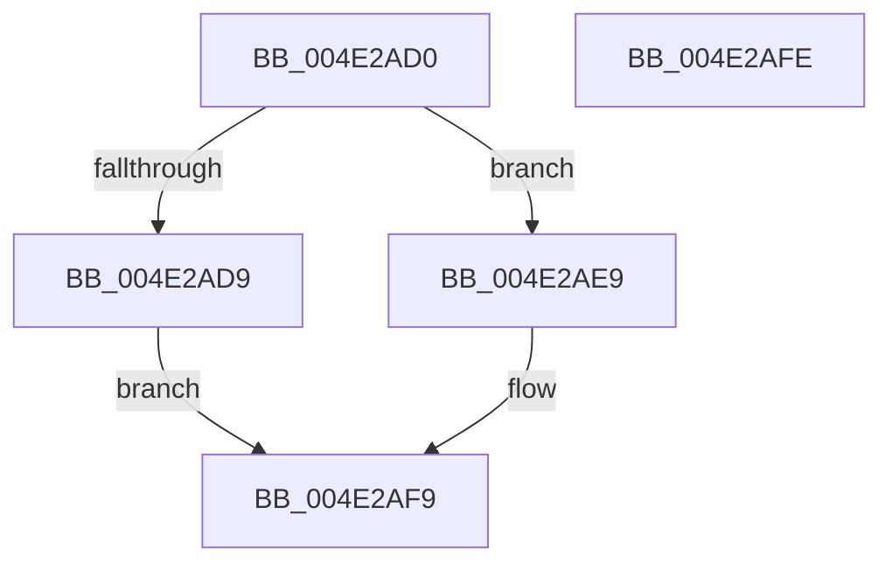

# CmpTransIsTransActive

- RVA: `0x004E2AD0`–`0x004E2AFF` (길이 `47` bytes)
- VA: `0x00000001404E2AD0`
- 실행 섹션: `.text`
- PDB 이름 있음: `예`; PDB Function 태그: `아니요`
- unwind 정보 RVA: `0x0005C788`
- 디코드: `16`개 명령, `47/47` bytes 표시
- 미해석 바이트: `0` (있으면 어셈블리에 `.byte`로 보존)

> 이 문서는 커널 이미지의 기계어와 PDB 기호를 분석해 생성했습니다. 4번과 5번은 함수 원형과 자료형을 바이너리 사용 방식에서 추정한 C 해석이며 원본 소스 복구 결과는 아닙니다.

## 1. Dependencies

- 직접 호출 지점: **3**; 고유 호출 대상: **2**
- 직접 호출자로 확인된 함수: **1**
- RIP 상대 이미지 참조: **0**

### Outgoing calls
- `0x004E2AD9` → [CmpTransGetTransPtr](../../page/A2/CmpTransGetTransPtr_function_00A2CA44.md) (function, `0x00A2CA44`)
- `0x004E2AE9` → [CmpTransGetTransPtr](../../page/A2/CmpTransGetTransPtr_function_00A2CA44.md) (function, `0x00A2CA44`)
- `0x004E2AF1` → [TmIsTransactionActive](../4F/TmIsTransactionActive_function_004FE1A0.md) (function, `0x004FE1A0`)

### Direct callers
- [sub_008C7465](../../page/8C/Unknown_function_008C7465.md) at `0x008C7465`

### Static image references
- 디코드된 RIP-relative 메모리 참조가 없습니다.

## 2. Other-region calls and transfers

- 다른 실행 섹션으로 향하는 call: **2**
  - `0x004E2AD9` → [CmpTransGetTransPtr](../../page/A2/CmpTransGetTransPtr_function_00A2CA44.md) (`.text` → `PAGE`)
  - `0x004E2AE9` → [CmpTransGetTransPtr](../../page/A2/CmpTransGetTransPtr_function_00A2CA44.md) (`.text` → `PAGE`)
- 별도 외부 분기/꼬리 이동을 확인하지 못했습니다.

## 3. Assembly (complete function range)

```asm
004E2AD0  48 83 EC 28                     sub rsp, 0x28
004E2AD4  F6 C1 01                        test cl, 1
004E2AD7  74 10                           je 0x1404e2ae9
004E2AD9  E8 66 9F 54 00                  call 0x140a2ca44
004E2ADE  33 C9                           xor ecx, ecx
004E2AE0  39 08                           cmp dword ptr [rax], ecx
004E2AE2  0F 94 C1                        sete cl
004E2AE5  8B C1                           mov eax, ecx
004E2AE7  EB 10                           jmp 0x1404e2af9
004E2AE9  E8 56 9F 54 00                  call 0x140a2ca44
004E2AEE  48 8B C8                        mov rcx, rax
004E2AF1  E8 AA B6 01 00                  call 0x1404fe1a0
004E2AF6  0F B6 C0                        movzx eax, al
004E2AF9  48 83 C4 28                     add rsp, 0x28
004E2AFD  C3                              ret
004E2AFE  CC                              int3
```

## 4. C-style interpretation (structured pseudocode)

```c
__int64 __fastcall CmpTransIsTransActive(int a1)
{
    __int64 result;
    __int64 v_rsp;

    v_rsp = (v_rsp) - (40);
    if ((((unsigned __int8)(a1)) & (1)) == 0) goto loc_004E2AE9;
    result = CmpTransGetTransPtr(a1, a2, a3, a4);
    a1 = 0;
    a1 = ((*(unsigned int *)(result)) == 0) ? 1 : 0;
    goto loc_004E2AF9;
loc_004E2AE9:
    result = CmpTransGetTransPtr(a1, a2, a3, a4);
    result = TmIsTransactionActive(result, a2, a3, a4);
loc_004E2AF9:
    v_rsp = (v_rsp) + (40);
    return (unsigned __int8)(result);
}
```

## 5. (Beta) C Style

```c
int64_t CmpTransIsTransActive(int32_t Arg1)
{
    int64_t result;
    int64_t local_rsp;

    local_rsp = (local_rsp) - (40);
    if ((((uint8_t)(Arg1)) & (1)) == 0) goto loc_004E2AE9;
    result = CmpTransGetTransPtr(Arg1, a2, a3, a4);
    Arg1 = 0;
    Arg1 = ((*(uint32_t *)(result)) == 0) ? 1 : 0;
    goto loc_004E2AF9;
loc_004E2AE9:
    result = CmpTransGetTransPtr(Arg1, a2, a3, a4);
    result = TmIsTransactionActive(result, a2, a3, a4);
loc_004E2AF9:
    local_rsp = (local_rsp) + (40);
    return (uint8_t)(result);
}
```

## 6. Execution-region graph

[열기: 2D/3D 그래프와 함수 탐색 컨트롤 패널](../../../control-panel.html?section=text&rva=0x004E2AD0&view=graph)

- 2D 그래프는 위에서 아래로 흐르고, 3D 그래프는 빈 공간을 드래그해 회전합니다. Shift+드래그는 이동, 휠은 확대·축소, 함수 노드 선택은 대상 보고서 이동입니다.

### Static fallback


