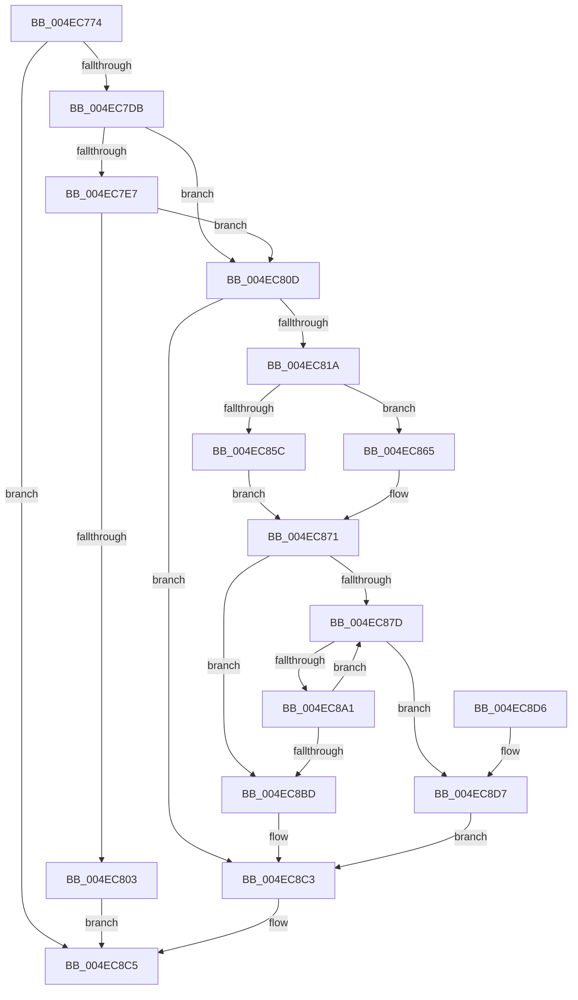

# EtwpInitializeCompression

- RVA: `0x004EC774`–`0x004EC8F4` (길이 `384` bytes)
- VA: `0x00000001404EC774`
- 실행 섹션: `.text`
- PDB 이름 있음: `예`; PDB Function 태그: `아니요`
- unwind 정보 RVA: `0x000D3EB4`
- 디코드: `91`개 명령, `384/384` bytes 표시
- 미해석 바이트: `0` (있으면 어셈블리에 `.byte`로 보존)

> 이 문서는 커널 이미지의 기계어와 PDB 기호를 분석해 생성했습니다. 4번과 5번은 함수 원형과 자료형을 바이너리 사용 방식에서 추정한 C 해석이며 원본 소스 복구 결과는 아닙니다.

## 1. Dependencies

- 직접 호출 지점: **8**; 고유 호출 대상: **7**
- 직접 호출자로 확인된 함수: **1**
- RIP 상대 이미지 참조: **2**

### Outgoing calls
- `0x004EC7CC` → [RtlGetCompressionWorkSpaceSize](../3B/RtlGetCompressionWorkSpaceSize_function_003B2560.md) (function, `0x003B2560`)
- `0x004EC7F2` → [ExAllocatePool2](../../poolcode/B8/ExAllocatePool2_function_00B820F0.md) (function, `0x00B820F0`)
- `0x004EC853` → [Feature_218004792__private_IsEnabledDeviceUsageNoInline](../64/Feature_218004792__private_IsEnabledDeviceUsageNoInline_function_0064F3EC.md) (function, `0x0064F3EC`)
- `0x004EC86C` → [InitializeSListHead](../46/InitializeSListHead_function_00468A90.md) (function, `0x00468A90`)
- `0x004EC897` → [ExAllocatePool2](../../poolcode/B8/ExAllocatePool2_function_00B820F0.md) (function, `0x00B820F0`)
- `0x004EC8AE` → [EtwpInsertPlaceholderBuffer](../65/EtwpInsertPlaceholderBuffer_function_00653718.md) (function, `0x00653718`)
- `0x004EC8E5` → [ExFreePoolWithTag](../../poolcode/B8/ExFreePoolWithTag_function_00B82870.md) (function, `0x00B82870`)
- `0x004EC8ED` → [EtwpFreePlaceholderList](../46/EtwpFreePlaceholderList_function_0046CF3C.md) (function, `0x0046CF3C`)

### Direct callers
- [EtwpInitLoggerContext](../../page/A7/EtwpInitLoggerContext_function_00A7154C.md) at `0x00A717C1`

### Static image references
- `0x004EC796` → RVA `0x00653300` (`EtwpCompressionProc`; read)
- `0x004EC81A` → RVA `0x00653290` (`EtwpCompressionDpc`; read)

## 2. Other-region calls and transfers

- 다른 실행 섹션으로 향하는 call: **3**
  - `0x004EC7F2` → [ExAllocatePool2](../../poolcode/B8/ExAllocatePool2_function_00B820F0.md) (`.text` → `POOLCODE`)
  - `0x004EC897` → [ExAllocatePool2](../../poolcode/B8/ExAllocatePool2_function_00B820F0.md) (`.text` → `POOLCODE`)
  - `0x004EC8E5` → [ExFreePoolWithTag](../../poolcode/B8/ExFreePoolWithTag_function_00B82870.md) (`.text` → `POOLCODE`)
- 별도 외부 분기/꼬리 이동을 확인하지 못했습니다.

## 3. Assembly (complete function range)

```asm
004EC774  4C 8B DC                        mov r11, rsp
004EC777  49 89 5B 18                     mov qword ptr [r11 + 0x18], rbx
004EC77B  55                              push rbp
004EC77C  56                              push rsi
004EC77D  57                              push rdi
004EC77E  41 56                           push r14
004EC780  41 57                           push r15
004EC782  48 83 EC 20                     sub rsp, 0x20
004EC786  48 8B D9                        mov rbx, rcx
004EC789  C7 81 9C 05 00 00 05 00 00 00   mov dword ptr [rcx + 0x59c], 5
004EC793  45 33 F6                        xor r14d, r14d
004EC796  48 8D 05 63 6B 16 00            lea rax, [rip + 0x166b63]
004EC79D  4D 8D 43 10                     lea r8, [r11 + 0x10]
004EC7A1  45 89 73 08                     mov dword ptr [r11 + 8], r14d
004EC7A5  49 8D 53 08                     lea rdx, [r11 + 8]
004EC7A9  45 89 73 10                     mov dword ptr [r11 + 0x10], r14d
004EC7AD  48 89 83 68 05 00 00            mov qword ptr [rbx + 0x568], rax
004EC7B4  41 8D 4E 03                     lea ecx, [r14 + 3]
004EC7B8  48 89 9B 70 05 00 00            mov qword ptr [rbx + 0x570], rbx
004EC7BF  89 8B A0 05 00 00               mov dword ptr [rbx + 0x5a0], ecx
004EC7C5  4C 89 B3 58 05 00 00            mov qword ptr [rbx + 0x558], r14
004EC7CC  E8 8F 5D EC FF                  call 0x1403b2560
004EC7D1  8B F8                           mov edi, eax
004EC7D3  85 C0                           test eax, eax
004EC7D5  0F 88 EA 00 00 00               js 0x1404ec8c5
004EC7DB  8B 44 24 50                     mov eax, dword ptr [rsp + 0x50]
004EC7DF  45 8D 7E 40                     lea r15d, [r14 + 0x40]
004EC7E3  85 C0                           test eax, eax
004EC7E5  74 26                           je 0x1404ec80d
004EC7E7  8B D0                           mov edx, eax
004EC7E9  41 B8 45 74 77 5A               mov r8d, 0x5a777445
004EC7EF  41 8B CF                        mov ecx, r15d
004EC7F2  E8 F9 58 69 00                  call 0x140b820f0
004EC7F7  48 89 83 90 05 00 00            mov qword ptr [rbx + 0x590], rax
004EC7FE  48 85 C0                        test rax, rax
004EC801  75 0A                           jne 0x1404ec80d
004EC803  B8 17 00 00 C0                  mov eax, 0xc0000017
004EC808  E9 B8 00 00 00                  jmp 0x1404ec8c5
004EC80D  F7 43 0C 00 04 00 00            test dword ptr [rbx + 0xc], 0x400
004EC814  0F 84 A9 00 00 00               je 0x1404ec8c3
004EC81A  48 8D 05 6F 6A 16 00            lea rax, [rip + 0x166a6f]
004EC821  4C 89 B3 80 05 00 00            mov qword ptr [rbx + 0x580], r14
004EC828  48 89 83 D8 05 00 00            mov qword ptr [rbx + 0x5d8], rax
004EC82F  BE 01 00 00 00                  mov esi, 1
004EC834  C7 83 C0 05 00 00 13 01 00 00   mov dword ptr [rbx + 0x5c0], 0x113
004EC83E  48 89 9B E0 05 00 00            mov qword ptr [rbx + 0x5e0], rbx
004EC845  4C 89 B3 F8 05 00 00            mov qword ptr [rbx + 0x5f8], r14
004EC84C  4C 89 B3 D0 05 00 00            mov qword ptr [rbx + 0x5d0], r14
004EC853  E8 94 2B 16 00                  call 0x14064f3ec
004EC858  85 C0                           test eax, eax
004EC85A  75 09                           jne 0x1404ec865
004EC85C  4C 89 B3 A8 05 00 00            mov qword ptr [rbx + 0x5a8], r14
004EC863  EB 0C                           jmp 0x1404ec871
004EC865  48 8D 8B B0 05 00 00            lea rcx, [rbx + 0x5b0]
004EC86C  E8 1F C2 F7 FF                  call 0x140468a90
004EC871  41 8B EE                        mov ebp, r14d
004EC874  44 39 B3 9C 05 00 00            cmp dword ptr [rbx + 0x59c], r14d
004EC87B  76 40                           jbe 0x1404ec8bd
004EC87D  39 B3 2C 01 00 00               cmp dword ptr [rbx + 0x12c], esi
004EC883  B9 00 01 00 00                  mov ecx, 0x100
004EC888  BA 48 00 00 00                  mov edx, 0x48
004EC88D  41 B8 45 74 77 42               mov r8d, 0x42777445
004EC893  49 0F 45 CF                     cmovne rcx, r15
004EC897  E8 54 58 69 00                  call 0x140b820f0
004EC89C  48 85 C0                        test rax, rax
004EC89F  74 36                           je 0x1404ec8d7
004EC8A1  48 8B D0                        mov rdx, rax
004EC8A4  C7 40 2C 06 00 00 00            mov dword ptr [rax + 0x2c], 6
004EC8AB  48 8B CB                        mov rcx, rbx
004EC8AE  E8 65 6E 16 00                  call 0x140653718
004EC8B3  03 EE                           add ebp, esi
004EC8B5  3B AB 9C 05 00 00               cmp ebp, dword ptr [rbx + 0x59c]
004EC8BB  72 C0                           jb 0x1404ec87d
004EC8BD  87 B3 98 05 00 00               xchg dword ptr [rbx + 0x598], esi
004EC8C3  8B C7                           mov eax, edi
004EC8C5  48 8B 5C 24 60                  mov rbx, qword ptr [rsp + 0x60]
004EC8CA  48 83 C4 20                     add rsp, 0x20
004EC8CE  41 5F                           pop r15
004EC8D0  41 5E                           pop r14
004EC8D2  5F                              pop rdi
004EC8D3  5E                              pop rsi
004EC8D4  5D                              pop rbp
004EC8D5  C3                              ret
004EC8D6  CC                              int3
004EC8D7  48 8B 8B 90 05 00 00            mov rcx, qword ptr [rbx + 0x590]
004EC8DE  33 D2                           xor edx, edx
004EC8E0  BF 17 00 00 C0                  mov edi, 0xc0000017
004EC8E5  E8 86 5F 69 00                  call 0x140b82870
004EC8EA  48 8B CB                        mov rcx, rbx
004EC8ED  E8 4A 06 F8 FF                  call 0x14046cf3c
004EC8F2  EB CF                           jmp 0x1404ec8c3
```

## 4. C-style interpretation (structured pseudocode)

```c
__int64 __fastcall EtwpInitializeCompression(__int64 a1)
{
    __int64 result;
    __int64 v_r14;
    __int64 v_rbp;
    __int64 v_rsp;
    unsigned __int64 v_stack_p18;
    unsigned int v_stack_p8;

    *(unsigned __int64 *)(v_rsp + 24) = v_rbx;
    v_rsp = (v_rsp) - (32);
    *(unsigned int *)(a1 + 1436) = 5;
    v_r14 = 0;
    *(unsigned int *)(v_rsp + 8) = 0;
    *(unsigned int *)(v_rsp + 16) = 0;
    *(unsigned __int64 *)(a1 + 1384) = v_rip + 1469283;
    *(unsigned __int64 *)(a1 + 1392) = a1;
    *(unsigned int *)(a1 + 1440) = (unsigned int)(v_r14 + 3);
    *(unsigned __int64 *)(a1 + 1368) = 0;
    result = RtlGetCompressionWorkSpaceSize(v_r14 + 3, v_rsp + 8, v_rsp + 16, a4);
    if (sign_flag) goto loc_004EC8C5;
    if ((unsigned int)((unsigned int)(v_stack_p8)) == 0) goto loc_004EC80D;
    result = ExAllocatePool2((unsigned int)((unsigned int)(v_r14 + 64)), (unsigned int)((unsigned int)((unsigned int)(v_stack_p8))), (unsigned int)(0x5A777445ULL), a4);
    *(unsigned __int64 *)(a1 + 1424) = result;
    if (result != 0) goto loc_004EC80D;
    goto loc_004EC8C5;
loc_004EC80D:
    if (((*(unsigned int *)(a1 + 12)) & (0x400ULL)) == 0) goto loc_004EC8C3;
    *(unsigned __int64 *)(a1 + 1408) = 0;
    *(unsigned __int64 *)(a1 + 1496) = v_rip + 1469039;
    *(unsigned int *)(a1 + 1472) = 275;
    *(unsigned __int64 *)(a1 + 1504) = a1;
    *(unsigned __int64 *)(a1 + 1528) = 0;
    *(unsigned __int64 *)(a1 + 1488) = 0;
    result = Feature_218004792__private_IsEnabledDeviceUsageNoInline((unsigned int)((unsigned int)(v_r14 + 64)), (unsigned int)((unsigned int)((unsigned int)(v_stack_p8))), (unsigned int)(0x5A777445ULL), a4);
    if ((unsigned int)(result) != 0) goto loc_004EC865;
    *(unsigned __int64 *)(a1 + 1448) = 0;
    goto loc_004EC871;
loc_004EC865:
    result = InitializeSListHead(a1 + 1456, (unsigned int)((unsigned int)((unsigned int)(v_stack_p8))), (unsigned int)(0x5A777445ULL), a4);
loc_004EC871:
    if ((*(unsigned int *)(a1 + 1436)) <= 0) goto loc_004EC8BD;
loc_004EC87D:
    a1 = 256;
    if ((*(unsigned int *)(a1 + 300)) != 1) { a1 = v_r14 + 64; }
    result = ExAllocatePool2(a1, 72, (unsigned int)(0x42777445ULL), a4);
    if (result == 0) goto loc_004EC8D7;
    *(unsigned int *)(result + 44) = 6;
    result = EtwpInsertPlaceholderBuffer(a1, result, (unsigned int)(0x42777445ULL), a4);
    v_rbp = (unsigned int)((0) + (1));
    if (((unsigned int)(v_rbp)) < (*(unsigned int *)(a1 + 1436))) goto loc_004EC87D;
loc_004EC8BD:
loc_004EC8C3:
loc_004EC8C5:
    v_rsp = (v_rsp) + (32);
    return (unsigned int)((unsigned int)((unsigned int)((unsigned int)(result))));
loc_004EC8D7:
    a2 = 0;
    result = ExFreePoolWithTag(*(unsigned __int64 *)(v_stack_p18 + 1424), a2, (unsigned int)(0x42777445ULL), a4);
    result = EtwpFreePlaceholderList(v_stack_p18, a2, (unsigned int)(0x42777445ULL), a4);
    goto loc_004EC8C3;
}
```

## 5. (Beta) C Style

```c
int64_t EtwpInitializeCompression(void *Arg1)
{
    uint8_t *arg1 = (uint8_t *)Arg1;

    int64_t result;
    int64_t local_r14;
    int64_t local_rbp;
    int64_t local_rsp;
    uint64_t v_stack_p18;
    uint32_t v_stack_p8;

    *(uint64_t *)(local_rsp + 0x18) = local_rbx;
    local_rsp = (local_rsp) - (32);
    *(uint32_t *)(arg1 + 0x59C) = 5;
    local_r14 = 0;
    *(uint32_t *)(local_rsp + 0x8) = 0;
    *(uint32_t *)(local_rsp + 0x10) = 0;
    *(uint64_t *)(arg1 + 0x568) = v_rip + 1469283;
    *(void **)(arg1 + 0x570) = Arg1;
    *(uint32_t *)(arg1 + 0x5A0) = (uint32_t)(local_r14 + 3);
    *(uint64_t *)(arg1 + 0x558) = 0;
    result = RtlGetCompressionWorkSpaceSize(local_r14 + 3, local_rsp + 8, local_rsp + 16, a4);
    if (sign_flag) goto loc_004EC8C5;
    if ((uint32_t)((uint32_t)(v_stack_p8)) == 0) goto loc_004EC80D;
    result = ExAllocatePool2((uint32_t)((uint32_t)(local_r14 + 64)), (uint32_t)((uint32_t)((uint32_t)(v_stack_p8))), (uint32_t)(0x5A777445ULL), a4);
    *(uint64_t *)(arg1 + 0x590) = result;
    if (result != 0) goto loc_004EC80D;
    goto loc_004EC8C5;
loc_004EC80D:
    if (((*(uint32_t *)(arg1 + 0xC)) & (0x400ULL)) == 0) goto loc_004EC8C3;
    *(uint64_t *)(arg1 + 0x580) = 0;
    *(uint64_t *)(arg1 + 0x5D8) = v_rip + 1469039;
    *(uint32_t *)(arg1 + 0x5C0) = 275;
    *(void **)(arg1 + 0x5E0) = Arg1;
    *(uint64_t *)(arg1 + 0x5F8) = 0;
    *(uint64_t *)(arg1 + 0x5D0) = 0;
    result = Feature_218004792__private_IsEnabledDeviceUsageNoInline((uint32_t)((uint32_t)(local_r14 + 64)), (uint32_t)((uint32_t)((uint32_t)(v_stack_p8))), (uint32_t)(0x5A777445ULL), a4);
    if ((uint32_t)(result) != 0) goto loc_004EC865;
    *(uint64_t *)(arg1 + 0x5A8) = 0;
    goto loc_004EC871;
loc_004EC865:
    result = InitializeSListHead(Arg1 + 1456, (uint32_t)((uint32_t)((uint32_t)(v_stack_p8))), (uint32_t)(0x5A777445ULL), a4);
loc_004EC871:
    if ((*(uint32_t *)(arg1 + 0x59C)) <= 0) goto loc_004EC8BD;
loc_004EC87D:
    Arg1 = 256;
    if ((*(uint32_t *)(arg1 + 0x12C)) != 1) { Arg1 = local_r14 + 64; }
    result = ExAllocatePool2(Arg1, 72, (uint32_t)(0x42777445ULL), a4);
    if (result == 0) goto loc_004EC8D7;
    *(uint32_t *)(result + 0x2C) = 6;
    result = EtwpInsertPlaceholderBuffer(Arg1, result, (uint32_t)(0x42777445ULL), a4);
    local_rbp = (uint32_t)((0) + (1));
    if (((uint32_t)(local_rbp)) < (*(uint32_t *)(arg1 + 0x59C))) goto loc_004EC87D;
loc_004EC8BD:
loc_004EC8C3:
loc_004EC8C5:
    local_rsp = (local_rsp) + (32);
    return (uint32_t)((uint32_t)((uint32_t)((uint32_t)(result))));
loc_004EC8D7:
    a2 = 0;
    result = ExFreePoolWithTag(*(uint64_t *)(v_stack_p18 + 0x590), a2, (uint32_t)(0x42777445ULL), a4);
    result = EtwpFreePlaceholderList(v_stack_p18, a2, (uint32_t)(0x42777445ULL), a4);
    goto loc_004EC8C3;
}
```

### 관측된 메모리 오프셋

구조체 형식이 확인되지 않은 접근은 인자 기준의 오프셋으로만 기록했습니다.

| 기준 인자 | 오프셋 표현 | 폭 (bit) | 접근 |
|---|---:|---:|---|
| `Arg1` | `+ 0xC` | `32` | `R` |
| `Arg1` | `+ 0x12C` | `32` | `R` |
| `Arg1` | `+ 0x558` | `64` | `W` |
| `Arg1` | `+ 0x568` | `64` | `W` |
| `Arg1` | `+ 0x570` | `64` | `W` |
| `Arg1` | `+ 0x580` | `64` | `W` |
| `Arg1` | `+ 0x590` | `64` | `R` |
| `Arg1` | `+ 0x590` | `64` | `W` |
| `Arg1` | `+ 0x598` | `32` | `R/W` |
| `Arg1` | `+ 0x59C` | `32` | `R` |
| `Arg1` | `+ 0x59C` | `32` | `W` |
| `Arg1` | `+ 0x5A0` | `32` | `W` |
| `Arg1` | `+ 0x5A8` | `64` | `W` |
| `Arg1` | `+ 0x5B0` | `64` | `R` |
| `Arg1` | `+ 0x5C0` | `32` | `W` |
| `Arg1` | `+ 0x5D0` | `64` | `W` |
| `Arg1` | `+ 0x5D8` | `64` | `W` |
| `Arg1` | `+ 0x5E0` | `64` | `W` |
| `Arg1` | `+ 0x5F8` | `64` | `W` |

## 6. Execution-region graph

[열기: 2D/3D 그래프와 함수 탐색 컨트롤 패널](../../../control-panel.html?section=text&rva=0x004EC774&view=graph)

- 2D 그래프는 위에서 아래로 흐르고, 3D 그래프는 빈 공간을 드래그해 회전합니다. Shift+드래그는 이동, 휠은 확대·축소, 함수 노드 선택은 대상 보고서 이동입니다.

### Static fallback


