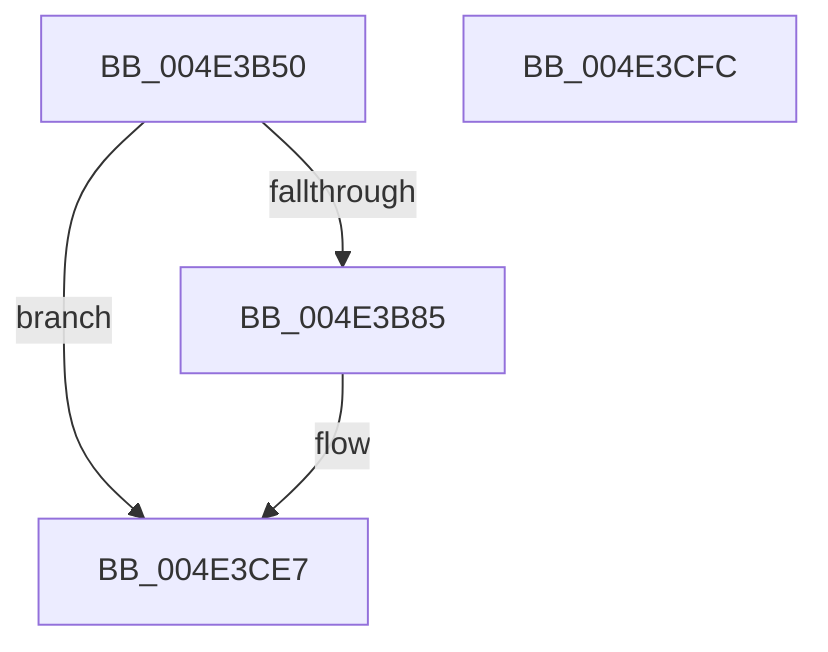

# ExLogTimeZoneInformation

- RVA: `0x004E3B50`–`0x004E3CFD` (길이 `429` bytes)
- VA: `0x00000001404E3B50`
- 실행 섹션: `.text`
- PDB 이름 있음: `예`; PDB Function 태그: `아니요`
- unwind 정보 RVA: `0x000BD0F0`
- 디코드: `93`개 명령, `429/429` bytes 표시
- 미해석 바이트: `0` (있으면 어셈블리에 `.byte`로 보존)

> 이 문서는 커널 이미지의 기계어와 PDB 기호를 분석해 생성했습니다. 4번과 5번은 함수 원형과 자료형을 바이너리 사용 방식에서 추정한 C 해석이며 원본 소스 복구 결과는 아닙니다.

## 1. Dependencies

- 직접 호출 지점: **4**; 고유 호출 대상: **4**
- 직접 호출자로 확인된 함수: **1**
- RIP 상대 이미지 참조: **4**

### Outgoing calls
- `0x004E3B6C` → [PsGetCurrentServerSiloGlobals](../2F/PsGetCurrentServerSiloGlobals_function_002FE1F0.md) (function, `0x002FE1F0`)
- `0x004E3C29` → [tlgCreate1Sz_wchar_t](../42/tlgCreate1Sz_wchar_t_function_00426198.md) (function, `0x00426198`)
- `0x004E3CE2` → [tlgWriteTransfer_EtwWriteTransfer](../42/tlgWriteTransfer_EtwWriteTransfer_function_004260E0.md) (function, `0x004260E0`)
- `0x004E3CEE` → [_security_check_cookie](../6A/_security_check_cookie_function_006AC640.md) (function, `0x006AC640`)

### Direct callers
- [Phase1InitializationIoReady](../../init/C7/Phase1InitializationIoReady_function_00C70458.md) at `0x00C7061D`

### Static image references
- `0x004E3B5E` → RVA `0x00E0A740` (`.data`; read)
- `0x004E3B71` → RVA `0x00E09388` (`.data`; read)
- `0x004E3BEE` → RVA `0x00E68570` (`.data`; read)
- `0x004E3C3E` → RVA `0x000558A8` (`.rdata`; read)

## 2. Other-region calls and transfers

- 다른 실행 섹션으로 향하는 call: **0**
- 별도 외부 분기/꼬리 이동을 확인하지 못했습니다.

## 3. Assembly (complete function range)

```asm
004E3B50  40 55                           push rbp
004E3B52  48 8D 6C 24 B0                  lea rbp, [rsp - 0x50]
004E3B57  48 81 EC 50 01 00 00            sub rsp, 0x150
004E3B5E  48 8B 05 DB 6B 92 00            mov rax, qword ptr [rip + 0x926bdb]
004E3B65  48 33 C4                        xor rax, rsp
004E3B68  48 89 45 40                     mov qword ptr [rbp + 0x40], rax
004E3B6C  E8 7F A6 E1 FF                  call 0x1402fe1f0
004E3B71  83 3D 10 58 92 00 05            cmp dword ptr [rip + 0x925810], 5
004E3B78  4C 8B 88 C8 04 00 00            mov r9, qword ptr [rax + 0x4c8]
004E3B7F  0F 86 62 01 00 00               jbe 0x1404e3ce7
004E3B85  41 8B 81 E8 03 00 00            mov eax, dword ptr [r9 + 0x3e8]
004E3B8C  49 8D 91 AC 00 00 00            lea rdx, [r9 + 0xac]
004E3B93  83 65 8C 00                     and dword ptr [rbp - 0x74], 0
004E3B97  48 8D 4D D0                     lea rcx, [rbp - 0x30]
004E3B9B  83 65 9C 00                     and dword ptr [rbp - 0x64], 0
004E3B9F  41 BB 04 00 00 00               mov r11d, 4
004E3BA5  83 65 AC 00                     and dword ptr [rbp - 0x54], 0
004E3BA9  83 65 BC 00                     and dword ptr [rbp - 0x44], 0
004E3BAD  83 65 CC 00                     and dword ptr [rbp - 0x34], 0
004E3BB1  89 44 24 34                     mov dword ptr [rsp + 0x34], eax
004E3BB5  45 8D 53 FD                     lea r10d, [r11 - 3]
004E3BB9  48 8D 44 24 34                  lea rax, [rsp + 0x34]
004E3BBE  44 89 5D 88                     mov dword ptr [rbp - 0x78], r11d
004E3BC2  48 89 45 80                     mov qword ptr [rbp - 0x80], rax
004E3BC6  41 8B 81 B4 01 00 00            mov eax, dword ptr [r9 + 0x1b4]
004E3BCD  89 44 24 38                     mov dword ptr [rsp + 0x38], eax
004E3BD1  48 8D 44 24 38                  lea rax, [rsp + 0x38]
004E3BD6  48 89 45 90                     mov qword ptr [rbp - 0x70], rax
004E3BDA  41 8B 81 B0 01 00 00            mov eax, dword ptr [r9 + 0x1b0]
004E3BE1  89 44 24 3C                     mov dword ptr [rsp + 0x3c], eax
004E3BE5  48 8D 44 24 3C                  lea rax, [rsp + 0x3c]
004E3BEA  48 89 45 A0                     mov qword ptr [rbp - 0x60], rax
004E3BEE  8A 05 7C 49 98 00               mov al, byte ptr [rip + 0x98497c]
004E3BF4  88 44 24 30                     mov byte ptr [rsp + 0x30], al
004E3BF8  48 8D 44 24 30                  lea rax, [rsp + 0x30]
004E3BFD  48 89 45 B0                     mov qword ptr [rbp - 0x50], rax
004E3C01  49 8B 81 E0 03 00 00            mov rax, qword ptr [r9 + 0x3e0]
004E3C08  48 89 44 24 50                  mov qword ptr [rsp + 0x50], rax
004E3C0D  48 8D 44 24 50                  lea rax, [rsp + 0x50]
004E3C12  48 89 45 C0                     mov qword ptr [rbp - 0x40], rax
004E3C16  44 89 5D 98                     mov dword ptr [rbp - 0x68], r11d
004E3C1A  44 89 5D A8                     mov dword ptr [rbp - 0x58], r11d
004E3C1E  44 89 55 B8                     mov dword ptr [rbp - 0x48], r10d
004E3C22  C7 45 C8 08 00 00 00            mov dword ptr [rbp - 0x38], 8
004E3C29  E8 6A 25 F4 FF                  call 0x140426198
004E3C2E  41 8A 89 AC 01 00 00            mov cl, byte ptr [r9 + 0x1ac]
004E3C35  48 8D 44 24 31                  lea rax, [rsp + 0x31]
004E3C3A  83 65 EC 00                     and dword ptr [rbp - 0x14], 0
004E3C3E  48 8D 15 63 1C B7 FF            lea rdx, [rip - 0x48e39d]
004E3C45  83 65 FC 00                     and dword ptr [rbp - 4], 0
004E3C49  45 33 C0                        xor r8d, r8d
004E3C4C  83 65 0C 00                     and dword ptr [rbp + 0xc], 0
004E3C50  83 65 1C 00                     and dword ptr [rbp + 0x1c], 0
004E3C54  83 65 2C 00                     and dword ptr [rbp + 0x2c], 0
004E3C58  83 65 3C 00                     and dword ptr [rbp + 0x3c], 0
004E3C5C  48 89 45 E0                     mov qword ptr [rbp - 0x20], rax
004E3C60  41 8B 01                        mov eax, dword ptr [r9]
004E3C63  89 44 24 40                     mov dword ptr [rsp + 0x40], eax
004E3C67  48 8D 44 24 40                  lea rax, [rsp + 0x40]
004E3C6C  48 89 45 F0                     mov qword ptr [rbp - 0x10], rax
004E3C70  41 8B 41 54                     mov eax, dword ptr [r9 + 0x54]
004E3C74  89 44 24 44                     mov dword ptr [rsp + 0x44], eax
004E3C78  48 8D 44 24 44                  lea rax, [rsp + 0x44]
004E3C7D  48 89 45 00                     mov qword ptr [rbp], rax
004E3C81  41 8B 81 A8 00 00 00            mov eax, dword ptr [r9 + 0xa8]
004E3C88  89 44 24 48                     mov dword ptr [rsp + 0x48], eax
004E3C8C  48 8D 44 24 48                  lea rax, [rsp + 0x48]
004E3C91  48 89 45 10                     mov qword ptr [rbp + 0x10], rax
004E3C95  49 8D 41 44                     lea rax, [r9 + 0x44]
004E3C99  48 89 45 20                     mov qword ptr [rbp + 0x20], rax
004E3C9D  49 8D 81 98 00 00 00            lea rax, [r9 + 0x98]
004E3CA4  88 4C 24 31                     mov byte ptr [rsp + 0x31], cl
004E3CA8  45 33 C9                        xor r9d, r9d
004E3CAB  41 8D 4B 0C                     lea ecx, [r11 + 0xc]
004E3CAF  48 89 45 30                     mov qword ptr [rbp + 0x30], rax
004E3CB3  48 8D 44 24 60                  lea rax, [rsp + 0x60]
004E3CB8  89 4D 28                        mov dword ptr [rbp + 0x28], ecx
004E3CBB  89 4D 38                        mov dword ptr [rbp + 0x38], ecx
004E3CBE  48 8D 0D C3 56 92 00            lea rcx, [rip + 0x9256c3]
004E3CC5  48 89 44 24 28                  mov qword ptr [rsp + 0x28], rax
004E3CCA  C7 44 24 20 0E 00 00 00         mov dword ptr [rsp + 0x20], 0xe
004E3CD2  44 89 55 E8                     mov dword ptr [rbp - 0x18], r10d
004E3CD6  44 89 5D F8                     mov dword ptr [rbp - 8], r11d
004E3CDA  44 89 5D 08                     mov dword ptr [rbp + 8], r11d
004E3CDE  44 89 5D 18                     mov dword ptr [rbp + 0x18], r11d
004E3CE2  E8 F9 23 F4 FF                  call 0x1404260e0
004E3CE7  48 8B 4D 40                     mov rcx, qword ptr [rbp + 0x40]
004E3CEB  48 33 CC                        xor rcx, rsp
004E3CEE  E8 4D 89 1C 00                  call 0x1406ac640
004E3CF3  48 81 C4 50 01 00 00            add rsp, 0x150
004E3CFA  5D                              pop rbp
004E3CFB  C3                              ret
004E3CFC  CC                              int3
```

## 4. C-style interpretation (structured pseudocode)

```c
__int64 __fastcall ExLogTimeZoneInformation(__int64 a1, __int64 a2, int a3)
{
    __int64 result;
    __int64 v_r10;
    __int64 v_r11;
    __int64 v_rsp;
    unsigned __int64 v_stack_m108;
    unsigned int v_stack_m110;
    unsigned int v_stack_m114;
    unsigned int v_stack_m118;
    unsigned int v_stack_m11C;
    unsigned int v_stack_m120;
    unsigned int v_stack_m124;
    unsigned __int64 v_stack_m127;
    unsigned __int8 v_stack_m128;
    unsigned __int64 v_stack_m130;
    unsigned int v_stack_m138;
    unsigned __int64 v_stack_m18;
    unsigned int v_stack_m1C;
    unsigned int v_stack_m20;
    unsigned __int64 v_stack_m28;
    unsigned int v_stack_m2C;
    unsigned int v_stack_m30;
    unsigned __int64 v_stack_m38;
    unsigned int v_stack_m3C;
    unsigned int v_stack_m40;
    unsigned __int64 v_stack_m48;
    unsigned int v_stack_m4C;
    unsigned int v_stack_m50;
    unsigned __int64 v_stack_m58;
    unsigned int v_stack_m5C;
    unsigned int v_stack_m60;
    unsigned __int64 v_stack_m68;
    unsigned int v_stack_m6C;
    unsigned int v_stack_m70;
    unsigned __int64 v_stack_m78;
    unsigned __int64 v_stack_m88;
    unsigned int v_stack_m8C;
    unsigned int v_stack_m90;
    unsigned __int64 v_stack_m98;
    unsigned int v_stack_m9C;
    unsigned int v_stack_mA0;
    unsigned __int64 v_stack_mA8;
    unsigned int v_stack_mAC;
    unsigned int v_stack_mB0;
    unsigned __int64 v_stack_mB8;
    unsigned int v_stack_mBC;
    unsigned int v_stack_mC0;
    unsigned __int64 v_stack_mC8;
    unsigned int v_stack_mCC;
    unsigned int v_stack_mD0;
    unsigned __int64 v_stack_mD8;
    unsigned __int64 v_stack_mF8;

    v_rsp = (v_rsp) - (336);
    result = (*(unsigned __int64 *)(v_rip + 9595867)) ^ (v_rsp);
    v_stack_m18 = result;
    result = PsGetCurrentServerSiloGlobals(a1, a2, a3, a4);
    if ((*(unsigned int *)(v_rip + 9590800)) >= = 5) {
        result = *(unsigned int *)(*(unsigned __int64 *)(result + 1224) + 1000);
        a2 = *(unsigned __int64 *)(result + 1224) + 172;
        a1 = v_stack_m88;
        v_r11 = 4;
        v_stack_m124 = (unsigned int)(result);
        v_r10 = v_r11 - 3;
        result = v_stack_m124;
        v_stack_mD0 = (unsigned int)(v_r11);
        v_stack_mD8 = result;
        result = *(unsigned int *)(*(unsigned __int64 *)(result + 1224) + 436);
        v_stack_m120 = (unsigned int)(result);
        result = v_stack_m120;
        v_stack_mC8 = result;
        result = *(unsigned int *)(*(unsigned __int64 *)(result + 1224) + 432);
        v_stack_m11C = (unsigned int)(result);
        result = v_stack_m11C;
        v_stack_mB8 = result;
        result = *(unsigned __int8 *)(v_rip + 9980284);
        v_stack_m128 = (unsigned __int8)(result);
        result = v_stack_m128;
        v_stack_mA8 = result;
        result = *(unsigned __int64 *)(*(unsigned __int64 *)(result + 1224) + 992);
        v_stack_m108 = result;
        result = v_stack_m108;
        v_stack_m98 = result;
        v_stack_mC0 = (unsigned int)(v_r11);
        v_stack_mB0 = (unsigned int)(v_r11);
        v_stack_mA0 = (unsigned int)(v_r10);
        v_stack_m90 = 8;
        result = tlgCreate1Sz_wchar_t(a1, a2, a3, *(unsigned __int64 *)(result + 1224));
        a1 = *(unsigned __int8 *)(*(unsigned __int64 *)(result + 1224) + 428);
        result = v_stack_m127;
        a2 = v_rip - 4776861;
        a3 = 0;
        v_stack_m78 = result;
        result = *(unsigned int *)(*(unsigned __int64 *)(result + 1224));
        v_stack_m118 = (unsigned int)(result);
        result = v_stack_m118;
        v_stack_m68 = result;
        result = *(unsigned int *)(*(unsigned __int64 *)(result + 1224) + 84);
        v_stack_m114 = (unsigned int)(result);
        result = v_stack_m114;
        v_stack_m58 = result;
        result = *(unsigned int *)(*(unsigned __int64 *)(result + 1224) + 168);
        v_stack_m110 = (unsigned int)(result);
        result = v_stack_m110;
        v_stack_m48 = result;
        result = *(unsigned __int64 *)(result + 1224) + 68;
        v_stack_m38 = result;
        result = *(unsigned __int64 *)(result + 1224) + 152;
        v_stack_m127 = (unsigned __int8)(a1);
        a4 = 0;
        a1 = v_r11 + 12;
        v_stack_m28 = result;
        result = v_stack_mF8;
        v_stack_m30 = (unsigned int)(a1);
        v_stack_m20 = (unsigned int)(a1);
        a1 = v_rip + 9590467;
        v_stack_m130 = result;
        v_stack_m138 = 14;
        v_stack_m70 = (unsigned int)(v_r10);
        v_stack_m60 = (unsigned int)(v_r11);
        v_stack_m50 = (unsigned int)(v_r11);
        v_stack_m40 = (unsigned int)(v_r11);
        result = tlgWriteTransfer_EtwWriteTransfer(a1, a2, a3, a4);
    }
    a1 = (v_stack_m18) ^ (v_rsp);
    result = _security_check_cookie(a1, a2, a3, a4);
    v_rsp = (v_rsp) + (336);
    return result;
}
```

## 5. (Beta) C Style

```c
int64_t ExLogTimeZoneInformation(int64_t Arg1, int64_t Arg2, int32_t Arg3)
{
    int64_t result;
    int64_t local_r10;
    int64_t local_r11;
    int64_t local_rsp;
    uint64_t v_stack_m108;
    uint32_t v_stack_m110;
    uint32_t v_stack_m114;
    uint32_t v_stack_m118;
    uint32_t v_stack_m11C;
    uint32_t v_stack_m120;
    uint32_t v_stack_m124;
    uint64_t v_stack_m127;
    uint8_t v_stack_m128;
    uint64_t v_stack_m130;
    uint32_t v_stack_m138;
    uint64_t v_stack_m18;
    uint32_t v_stack_m1C;
    uint32_t v_stack_m20;
    uint64_t v_stack_m28;
    uint32_t v_stack_m2C;
    uint32_t v_stack_m30;
    uint64_t v_stack_m38;
    uint32_t v_stack_m3C;
    uint32_t v_stack_m40;
    uint64_t v_stack_m48;
    uint32_t v_stack_m4C;
    uint32_t v_stack_m50;
    uint64_t v_stack_m58;
    uint32_t v_stack_m5C;
    uint32_t v_stack_m60;
    uint64_t v_stack_m68;
    uint32_t v_stack_m6C;
    uint32_t v_stack_m70;
    uint64_t v_stack_m78;
    uint64_t v_stack_m88;
    uint32_t v_stack_m8C;
    uint32_t v_stack_m90;
    uint64_t v_stack_m98;
    uint32_t v_stack_m9C;
    uint32_t v_stack_mA0;
    uint64_t v_stack_mA8;
    uint32_t v_stack_mAC;
    uint32_t v_stack_mB0;
    uint64_t v_stack_mB8;
    uint32_t v_stack_mBC;
    uint32_t v_stack_mC0;
    uint64_t v_stack_mC8;
    uint32_t v_stack_mCC;
    uint32_t v_stack_mD0;
    uint64_t v_stack_mD8;
    uint64_t v_stack_mF8;

    local_rsp = (local_rsp) - (336);
    result = (*(uint64_t *)(v_rip + 0x926BDB)) ^ (local_rsp);
    v_stack_m18 = result;
    result = PsGetCurrentServerSiloGlobals(Arg1, Arg2, Arg3, a4);
    if ((*(uint32_t *)(v_rip + 0x925810)) >= = 5) {
        result = *(uint32_t *)(*(uint64_t *)(result + 0x4C8) + 0x3E8);
        Arg2 = *(uint64_t *)(result + 0x4C8) + 172;
        Arg1 = v_stack_m88;
        local_r11 = 4;
        v_stack_m124 = (uint32_t)(result);
        local_r10 = local_r11 - 3;
        result = v_stack_m124;
        v_stack_mD0 = (uint32_t)(local_r11);
        v_stack_mD8 = result;
        result = *(uint32_t *)(*(uint64_t *)(result + 0x4C8) + 0x1B4);
        v_stack_m120 = (uint32_t)(result);
        result = v_stack_m120;
        v_stack_mC8 = result;
        result = *(uint32_t *)(*(uint64_t *)(result + 0x4C8) + 0x1B0);
        v_stack_m11C = (uint32_t)(result);
        result = v_stack_m11C;
        v_stack_mB8 = result;
        result = *(uint8_t *)(v_rip + 0x98497C);
        v_stack_m128 = (uint8_t)(result);
        result = v_stack_m128;
        v_stack_mA8 = result;
        result = *(uint64_t *)(*(uint64_t *)(result + 0x4C8) + 0x3E0);
        v_stack_m108 = result;
        result = v_stack_m108;
        v_stack_m98 = result;
        v_stack_mC0 = (uint32_t)(local_r11);
        v_stack_mB0 = (uint32_t)(local_r11);
        v_stack_mA0 = (uint32_t)(local_r10);
        v_stack_m90 = 8;
        result = tlgCreate1Sz_wchar_t(Arg1, Arg2, Arg3, *(uint64_t *)(result + 0x4C8));
        Arg1 = *(uint8_t *)(*(uint64_t *)(result + 0x4C8) + 0x1AC);
        result = v_stack_m127;
        Arg2 = v_rip - 4776861;
        Arg3 = 0;
        v_stack_m78 = result;
        result = *(uint32_t *)(*(uint64_t *)(result + 0x4C8));
        v_stack_m118 = (uint32_t)(result);
        result = v_stack_m118;
        v_stack_m68 = result;
        result = *(uint32_t *)(*(uint64_t *)(result + 0x4C8) + 0x54);
        v_stack_m114 = (uint32_t)(result);
        result = v_stack_m114;
        v_stack_m58 = result;
        result = *(uint32_t *)(*(uint64_t *)(result + 0x4C8) + 0xA8);
        v_stack_m110 = (uint32_t)(result);
        result = v_stack_m110;
        v_stack_m48 = result;
        result = *(uint64_t *)(result + 0x4C8) + 68;
        v_stack_m38 = result;
        result = *(uint64_t *)(result + 0x4C8) + 152;
        v_stack_m127 = (uint8_t)(Arg1);
        a4 = 0;
        Arg1 = local_r11 + 12;
        v_stack_m28 = result;
        result = v_stack_mF8;
        v_stack_m30 = (uint32_t)(Arg1);
        v_stack_m20 = (uint32_t)(Arg1);
        Arg1 = v_rip + 9590467;
        v_stack_m130 = result;
        v_stack_m138 = 14;
        v_stack_m70 = (uint32_t)(local_r10);
        v_stack_m60 = (uint32_t)(local_r11);
        v_stack_m50 = (uint32_t)(local_r11);
        v_stack_m40 = (uint32_t)(local_r11);
        result = tlgWriteTransfer_EtwWriteTransfer(Arg1, Arg2, Arg3, a4);
    }
    Arg1 = (v_stack_m18) ^ (local_rsp);
    result = _security_check_cookie(Arg1, Arg2, Arg3, a4);
    local_rsp = (local_rsp) + (336);
    return result;
}
```

## 6. Execution-region graph

[열기: 2D/3D 그래프와 함수 탐색 컨트롤 패널](../../../control-panel.html?section=text&rva=0x004E3B50&view=graph)

- 2D 그래프는 위에서 아래로 흐르고, 3D 그래프는 빈 공간을 드래그해 회전합니다. Shift+드래그는 이동, 휠은 확대·축소, 함수 노드 선택은 대상 보고서 이동입니다.

### Static fallback


