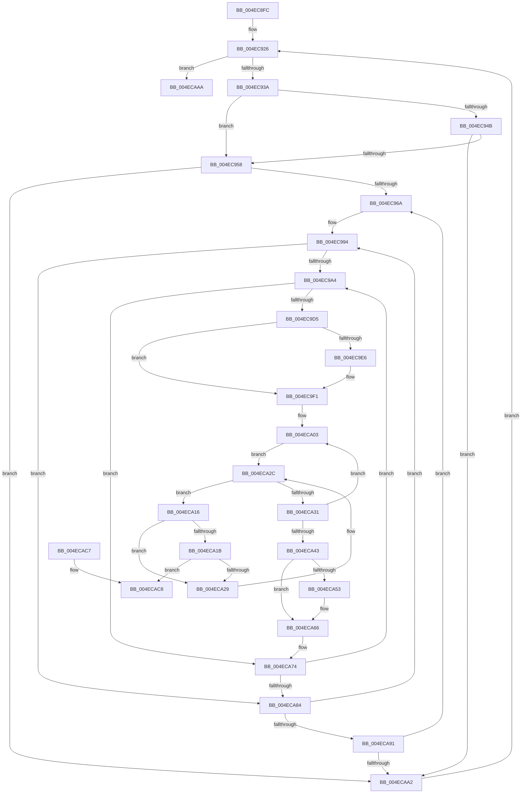

# ExpCheckForWorker

- RVA: `0x004EC8FC`–`0x004ECADD` (길이 `481` bytes)
- VA: `0x00000001404EC8FC`
- 실행 섹션: `.text`
- PDB 이름 있음: `예`; PDB Function 태그: `아니요`
- unwind 정보 RVA: `0x000D5584`
- 디코드: `122`개 명령, `481/481` bytes 표시
- 미해석 바이트: `0` (있으면 어셈블리에 `.byte`로 보존)

> 이 문서는 커널 이미지의 기계어와 PDB 기호를 분석해 생성했습니다. 4번과 5번은 함수 원형과 자료형을 바이너리 사용 방식에서 추정한 C 해석이며 원본 소스 복구 결과는 아닙니다.

## 1. Dependencies

- 직접 호출 지점: **5**; 고유 호출 대상: **5**
- 직접 호출자로 확인된 함수: **4**
- RIP 상대 이미지 참조: **6**

### Outgoing calls
- `0x004EC926` → [PsGetNextPartition](../3B/PsGetNextPartition_function_003B9D5C.md) (function, `0x003B9D5C`)
- `0x004EC9EC` → [KiRaiseIrqlProcessIrqlFlags](../4F/KiRaiseIrqlProcessIrqlFlags_function_004F56FC.md) (function, `0x004F56FC`)
- `0x004EC9F4` → [KiAcquireKobjectLockSafe](../25/KiAcquireKobjectLockSafe_function_00251C90.md) (function, `0x00251C90`)
- `0x004ECA5A` → [KiLowerIrqlProcessIrqlFlags](../4F/KiLowerIrqlProcessIrqlFlags_function_004F5698.md) (function, `0x004F5698`)
- `0x004ECAD7` → [KeBugCheckEx](../4F/KeBugCheckEx_function_004FD660.md) (function, `0x004FD660`)

### Direct callers
- [ExAllocateHeapPool](../35/ExAllocateHeapPool_function_0035BA30.md) at `0x0035E682`
- [ExpFreePoolChecks](../35/ExpFreePoolChecks_function_0035F4F0.md) at `0x0035F598`
- [sub_00360968](../36/Unknown_function_00360968.md) at `0x00360DA5`
- [sub_00B8371E](../../poolcode/B8/Unknown_function_00B8371E.md) at `0x00B83B5E`

### Static image references
- `0x004EC93A` → RVA `0x00FC6EA0` (`ALMOSTRO`; read)
- `0x004EC958` → RVA `0x00FC5000` (`ALMOSTRO`; read)
- `0x004EC96D` → RVA `0x00FCF6C0` (`CACHEALI`; read)
- `0x004EC983` → RVA `0x00FDAEC0` (`PAGEDATA`; read)
- `0x004EC9B3` → RVA `0x00EFAA0C` (`.data`; read)
- `0x004EC9DD` → RVA `0x00FC6D20` (`ALMOSTRO`; read)

## 2. Other-region calls and transfers

- 다른 실행 섹션으로 향하는 call: **0**
- 별도 외부 분기/꼬리 이동을 확인하지 못했습니다.

## 3. Assembly (complete function range)

```asm
004EC8FC  48 89 5C 24 10                  mov qword ptr [rsp + 0x10], rbx
004EC901  48 89 6C 24 18                  mov qword ptr [rsp + 0x18], rbp
004EC906  48 89 74 24 20                  mov qword ptr [rsp + 0x20], rsi
004EC90B  57                              push rdi
004EC90C  41 54                           push r12
004EC90E  41 55                           push r13
004EC910  41 56                           push r14
004EC912  41 57                           push r15
004EC914  48 83 EC 30                     sub rsp, 0x30
004EC918  48 8D 04 0A                     lea rax, [rdx + rcx]
004EC91C  4C 8B E9                        mov r13, rcx
004EC91F  48 89 44 24 60                  mov qword ptr [rsp + 0x60], rax
004EC924  33 C9                           xor ecx, ecx
004EC926  E8 31 D4 EC FF                  call 0x1403b9d5c
004EC92B  45 33 D2                        xor r10d, r10d
004EC92E  48 8B D8                        mov rbx, rax
004EC931  48 85 C0                        test rax, rax
004EC934  0F 84 70 01 00 00               je 0x1404ecaaa
004EC93A  48 3B 05 5F A5 AD 00            cmp rax, qword ptr [rip + 0xada55f]
004EC941  45 8D 4A 02                     lea r9d, [r10 + 2]
004EC945  45 8D 42 01                     lea r8d, [r10 + 1]
004EC949  75 0D                           jne 0x1404ec958
004EC94B  48 8B 48 10                     mov rcx, qword ptr [rax + 0x10]
004EC94F  48 85 C9                        test rcx, rcx
004EC952  0F 84 4A 01 00 00               je 0x1404ecaa2
004EC958  66 44 3B 15 A0 86 AD 00         cmp r10w, word ptr [rip + 0xad86a0]
004EC960  41 0F B7 F2                     movzx esi, r10w
004EC964  0F 83 38 01 00 00               jae 0x1404ecaa2
004EC96A  0F B7 C6                        movzx eax, si
004EC96D  48 8D 2D 4C 2D AE 00            lea rbp, [rip + 0xae2d4c]
004EC974  48 69 C8 38 03 00 00            imul rcx, rax, 0x338
004EC97B  48 8B 6C C5 00                  mov rbp, qword ptr [rbp + rax*8]
004EC980  45 8B FA                        mov r15d, r10d
004EC983  48 8D 05 36 E5 AE 00            lea rax, [rip + 0xaee536]
004EC98A  48 03 C8                        add rcx, rax
004EC98D  48 3B E9                        cmp rbp, rcx
004EC990  49 0F 44 EA                     cmove rbp, r10
004EC994  45 8B F2                        mov r14d, r10d
004EC997  44 39 95 58 03 00 00            cmp dword ptr [rbp + 0x358], r10d
004EC99E  0F 86 E0 00 00 00               jbe 0x1404eca84
004EC9A4  0F B7 45 00                     movzx eax, word ptr [rbp]
004EC9A8  49 8B FA                        mov rdi, r10
004EC9AB  41 8D 14 C7                     lea edx, [r15 + rax*8]
004EC9AF  48 8B 43 10                     mov rax, qword ptr [rbx + 0x10]
004EC9B3  0F AF 15 52 E0 A0 00            imul edx, dword ptr [rip + 0xa0e052]
004EC9BA  48 8B 48 08                     mov rcx, qword ptr [rax + 8]
004EC9BE  41 03 D6                        add edx, r14d
004EC9C1  48 8B 04 D1                     mov rax, qword ptr [rcx + rdx*8]
004EC9C5  41 84 C0                        test r8b, al
004EC9C8  48 0F 44 F8                     cmove rdi, rax
004EC9CC  48 85 FF                        test rdi, rdi
004EC9CF  0F 84 9F 00 00 00               je 0x1404eca74
004EC9D5  45 0F 20 C4                     mov r12, cr8
004EC9D9  45 0F 22 C1                     mov cr8, r9
004EC9DD  44 39 15 3C A3 AD 00            cmp dword ptr [rip + 0xada33c], r10d
004EC9E4  74 0B                           je 0x1404ec9f1
004EC9E6  41 8A D1                        mov dl, r9b
004EC9E9  41 8A CC                        mov cl, r12b
004EC9EC  E8 0B 8D 00 00                  call 0x1404f56fc
004EC9F1  48 8B CF                        mov rcx, rdi
004EC9F4  E8 97 52 D6 FF                  call 0x140251c90
004EC9F9  45 33 D2                        xor r10d, r10d
004EC9FC  48 8D 57 18                     lea rdx, [rdi + 0x18]
004ECA00  41 8B CA                        mov ecx, r10d
004ECA03  4C 8B 02                        mov r8, qword ptr [rdx]
004ECA06  4C 63 C9                        movsxd r9, ecx
004ECA09  49 C1 E1 04                     shl r9, 4
004ECA0D  49 83 C1 18                     add r9, 0x18
004ECA11  4C 03 CF                        add r9, rdi
004ECA14  EB 16                           jmp 0x1404eca2c
004ECA16  4D 3B C5                        cmp r8, r13
004ECA19  72 0E                           jb 0x1404eca29
004ECA1B  48 8B 44 24 60                  mov rax, qword ptr [rsp + 0x60]
004ECA20  4C 3B C0                        cmp r8, rax
004ECA23  0F 82 9F 00 00 00               jb 0x1404ecac8
004ECA29  4D 8B 00                        mov r8, qword ptr [r8]
004ECA2C  4D 3B C1                        cmp r8, r9
004ECA2F  75 E5                           jne 0x1404eca16
004ECA31  41 B8 01 00 00 00               mov r8d, 1
004ECA37  48 83 C2 10                     add rdx, 0x10
004ECA3B  41 03 C8                        add ecx, r8d
004ECA3E  83 F9 20                        cmp ecx, 0x20
004ECA41  7C C0                           jl 0x1404eca03
004ECA43  F0 81 27 7F FF FF FF            lock and dword ptr [rdi], 0xffffff7f
004ECA4A  44 39 15 CF A2 AD 00            cmp dword ptr [rip + 0xada2cf], r10d
004ECA51  74 13                           je 0x1404eca66
004ECA53  44 0F 20 C1                     mov rcx, cr8
004ECA57  41 8A D4                        mov dl, r12b
004ECA5A  E8 39 8C 00 00                  call 0x1404f5698
004ECA5F  45 33 D2                        xor r10d, r10d
004ECA62  45 8D 42 01                     lea r8d, [r10 + 1]
004ECA66  41 0F B6 C4                     movzx eax, r12b
004ECA6A  44 0F 22 C0                     mov cr8, rax
004ECA6E  41 B9 02 00 00 00               mov r9d, 2
004ECA74  45 03 F0                        add r14d, r8d
004ECA77  44 3B B5 58 03 00 00            cmp r14d, dword ptr [rbp + 0x358]
004ECA7E  0F 82 20 FF FF FF               jb 0x1404ec9a4
004ECA84  45 03 F8                        add r15d, r8d
004ECA87  41 83 FF 08                     cmp r15d, 8
004ECA8B  0F 8C 03 FF FF FF               jl 0x1404ec994
004ECA91  66 41 03 F0                     add si, r8w
004ECA95  66 3B 35 64 85 AD 00            cmp si, word ptr [rip + 0xad8564]
004ECA9C  0F 82 C8 FE FF FF               jb 0x1404ec96a
004ECAA2  48 8B CB                        mov rcx, rbx
004ECAA5  E9 7C FE FF FF                  jmp 0x1404ec926
004ECAAA  48 8B 5C 24 68                  mov rbx, qword ptr [rsp + 0x68]
004ECAAF  48 8B 6C 24 70                  mov rbp, qword ptr [rsp + 0x70]
004ECAB4  48 8B 74 24 78                  mov rsi, qword ptr [rsp + 0x78]
004ECAB9  48 83 C4 30                     add rsp, 0x30
004ECABD  41 5F                           pop r15
004ECABF  41 5E                           pop r14
004ECAC1  41 5D                           pop r13
004ECAC3  41 5C                           pop r12
004ECAC5  5F                              pop rdi
004ECAC6  C3                              ret
004ECAC7  CC                              int3
004ECAC8  4D 8B CD                        mov r9, r13
004ECACB  48 89 44 24 20                  mov qword ptr [rsp + 0x20], rax
004ECAD0  33 D2                           xor edx, edx
004ECAD2  B9 E4 00 00 00                  mov ecx, 0xe4
004ECAD7  E8 84 0B 01 00                  call 0x1404fd660
004ECADC  CC                              int3
```

## 4. C-style interpretation (structured pseudocode)

```c
__int64 __fastcall ExpCheckForWorker(__int64 a1, __int64 a2)
{
    __int64 result;
    __int64 v_r10;
    __int64 v_r14;
    __int64 v_r15;
    __int64 v_rbp;
    __int64 v_rdi;
    __int64 v_rsi;
    __int64 v_rsp;
    unsigned __int64 v_stack_p10;
    unsigned __int64 v_stack_p18;
    unsigned __int64 v_stack_p20;
    unsigned __int64 v_stack_p8;

    v_stack_p10 = v_rbx;
    v_stack_p18 = v_rbp;
    v_stack_p20 = v_rsi;
    v_rsp = (v_rsp) - (48);
    v_stack_p8 = a2 + a1 * 1;
    a1 = 0;
loc_004EC926:
    result = PsGetNextPartition(a1, a2, a3, a4);
    v_r10 = 0;
    if (result == 0) goto loc_004ECAAA;
    if (result != (*(unsigned __int64 *)(v_rip + 11380063))) goto loc_004EC958;
    if (*(unsigned __int64 *)(result + 16) == 0) goto loc_004ECAA2;
loc_004EC958:
    if (0 >= (*(unsigned __int16 *)(v_rip + 11372192))) goto loc_004ECAA2;
loc_004EC96A:
    a1 = (*(unsigned __int64 *)(result + 16)) * (0);
    a1 = (a1) + (v_rip + 11461942);
    v_rbp = *(unsigned __int64 *)(v_rip + 11414860 + 0 * 8);
    if ((*(unsigned __int64 *)(v_rip + 11414860 + 0 * 8)) == a1) { v_rbp = 0; }
loc_004EC994:
    if ((*(unsigned int *)(v_rbp + 856)) <= 0) goto loc_004ECA84;
loc_004EC9A4:
    a2 = (unsigned int)((0 + *(unsigned __int16 *)(v_rbp) * 8) * (*(unsigned int *)(v_rip + 10543186)));
    a2 = (unsigned int)((a2) + (0));
    v_rdi = 0;
    if ((((unsigned __int8)(v_r10 + 1)) & ((unsigned __int8)(*(unsigned __int64 *)(*(unsigned __int64 *)(*(unsigned __int64 *)(result + 16) + 8) + a2 * 8)))) == 0) { v_rdi = *(unsigned __int64 *)(*(unsigned __int64 *)(*(unsigned __int64 *)(result + 16) + 8) + a2 * 8); }
    if (v_rdi == 0) goto loc_004ECA74;
    result = *(unsigned __int64 *)(*(unsigned __int64 *)(*(unsigned __int64 *)(result + 16) + 8) + a2 * 8);
    if ((*(unsigned int *)(v_rip + 11379516)) != 0) {
        a2 = (unsigned __int8)(v_r10 + 2);
        a1 = (unsigned __int8)(v_cr8);
        result = KiRaiseIrqlProcessIrqlFlags(a1, a2, v_r10 + 1, v_r10 + 2);
    }
    result = KiAcquireKobjectLockSafe(v_rdi, a2, v_r10 + 1, v_r10 + 2);
    v_r10 = 0;
loc_004ECA03:
    a4 = ((int)(0)) << (4);
    a4 = (a4) + (24);
    a4 = (a4) + (v_rdi);
    goto loc_004ECA2C;
loc_004ECA16:
    if ((*(unsigned __int64 *)(v_rdi + 24)) < a1) goto loc_004ECA29;
    if ((*(unsigned __int64 *)(v_rdi + 24)) < v_stack_p8) goto loc_004ECAC8;
loc_004ECA29:
loc_004ECA2C:
    if ((*(unsigned __int64 *)(*(unsigned __int64 *)(v_rdi + 24))) != a4) goto loc_004ECA16;
    a2 = (v_rdi + 24) + (16);
    a1 = (unsigned int)((0) + (1));
    if (((unsigned int)(a1)) < 32) goto loc_004ECA03;
    result = v_stack_p8;
    if ((*(unsigned int *)(v_rip + 11379407)) != 0) {
        a1 = v_r10 + 2;
        a2 = (unsigned __int8)(v_cr8);
        result = KiLowerIrqlProcessIrqlFlags(a1, a2, 1, a4);
        v_r10 = 0;
        a3 = v_r10 + 1;
    }
loc_004ECA74:
    v_r14 = (unsigned int)((0) + ((unsigned int)(a3)));
    if (((unsigned int)(v_r14)) < (*(unsigned int *)(v_rbp + 856))) goto loc_004EC9A4;
loc_004ECA84:
    v_r15 = (unsigned int)((0) + ((unsigned int)(a3)));
    if (((unsigned int)(v_r15)) < 8) goto loc_004EC994;
    v_rsi = (unsigned __int16)((0) + ((unsigned __int16)(a3)));
    if (((unsigned __int16)(v_rsi)) < (*(unsigned __int16 *)(v_rip + 11371876))) goto loc_004EC96A;
loc_004ECAA2:
    goto loc_004EC926;
loc_004ECAAA:
    v_rsp = (v_rsp) + (48);
    return (unsigned __int8)(v_cr8);
loc_004ECAC8:
    v_stack_p20 = (unsigned __int8)(v_cr8);
    a2 = 0;
    result = KeBugCheckEx(228, a2, a3, a1);
    return result;
}
```

## 5. (Beta) C Style

```c
int64_t ExpCheckForWorker(int64_t Arg1, void *Arg2)
{
    uint8_t *arg2 = (uint8_t *)Arg2;

    int64_t result;
    int64_t local_r10;
    int64_t local_r14;
    int64_t local_r15;
    int64_t local_rbp;
    int64_t local_rdi;
    int64_t local_rsi;
    int64_t local_rsp;
    uint64_t v_stack_p10;
    uint64_t v_stack_p18;
    uint64_t v_stack_p20;
    uint64_t v_stack_p8;

    v_stack_p10 = local_rbx;
    v_stack_p18 = local_rbp;
    v_stack_p20 = local_rsi;
    local_rsp = (local_rsp) - (48);
    v_stack_p8 = Arg2 + Arg1 * 1;
    Arg1 = 0;
loc_004EC926:
    result = PsGetNextPartition(Arg1, Arg2, a3, a4);
    local_r10 = 0;
    if (result == 0) goto loc_004ECAAA;
    if (result != (*(uint64_t *)(v_rip + 0xADA55F))) goto loc_004EC958;
    if (*(uint64_t *)(result + 0x10) == 0) goto loc_004ECAA2;
loc_004EC958:
    if (0 >= (*(uint16_t *)(v_rip + 0xAD86A0))) goto loc_004ECAA2;
loc_004EC96A:
    Arg1 = (*(uint64_t *)(result + 0x10)) * (0);
    Arg1 = (Arg1) + (v_rip + 11461942);
    local_rbp = *(uint64_t *)(v_rip + 0xAE2D4C + 0x0 * 8);
    if ((*(uint64_t *)(v_rip + 0xAE2D4C + 0x0 * 8)) == Arg1) { local_rbp = 0; }
loc_004EC994:
    if ((*(uint32_t *)(local_rbp + 0x358)) <= 0) goto loc_004ECA84;
loc_004EC9A4:
    Arg2 = (uint32_t)((0 + *(uint16_t *)(local_rbp) * 8) * (*(uint32_t *)(v_rip + 0xA0E052)));
    Arg2 = (uint32_t)((Arg2) + (0));
    local_rdi = 0;
    if ((((uint8_t)(local_r10 + 1)) & ((uint8_t)(*(uint64_t *)(*(uint64_t *)(*(uint64_t *)(result + 0x10) + 0x8) + arg2 * 8)))) == 0) { local_rdi = *(uint64_t *)(*(uint64_t *)(*(uint64_t *)(result + 0x10) + 0x8) + arg2 * 8); }
    if (local_rdi == 0) goto loc_004ECA74;
    result = *(uint64_t *)(*(uint64_t *)(*(uint64_t *)(result + 0x10) + 0x8) + arg2 * 8);
    if ((*(uint32_t *)(v_rip + 0xADA33C)) != 0) {
        Arg2 = (uint8_t)(local_r10 + 2);
        Arg1 = (uint8_t)(v_cr8);
        result = KiRaiseIrqlProcessIrqlFlags(Arg1, Arg2, local_r10 + 1, local_r10 + 2);
    }
    result = KiAcquireKobjectLockSafe(local_rdi, Arg2, local_r10 + 1, local_r10 + 2);
    local_r10 = 0;
loc_004ECA03:
    a4 = ((int32_t)(0)) << (4);
    a4 = (a4) + (24);
    a4 = (a4) + (local_rdi);
    goto loc_004ECA2C;
loc_004ECA16:
    if ((*(uint64_t *)(local_rdi + 0x18)) < Arg1) goto loc_004ECA29;
    if ((*(uint64_t *)(local_rdi + 0x18)) < v_stack_p8) goto loc_004ECAC8;
loc_004ECA29:
loc_004ECA2C:
    if ((*(uint64_t *)(*(uint64_t *)(local_rdi + 0x18))) != a4) goto loc_004ECA16;
    Arg2 = (local_rdi + 24) + (16);
    Arg1 = (uint32_t)((0) + (1));
    if (((uint32_t)(Arg1)) < 32) goto loc_004ECA03;
    result = v_stack_p8;
    if ((*(uint32_t *)(v_rip + 0xADA2CF)) != 0) {
        Arg1 = local_r10 + 2;
        Arg2 = (uint8_t)(v_cr8);
        result = KiLowerIrqlProcessIrqlFlags(Arg1, Arg2, 1, a4);
        local_r10 = 0;
        a3 = local_r10 + 1;
    }
loc_004ECA74:
    local_r14 = (uint32_t)((0) + ((uint32_t)(a3)));
    if (((uint32_t)(local_r14)) < (*(uint32_t *)(local_rbp + 0x358))) goto loc_004EC9A4;
loc_004ECA84:
    local_r15 = (uint32_t)((0) + ((uint32_t)(a3)));
    if (((uint32_t)(local_r15)) < 8) goto loc_004EC994;
    local_rsi = (uint16_t)((0) + ((uint16_t)(a3)));
    if (((uint16_t)(local_rsi)) < (*(uint16_t *)(v_rip + 0xAD8564))) goto loc_004EC96A;
loc_004ECAA2:
    goto loc_004EC926;
loc_004ECAAA:
    local_rsp = (local_rsp) + (48);
    return (uint8_t)(v_cr8);
loc_004ECAC8:
    v_stack_p20 = (uint8_t)(v_cr8);
    Arg2 = 0;
    result = KeBugCheckEx(228, Arg2, a3, Arg1);
    return result;
}
```

### 관측된 메모리 오프셋

구조체 형식이 확인되지 않은 접근은 인자 기준의 오프셋으로만 기록했습니다.

| 기준 인자 | 오프셋 표현 | 폭 (bit) | 접근 |
|---|---:|---:|---|
| `Arg2` | `+ 0x0 + rcx*1` | `64` | `R` |

## 6. Execution-region graph

[열기: 2D/3D 그래프와 함수 탐색 컨트롤 패널](../../../control-panel.html?section=text&rva=0x004EC8FC&view=graph)

- 2D 그래프는 위에서 아래로 흐르고, 3D 그래프는 빈 공간을 드래그해 회전합니다. Shift+드래그는 이동, 휠은 확대·축소, 함수 노드 선택은 대상 보고서 이동입니다.

### Static fallback


