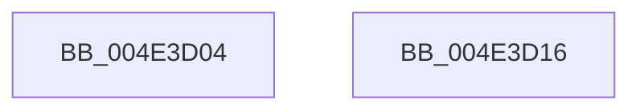

# ExpGetIRTimerDesc

- RVA: `0x004E3D04`–`0x004E3D17` (길이 `19` bytes)
- VA: `0x00000001404E3D04`
- 실행 섹션: `.text`
- PDB 이름 있음: `예`; PDB Function 태그: `아니요`
- unwind 정보 RVA: `0x000DB714`
- 디코드: `6`개 명령, `19/19` bytes 표시
- 미해석 바이트: `0` (있으면 어셈블리에 `.byte`로 보존)

> 이 문서는 커널 이미지의 기계어와 PDB 기호를 분석해 생성했습니다. 4번과 5번은 함수 원형과 자료형을 바이너리 사용 방식에서 추정한 C 해석이며 원본 소스 복구 결과는 아닙니다.

## 1. Dependencies

- 직접 호출 지점: **0**; 고유 호출 대상: **0**
- 직접 호출자로 확인된 함수: **3**
- RIP 상대 이미지 참조: **1**

### Outgoing calls
- 직접 디코드된 call 명령이 없습니다.

### Direct callers
- [ExStartRecordingIRTimerExpiries](../../page/7C/ExStartRecordingIRTimerExpiries_function_007CAD18.md) at `0x007CAD23`
- [ExpCheckIRTimerAccess](../../page/A2/ExpCheckIRTimerAccess_function_00A2C83C.md) at `0x00A2C85B`
- [ExStopRecordingIRTimerExpiries](../../page/AD/ExStopRecordingIRTimerExpiries_function_00AD66A0.md) at `0x00AD66DB`

### Static image references
- `0x004E3D0A` → RVA `0x00E093C0` (`.data`; read)

## 2. Other-region calls and transfers

- 다른 실행 섹션으로 향하는 call: **0**
- 별도 외부 분기/꼬리 이동을 확인하지 못했습니다.

## 3. Assembly (complete function range)

```asm
004E3D04  8B C1                           mov eax, ecx
004E3D06  48 8D 0C 40                     lea rcx, [rax + rax*2]
004E3D0A  48 8D 05 AF 56 92 00            lea rax, [rip + 0x9256af]
004E3D11  48 8D 04 C8                     lea rax, [rax + rcx*8]
004E3D15  C3                              ret
004E3D16  CC                              int3
```

## 4. C-style interpretation (structured pseudocode)

```c
__int64 __fastcall ExpGetIRTimerDesc(int a1)
{
    return v_rip + 9590447 + (unsigned int)(a1) + (unsigned int)(a1) * 2 * 8;
}
```

## 5. (Beta) C Style

```c
int64_t ExpGetIRTimerDesc(void *Arg1)
{
    uint8_t *arg1 = (uint8_t *)Arg1;

    return v_rip + 9590447 + (uint32_t)(Arg1) + (uint32_t)(Arg1) * 2 * 8;
}
```

### 관측된 메모리 오프셋

구조체 형식이 확인되지 않은 접근은 인자 기준의 오프셋으로만 기록했습니다.

| 기준 인자 | 오프셋 표현 | 폭 (bit) | 접근 |
|---|---:|---:|---|
| `Arg1` | `+ 0x0 + rax*2` | `64` | `R` |

## 6. Execution-region graph

[열기: 2D/3D 그래프와 함수 탐색 컨트롤 패널](../../../control-panel.html?section=text&rva=0x004E3D04&view=graph)

- 2D 그래프는 위에서 아래로 흐르고, 3D 그래프는 빈 공간을 드래그해 회전합니다. Shift+드래그는 이동, 휠은 확대·축소, 함수 노드 선택은 대상 보고서 이동입니다.

### Static fallback


