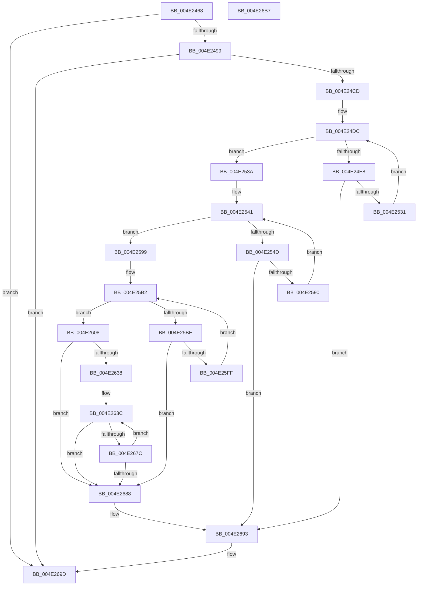

# ExpGetLookasideInformation

- RVA: `0x004E2468`–`0x004E26B8` (길이 `592` bytes)
- VA: `0x00000001404E2468`
- 실행 섹션: `.text`
- PDB 이름 있음: `예`; PDB Function 태그: `아니요`
- unwind 정보 RVA: `0x000BF2D4`
- 디코드: `172`개 명령, `592/592` bytes 표시
- 미해석 바이트: `0` (있으면 어셈블리에 `.byte`로 보존)

> 이 문서는 커널 이미지의 기계어와 PDB 기호를 분석해 생성했습니다. 4번과 5번은 함수 원형과 자료형을 바이너리 사용 방식에서 추정한 C 해석이며 원본 소스 복구 결과는 아닙니다.

## 1. Dependencies

- 직접 호출 지점: **6**; 고유 호출 대상: **4**
- 직접 호출자로 확인된 함수: **1**
- RIP 상대 이미지 참조: **6**

### Outgoing calls
- `0x004E24BD` → [ExLockUserBuffer](../../page/95/ExLockUserBuffer_function_009533B8.md) (function, `0x009533B8`)
- `0x004E25A3` → [KeAcquireSpinLockRaiseToDpc](../20/KeAcquireSpinLockRaiseToDpc_function_00208470.md) (function, `0x00208470`)
- `0x004E260E` → [KeReleaseSpinLock](../39/KeReleaseSpinLock_function_00392BA0.md) (function, `0x00392BA0`)
- `0x004E261D` → [KeAcquireSpinLockRaiseToDpc](../20/KeAcquireSpinLockRaiseToDpc_function_00208470.md) (function, `0x00208470`)
- `0x004E268E` → [KeReleaseSpinLock](../39/KeReleaseSpinLock_function_00392BA0.md) (function, `0x00392BA0`)
- `0x004E2698` → [ExUnlockUserBuffer](../29/ExUnlockUserBuffer_function_0029F258.md) (function, `0x0029F258`)

### Direct callers
- [ExpQuerySystemInformation](../../page/A5/ExpQuerySystemInformation_function_00A57858.md) at `0x00A58581`

### Static image references
- `0x004E24CD` → RVA `0x00EFABD0` (`.data`; read)
- `0x004E253A` → RVA `0x00EFAC00` (`.data`; read)
- `0x004E2599` → RVA `0x00EFABC0` (`.data`; read)
- `0x004E25A8` → RVA `0x00EFABF0` (`.data`; read)
- `0x004E2613` → RVA `0x00EFABE0` (`.data`; read)
- `0x004E2622` → RVA `0x00EFABB0` (`.data`; read)

## 2. Other-region calls and transfers

- 다른 실행 섹션으로 향하는 call: **1**
  - `0x004E24BD` → [ExLockUserBuffer](../../page/95/ExLockUserBuffer_function_009533B8.md) (`.text` → `PAGE`)
- 별도 외부 분기/꼬리 이동을 확인하지 못했습니다.

## 3. Assembly (complete function range)

```asm
004E2468  4C 8B DC                        mov r11, rsp
004E246B  49 89 5B 08                     mov qword ptr [r11 + 8], rbx
004E246F  55                              push rbp
004E2470  56                              push rsi
004E2471  57                              push rdi
004E2472  41 56                           push r14
004E2474  41 57                           push r15
004E2476  48 83 EC 30                     sub rsp, 0x30
004E247A  49 83 63 20 00                  and qword ptr [r11 + 0x20], 0
004E247F  8B F2                           mov esi, edx
004E2481  49 83 63 18 00                  and qword ptr [r11 + 0x18], 0
004E2486  33 FF                           xor edi, edi
004E2488  C1 EE 05                        shr esi, 5
004E248B  45 33 F6                        xor r14d, r14d
004E248E  4D 8B F8                        mov r15, r8
004E2491  85 F6                           test esi, esi
004E2493  0F 84 04 02 00 00               je 0x1404e269d
004E2499  65 48 8B 04 25 88 01 00 00      mov rax, qword ptr gs:[0x188]
004E24A2  44 8D 4F 01                     lea r9d, [rdi + 1]
004E24A6  44 8A 80 32 02 00 00            mov r8b, byte ptr [rax + 0x232]
004E24AD  49 8D 43 20                     lea rax, [r11 + 0x20]
004E24B1  49 89 43 D0                     mov qword ptr [r11 - 0x30], rax
004E24B5  49 8D 43 18                     lea rax, [r11 + 0x18]
004E24B9  49 89 43 C8                     mov qword ptr [r11 - 0x38], rax
004E24BD  E8 F6 0E 47 00                  call 0x1409533b8
004E24C2  44 8B F0                        mov r14d, eax
004E24C5  85 C0                           test eax, eax
004E24C7  0F 88 D0 01 00 00               js 0x1404e269d
004E24CD  48 8B 15 FC 86 A1 00            mov rdx, qword ptr [rip + 0xa186fc]
004E24D4  45 33 F6                        xor r14d, r14d
004E24D7  48 8B 5C 24 70                  mov rbx, qword ptr [rsp + 0x70]
004E24DC  48 8D 05 ED 86 A1 00            lea rax, [rip + 0xa186ed]
004E24E3  48 3B D0                        cmp rdx, rax
004E24E6  74 52                           je 0x1404e253a
004E24E8  0F B7 42 C0                     movzx eax, word ptr [rdx - 0x40]
004E24EC  FF C7                           inc edi
004E24EE  66 89 03                        mov word ptr [rbx], ax
004E24F1  0F B7 42 D0                     movzx eax, word ptr [rdx - 0x30]
004E24F5  66 89 43 02                     mov word ptr [rbx + 2], ax
004E24F9  8B 42 D4                        mov eax, dword ptr [rdx - 0x2c]
004E24FC  89 43 04                        mov dword ptr [rbx + 4], eax
004E24FF  8B 4A D4                        mov ecx, dword ptr [rdx - 0x2c]
004E2502  2B 4A D8                        sub ecx, dword ptr [rdx - 0x28]
004E2505  89 4B 08                        mov dword ptr [rbx + 8], ecx
004E2508  8B 42 DC                        mov eax, dword ptr [rdx - 0x24]
004E250B  89 43 0C                        mov dword ptr [rbx + 0xc], eax
004E250E  8B 4A DC                        mov ecx, dword ptr [rdx - 0x24]
004E2511  2B 4A E0                        sub ecx, dword ptr [rdx - 0x20]
004E2514  89 4B 10                        mov dword ptr [rbx + 0x10], ecx
004E2517  8B 42 E4                        mov eax, dword ptr [rdx - 0x1c]
004E251A  89 43 14                        mov dword ptr [rbx + 0x14], eax
004E251D  8B 42 E8                        mov eax, dword ptr [rdx - 0x18]
004E2520  89 43 18                        mov dword ptr [rbx + 0x18], eax
004E2523  8B 42 EC                        mov eax, dword ptr [rdx - 0x14]
004E2526  89 43 1C                        mov dword ptr [rbx + 0x1c], eax
004E2529  3B FE                           cmp edi, esi
004E252B  0F 84 62 01 00 00               je 0x1404e2693
004E2531  48 8B 12                        mov rdx, qword ptr [rdx]
004E2534  48 83 C3 20                     add rbx, 0x20
004E2538  EB A2                           jmp 0x1404e24dc
004E253A  48 8B 0D BF 86 A1 00            mov rcx, qword ptr [rip + 0xa186bf]
004E2541  48 8D 05 B8 86 A1 00            lea rax, [rip + 0xa186b8]
004E2548  48 3B C8                        cmp rcx, rax
004E254B  74 4C                           je 0x1404e2599
004E254D  0F B7 41 C0                     movzx eax, word ptr [rcx - 0x40]
004E2551  FF C7                           inc edi
004E2553  66 89 03                        mov word ptr [rbx], ax
004E2556  0F B7 41 D0                     movzx eax, word ptr [rcx - 0x30]
004E255A  66 89 43 02                     mov word ptr [rbx + 2], ax
004E255E  8B 41 D4                        mov eax, dword ptr [rcx - 0x2c]
004E2561  89 43 04                        mov dword ptr [rbx + 4], eax
004E2564  8B 41 D8                        mov eax, dword ptr [rcx - 0x28]
004E2567  89 43 08                        mov dword ptr [rbx + 8], eax
004E256A  8B 41 DC                        mov eax, dword ptr [rcx - 0x24]
004E256D  89 43 0C                        mov dword ptr [rbx + 0xc], eax
004E2570  8B 41 E0                        mov eax, dword ptr [rcx - 0x20]
004E2573  89 43 10                        mov dword ptr [rbx + 0x10], eax
004E2576  8B 41 E4                        mov eax, dword ptr [rcx - 0x1c]
004E2579  89 43 14                        mov dword ptr [rbx + 0x14], eax
004E257C  8B 41 E8                        mov eax, dword ptr [rcx - 0x18]
004E257F  89 43 18                        mov dword ptr [rbx + 0x18], eax
004E2582  8B 41 EC                        mov eax, dword ptr [rcx - 0x14]
004E2585  89 43 1C                        mov dword ptr [rbx + 0x1c], eax
004E2588  3B FE                           cmp edi, esi
004E258A  0F 84 03 01 00 00               je 0x1404e2693
004E2590  48 8B 09                        mov rcx, qword ptr [rcx]
004E2593  48 83 C3 20                     add rbx, 0x20
004E2597  EB A8                           jmp 0x1404e2541
004E2599  48 8D 2D 20 86 A1 00            lea rbp, [rip + 0xa18620]
004E25A0  48 8B CD                        mov rcx, rbp
004E25A3  E8 C8 5E D2 FF                  call 0x140208470
004E25A8  48 8B 15 41 86 A1 00            mov rdx, qword ptr [rip + 0xa18641]
004E25AF  44 8A C0                        mov r8b, al
004E25B2  48 8D 05 37 86 A1 00            lea rax, [rip + 0xa18637]
004E25B9  48 3B D0                        cmp rdx, rax
004E25BC  74 4A                           je 0x1404e2608
004E25BE  0F B7 4A C0                     movzx ecx, word ptr [rdx - 0x40]
004E25C2  FF C7                           inc edi
004E25C4  66 89 0B                        mov word ptr [rbx], cx
004E25C7  0F B7 4A D0                     movzx ecx, word ptr [rdx - 0x30]
004E25CB  66 89 4B 02                     mov word ptr [rbx + 2], cx
004E25CF  8B 4A D4                        mov ecx, dword ptr [rdx - 0x2c]
004E25D2  89 4B 04                        mov dword ptr [rbx + 4], ecx
004E25D5  8B 42 D8                        mov eax, dword ptr [rdx - 0x28]
004E25D8  89 43 08                        mov dword ptr [rbx + 8], eax
004E25DB  8B 42 DC                        mov eax, dword ptr [rdx - 0x24]
004E25DE  89 43 0C                        mov dword ptr [rbx + 0xc], eax
004E25E1  8B 42 E0                        mov eax, dword ptr [rdx - 0x20]
004E25E4  89 43 10                        mov dword ptr [rbx + 0x10], eax
004E25E7  44 21 73 14                     and dword ptr [rbx + 0x14], r14d
004E25EB  8B 42 E8                        mov eax, dword ptr [rdx - 0x18]
004E25EE  89 43 18                        mov dword ptr [rbx + 0x18], eax
004E25F1  8B 42 EC                        mov eax, dword ptr [rdx - 0x14]
004E25F4  89 43 1C                        mov dword ptr [rbx + 0x1c], eax
004E25F7  3B FE                           cmp edi, esi
004E25F9  0F 84 89 00 00 00               je 0x1404e2688
004E25FF  48 8B 12                        mov rdx, qword ptr [rdx]
004E2602  48 83 C3 20                     add rbx, 0x20
004E2606  EB AA                           jmp 0x1404e25b2
004E2608  41 8A D0                        mov dl, r8b
004E260B  48 8B CD                        mov rcx, rbp
004E260E  E8 8D 05 EB FF                  call 0x140392ba0
004E2613  48 8D 2D C6 85 A1 00            lea rbp, [rip + 0xa185c6]
004E261A  48 8B CD                        mov rcx, rbp
004E261D  E8 4E 5E D2 FF                  call 0x140208470
004E2622  48 8B 15 87 85 A1 00            mov rdx, qword ptr [rip + 0xa18587]
004E2629  48 8D 0D 80 85 A1 00            lea rcx, [rip + 0xa18580]
004E2630  44 8A C0                        mov r8b, al
004E2633  48 3B D1                        cmp rdx, rcx
004E2636  74 50                           je 0x1404e2688
004E2638  48 83 C3 04                     add rbx, 4
004E263C  0F B7 42 C0                     movzx eax, word ptr [rdx - 0x40]
004E2640  FF C7                           inc edi
004E2642  66 89 43 FC                     mov word ptr [rbx - 4], ax
004E2646  0F B7 42 D0                     movzx eax, word ptr [rdx - 0x30]
004E264A  66 89 43 FE                     mov word ptr [rbx - 2], ax
004E264E  8B 42 D4                        mov eax, dword ptr [rdx - 0x2c]
004E2651  89 03                           mov dword ptr [rbx], eax
004E2653  8B 42 D8                        mov eax, dword ptr [rdx - 0x28]
004E2656  89 43 04                        mov dword ptr [rbx + 4], eax
004E2659  8B 42 DC                        mov eax, dword ptr [rdx - 0x24]
004E265C  89 43 08                        mov dword ptr [rbx + 8], eax
004E265F  8B 42 E0                        mov eax, dword ptr [rdx - 0x20]
004E2662  89 43 0C                        mov dword ptr [rbx + 0xc], eax
004E2665  C7 43 10 01 00 00 00            mov dword ptr [rbx + 0x10], 1
004E266C  8B 42 E8                        mov eax, dword ptr [rdx - 0x18]
004E266F  89 43 14                        mov dword ptr [rbx + 0x14], eax
004E2672  8B 42 EC                        mov eax, dword ptr [rdx - 0x14]
004E2675  89 43 18                        mov dword ptr [rbx + 0x18], eax
004E2678  3B FE                           cmp edi, esi
004E267A  74 0C                           je 0x1404e2688
004E267C  48 8B 12                        mov rdx, qword ptr [rdx]
004E267F  48 83 C3 20                     add rbx, 0x20
004E2683  48 3B D1                        cmp rdx, rcx
004E2686  75 B4                           jne 0x1404e263c
004E2688  41 8A D0                        mov dl, r8b
004E268B  48 8B CD                        mov rcx, rbp
004E268E  E8 0D 05 EB FF                  call 0x140392ba0
004E2693  48 8B 4C 24 78                  mov rcx, qword ptr [rsp + 0x78]
004E2698  E8 BB CB DB FF                  call 0x14029f258
004E269D  48 8B 5C 24 60                  mov rbx, qword ptr [rsp + 0x60]
004E26A2  41 8B C6                        mov eax, r14d
004E26A5  C1 E7 05                        shl edi, 5
004E26A8  41 89 3F                        mov dword ptr [r15], edi
004E26AB  48 83 C4 30                     add rsp, 0x30
004E26AF  41 5F                           pop r15
004E26B1  41 5E                           pop r14
004E26B3  5F                              pop rdi
004E26B4  5E                              pop rsi
004E26B5  5D                              pop rbp
004E26B6  C3                              ret
004E26B7  CC                              int3
```

## 4. C-style interpretation (structured pseudocode)

```c
__int64 __fastcall ExpGetLookasideInformation(__int64 a1, int a2, __int64 a3)
{
    __int64 result;
    __int64 v_r14;
    __int64 v_rbx;
    __int64 v_rdi;
    __int64 v_rsi;
    __int64 v_rsp;
    unsigned __int64 v_stack_p18;
    unsigned __int64 v_stack_p20;
    unsigned __int64 v_stack_p8;

    *(unsigned __int64 *)(v_rsp + 8) = v_rbx;
    v_rsp = (v_rsp) - (48);
    v_rdi = 0;
    v_rsi = (unsigned int)(((unsigned int)(a2)) >> (5));
    v_r14 = 0;
    if ((unsigned int)(v_rsi) == 0) goto loc_004E269D;
    *(unsigned __int64 *)(v_rsp - 48) = v_rsp + 32;
    *(unsigned __int64 *)(v_rsp - 56) = v_rsp + 24;
    result = ExLockUserBuffer(a1, a2, *(unsigned __int8 *)(*(unsigned __int64 *)(gs_base + (0 + 392)) + 562), v_rdi + 1);
    if (sign_flag) goto loc_004E269D;
    v_r14 = 0;
loc_004E24DC:
    if ((*(unsigned __int64 *)(v_rip + 10585852)) == (v_rip + 10585837)) goto loc_004E253A;
    v_rdi = (unsigned int)((v_rdi) + 1);
    *(unsigned __int16 *)(v_stack_p18) = (unsigned __int16)(*(unsigned __int16 *)(*(unsigned __int64 *)(v_rip + 10585852) - 64));
    *(unsigned __int16 *)(v_stack_p18 + 2) = (unsigned __int16)(*(unsigned __int16 *)(*(unsigned __int64 *)(v_rip + 10585852) - 48));
    *(unsigned int *)(v_stack_p18 + 4) = (unsigned int)((unsigned int)(*(unsigned int *)(*(unsigned __int64 *)(v_rip + 10585852) - 44)));
    a1 = (unsigned int)(((unsigned int)(*(unsigned int *)(*(unsigned __int64 *)(v_rip + 10585852) - 44))) - (*(unsigned int *)(*(unsigned __int64 *)(v_rip + 10585852) - 40)));
    *(unsigned int *)(v_stack_p18 + 8) = (unsigned int)(a1);
    *(unsigned int *)(v_stack_p18 + 12) = (unsigned int)((unsigned int)(*(unsigned int *)(*(unsigned __int64 *)(v_rip + 10585852) - 36)));
    a1 = (unsigned int)(((unsigned int)(*(unsigned int *)(*(unsigned __int64 *)(v_rip + 10585852) - 36))) - (*(unsigned int *)(*(unsigned __int64 *)(v_rip + 10585852) - 32)));
    *(unsigned int *)(v_stack_p18 + 16) = (unsigned int)(a1);
    *(unsigned int *)(v_stack_p18 + 20) = (unsigned int)((unsigned int)(*(unsigned int *)(*(unsigned __int64 *)(v_rip + 10585852) - 28)));
    *(unsigned int *)(v_stack_p18 + 24) = (unsigned int)((unsigned int)(*(unsigned int *)(*(unsigned __int64 *)(v_rip + 10585852) - 24)));
    *(unsigned int *)(v_stack_p18 + 28) = (unsigned int)((unsigned int)(*(unsigned int *)(*(unsigned __int64 *)(v_rip + 10585852) - 20)));
    if (((unsigned int)(v_rdi)) == ((unsigned int)(v_rsi))) goto loc_004E2693;
    v_rbx = (v_stack_p18) + (32);
    goto loc_004E24DC;
loc_004E253A:
loc_004E2541:
    if ((*(unsigned __int64 *)(v_rip + 10585791)) == (v_rip + 10585784)) goto loc_004E2599;
    v_rdi = (unsigned int)((v_rdi) + 1);
    *(unsigned __int16 *)(v_rbx) = (unsigned __int16)(*(unsigned __int16 *)(*(unsigned __int64 *)(v_rip + 10585791) - 64));
    *(unsigned __int16 *)(v_rbx + 2) = (unsigned __int16)(*(unsigned __int16 *)(*(unsigned __int64 *)(v_rip + 10585791) - 48));
    *(unsigned int *)(v_rbx + 4) = (unsigned int)((unsigned int)(*(unsigned int *)(*(unsigned __int64 *)(v_rip + 10585791) - 44)));
    *(unsigned int *)(v_rbx + 8) = (unsigned int)((unsigned int)(*(unsigned int *)(*(unsigned __int64 *)(v_rip + 10585791) - 40)));
    *(unsigned int *)(v_rbx + 12) = (unsigned int)((unsigned int)(*(unsigned int *)(*(unsigned __int64 *)(v_rip + 10585791) - 36)));
    *(unsigned int *)(v_rbx + 16) = (unsigned int)((unsigned int)(*(unsigned int *)(*(unsigned __int64 *)(v_rip + 10585791) - 32)));
    *(unsigned int *)(v_rbx + 20) = (unsigned int)((unsigned int)(*(unsigned int *)(*(unsigned __int64 *)(v_rip + 10585791) - 28)));
    *(unsigned int *)(v_rbx + 24) = (unsigned int)((unsigned int)(*(unsigned int *)(*(unsigned __int64 *)(v_rip + 10585791) - 24)));
    *(unsigned int *)(v_rbx + 28) = (unsigned int)((unsigned int)(*(unsigned int *)(*(unsigned __int64 *)(v_rip + 10585791) - 20)));
    if (((unsigned int)(v_rdi)) == ((unsigned int)(v_rsi))) goto loc_004E2693;
    v_rbx = (v_rbx) + (32);
    goto loc_004E2541;
loc_004E2599:
    result = KeAcquireSpinLockRaiseToDpc(v_rip + 10585632, *(unsigned __int64 *)(*(unsigned __int64 *)(v_rip + 10585852)), *(unsigned __int8 *)(*(unsigned __int64 *)(gs_base + (0 + 392)) + 562), v_rdi + 1);
loc_004E25B2:
    if ((*(unsigned __int64 *)(v_rip + 10585665)) == (v_rip + 10585655)) goto loc_004E2608;
    v_rdi = (unsigned int)((v_rdi) + 1);
    *(unsigned __int16 *)(v_rbx) = (unsigned __int16)(*(unsigned __int16 *)(*(unsigned __int64 *)(v_rip + 10585665) - 64));
    *(unsigned __int16 *)(v_rbx + 2) = (unsigned __int16)(*(unsigned __int16 *)(*(unsigned __int64 *)(v_rip + 10585665) - 48));
    *(unsigned int *)(v_rbx + 4) = (unsigned int)((unsigned int)(*(unsigned int *)(*(unsigned __int64 *)(v_rip + 10585665) - 44)));
    *(unsigned int *)(v_rbx + 8) = (unsigned int)((unsigned int)(*(unsigned int *)(*(unsigned __int64 *)(v_rip + 10585665) - 40)));
    *(unsigned int *)(v_rbx + 12) = (unsigned int)((unsigned int)(*(unsigned int *)(*(unsigned __int64 *)(v_rip + 10585665) - 36)));
    *(unsigned int *)(v_rbx + 16) = (unsigned int)((unsigned int)(*(unsigned int *)(*(unsigned __int64 *)(v_rip + 10585665) - 32)));
    *(unsigned int *)(v_rbx + 24) = (unsigned int)((unsigned int)(*(unsigned int *)(*(unsigned __int64 *)(v_rip + 10585665) - 24)));
    *(unsigned int *)(v_rbx + 28) = (unsigned int)((unsigned int)(*(unsigned int *)(*(unsigned __int64 *)(v_rip + 10585665) - 20)));
    if (((unsigned int)(v_rdi)) == ((unsigned int)(v_rsi))) goto loc_004E2688;
    v_rbx = (v_rbx) + (32);
    goto loc_004E25B2;
loc_004E2608:
    result = KeReleaseSpinLock(v_rip + 10585632, (unsigned __int8)((unsigned __int8)(result)), (unsigned __int8)(result), v_rdi + 1);
    result = KeAcquireSpinLockRaiseToDpc(v_rip + 10585542, (unsigned __int8)((unsigned __int8)(result)), (unsigned __int8)(result), v_rdi + 1);
    if ((*(unsigned __int64 *)(v_rip + 10585479)) == (v_rip + 10585472)) goto loc_004E2688;
    v_rbx = (v_rbx) + (4);
loc_004E263C:
    v_rdi = (unsigned int)((v_rdi) + 1);
    *(unsigned __int16 *)(v_rbx - 4) = (unsigned __int16)(*(unsigned __int16 *)(*(unsigned __int64 *)(v_rip + 10585479) - 64));
    *(unsigned __int16 *)(v_rbx - 2) = (unsigned __int16)(*(unsigned __int16 *)(*(unsigned __int64 *)(v_rip + 10585479) - 48));
    *(unsigned int *)(v_rbx) = (unsigned int)((unsigned int)(*(unsigned int *)(*(unsigned __int64 *)(v_rip + 10585479) - 44)));
    *(unsigned int *)(v_rbx + 4) = (unsigned int)((unsigned int)(*(unsigned int *)(*(unsigned __int64 *)(v_rip + 10585479) - 40)));
    *(unsigned int *)(v_rbx + 8) = (unsigned int)((unsigned int)(*(unsigned int *)(*(unsigned __int64 *)(v_rip + 10585479) - 36)));
    *(unsigned int *)(v_rbx + 12) = (unsigned int)((unsigned int)(*(unsigned int *)(*(unsigned __int64 *)(v_rip + 10585479) - 32)));
    *(unsigned int *)(v_rbx + 16) = 1;
    *(unsigned int *)(v_rbx + 20) = (unsigned int)((unsigned int)(*(unsigned int *)(*(unsigned __int64 *)(v_rip + 10585479) - 24)));
    *(unsigned int *)(v_rbx + 24) = (unsigned int)((unsigned int)(*(unsigned int *)(*(unsigned __int64 *)(v_rip + 10585479) - 20)));
    if (((unsigned int)(v_rdi)) == ((unsigned int)(v_rsi))) goto loc_004E2688;
    v_rbx = (v_rbx) + (32);
    if ((*(unsigned __int64 *)(*(unsigned __int64 *)(v_rip + 10585479))) != (v_rip + 10585472)) goto loc_004E263C;
loc_004E2688:
    result = KeReleaseSpinLock(v_rip + 10585542, (unsigned __int8)((unsigned __int8)(result)), (unsigned __int8)(result), v_rdi + 1);
loc_004E2693:
    result = ExUnlockUserBuffer(v_stack_p20, (unsigned __int8)((unsigned __int8)(result)), (unsigned __int8)(result), v_rdi + 1);
loc_004E269D:
    v_rdi = (unsigned int)((v_rdi) << (5));
    *(unsigned int *)(a3) = (unsigned int)(v_rdi);
    v_rsp = (v_rsp) + (48);
    return 0;
}
```

## 5. (Beta) C Style

```c
int64_t ExpGetLookasideInformation(int64_t Arg1, int32_t Arg2, void *Arg3)
{
    uint8_t *arg3 = (uint8_t *)Arg3;

    int64_t result;
    int64_t local_r14;
    int64_t local_rbx;
    int64_t local_rdi;
    int64_t local_rsi;
    int64_t local_rsp;
    uint64_t v_stack_p18;
    uint64_t v_stack_p20;
    uint64_t v_stack_p8;

    *(uint64_t *)(local_rsp + 0x8) = local_rbx;
    local_rsp = (local_rsp) - (48);
    local_rdi = 0;
    local_rsi = (uint32_t)(((uint32_t)(Arg2)) >> (5));
    local_r14 = 0;
    if ((uint32_t)(local_rsi) == 0) goto loc_004E269D;
    *(uint64_t *)(local_rsp - 0x30) = local_rsp + 32;
    *(uint64_t *)(local_rsp - 0x38) = local_rsp + 24;
    result = ExLockUserBuffer(Arg1, Arg2, *(uint8_t *)(*(uint64_t *)(gs_base + (0 + 0x188)) + 0x232), local_rdi + 1);
    if (sign_flag) goto loc_004E269D;
    local_r14 = 0;
loc_004E24DC:
    if ((*(uint64_t *)(v_rip + 0xA186FC)) == (v_rip + 10585837)) goto loc_004E253A;
    local_rdi = (uint32_t)((local_rdi) + 1);
    *(uint16_t *)(v_stack_p18) = (uint16_t)(*(uint16_t *)(*(uint64_t *)(v_rip + 0xA186FC) - 0x40));
    *(uint16_t *)(v_stack_p18 + 0x2) = (uint16_t)(*(uint16_t *)(*(uint64_t *)(v_rip + 0xA186FC) - 0x30));
    *(uint32_t *)(v_stack_p18 + 0x4) = (uint32_t)((uint32_t)(*(uint32_t *)(*(uint64_t *)(v_rip + 0xA186FC) - 0x2C)));
    Arg1 = (uint32_t)(((uint32_t)(*(uint32_t *)(*(uint64_t *)(v_rip + 0xA186FC) - 0x2C))) - (*(uint32_t *)(*(uint64_t *)(v_rip + 0xA186FC) - 0x28)));
    *(uint32_t *)(v_stack_p18 + 0x8) = (uint32_t)(Arg1);
    *(uint32_t *)(v_stack_p18 + 0xC) = (uint32_t)((uint32_t)(*(uint32_t *)(*(uint64_t *)(v_rip + 0xA186FC) - 0x24)));
    Arg1 = (uint32_t)(((uint32_t)(*(uint32_t *)(*(uint64_t *)(v_rip + 0xA186FC) - 0x24))) - (*(uint32_t *)(*(uint64_t *)(v_rip + 0xA186FC) - 0x20)));
    *(uint32_t *)(v_stack_p18 + 0x10) = (uint32_t)(Arg1);
    *(uint32_t *)(v_stack_p18 + 0x14) = (uint32_t)((uint32_t)(*(uint32_t *)(*(uint64_t *)(v_rip + 0xA186FC) - 0x1C)));
    *(uint32_t *)(v_stack_p18 + 0x18) = (uint32_t)((uint32_t)(*(uint32_t *)(*(uint64_t *)(v_rip + 0xA186FC) - 0x18)));
    *(uint32_t *)(v_stack_p18 + 0x1C) = (uint32_t)((uint32_t)(*(uint32_t *)(*(uint64_t *)(v_rip + 0xA186FC) - 0x14)));
    if (((uint32_t)(local_rdi)) == ((uint32_t)(local_rsi))) goto loc_004E2693;
    local_rbx = (v_stack_p18) + (32);
    goto loc_004E24DC;
loc_004E253A:
loc_004E2541:
    if ((*(uint64_t *)(v_rip + 0xA186BF)) == (v_rip + 10585784)) goto loc_004E2599;
    local_rdi = (uint32_t)((local_rdi) + 1);
    *(uint16_t *)(local_rbx) = (uint16_t)(*(uint16_t *)(*(uint64_t *)(v_rip + 0xA186BF) - 0x40));
    *(uint16_t *)(local_rbx + 0x2) = (uint16_t)(*(uint16_t *)(*(uint64_t *)(v_rip + 0xA186BF) - 0x30));
    *(uint32_t *)(local_rbx + 0x4) = (uint32_t)((uint32_t)(*(uint32_t *)(*(uint64_t *)(v_rip + 0xA186BF) - 0x2C)));
    *(uint32_t *)(local_rbx + 0x8) = (uint32_t)((uint32_t)(*(uint32_t *)(*(uint64_t *)(v_rip + 0xA186BF) - 0x28)));
    *(uint32_t *)(local_rbx + 0xC) = (uint32_t)((uint32_t)(*(uint32_t *)(*(uint64_t *)(v_rip + 0xA186BF) - 0x24)));
    *(uint32_t *)(local_rbx + 0x10) = (uint32_t)((uint32_t)(*(uint32_t *)(*(uint64_t *)(v_rip + 0xA186BF) - 0x20)));
    *(uint32_t *)(local_rbx + 0x14) = (uint32_t)((uint32_t)(*(uint32_t *)(*(uint64_t *)(v_rip + 0xA186BF) - 0x1C)));
    *(uint32_t *)(local_rbx + 0x18) = (uint32_t)((uint32_t)(*(uint32_t *)(*(uint64_t *)(v_rip + 0xA186BF) - 0x18)));
    *(uint32_t *)(local_rbx + 0x1C) = (uint32_t)((uint32_t)(*(uint32_t *)(*(uint64_t *)(v_rip + 0xA186BF) - 0x14)));
    if (((uint32_t)(local_rdi)) == ((uint32_t)(local_rsi))) goto loc_004E2693;
    local_rbx = (local_rbx) + (32);
    goto loc_004E2541;
loc_004E2599:
    result = KeAcquireSpinLockRaiseToDpc(v_rip + 10585632, *(uint64_t *)(*(uint64_t *)(v_rip + 0xA186FC)), *(uint8_t *)(*(uint64_t *)(gs_base + (0 + 0x188)) + 0x232), local_rdi + 1);
loc_004E25B2:
    if ((*(uint64_t *)(v_rip + 0xA18641)) == (v_rip + 10585655)) goto loc_004E2608;
    local_rdi = (uint32_t)((local_rdi) + 1);
    *(uint16_t *)(local_rbx) = (uint16_t)(*(uint16_t *)(*(uint64_t *)(v_rip + 0xA18641) - 0x40));
    *(uint16_t *)(local_rbx + 0x2) = (uint16_t)(*(uint16_t *)(*(uint64_t *)(v_rip + 0xA18641) - 0x30));
    *(uint32_t *)(local_rbx + 0x4) = (uint32_t)((uint32_t)(*(uint32_t *)(*(uint64_t *)(v_rip + 0xA18641) - 0x2C)));
    *(uint32_t *)(local_rbx + 0x8) = (uint32_t)((uint32_t)(*(uint32_t *)(*(uint64_t *)(v_rip + 0xA18641) - 0x28)));
    *(uint32_t *)(local_rbx + 0xC) = (uint32_t)((uint32_t)(*(uint32_t *)(*(uint64_t *)(v_rip + 0xA18641) - 0x24)));
    *(uint32_t *)(local_rbx + 0x10) = (uint32_t)((uint32_t)(*(uint32_t *)(*(uint64_t *)(v_rip + 0xA18641) - 0x20)));
    *(uint32_t *)(local_rbx + 0x18) = (uint32_t)((uint32_t)(*(uint32_t *)(*(uint64_t *)(v_rip + 0xA18641) - 0x18)));
    *(uint32_t *)(local_rbx + 0x1C) = (uint32_t)((uint32_t)(*(uint32_t *)(*(uint64_t *)(v_rip + 0xA18641) - 0x14)));
    if (((uint32_t)(local_rdi)) == ((uint32_t)(local_rsi))) goto loc_004E2688;
    local_rbx = (local_rbx) + (32);
    goto loc_004E25B2;
loc_004E2608:
    result = KeReleaseSpinLock(v_rip + 10585632, (uint8_t)((uint8_t)(result)), (uint8_t)(result), local_rdi + 1);
    result = KeAcquireSpinLockRaiseToDpc(v_rip + 10585542, (uint8_t)((uint8_t)(result)), (uint8_t)(result), local_rdi + 1);
    if ((*(uint64_t *)(v_rip + 0xA18587)) == (v_rip + 10585472)) goto loc_004E2688;
    local_rbx = (local_rbx) + (4);
loc_004E263C:
    local_rdi = (uint32_t)((local_rdi) + 1);
    *(uint16_t *)(local_rbx - 0x4) = (uint16_t)(*(uint16_t *)(*(uint64_t *)(v_rip + 0xA18587) - 0x40));
    *(uint16_t *)(local_rbx - 0x2) = (uint16_t)(*(uint16_t *)(*(uint64_t *)(v_rip + 0xA18587) - 0x30));
    *(uint32_t *)(local_rbx) = (uint32_t)((uint32_t)(*(uint32_t *)(*(uint64_t *)(v_rip + 0xA18587) - 0x2C)));
    *(uint32_t *)(local_rbx + 0x4) = (uint32_t)((uint32_t)(*(uint32_t *)(*(uint64_t *)(v_rip + 0xA18587) - 0x28)));
    *(uint32_t *)(local_rbx + 0x8) = (uint32_t)((uint32_t)(*(uint32_t *)(*(uint64_t *)(v_rip + 0xA18587) - 0x24)));
    *(uint32_t *)(local_rbx + 0xC) = (uint32_t)((uint32_t)(*(uint32_t *)(*(uint64_t *)(v_rip + 0xA18587) - 0x20)));
    *(uint32_t *)(local_rbx + 0x10) = 1;
    *(uint32_t *)(local_rbx + 0x14) = (uint32_t)((uint32_t)(*(uint32_t *)(*(uint64_t *)(v_rip + 0xA18587) - 0x18)));
    *(uint32_t *)(local_rbx + 0x18) = (uint32_t)((uint32_t)(*(uint32_t *)(*(uint64_t *)(v_rip + 0xA18587) - 0x14)));
    if (((uint32_t)(local_rdi)) == ((uint32_t)(local_rsi))) goto loc_004E2688;
    local_rbx = (local_rbx) + (32);
    if ((*(uint64_t *)(*(uint64_t *)(v_rip + 0xA18587))) != (v_rip + 10585472)) goto loc_004E263C;
loc_004E2688:
    result = KeReleaseSpinLock(v_rip + 10585542, (uint8_t)((uint8_t)(result)), (uint8_t)(result), local_rdi + 1);
loc_004E2693:
    result = ExUnlockUserBuffer(v_stack_p20, (uint8_t)((uint8_t)(result)), (uint8_t)(result), local_rdi + 1);
loc_004E269D:
    local_rdi = (uint32_t)((local_rdi) << (5));
    *(uint32_t *)(arg3) = (uint32_t)(local_rdi);
    local_rsp = (local_rsp) + (48);
    return 0;
}
```

### 관측된 메모리 오프셋

구조체 형식이 확인되지 않은 접근은 인자 기준의 오프셋으로만 기록했습니다.

| 기준 인자 | 오프셋 표현 | 폭 (bit) | 접근 |
|---|---:|---:|---|
| `Arg3` | `+ 0x0` | `32` | `W` |

## 6. Execution-region graph

[열기: 2D/3D 그래프와 함수 탐색 컨트롤 패널](../../../control-panel.html?section=text&rva=0x004E2468&view=graph)

- 2D 그래프는 위에서 아래로 흐르고, 3D 그래프는 빈 공간을 드래그해 회전합니다. Shift+드래그는 이동, 휠은 확대·축소, 함수 노드 선택은 대상 보고서 이동입니다.

### Static fallback


