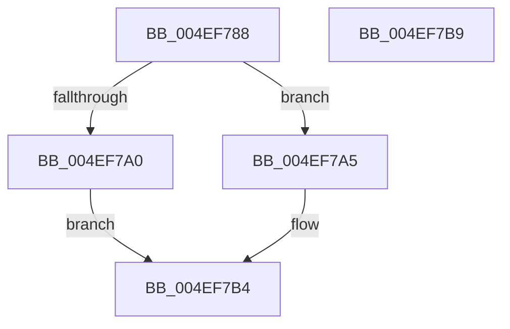

# Feature_DecoupleAppContainerAndIntegrityLevel__private_IsEnabledDeviceUsageNoInline

- RVA: `0x004EF788`–`0x004EF7BA` (길이 `50` bytes)
- VA: `0x00000001404EF788`
- 실행 섹션: `.text`
- PDB 이름 있음: `예`; PDB Function 태그: `아니요`
- unwind 정보 RVA: `0x0005C788`
- 디코드: `14`개 명령, `50/50` bytes 표시
- 미해석 바이트: `0` (있으면 어셈블리에 `.byte`로 보존)

> 이 문서는 커널 이미지의 기계어와 PDB 기호를 분석해 생성했습니다. 4번과 5번은 함수 원형과 자료형을 바이너리 사용 방식에서 추정한 C 해석이며 원본 소스 복구 결과는 아닙니다.

## 1. Dependencies

- 직접 호출 지점: **1**; 고유 호출 대상: **1**
- 직접 호출자로 확인된 함수: **20**
- RIP 상대 이미지 참조: **1**

### Outgoing calls
- `0x004EF7AF` → [Feature_DecoupleAppContainerAndIntegrityLevel__private_IsEnabledFallback](../5E/Feature_DecoupleAppContainerAndIntegrityLevel__private_IsEnabledFallback_function_005E3414.md) (function, `0x005E3414`)

### Direct callers
- [SepMaximumAccessCheck](../30/SepMaximumAccessCheck_function_00300BF0.md) at `0x00300C92`
- [SepMaximumAccessCheck](../30/SepMaximumAccessCheck_function_00300BF0.md) at `0x00300F72`
- [SeAccessCheckWithHint](../3A/SeAccessCheckWithHint_function_003A6C30.md) at `0x003A70F0`
- [SepAccessCheckEx](../3C/SepAccessCheckEx_function_003CF7B0.md) at `0x003CFA4E`
- [SepAccessCheckEx](../3C/SepAccessCheckEx_function_003CF7B0.md) at `0x003CFCAF`
- [SepNormalAccessCheckEx](../3C/SepNormalAccessCheckEx_function_003CFD8C.md) at `0x003CFDF8`
- [SepNormalAccessCheckEx](../3C/SepNormalAccessCheckEx_function_003CFD8C.md) at `0x003CFF95`
- [SepNormalAccessCheckEx](../3C/SepNormalAccessCheckEx_function_003CFD8C.md) at `0x003D010B`
- [SepNormalAccessCheck](../3D/SepNormalAccessCheck_function_003D0688.md) at `0x003D0708`
- [SepNormalAccessCheck](../3D/SepNormalAccessCheck_function_003D0688.md) at `0x003D077B`
- [SepNormalAccessCheck](../3D/SepNormalAccessCheck_function_003D0688.md) at `0x003D0AA5`
- [SepAccessCheck](../3D/SepAccessCheck_function_003D0E54.md) at `0x003D1087`
- [SepAccessCheck](../3D/SepAccessCheck_function_003D0E54.md) at `0x003D11AE`
- [SepAccessCheck](../3D/SepAccessCheck_function_003D0E54.md) at `0x003D146C`
- [SeAccessCheckByType](../44/SeAccessCheckByType_function_00440BC8.md) at `0x00441928`
- [SepCommonAccessCheckEx](../47/SepCommonAccessCheckEx_function_0047602C.md) at `0x00476798`
- [SepMaximumAccessCheckEx](../60/SepMaximumAccessCheckEx_function_00606D78.md) at `0x00606E5F`
- [SepMaximumAccessCheckEx](../60/SepMaximumAccessCheckEx_function_00606D78.md) at `0x006072C4`
- [sub_006E89DA](../6E/Unknown_function_006E89DA.md) at `0x006E8CC4`
- [SepCheckCreateAppContainer](../../page/70/SepCheckCreateAppContainer_function_007006CC.md) at `0x00700717`
- [SepAdjustPrivileges](../../page/9C/SepAdjustPrivileges_function_009C8DFC.md) at `0x009C9203`
- [SepAdjustPrivileges](../../page/9C/SepAdjustPrivileges_function_009C8DFC.md) at `0x009C9273`
- [SepAdjustPrivileges](../../page/9C/SepAdjustPrivileges_function_009C8DFC.md) at `0x009C929B`
- [PspBuildCreateProcessContext](../../page/9E/PspBuildCreateProcessContext_function_009ED6E0.md) at `0x009EE5EB`
- [PspDeleteCreateProcessContext](../../page/9E/PspDeleteCreateProcessContext_function_009EF4C4.md) at `0x009EF5B9`
- [PspAllocateProcess](../../page/A1/PspAllocateProcess_function_00A13B3C.md) at `0x00A153B1`
- [SepAccessCheckAndAuditAlarm](../../page/A1/SepAccessCheckAndAuditAlarm_function_00A1AF4C.md) at `0x00A1BCC1`
- [PspInitializeProcessSecurity](../../page/AA/PspInitializeProcessSecurity_function_00AAD368.md) at `0x00AAD3F5`
- [SeSubProcessToken](../../page/AA/SeSubProcessToken_function_00AAD570.md) at `0x00AAD868`
- [SeSubProcessToken](../../page/AA/SeSubProcessToken_function_00AAD570.md) at `0x00AADD93`
- [NtCreateLowBoxToken](../../page/AB/NtCreateLowBoxToken_function_00AB9880.md) at `0x00AB98AD`
- [NtSetInformationToken](../../page/AF/NtSetInformationToken_function_00AF0530.md) at `0x00AF1651`
- [NtSetInformationToken](../../page/AF/NtSetInformationToken_function_00AF0530.md) at `0x00AF1BA8`
- [NtSetInformationToken](../../page/AF/NtSetInformationToken_function_00AF0530.md) at `0x00AF1C9E`

### Static image references
- `0x004EF792` → RVA `0x00FC4A40` (`.data`; read)

## 2. Other-region calls and transfers

- 다른 실행 섹션으로 향하는 call: **0**
- 별도 외부 분기/꼬리 이동을 확인하지 못했습니다.

## 3. Assembly (complete function range)

```asm
004EF788  48 83 EC 28                     sub rsp, 0x28
004EF78C  48 83 64 24 30 00               and qword ptr [rsp + 0x30], 0
004EF792  8B 05 A8 52 AD 00               mov eax, dword ptr [rip + 0xad52a8]
004EF798  89 44 24 30                     mov dword ptr [rsp + 0x30], eax
004EF79C  A8 10                           test al, 0x10
004EF79E  74 05                           je 0x1404ef7a5
004EF7A0  83 E0 01                        and eax, 1
004EF7A3  EB 0F                           jmp 0x1404ef7b4
004EF7A5  48 8B 4C 24 30                  mov rcx, qword ptr [rsp + 0x30]
004EF7AA  BA 03 00 00 00                  mov edx, 3
004EF7AF  E8 60 3C 0F 00                  call 0x1405e3414
004EF7B4  48 83 C4 28                     add rsp, 0x28
004EF7B8  C3                              ret
004EF7B9  CC                              int3
```

## 4. C-style interpretation (structured pseudocode)

```c
__int64 __fastcall Feature_DecoupleAppContainerAndIntegrityLevel__private_IsEnabledDeviceUsageNoInline(void)
{
    __int64 result;
    __int64 v_rsp;
    unsigned __int64 v_stack_p8;

    v_rsp = (v_rsp) - (40);
    v_stack_p8 = (unsigned int)((unsigned int)(*(unsigned int *)(v_rip + 11358888)));
    if ((((unsigned __int8)((unsigned int)(*(unsigned int *)(v_rip + 11358888)))) & (16)) == 0) goto loc_004EF7A5;
    result = (unsigned int)(((unsigned int)(*(unsigned int *)(v_rip + 11358888))) & (1));
    goto loc_004EF7B4;
loc_004EF7A5:
    result = Feature_DecoupleAppContainerAndIntegrityLevel__private_IsEnabledFallback(v_stack_p8, 3, a3, a4);
loc_004EF7B4:
    v_rsp = (v_rsp) + (40);
    return result;
}
```

## 5. (Beta) C Style

```c
void Feature_DecoupleAppContainerAndIntegrityLevel__private_IsEnabledDeviceUsageNoInline(void)
{
    int64_t result;
    int64_t local_rsp;
    uint64_t v_stack_p8;

    local_rsp = (local_rsp) - (40);
    v_stack_p8 = (uint32_t)((uint32_t)(*(uint32_t *)(v_rip + 0xAD52A8)));
    if ((((uint8_t)((uint32_t)(*(uint32_t *)(v_rip + 0xAD52A8)))) & (16)) == 0) goto loc_004EF7A5;
    result = (uint32_t)(((uint32_t)(*(uint32_t *)(v_rip + 0xAD52A8))) & (1));
    goto loc_004EF7B4;
loc_004EF7A5:
    result = Feature_DecoupleAppContainerAndIntegrityLevel__private_IsEnabledFallback(v_stack_p8, 3, a3, a4);
loc_004EF7B4:
    local_rsp = (local_rsp) + (40);
    return result;
}
```

## 6. Execution-region graph

[열기: 2D/3D 그래프와 함수 탐색 컨트롤 패널](../../../control-panel.html?section=text&rva=0x004EF788&view=graph)

- 2D 그래프는 위에서 아래로 흐르고, 3D 그래프는 빈 공간을 드래그해 회전합니다. Shift+드래그는 이동, 휠은 확대·축소, 함수 노드 선택은 대상 보고서 이동입니다.

### Static fallback


