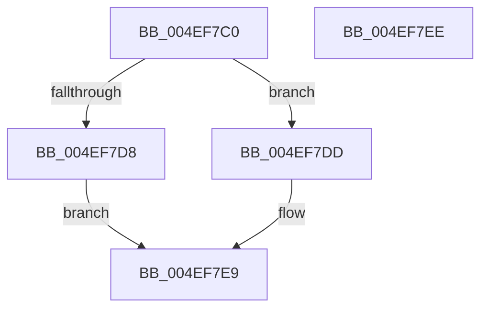

# Feature_StackingDecayBoosts__private_IsEnabledNoReportingNoInline

- RVA: `0x004EF7C0`–`0x004EF7EF` (길이 `47` bytes)
- VA: `0x00000001404EF7C0`
- 실행 섹션: `.text`
- PDB 이름 있음: `예`; PDB Function 태그: `아니요`
- unwind 정보 RVA: `0x0005C788`
- 디코드: `14`개 명령, `47/47` bytes 표시
- 미해석 바이트: `0` (있으면 어셈블리에 `.byte`로 보존)

> 이 문서는 커널 이미지의 기계어와 PDB 기호를 분석해 생성했습니다. 4번과 5번은 함수 원형과 자료형을 바이너리 사용 방식에서 추정한 C 해석이며 원본 소스 복구 결과는 아닙니다.

## 1. Dependencies

- 직접 호출 지점: **1**; 고유 호출 대상: **1**
- 직접 호출자로 확인된 함수: **21**
- RIP 상대 이미지 참조: **1**

### Outgoing calls
- `0x004EF7E4` → [Feature_StackingDecayBoosts__private_IsEnabledFallback](../5C/Feature_StackingDecayBoosts__private_IsEnabledFallback_function_005C65E8.md) (function, `0x005C65E8`)

### Direct callers
- [sub_002099FA](../20/Unknown_function_002099FA.md) at `0x00209B79`
- [sub_0020C2D4](../20/Unknown_function_0020C2D4.md) at `0x0020C8C9`
- [sub_0020C2D4](../20/Unknown_function_0020C2D4.md) at `0x0020CA4F`
- [KeWaitForSingleObject](../20/KeWaitForSingleObject_function_0020E6B0.md) at `0x0020EFDF`
- [KeWaitForSingleObject](../20/KeWaitForSingleObject_function_0020E6B0.md) at `0x0020F3D1`
- [sub_00210E15](../21/Unknown_function_00210E15.md) at `0x00210E67`
- [sub_0021BDD6](../21/Unknown_function_0021BDD6.md) at `0x0021BDF2`
- [sub_0021C0DA](../21/Unknown_function_0021C0DA.md) at `0x0021C111`
- [sub_0021D7F8](../21/Unknown_function_0021D7F8.md) at `0x0021D9F9`
- [sub_0021D7F8](../21/Unknown_function_0021D7F8.md) at `0x0021DB7B`
- [sub_0021D7F8](../21/Unknown_function_0021D7F8.md) at `0x0021E300`
- [KiWakePriQueueWaiter](../21/KiWakePriQueueWaiter_function_0021F720.md) at `0x0021F854`
- [sub_002202B6](../22/Unknown_function_002202B6.md) at `0x0022030C`
- [sub_0022053D](../22/Unknown_function_0022053D.md) at `0x0022057A`
- [KiFastExitThreadWait](../22/KiFastExitThreadWait_function_00220BB0.md) at `0x00220D23`
- [sub_0025308F](../25/Unknown_function_0025308F.md) at `0x00254375`
- [sub_0025308F](../25/Unknown_function_0025308F.md) at `0x0025439D`
- [KeSetPriorityThread](../2C/KeSetPriorityThread_function_002C76E0.md) at `0x002C787E`
- [KeSetPriorityThread](../2C/KeSetPriorityThread_function_002C76E0.md) at `0x002C78AC`
- [KeSetPriorityThread](../2C/KeSetPriorityThread_function_002C76E0.md) at `0x002C78E8`
- [sub_00352D10](../35/Unknown_function_00352D10.md) at `0x00352D49`
- [KeAdjustWobPriority](../39/KeAdjustWobPriority_function_00393570.md) at `0x00393685`
- [KiClearPriorityFloor](../39/KiClearPriorityFloor_function_00396314.md) at `0x003963C8`
- [KiComputeNewPriority](../3C/KiComputeNewPriority_function_003C2D8C.md) at `0x003C2D9C`
- [KiSetForegroundBoost](../3C/KiSetForegroundBoost_function_003C343C.md) at `0x003C347A`
- [KiComputeThreadPriority](../3C/KiComputeThreadPriority_function_003C45F4.md) at `0x003C460B`
- [KeSetBasePriorityThread](../3C/KeSetBasePriorityThread_function_003C6EB0.md) at `0x003C6FC5`
- [KeSetBasePriorityThread](../3C/KeSetBasePriorityThread_function_003C6EB0.md) at `0x003C7000`
- [KeBoostPriorityThread](../4D/KeBoostPriorityThread_function_004D37F8.md) at `0x004D38BD`
- [KeBoostPriorityThread](../4D/KeBoostPriorityThread_function_004D37F8.md) at `0x004D38FD`

### Static image references
- `0x004EF7CA` → RVA `0x00FC48F0` (`.data`; read)

## 2. Other-region calls and transfers

- 다른 실행 섹션으로 향하는 call: **0**
- 별도 외부 분기/꼬리 이동을 확인하지 못했습니다.

## 3. Assembly (complete function range)

```asm
004EF7C0  48 83 EC 28                     sub rsp, 0x28
004EF7C4  48 83 64 24 30 00               and qword ptr [rsp + 0x30], 0
004EF7CA  8B 05 20 51 AD 00               mov eax, dword ptr [rip + 0xad5120]
004EF7D0  89 44 24 30                     mov dword ptr [rsp + 0x30], eax
004EF7D4  A8 02                           test al, 2
004EF7D6  74 05                           je 0x1404ef7dd
004EF7D8  83 E0 01                        and eax, 1
004EF7DB  EB 0C                           jmp 0x1404ef7e9
004EF7DD  48 8B 4C 24 30                  mov rcx, qword ptr [rsp + 0x30]
004EF7E2  33 D2                           xor edx, edx
004EF7E4  E8 FF 6D 0D 00                  call 0x1405c65e8
004EF7E9  48 83 C4 28                     add rsp, 0x28
004EF7ED  C3                              ret
004EF7EE  CC                              int3
```

## 4. C-style interpretation (structured pseudocode)

```c
__int64 __fastcall Feature_StackingDecayBoosts__private_IsEnabledNoReportingNoInline(__int64 a1, int a2)
{
    __int64 result;
    __int64 v_rsp;
    unsigned __int64 v_stack_p8;

    v_rsp = (v_rsp) - (40);
    v_stack_p8 = (unsigned int)((unsigned int)(*(unsigned int *)(v_rip + 11358496)));
    if ((((unsigned __int8)((unsigned int)(*(unsigned int *)(v_rip + 11358496)))) & (2)) == 0) goto loc_004EF7DD;
    result = (unsigned int)(((unsigned int)(*(unsigned int *)(v_rip + 11358496))) & (1));
    goto loc_004EF7E9;
loc_004EF7DD:
    a2 = 0;
    result = Feature_StackingDecayBoosts__private_IsEnabledFallback(v_stack_p8, a2, a3, a4);
loc_004EF7E9:
    v_rsp = (v_rsp) + (40);
    return result;
}
```

## 5. (Beta) C Style

```c
int64_t Feature_StackingDecayBoosts__private_IsEnabledNoReportingNoInline(int64_t Arg1, int32_t Arg2)
{
    int64_t result;
    int64_t local_rsp;
    uint64_t v_stack_p8;

    local_rsp = (local_rsp) - (40);
    v_stack_p8 = (uint32_t)((uint32_t)(*(uint32_t *)(v_rip + 0xAD5120)));
    if ((((uint8_t)((uint32_t)(*(uint32_t *)(v_rip + 0xAD5120)))) & (2)) == 0) goto loc_004EF7DD;
    result = (uint32_t)(((uint32_t)(*(uint32_t *)(v_rip + 0xAD5120))) & (1));
    goto loc_004EF7E9;
loc_004EF7DD:
    Arg2 = 0;
    result = Feature_StackingDecayBoosts__private_IsEnabledFallback(v_stack_p8, Arg2, a3, a4);
loc_004EF7E9:
    local_rsp = (local_rsp) + (40);
    return result;
}
```

## 6. Execution-region graph

[열기: 2D/3D 그래프와 함수 탐색 컨트롤 패널](../../../control-panel.html?section=text&rva=0x004EF7C0&view=graph)

- 2D 그래프는 위에서 아래로 흐르고, 3D 그래프는 빈 공간을 드래그해 회전합니다. Shift+드래그는 이동, 휠은 확대·축소, 함수 노드 선택은 대상 보고서 이동입니다.

### Static fallback


