# FsRtlCancelNotify

- RVA: `0x004E7F90`–`0x004E837C` (길이 `1,004` bytes)
- VA: `0x00000001404E7F90`
- 실행 섹션: `.text`
- PDB 이름 있음: `예`; PDB Function 태그: `아니요`
- unwind 정보 RVA: `0x000C623C`
- 디코드: `254`개 명령, `1,004/1,004` bytes 표시
- 미해석 바이트: `0` (있으면 어셈블리에 `.byte`로 보존)

> 이 문서는 커널 이미지의 기계어와 PDB 기호를 분석해 생성했습니다. 4번과 5번은 함수 원형과 자료형을 바이너리 사용 방식에서 추정한 C 해석이며 원본 소스 복구 결과는 아닙니다.

## 1. Dependencies

- 직접 호출 지점: **18**; 고유 호출 대상: **14**
- 직접 호출자로 확인된 함수: **1**
- RIP 상대 이미지 참조: **0**

### Outgoing calls
- `0x004E7FDB` → [KeReleaseQueuedSpinLock](../27/KeReleaseQueuedSpinLock_function_00272540.md) (function, `0x00272540`)
- `0x004E8029` → [ExAcquireFastMutexUnsafe](../3F/ExAcquireFastMutexUnsafe_function_003F3720.md) (function, `0x003F3720`)
- `0x004E80DA` → [MmMapLockedPagesSpecifyCache](../31/MmMapLockedPagesSpecifyCache_function_00318800.md) (function, `0x00318800`)
- `0x004E8176` → [MmMapLockedPagesSpecifyCache](../31/MmMapLockedPagesSpecifyCache_function_00318800.md) (function, `0x00318800`)
- `0x004E81CC` → [PsChargePoolQuota](../3E/PsChargePoolQuota_function_003EC7F0.md) (function, `0x003EC7F0`)
- `0x004E81E7` → [ExAllocatePool2](../../poolcode/B8/ExAllocatePool2_function_00B820F0.md) (function, `0x00B820F0`)
- `0x004E820B` → [memcpy](../6C/memcpy_function_006C6840.md) (function, `0x006C6840`)
- `0x004E8239` → [PsReturnProcessPagedPoolQuota](../2A/PsReturnProcessPagedPoolQuota_function_002A6860.md) (function, `0x002A6860`)
- `0x004E82C0` → [IofCompleteRequest](../29/IofCompleteRequest_function_0029B5C0.md) (function, `0x0029B5C0`)
- `0x004E82E3` → [PsReturnProcessPagedPoolQuota](../2A/PsReturnProcessPagedPoolQuota_function_002A6860.md) (function, `0x002A6860`)
- `0x004E82EE` → [ExFreePoolWithTag](../../poolcode/B8/ExFreePoolWithTag_function_00B82870.md) (function, `0x00B82870`)
- `0x004E830B` → [Feature_4131803451__private_IsEnabledDeviceUsageNoInline](../58/Feature_4131803451__private_IsEnabledDeviceUsageNoInline_function_0058336C.md) (function, `0x0058336C`)
- `0x004E831D` → [ObfDereferenceObjectWithTag](../2F/ObfDereferenceObjectWithTag_function_002F78E0.md) (function, `0x002F78E0`)
- `0x004E8327` → [ExFreePoolWithTag](../../poolcode/B8/ExFreePoolWithTag_function_00B82870.md) (function, `0x00B82870`)
- `0x004E8342` → [ExReleaseFastMutexUnsafe](../25/ExReleaseFastMutexUnsafe_function_002503A0.md) (function, `0x002503A0`)
- `0x004E8354` → [SeReleaseSubjectContext](../../page/86/SeReleaseSubjectContext_function_0086B710.md) (function, `0x0086B710`)
- `0x004E835E` → [ExFreePoolWithTag](../../poolcode/B8/ExFreePoolWithTag_function_00B82870.md) (function, `0x00B82870`)
- `0x004E8363` → [KeLeaveCriticalRegion](../25/KeLeaveCriticalRegion_function_0025D8B0.md) (function, `0x0025D8B0`)

### Direct callers
- [FsRtlNotifySetCancelRoutine](../27/FsRtlNotifySetCancelRoutine_function_0027239C.md) at `0x00272434`

### Static image references
- 디코드된 RIP-relative 메모리 참조가 없습니다.

## 2. Other-region calls and transfers

- 다른 실행 섹션으로 향하는 call: **5**
  - `0x004E81E7` → [ExAllocatePool2](../../poolcode/B8/ExAllocatePool2_function_00B820F0.md) (`.text` → `POOLCODE`)
  - `0x004E82EE` → [ExFreePoolWithTag](../../poolcode/B8/ExFreePoolWithTag_function_00B82870.md) (`.text` → `POOLCODE`)
  - `0x004E8327` → [ExFreePoolWithTag](../../poolcode/B8/ExFreePoolWithTag_function_00B82870.md) (`.text` → `POOLCODE`)
  - `0x004E8354` → [SeReleaseSubjectContext](../../page/86/SeReleaseSubjectContext_function_0086B710.md) (`.text` → `PAGE`)
  - `0x004E835E` → [ExFreePoolWithTag](../../poolcode/B8/ExFreePoolWithTag_function_00B82870.md) (`.text` → `POOLCODE`)
- 별도 외부 분기/꼬리 이동을 확인하지 못했습니다.

## 3. Assembly (complete function range)

```asm
004E7F90  4C 8B DC                        mov r11, rsp
004E7F93  49 89 53 10                     mov qword ptr [r11 + 0x10], rdx
004E7F97  53                              push rbx
004E7F98  56                              push rsi
004E7F99  57                              push rdi
004E7F9A  41 54                           push r12
004E7F9C  41 55                           push r13
004E7F9E  41 56                           push r14
004E7FA0  41 57                           push r15
004E7FA2  48 81 EC B0 00 00 00            sub rsp, 0xb0
004E7FA9  4C 8B FA                        mov r15, rdx
004E7FAC  33 FF                           xor edi, edi
004E7FAE  48 89 7C 24 48                  mov qword ptr [rsp + 0x48], rdi
004E7FB3  89 7C 24 34                     mov dword ptr [rsp + 0x34], edi
004E7FB7  48 8B 42 38                     mov rax, qword ptr [rdx + 0x38]
004E7FBB  49 89 43 98                     mov qword ptr [r11 - 0x68], rax
004E7FBF  49 89 43 18                     mov qword ptr [r11 + 0x18], rax
004E7FC3  48 89 84 24 98 00 00 00         mov qword ptr [rsp + 0x98], rax
004E7FCB  8B C7                           mov eax, edi
004E7FCD  48 87 42 68                     xchg qword ptr [rdx + 0x68], rax
004E7FD1  48 89 7A 38                     mov qword ptr [rdx + 0x38], rdi
004E7FD5  8A 52 45                        mov dl, byte ptr [rdx + 0x45]
004E7FD8  8D 4F 07                        lea ecx, [rdi + 7]
004E7FDB  E8 60 A5 D8 FF                  call 0x140272540
004E7FE0  65 48 8B 04 25 88 01 00 00      mov rax, qword ptr gs:[0x188]
004E7FE9  83 C9 FF                        or ecx, 0xffffffff
004E7FEC  66 01 88 E4 01 00 00            add word ptr [rax + 0x1e4], cx
004E7FF3  90                              nop
004E7FF4  48 8B 84 24 00 01 00 00         mov rax, qword ptr [rsp + 0x100]
004E7FFC  4C 8B 30                        mov r14, qword ptr [rax]
004E7FFF  4C 89 B4 24 08 01 00 00         mov qword ptr [rsp + 0x108], r14
004E8007  4C 89 74 24 60                  mov qword ptr [rsp + 0x60], r14
004E800C  65 48 8B 1C 25 88 01 00 00      mov rbx, qword ptr gs:[0x188]
004E8015  49 8D 76 38                     lea rsi, [r14 + 0x38]
004E8019  48 89 B4 24 A0 00 00 00         mov qword ptr [rsp + 0xa0], rsi
004E8021  48 3B 1E                        cmp rbx, qword ptr [rsi]
004E8024  74 0B                           je 0x1404e8031
004E8026  49 8B CE                        mov rcx, r14
004E8029  E8 F2 B6 F0 FF                  call 0x1403f3720
004E802E  48 89 1E                        mov qword ptr [rsi], rbx
004E8031  4D 8D 66 40                     lea r12, [r14 + 0x40]
004E8035  4C 89 A4 24 90 00 00 00         mov qword ptr [rsp + 0x90], r12
004E803D  41 FF 04 24                     inc dword ptr [r12]
004E8041  49 8D 8F A8 00 00 00            lea rcx, [r15 + 0xa8]
004E8048  48 8B 01                        mov rax, qword ptr [rcx]
004E804B  48 85 C0                        test rax, rax
004E804E  74 16                           je 0x1404e8066
004E8050  48 8B 51 08                     mov rdx, qword ptr [rcx + 8]
004E8054  48 39 48 08                     cmp qword ptr [rax + 8], rcx
004E8058  75 64                           jne 0x1404e80be
004E805A  48 39 0A                        cmp qword ptr [rdx], rcx
004E805D  75 5F                           jne 0x1404e80be
004E805F  48 89 02                        mov qword ptr [rdx], rax
004E8062  48 89 50 08                     mov qword ptr [rax + 8], rdx
004E8066  49 8B 87 B8 00 00 00            mov rax, qword ptr [r15 + 0xb8]
004E806D  80 48 03 01                     or byte ptr [rax + 3], 1
004E8071  48 8B B4 24 00 01 00 00         mov rsi, qword ptr [rsp + 0x100]
004E8079  4C 8D 6E 58                     lea r13, [rsi + 0x58]
004E807D  4C 89 AC 24 88 00 00 00         mov qword ptr [rsp + 0x88], r13
004E8085  49 8B 45 00                     mov rax, qword ptr [r13]
004E8089  48 85 C0                        test rax, rax
004E808C  0F 84 21 02 00 00               je 0x1404e82b3
004E8092  48 8D 4E 50                     lea rcx, [rsi + 0x50]
004E8096  48 89 4C 24 50                  mov qword ptr [rsp + 0x50], rcx
004E809B  48 39 39                        cmp qword ptr [rcx], rdi
004E809E  0F 85 0F 02 00 00               jne 0x1404e82b3
004E80A4  49 8B 4F 08                     mov rcx, qword ptr [r15 + 8]
004E80A8  48 85 C9                        test rcx, rcx
004E80AB  74 43                           je 0x1404e80f0
004E80AD  F6 41 0A 05                     test byte ptr [rcx + 0xa], 5
004E80B1  74 12                           je 0x1404e80c5
004E80B3  48 8B 51 18                     mov rdx, qword ptr [rcx + 0x18]
004E80B7  48 89 54 24 70                  mov qword ptr [rsp + 0x70], rdx
004E80BC  EB 29                           jmp 0x1404e80e7
004E80BE  B9 03 00 00 00                  mov ecx, 3
004E80C3  CD 29                           int 0x29
004E80C5  C7 44 24 28 10 00 00 40         mov dword ptr [rsp + 0x28], 0x40000010
004E80CD  89 7C 24 20                     mov dword ptr [rsp + 0x20], edi
004E80D1  45 33 C9                        xor r9d, r9d
004E80D4  33 D2                           xor edx, edx
004E80D6  45 8D 41 01                     lea r8d, [r9 + 1]
004E80DA  E8 21 07 E3 FF                  call 0x140318800
004E80DF  48 8B D0                        mov rdx, rax
004E80E2  48 89 44 24 70                  mov qword ptr [rsp + 0x70], rax
004E80E7  49 8B 45 00                     mov rax, qword ptr [r13]
004E80EB  48 3B D0                        cmp rdx, rax
004E80EE  74 0A                           je 0x1404e80fa
004E80F0  49 3B 47 18                     cmp rax, qword ptr [r15 + 0x18]
004E80F4  0F 85 B9 01 00 00               jne 0x1404e82b3
004E80FA  48 89 7C 24 40                  mov qword ptr [rsp + 0x40], rdi
004E80FF  89 7C 24 30                     mov dword ptr [rsp + 0x30], edi
004E8103  48 8B DF                        mov rbx, rdi
004E8106  48 89 5C 24 40                  mov qword ptr [rsp + 0x40], rbx
004E810B  44 8B F7                        mov r14d, edi
004E810E  89 7C 24 30                     mov dword ptr [rsp + 0x30], edi
004E8112  48 8D 46 30                     lea rax, [rsi + 0x30]
004E8116  48 8B 08                        mov rcx, qword ptr [rax]
004E8119  48 8D 56 68                     lea rdx, [rsi + 0x68]
004E811D  48 89 54 24 58                  mov qword ptr [rsp + 0x58], rdx
004E8122  48 3B C8                        cmp rcx, rax
004E8125  74 7B                           je 0x1404e81a2
004E8127  4C 8B 41 10                     mov r8, qword ptr [rcx + 0x10]
004E812B  4C 89 44 24 78                  mov qword ptr [rsp + 0x78], r8
004E8130  8B 02                           mov eax, dword ptr [rdx]
004E8132  41 39 40 08                     cmp dword ptr [r8 + 8], eax
004E8136  72 78                           jb 0x1404e81b0
004E8138  48 8B 81 70 FF FF FF            mov rax, qword ptr [rcx - 0x90]
004E813F  48 85 C0                        test rax, rax
004E8142  75 3C                           jne 0x1404e8180
004E8144  48 8B 89 60 FF FF FF            mov rcx, qword ptr [rcx - 0xa0]
004E814B  48 85 C9                        test rcx, rcx
004E814E  74 38                           je 0x1404e8188
004E8150  F6 41 0A 05                     test byte ptr [rcx + 0xa], 5
004E8154  74 0B                           je 0x1404e8161
004E8156  48 8B 59 18                     mov rbx, qword ptr [rcx + 0x18]
004E815A  48 89 5C 24 40                  mov qword ptr [rsp + 0x40], rbx
004E815F  EB 27                           jmp 0x1404e8188
004E8161  C7 44 24 28 10 00 00 40         mov dword ptr [rsp + 0x28], 0x40000010
004E8169  89 7C 24 20                     mov dword ptr [rsp + 0x20], edi
004E816D  45 33 C9                        xor r9d, r9d
004E8170  33 D2                           xor edx, edx
004E8172  45 8D 41 01                     lea r8d, [r9 + 1]
004E8176  E8 85 06 E3 FF                  call 0x140318800
004E817B  4C 8B 44 24 78                  mov r8, qword ptr [rsp + 0x78]
004E8180  48 89 44 24 40                  mov qword ptr [rsp + 0x40], rax
004E8185  48 8B D8                        mov rbx, rax
004E8188  45 8B 70 08                     mov r14d, dword ptr [r8 + 8]
004E818C  44 89 74 24 30                  mov dword ptr [rsp + 0x30], r14d
004E8191  8B 46 60                        mov eax, dword ptr [rsi + 0x60]
004E8194  44 3B F0                        cmp r14d, eax
004E8197  76 17                           jbe 0x1404e81b0
004E8199  44 8B F0                        mov r14d, eax
004E819C  89 44 24 30                     mov dword ptr [rsp + 0x30], eax
004E81A0  EB 0E                           jmp 0x1404e81b0
004E81A2  8B 46 60                        mov eax, dword ptr [rsi + 0x60]
004E81A5  3B 02                           cmp eax, dword ptr [rdx]
004E81A7  44 0F 43 F0                     cmovae r14d, eax
004E81AB  44 89 74 24 30                  mov dword ptr [rsp + 0x30], r14d
004E81B0  45 85 F6                        test r14d, r14d
004E81B3  0F 84 C6 00 00 00               je 0x1404e827f
004E81B9  89 7C 24 38                     mov dword ptr [rsp + 0x38], edi
004E81BD  48 85 DB                        test rbx, rbx
004E81C0  75 3A                           jne 0x1404e81fc
004E81C2  45 8B C6                        mov r8d, r14d
004E81C5  8D 53 01                        lea edx, [rbx + 1]
004E81C8  48 8B 4E 78                     mov rcx, qword ptr [rsi + 0x78]
004E81CC  E8 1F 46 F0 FF                  call 0x1403ec7f0
004E81D1  C7 44 24 38 01 00 00 00         mov dword ptr [rsp + 0x38], 1
004E81D9  41 B8 46 53 72 4E               mov r8d, 0x4e725346
004E81DF  41 8B D6                        mov edx, r14d
004E81E2  B9 22 01 00 00                  mov ecx, 0x122
004E81E7  E8 04 9F 69 00                  call 0x140b820f0
004E81EC  48 8B D8                        mov rbx, rax
004E81EF  48 89 44 24 40                  mov qword ptr [rsp + 0x40], rax
004E81F4  48 8B 44 24 50                  mov rax, qword ptr [rsp + 0x50]
004E81F9  48 89 18                        mov qword ptr [rax], rbx
004E81FC  48 8B 44 24 58                  mov rax, qword ptr [rsp + 0x58]
004E8201  44 8B 00                        mov r8d, dword ptr [rax]
004E8204  49 8B 55 00                     mov rdx, qword ptr [r13]
004E8208  48 8B CB                        mov rcx, rbx
004E820B  E8 30 E6 1D 00                  call 0x1406c6840
004E8210  44 89 76 64                     mov dword ptr [rsi + 0x64], r14d
004E8214  49 89 5D 00                     mov qword ptr [r13], rbx
004E8218  48 8B 8C 24 80 00 00 00         mov rcx, qword ptr [rsp + 0x80]
004E8220  EB 57                           jmp 0x1404e8279
004E8222  48 8B B4 24 00 01 00 00         mov rsi, qword ptr [rsp + 0x100]
004E822A  83 7C 24 38 00                  cmp dword ptr [rsp + 0x38], 0
004E822F  74 0D                           je 0x1404e823e
004E8231  8B 54 24 30                     mov edx, dword ptr [rsp + 0x30]
004E8235  48 8B 4E 78                     mov rcx, qword ptr [rsi + 0x78]
004E8239  E8 22 E6 DB FF                  call 0x1402a6860
004E823E  0F B7 46 48                     movzx eax, word ptr [rsi + 0x48]
004E8242  66 83 C8 02                     or ax, 2
004E8246  66 89 46 48                     mov word ptr [rsi + 0x48], ax
004E824A  33 FF                           xor edi, edi
004E824C  4C 8B BC 24 F8 00 00 00         mov r15, qword ptr [rsp + 0xf8]
004E8254  48 8B 44 24 60                  mov rax, qword ptr [rsp + 0x60]
004E8259  48 89 84 24 08 01 00 00         mov qword ptr [rsp + 0x108], rax
004E8261  4C 8B AC 24 88 00 00 00         mov r13, qword ptr [rsp + 0x88]
004E8269  4C 8B A4 24 90 00 00 00         mov r12, qword ptr [rsp + 0x90]
004E8271  48 8B 8C 24 98 00 00 00         mov rcx, qword ptr [rsp + 0x98]
004E8279  48 83 C1 48                     add rcx, 0x48
004E827D  EB 0E                           jmp 0x1404e828d
004E827F  48 8D 4E 48                     lea rcx, [rsi + 0x48]
004E8283  0F B7 01                        movzx eax, word ptr [rcx]
004E8286  66 83 C8 02                     or ax, 2
004E828A  66 89 01                        mov word ptr [rcx], ax
004E828D  4C 8B B4 24 08 01 00 00         mov r14, qword ptr [rsp + 0x108]
004E8295  F6 01 02                        test byte ptr [rcx], 2
004E8298  74 19                           je 0x1404e82b3
004E829A  49 89 7D 00                     mov qword ptr [r13], rdi
004E829E  48 8B 44 24 50                  mov rax, qword ptr [rsp + 0x50]
004E82A3  48 89 38                        mov qword ptr [rax], rdi
004E82A6  89 7E 6C                        mov dword ptr [rsi + 0x6c], edi
004E82A9  48 8B 44 24 58                  mov rax, qword ptr [rsp + 0x58]
004E82AE  89 38                           mov dword ptr [rax], edi
004E82B0  89 7E 64                        mov dword ptr [rsi + 0x64], edi
004E82B3  41 C7 47 30 20 01 00 C0         mov dword ptr [r15 + 0x30], 0xc0000120
004E82BB  B2 01                           mov dl, 1
004E82BD  49 8B CF                        mov rcx, r15
004E82C0  E8 FB 32 DB FF                  call 0x14029b5c0
004E82C5  F0 FF 4E 70                     lock dec dword ptr [rsi + 0x70]
004E82C9  39 7E 70                        cmp dword ptr [rsi + 0x70], edi
004E82CC  75 5F                           jne 0x1404e832d
004E82CE  48 8B 9C 24 00 01 00 00         mov rbx, qword ptr [rsp + 0x100]
004E82D6  48 39 7B 50                     cmp qword ptr [rbx + 0x50], rdi
004E82DA  74 17                           je 0x1404e82f3
004E82DC  8B 53 64                        mov edx, dword ptr [rbx + 0x64]
004E82DF  48 8B 4B 78                     mov rcx, qword ptr [rbx + 0x78]
004E82E3  E8 78 E5 DB FF                  call 0x1402a6860
004E82E8  33 D2                           xor edx, edx
004E82EA  48 8B 4B 50                     mov rcx, qword ptr [rbx + 0x50]
004E82EE  E8 7D A5 69 00                  call 0x140b82870
004E82F3  F6 43 48 40                     test byte ptr [rbx + 0x48], 0x40
004E82F7  75 09                           jne 0x1404e8302
004E82F9  48 39 BB 88 00 00 00            cmp qword ptr [rbx + 0x88], rdi
004E8300  74 09                           je 0x1404e830b
004E8302  48 8B 43 18                     mov rax, qword ptr [rbx + 0x18]
004E8306  48 89 44 24 48                  mov qword ptr [rsp + 0x48], rax
004E830B  E8 5C B0 09 00                  call 0x14058336c
004E8310  85 C0                           test eax, eax
004E8312  74 0E                           je 0x1404e8322
004E8314  BA 46 73 4E 74                  mov edx, 0x744e7346
004E8319  48 8B 4B 78                     mov rcx, qword ptr [rbx + 0x78]
004E831D  E8 BE F5 E0 FF                  call 0x1402f78e0
004E8322  33 D2                           xor edx, edx
004E8324  48 8B CB                        mov rcx, rbx
004E8327  E8 44 A5 69 00                  call 0x140b82870
004E832C  90                              nop
004E832D  41 83 04 24 FF                  add dword ptr [r12], -1
004E8332  75 13                           jne 0x1404e8347
004E8334  48 8B 84 24 A0 00 00 00         mov rax, qword ptr [rsp + 0xa0]
004E833C  48 89 38                        mov qword ptr [rax], rdi
004E833F  49 8B CE                        mov rcx, r14
004E8342  E8 59 80 D6 FF                  call 0x1402503a0
004E8347  48 8B 5C 24 48                  mov rbx, qword ptr [rsp + 0x48]
004E834C  48 85 DB                        test rbx, rbx
004E834F  74 12                           je 0x1404e8363
004E8351  48 8B CB                        mov rcx, rbx
004E8354  E8 B7 33 38 00                  call 0x14086b710
004E8359  33 D2                           xor edx, edx
004E835B  48 8B CB                        mov rcx, rbx
004E835E  E8 0D A5 69 00                  call 0x140b82870
004E8363  E8 48 55 D7 FF                  call 0x14025d8b0
004E8368  48 81 C4 B0 00 00 00            add rsp, 0xb0
004E836F  41 5F                           pop r15
004E8371  41 5E                           pop r14
004E8373  41 5D                           pop r13
004E8375  41 5C                           pop r12
004E8377  5F                              pop rdi
004E8378  5E                              pop rsi
004E8379  5B                              pop rbx
004E837A  C3                              ret
004E837B  CC                              int3
```

## 4. C-style interpretation (structured pseudocode)

```c
__int64 __fastcall FsRtlCancelNotify(__int64 a1, __int64 a2, __int64 a3, int a4)
{
    __int64 result;
    __int64 v_r14;
    __int64 v_rbx;
    __int64 v_rdi;
    __int64 v_rsp;
    unsigned __int64 v_stack_m48;
    unsigned __int64 v_stack_m50;
    unsigned __int64 v_stack_m58;
    unsigned __int64 v_stack_m60;
    unsigned __int64 v_stack_m68;
    unsigned __int64 v_stack_m70;
    unsigned __int64 v_stack_m78;
    unsigned __int64 v_stack_m88;
    unsigned __int64 v_stack_m90;
    unsigned __int64 v_stack_m98;
    unsigned __int64 v_stack_mA0;
    unsigned __int64 v_stack_mA8;
    unsigned int v_stack_mB0;
    unsigned int v_stack_mB4;
    unsigned int v_stack_mB8;
    unsigned int v_stack_mC0;
    unsigned int v_stack_mC8;
    unsigned __int64 v_stack_p10;
    unsigned __int64 v_stack_p18;
    unsigned __int64 v_stack_p20;

    *(unsigned __int64 *)(v_rsp + 16) = a2;
    v_rsp = (v_rsp) - (176);
    v_rdi = 0;
    v_stack_mA0 = 0;
    v_stack_mB4 = 0;
    *(unsigned __int64 *)(v_rsp - 104) = *(unsigned __int64 *)(a2 + 56);
    *(unsigned __int64 *)(v_rsp + 24) = *(unsigned __int64 *)(a2 + 56);
    v_stack_m50 = *(unsigned __int64 *)(a2 + 56);
    *(unsigned __int64 *)(a2 + 56) = 0;
    result = KeReleaseQueuedSpinLock(v_rdi + 7, *(unsigned __int8 *)(a2 + 69), a3, a4);
    a1 = (unsigned int)((v_rdi + 7) | (0xFFFFFFFFULL));
    v_stack_p20 = *(unsigned __int64 *)(v_stack_p18);
    v_stack_m88 = *(unsigned __int64 *)(v_stack_p18);
    v_stack_m48 = *(unsigned __int64 *)(v_stack_p18) + 56;
    result = v_stack_p18;
    if ((*(unsigned __int64 *)(gs_base + (0 + 392))) != (*(unsigned __int64 *)(*(unsigned __int64 *)(v_stack_p18) + 56))) {
        a1 = *(unsigned __int64 *)(v_stack_p18);
        result = ExAcquireFastMutexUnsafe(a1, *(unsigned __int8 *)(a2 + 69), a3, a4);
        *(unsigned __int64 *)(*(unsigned __int64 *)(v_stack_p18) + 56) = *(unsigned __int64 *)(gs_base + (0 + 392));
    }
    v_stack_m58 = *(unsigned __int64 *)(v_stack_p18) + 64;
    if (*(unsigned __int64 *)(a2 + 168) == 0) goto loc_004E8066;
    if ((*(unsigned __int64 *)(*(unsigned __int64 *)(a2 + 168) + 8)) != (a2 + 168)) goto loc_004E80BE;
    if ((*(unsigned __int64 *)(*(unsigned __int64 *)(a2 + 168 + 8))) != (a2 + 168)) goto loc_004E80BE;
    *(unsigned __int64 *)(*(unsigned __int64 *)(a2 + 168 + 8)) = *(unsigned __int64 *)(a2 + 168);
    *(unsigned __int64 *)(*(unsigned __int64 *)(a2 + 168) + 8) = *(unsigned __int64 *)(a2 + 168 + 8);
loc_004E8066:
    v_stack_m60 = v_stack_p18 + 88;
    if (*(unsigned __int64 *)(v_stack_p18 + 88) == 0) goto loc_004E82B3;
    v_stack_m98 = v_stack_p18 + 80;
    if ((*(unsigned __int64 *)(v_stack_p18 + 80)) != 0) goto loc_004E82B3;
    if (*(unsigned __int64 *)(a2 + 8) == 0) goto loc_004E80F0;
    if (((*(unsigned __int8 *)(*(unsigned __int64 *)(a2 + 8) + 10)) & (5)) == 0) goto loc_004E80C5;
    v_stack_m78 = *(unsigned __int64 *)(*(unsigned __int64 *)(a2 + 8) + 24);
    goto loc_004E80E7;
loc_004E80BE:
loc_004E80C5:
    v_stack_mC0 = 0x40000010ULL;
    v_stack_mC8 = 0;
    a4 = 0;
    a2 = 0;
    result = MmMapLockedPagesSpecifyCache(3, a2, a4 + 1, a4);
    v_stack_m78 = result;
loc_004E80E7:
    if (result == (*(unsigned __int64 *)(v_stack_p18 + 88))) goto loc_004E80FA;
loc_004E80F0:
    if ((*(unsigned __int64 *)(v_stack_p18 + 88)) != (*(unsigned __int64 *)(a2 + 24))) goto loc_004E82B3;
loc_004E80FA:
    v_stack_mA8 = 0;
    v_stack_mB8 = 0;
    v_stack_mA8 = 0;
    v_stack_mB8 = 0;
    v_stack_m90 = v_stack_p18 + 104;
    if ((*(unsigned __int64 *)(v_stack_p18 + 48)) == (v_stack_p18 + 48)) goto loc_004E81A2;
    v_stack_m70 = *(unsigned __int64 *)(*(unsigned __int64 *)(v_stack_p18 + 48) + 16);
    if ((*(unsigned int *)(*(unsigned __int64 *)(*(unsigned __int64 *)(v_stack_p18 + 48) + 16) + 8)) < ((unsigned int)((unsigned int)(*(unsigned int *)(v_stack_p18 + 104))))) goto loc_004E81B0;
    if (*(unsigned __int64 *)(*(unsigned __int64 *)(v_stack_p18 + 48) - 144) != 0) goto loc_004E8180;
    if (*(unsigned __int64 *)(*(unsigned __int64 *)(v_stack_p18 + 48) - 160) == 0) goto loc_004E8188;
    if (((*(unsigned __int8 *)(*(unsigned __int64 *)(*(unsigned __int64 *)(v_stack_p18 + 48) - 160) + 10)) & (5)) == 0) goto loc_004E8161;
    v_stack_mA8 = *(unsigned __int64 *)(*(unsigned __int64 *)(*(unsigned __int64 *)(v_stack_p18 + 48) - 160) + 24);
    goto loc_004E8188;
loc_004E8161:
    v_stack_mC0 = 0x40000010ULL;
    v_stack_mC8 = 0;
    a4 = 0;
    a2 = 0;
    result = MmMapLockedPagesSpecifyCache(*(unsigned __int64 *)(*(unsigned __int64 *)(v_stack_p18 + 48) - 160), a2, a4 + 1, a4);
loc_004E8180:
    v_stack_mA8 = result;
loc_004E8188:
    v_stack_mB8 = (unsigned int)((unsigned int)(*(unsigned int *)(v_stack_m70 + 8)));
    if (((unsigned int)((unsigned int)(*(unsigned int *)(v_stack_m70 + 8)))) <= ((unsigned int)((unsigned int)(*(unsigned int *)(v_stack_p18 + 96))))) goto loc_004E81B0;
    v_stack_mB8 = (unsigned int)((unsigned int)(*(unsigned int *)(v_stack_p18 + 96)));
    goto loc_004E81B0;
loc_004E81A2:
    v_r14 = (unsigned int)((unsigned int)((unsigned int)(*(unsigned int *)(v_stack_p18 + 96))));
    if (((unsigned int)((unsigned int)(*(unsigned int *)(v_stack_p18 + 96)))) >= (*(unsigned int *)(a2))) { v_r14 = (unsigned int)((unsigned int)(*(unsigned int *)(v_stack_p18 + 96))); }
    v_stack_mB8 = (unsigned int)(v_r14);
loc_004E81B0:
    if ((unsigned int)(v_r14) == 0) goto loc_004E827F;
    v_stack_mB0 = 0;
    result = (unsigned int)(*(unsigned int *)(v_stack_p18 + 96));
    v_rbx = result;
    if (result == 0) {
        a3 = (unsigned int)(v_r14);
        a2 = result + 1;
        a1 = *(unsigned __int64 *)(v_stack_p18 + 120);
        result = PsChargePoolQuota(a1, a2, a3, a4);
        v_stack_mB0 = 1;
        a3 = 0x4E725346ULL;
        a2 = (unsigned int)(v_r14);
        a1 = 290;
        result = ExAllocatePool2(a1, a2, a3, a4);
        v_rbx = result;
        v_stack_mA8 = result;
        result = v_stack_m98;
        *(unsigned __int64 *)(result) = v_rbx;
    }
    result = memcpy(v_rbx, *(unsigned __int64 *)(v_stack_p18 + 88), (unsigned int)(*(unsigned int *)(v_stack_m90)), a4);
    *(unsigned int *)(v_stack_p18 + 100) = (unsigned int)(v_r14);
    *(unsigned __int64 *)(v_stack_p18 + 88) = v_rbx;
    goto loc_004E8279;
loc_004E8279:
    a1 = (v_stack_m68) + (72);
    goto loc_004E828D;
loc_004E827F:
    result = (unsigned __int16)((*(unsigned __int16 *)(v_stack_p18 + 72)) | (2));
    *(unsigned __int16 *)(v_stack_p18 + 72) = (unsigned __int16)(result);
loc_004E828D:
    if (((*(unsigned __int8 *)(v_stack_p18 + 72)) & (2)) != 0) {
        *(unsigned __int64 *)(v_stack_p18 + 88) = 0;
        result = v_stack_m98;
        *(unsigned __int64 *)(result) = 0;
        *(unsigned int *)(v_stack_p18 + 108) = 0;
        result = v_stack_m90;
        *(unsigned int *)(result) = 0;
        *(unsigned int *)(v_stack_p18 + 100) = 0;
    }
    *(unsigned int *)(a2 + 48) = 0xC0000120ULL;
    result = IofCompleteRequest(a2, 1, (unsigned int)(*(unsigned int *)(v_stack_m90)), a4);
    if ((*(unsigned int *)(v_stack_p18 + 112)) != 0) goto loc_004E832D;
    if ((*(unsigned __int64 *)(v_stack_p18 + 80)) != 0) {
        a2 = *(unsigned int *)(v_stack_p18 + 100);
        a1 = *(unsigned __int64 *)(v_stack_p18 + 120);
        result = PsReturnProcessPagedPoolQuota(a1, a2, (unsigned int)(*(unsigned int *)(v_stack_m90)), a4);
        a2 = 0;
        a1 = *(unsigned __int64 *)(v_stack_p18 + 80);
        result = ExFreePoolWithTag(a1, a2, (unsigned int)(*(unsigned int *)(v_stack_m90)), a4);
    }
    if (((*(unsigned __int8 *)(v_stack_p18 + 72)) & (64)) != 0) goto loc_004E8302;
    if ((*(unsigned __int64 *)(v_stack_p18 + 136)) != 0) {
        result = *(unsigned __int64 *)(v_stack_p18 + 24);
        v_stack_mA0 = result;
    }
    result = Feature_4131803451__private_IsEnabledDeviceUsageNoInline(a1, a2, (unsigned int)(*(unsigned int *)(v_stack_m90)), a4);
    if ((unsigned int)(result) != 0) {
        a2 = 0x744E7346ULL;
        a1 = *(unsigned __int64 *)(v_stack_p18 + 120);
        result = ObfDereferenceObjectWithTag(a1, a2, (unsigned int)(*(unsigned int *)(v_stack_m90)), a4);
    }
    a2 = 0;
    result = ExFreePoolWithTag(v_stack_p18, a2, (unsigned int)(*(unsigned int *)(v_stack_m90)), a4);
loc_004E832D:
    if (!(condition_is_not_equal)) {
        result = v_stack_m48;
        *(unsigned __int64 *)(result) = 0;
        a1 = v_stack_p20;
        result = ExReleaseFastMutexUnsafe(a1, a2, (unsigned int)(*(unsigned int *)(v_stack_m90)), a4);
    }
    if (v_stack_mA0 != 0) {
        a1 = v_stack_mA0;
        result = SeReleaseSubjectContext(a1, a2, (unsigned int)(*(unsigned int *)(v_stack_m90)), a4);
        a2 = 0;
        a1 = v_stack_mA0;
        result = ExFreePoolWithTag(a1, a2, (unsigned int)(*(unsigned int *)(v_stack_m90)), a4);
    }
    result = KeLeaveCriticalRegion(a1, a2, (unsigned int)(*(unsigned int *)(v_stack_m90)), a4);
    v_rsp = (v_rsp) + (176);
    return result;
}
```

## 5. (Beta) C Style

```c
int64_t FsRtlCancelNotify(int64_t Arg1, void *Arg2, int64_t Arg3, int32_t Arg4)
{
    uint8_t *arg2 = (uint8_t *)Arg2;

    int64_t result;
    int64_t local_r14;
    int64_t local_rbx;
    int64_t local_rdi;
    int64_t local_rsp;
    uint64_t v_stack_m48;
    uint64_t v_stack_m50;
    uint64_t v_stack_m58;
    uint64_t v_stack_m60;
    uint64_t v_stack_m68;
    uint64_t v_stack_m70;
    uint64_t v_stack_m78;
    uint64_t v_stack_m88;
    uint64_t v_stack_m90;
    uint64_t v_stack_m98;
    uint64_t v_stack_mA0;
    uint64_t v_stack_mA8;
    uint32_t v_stack_mB0;
    uint32_t v_stack_mB4;
    uint32_t v_stack_mB8;
    uint32_t v_stack_mC0;
    uint32_t v_stack_mC8;
    uint64_t v_stack_p10;
    uint64_t v_stack_p18;
    uint64_t v_stack_p20;

    *(void **)(local_rsp + 0x10) = Arg2;
    local_rsp = (local_rsp) - (176);
    local_rdi = 0;
    v_stack_mA0 = 0;
    v_stack_mB4 = 0;
    *(uint64_t *)(local_rsp - 0x68) = *(uint64_t *)(arg2 + 0x38);
    *(uint64_t *)(local_rsp + 0x18) = *(uint64_t *)(arg2 + 0x38);
    v_stack_m50 = *(uint64_t *)(arg2 + 0x38);
    *(uint64_t *)(arg2 + 0x38) = 0;
    result = KeReleaseQueuedSpinLock(local_rdi + 7, *(uint8_t *)(arg2 + 0x45), Arg3, Arg4);
    Arg1 = (uint32_t)((local_rdi + 7) | (0xFFFFFFFFULL));
    v_stack_p20 = *(uint64_t *)(v_stack_p18);
    v_stack_m88 = *(uint64_t *)(v_stack_p18);
    v_stack_m48 = *(uint64_t *)(v_stack_p18) + 56;
    result = v_stack_p18;
    if ((*(uint64_t *)(gs_base + (0 + 0x188))) != (*(uint64_t *)(*(uint64_t *)(v_stack_p18) + 0x38))) {
        Arg1 = *(uint64_t *)(v_stack_p18);
        result = ExAcquireFastMutexUnsafe(Arg1, *(uint8_t *)(arg2 + 0x45), Arg3, Arg4);
        *(uint64_t *)(*(uint64_t *)(v_stack_p18) + 0x38) = *(uint64_t *)(gs_base + (0 + 0x188));
    }
    v_stack_m58 = *(uint64_t *)(v_stack_p18) + 64;
    if (*(uint64_t *)(arg2 + 0xA8) == 0) goto loc_004E8066;
    if ((*(uint64_t *)(*(uint64_t *)(arg2 + 0xA8) + 0x8)) != (Arg2 + 168)) goto loc_004E80BE;
    if ((*(uint64_t *)(*(uint64_t *)(arg2 + 0xA8 + 0x8))) != (Arg2 + 168)) goto loc_004E80BE;
    *(uint64_t *)(*(uint64_t *)(arg2 + 0xA8 + 0x8)) = *(uint64_t *)(arg2 + 0xA8);
    *(uint64_t *)(*(uint64_t *)(arg2 + 0xA8) + 0x8) = *(uint64_t *)(arg2 + 0xA8 + 0x8);
loc_004E8066:
    v_stack_m60 = v_stack_p18 + 88;
    if (*(uint64_t *)(v_stack_p18 + 0x58) == 0) goto loc_004E82B3;
    v_stack_m98 = v_stack_p18 + 80;
    if ((*(uint64_t *)(v_stack_p18 + 0x50)) != 0) goto loc_004E82B3;
    if (*(uint64_t *)(arg2 + 0x8) == 0) goto loc_004E80F0;
    if (((*(uint8_t *)(*(uint64_t *)(arg2 + 0x8) + 0xA)) & (5)) == 0) goto loc_004E80C5;
    v_stack_m78 = *(uint64_t *)(*(uint64_t *)(arg2 + 0x8) + 0x18);
    goto loc_004E80E7;
loc_004E80BE:
loc_004E80C5:
    v_stack_mC0 = 0x40000010ULL;
    v_stack_mC8 = 0;
    Arg4 = 0;
    Arg2 = 0;
    result = MmMapLockedPagesSpecifyCache(3, Arg2, Arg4 + 1, Arg4);
    v_stack_m78 = result;
loc_004E80E7:
    if (result == (*(uint64_t *)(v_stack_p18 + 0x58))) goto loc_004E80FA;
loc_004E80F0:
    if ((*(uint64_t *)(v_stack_p18 + 0x58)) != (*(uint64_t *)(arg2 + 0x18))) goto loc_004E82B3;
loc_004E80FA:
    v_stack_mA8 = 0;
    v_stack_mB8 = 0;
    v_stack_mA8 = 0;
    v_stack_mB8 = 0;
    v_stack_m90 = v_stack_p18 + 104;
    if ((*(uint64_t *)(v_stack_p18 + 0x30)) == (v_stack_p18 + 48)) goto loc_004E81A2;
    v_stack_m70 = *(uint64_t *)(*(uint64_t *)(v_stack_p18 + 0x30) + 0x10);
    if ((*(uint32_t *)(*(uint64_t *)(*(uint64_t *)(v_stack_p18 + 0x30) + 0x10) + 0x8)) < ((uint32_t)((uint32_t)(*(uint32_t *)(v_stack_p18 + 0x68))))) goto loc_004E81B0;
    if (*(uint64_t *)(*(uint64_t *)(v_stack_p18 + 0x30) - 0x90) != 0) goto loc_004E8180;
    if (*(uint64_t *)(*(uint64_t *)(v_stack_p18 + 0x30) - 0xA0) == 0) goto loc_004E8188;
    if (((*(uint8_t *)(*(uint64_t *)(*(uint64_t *)(v_stack_p18 + 0x30) - 0xA0) + 0xA)) & (5)) == 0) goto loc_004E8161;
    v_stack_mA8 = *(uint64_t *)(*(uint64_t *)(*(uint64_t *)(v_stack_p18 + 0x30) - 0xA0) + 0x18);
    goto loc_004E8188;
loc_004E8161:
    v_stack_mC0 = 0x40000010ULL;
    v_stack_mC8 = 0;
    Arg4 = 0;
    Arg2 = 0;
    result = MmMapLockedPagesSpecifyCache(*(uint64_t *)(*(uint64_t *)(v_stack_p18 + 0x30) - 0xA0), Arg2, Arg4 + 1, Arg4);
loc_004E8180:
    v_stack_mA8 = result;
loc_004E8188:
    v_stack_mB8 = (uint32_t)((uint32_t)(*(uint32_t *)(v_stack_m70 + 0x8)));
    if (((uint32_t)((uint32_t)(*(uint32_t *)(v_stack_m70 + 0x8)))) <= ((uint32_t)((uint32_t)(*(uint32_t *)(v_stack_p18 + 0x60))))) goto loc_004E81B0;
    v_stack_mB8 = (uint32_t)((uint32_t)(*(uint32_t *)(v_stack_p18 + 0x60)));
    goto loc_004E81B0;
loc_004E81A2:
    local_r14 = (uint32_t)((uint32_t)((uint32_t)(*(uint32_t *)(v_stack_p18 + 0x60))));
    if (((uint32_t)((uint32_t)(*(uint32_t *)(v_stack_p18 + 0x60)))) >= (*(uint32_t *)(arg2))) { local_r14 = (uint32_t)((uint32_t)(*(uint32_t *)(v_stack_p18 + 0x60))); }
    v_stack_mB8 = (uint32_t)(local_r14);
loc_004E81B0:
    if ((uint32_t)(local_r14) == 0) goto loc_004E827F;
    v_stack_mB0 = 0;
    result = (uint32_t)(*(uint32_t *)(v_stack_p18 + 0x60));
    local_rbx = result;
    if (result == 0) {
        Arg3 = (uint32_t)(local_r14);
        Arg2 = result + 1;
        Arg1 = *(uint64_t *)(v_stack_p18 + 0x78);
        result = PsChargePoolQuota(Arg1, Arg2, Arg3, Arg4);
        v_stack_mB0 = 1;
        Arg3 = 0x4E725346ULL;
        Arg2 = (uint32_t)(local_r14);
        Arg1 = 290;
        result = ExAllocatePool2(Arg1, Arg2, Arg3, Arg4);
        local_rbx = result;
        v_stack_mA8 = result;
        result = v_stack_m98;
        *(uint64_t *)(result) = local_rbx;
    }
    result = memcpy(local_rbx, *(uint64_t *)(v_stack_p18 + 0x58), (uint32_t)(*(uint32_t *)(v_stack_m90)), Arg4);
    *(uint32_t *)(v_stack_p18 + 0x64) = (uint32_t)(local_r14);
    *(uint64_t *)(v_stack_p18 + 0x58) = local_rbx;
    goto loc_004E8279;
loc_004E8279:
    Arg1 = (v_stack_m68) + (72);
    goto loc_004E828D;
loc_004E827F:
    result = (uint16_t)((*(uint16_t *)(v_stack_p18 + 0x48)) | (2));
    *(uint16_t *)(v_stack_p18 + 0x48) = (uint16_t)(result);
loc_004E828D:
    if (((*(uint8_t *)(v_stack_p18 + 0x48)) & (2)) != 0) {
        *(uint64_t *)(v_stack_p18 + 0x58) = 0;
        result = v_stack_m98;
        *(uint64_t *)(result) = 0;
        *(uint32_t *)(v_stack_p18 + 0x6C) = 0;
        result = v_stack_m90;
        *(uint32_t *)(result) = 0;
        *(uint32_t *)(v_stack_p18 + 0x64) = 0;
    }
    *(uint32_t *)(arg2 + 0x30) = 0xC0000120ULL;
    result = IofCompleteRequest(Arg2, 1, (uint32_t)(*(uint32_t *)(v_stack_m90)), Arg4);
    if ((*(uint32_t *)(v_stack_p18 + 0x70)) != 0) goto loc_004E832D;
    if ((*(uint64_t *)(v_stack_p18 + 0x50)) != 0) {
        Arg2 = *(uint32_t *)(v_stack_p18 + 0x64);
        Arg1 = *(uint64_t *)(v_stack_p18 + 0x78);
        result = PsReturnProcessPagedPoolQuota(Arg1, Arg2, (uint32_t)(*(uint32_t *)(v_stack_m90)), Arg4);
        Arg2 = 0;
        Arg1 = *(uint64_t *)(v_stack_p18 + 0x50);
        result = ExFreePoolWithTag(Arg1, Arg2, (uint32_t)(*(uint32_t *)(v_stack_m90)), Arg4);
    }
    if (((*(uint8_t *)(v_stack_p18 + 0x48)) & (64)) != 0) goto loc_004E8302;
    if ((*(uint64_t *)(v_stack_p18 + 0x88)) != 0) {
        result = *(uint64_t *)(v_stack_p18 + 0x18);
        v_stack_mA0 = result;
    }
    result = Feature_4131803451__private_IsEnabledDeviceUsageNoInline(Arg1, Arg2, (uint32_t)(*(uint32_t *)(v_stack_m90)), Arg4);
    if ((uint32_t)(result) != 0) {
        Arg2 = 0x744E7346ULL;
        Arg1 = *(uint64_t *)(v_stack_p18 + 0x78);
        result = ObfDereferenceObjectWithTag(Arg1, Arg2, (uint32_t)(*(uint32_t *)(v_stack_m90)), Arg4);
    }
    Arg2 = 0;
    result = ExFreePoolWithTag(v_stack_p18, Arg2, (uint32_t)(*(uint32_t *)(v_stack_m90)), Arg4);
loc_004E832D:
    if (!(condition_is_not_equal)) {
        result = v_stack_m48;
        *(uint64_t *)(result) = 0;
        Arg1 = v_stack_p20;
        result = ExReleaseFastMutexUnsafe(Arg1, Arg2, (uint32_t)(*(uint32_t *)(v_stack_m90)), Arg4);
    }
    if (v_stack_mA0 != 0) {
        Arg1 = v_stack_mA0;
        result = SeReleaseSubjectContext(Arg1, Arg2, (uint32_t)(*(uint32_t *)(v_stack_m90)), Arg4);
        Arg2 = 0;
        Arg1 = v_stack_mA0;
        result = ExFreePoolWithTag(Arg1, Arg2, (uint32_t)(*(uint32_t *)(v_stack_m90)), Arg4);
    }
    result = KeLeaveCriticalRegion(Arg1, Arg2, (uint32_t)(*(uint32_t *)(v_stack_m90)), Arg4);
    local_rsp = (local_rsp) + (176);
    return result;
}
```

### 관측된 메모리 오프셋

구조체 형식이 확인되지 않은 접근은 인자 기준의 오프셋으로만 기록했습니다.

| 기준 인자 | 오프셋 표현 | 폭 (bit) | 접근 |
|---|---:|---:|---|
| `Arg2` | `+ 0x0` | `64` | `R` |
| `Arg2` | `+ 0x8` | `64` | `R` |
| `Arg2` | `+ 0x18` | `64` | `R` |
| `Arg2` | `+ 0x30` | `32` | `W` |
| `Arg2` | `+ 0x38` | `64` | `R` |
| `Arg2` | `+ 0x38` | `64` | `W` |
| `Arg2` | `+ 0x45` | `8` | `R` |
| `Arg2` | `+ 0x68` | `64` | `R/W` |
| `Arg2` | `+ 0xA8` | `64` | `R` |
| `Arg2` | `+ 0xB8` | `64` | `R` |

## 6. Execution-region graph

[열기: 2D/3D 그래프와 함수 탐색 컨트롤 패널](../../../control-panel.html?section=text&rva=0x004E7F90&view=graph)

- 2D 그래프는 위에서 아래로 흐르고, 3D 그래프는 빈 공간을 드래그해 회전합니다. Shift+드래그는 이동, 휠은 확대·축소, 함수 노드 선택은 대상 보고서 이동입니다.

### Static fallback

```mermaid
flowchart TD
  bb_004E7F90[BB_004E7F90]
  bb_004E8026[BB_004E8026]
  bb_004E8031[BB_004E8031]
  bb_004E8050[BB_004E8050]
  bb_004E805A[BB_004E805A]
  bb_004E805F[BB_004E805F]
  bb_004E8066[BB_004E8066]
  bb_004E8092[BB_004E8092]
  bb_004E80A4[BB_004E80A4]
  bb_004E80AD[BB_004E80AD]
  bb_004E80B3[BB_004E80B3]
  bb_004E80BE[BB_004E80BE]
  bb_004E80C5[BB_004E80C5]
  bb_004E80E7[BB_004E80E7]
  bb_004E80F0[BB_004E80F0]
  bb_004E80FA[BB_004E80FA]
  bb_004E8127[BB_004E8127]
  bb_004E8138[BB_004E8138]
  bb_004E8144[BB_004E8144]
  bb_004E8150[BB_004E8150]
  bb_004E8156[BB_004E8156]
  bb_004E8161[BB_004E8161]
  bb_004E8180[BB_004E8180]
  bb_004E8188[BB_004E8188]
  bb_004E8199[BB_004E8199]
  bb_004E81A2[BB_004E81A2]
  bb_004E81B0[BB_004E81B0]
  bb_004E81B9[BB_004E81B9]
  bb_004E81C2[BB_004E81C2]
  bb_004E81FC[BB_004E81FC]
  bb_004E8222[BB_004E8222]
  bb_004E8231[BB_004E8231]
  bb_004E823E[BB_004E823E]
  bb_004E8279[BB_004E8279]
  bb_004E827F[BB_004E827F]
  bb_004E828D[BB_004E828D]
  bb_004E829A[BB_004E829A]
  bb_004E82B3[BB_004E82B3]
  bb_004E82CE[BB_004E82CE]
  bb_004E82DC[BB_004E82DC]
  bb_004E82F3[BB_004E82F3]
  bb_004E82F9[BB_004E82F9]
  bb_004E8302[BB_004E8302]
  bb_004E830B[BB_004E830B]
  bb_004E8314[BB_004E8314]
  bb_004E8322[BB_004E8322]
  bb_004E832D[BB_004E832D]
  bb_004E8334[BB_004E8334]
  bb_004E8347[BB_004E8347]
  bb_004E8351[BB_004E8351]
  bb_004E8363[BB_004E8363]
  bb_004E837B[BB_004E837B]
  bb_004E7F90 -->|branch| bb_004E8031
  bb_004E7F90 -->|fallthrough| bb_004E8026
  bb_004E8026 -->|flow| bb_004E8031
  bb_004E8031 -->|branch| bb_004E8066
  bb_004E8031 -->|fallthrough| bb_004E8050
  bb_004E8050 -->|branch| bb_004E80BE
  bb_004E8050 -->|fallthrough| bb_004E805A
  bb_004E805A -->|branch| bb_004E80BE
  bb_004E805A -->|fallthrough| bb_004E805F
  bb_004E805F -->|flow| bb_004E8066
  bb_004E8066 -->|branch| bb_004E82B3
  bb_004E8066 -->|fallthrough| bb_004E8092
  bb_004E8092 -->|branch| bb_004E82B3
  bb_004E8092 -->|fallthrough| bb_004E80A4
  bb_004E80A4 -->|branch| bb_004E80F0
  bb_004E80A4 -->|fallthrough| bb_004E80AD
  bb_004E80AD -->|branch| bb_004E80C5
  bb_004E80AD -->|fallthrough| bb_004E80B3
  bb_004E80B3 -->|branch| bb_004E80E7
  bb_004E80BE -->|flow| bb_004E80C5
  bb_004E80C5 -->|flow| bb_004E80E7
  bb_004E80E7 -->|branch| bb_004E80FA
  bb_004E80E7 -->|fallthrough| bb_004E80F0
  bb_004E80F0 -->|branch| bb_004E82B3
  bb_004E80F0 -->|fallthrough| bb_004E80FA
  bb_004E80FA -->|branch| bb_004E81A2
  bb_004E80FA -->|fallthrough| bb_004E8127
  bb_004E8127 -->|branch| bb_004E81B0
  bb_004E8127 -->|fallthrough| bb_004E8138
  bb_004E8138 -->|branch| bb_004E8180
  bb_004E8138 -->|fallthrough| bb_004E8144
  bb_004E8144 -->|branch| bb_004E8188
  bb_004E8144 -->|fallthrough| bb_004E8150
  bb_004E8150 -->|branch| bb_004E8161
  bb_004E8150 -->|fallthrough| bb_004E8156
  bb_004E8156 -->|branch| bb_004E8188
  bb_004E8161 -->|flow| bb_004E8180
  bb_004E8180 -->|flow| bb_004E8188
  bb_004E8188 -->|branch| bb_004E81B0
  bb_004E8188 -->|fallthrough| bb_004E8199
  bb_004E8199 -->|branch| bb_004E81B0
  bb_004E81A2 -->|flow| bb_004E81B0
  bb_004E81B0 -->|branch| bb_004E827F
  bb_004E81B0 -->|fallthrough| bb_004E81B9
  bb_004E81B9 -->|branch| bb_004E81FC
  bb_004E81B9 -->|fallthrough| bb_004E81C2
  bb_004E81C2 -->|flow| bb_004E81FC
  bb_004E81FC -->|branch| bb_004E8279
  bb_004E8222 -->|branch| bb_004E823E
  bb_004E8222 -->|fallthrough| bb_004E8231
  bb_004E8231 -->|flow| bb_004E823E
  bb_004E823E -->|flow| bb_004E8279
  bb_004E8279 -->|branch| bb_004E828D
  bb_004E827F -->|flow| bb_004E828D
  bb_004E828D -->|branch| bb_004E82B3
  bb_004E828D -->|fallthrough| bb_004E829A
  bb_004E829A -->|flow| bb_004E82B3
  bb_004E82B3 -->|branch| bb_004E832D
  bb_004E82B3 -->|fallthrough| bb_004E82CE
  bb_004E82CE -->|branch| bb_004E82F3
  bb_004E82CE -->|fallthrough| bb_004E82DC
  bb_004E82DC -->|flow| bb_004E82F3
  bb_004E82F3 -->|branch| bb_004E8302
  bb_004E82F3 -->|fallthrough| bb_004E82F9
  bb_004E82F9 -->|branch| bb_004E830B
  bb_004E82F9 -->|fallthrough| bb_004E8302
  bb_004E8302 -->|flow| bb_004E830B
  bb_004E830B -->|branch| bb_004E8322
  bb_004E830B -->|fallthrough| bb_004E8314
  bb_004E8314 -->|flow| bb_004E8322
  bb_004E8322 -->|flow| bb_004E832D
  bb_004E832D -->|branch| bb_004E8347
  bb_004E832D -->|fallthrough| bb_004E8334
  bb_004E8334 -->|flow| bb_004E8347
  bb_004E8347 -->|branch| bb_004E8363
  bb_004E8347 -->|fallthrough| bb_004E8351
  bb_004E8351 -->|flow| bb_004E8363
```


