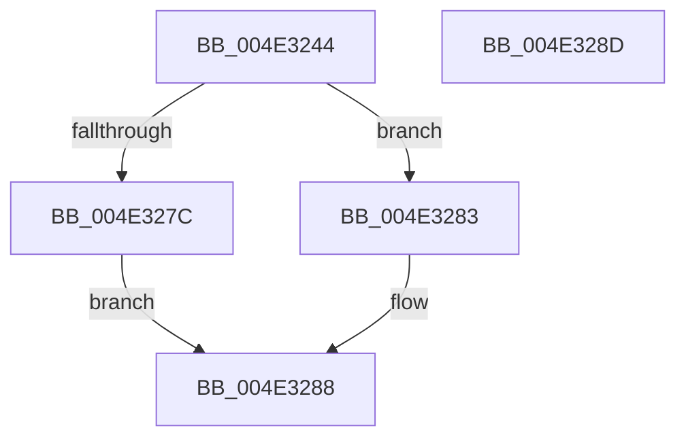

# FsRtlPrivateRemoveLock

- RVA: `0x004E3244`–`0x004E328E` (길이 `74` bytes)
- VA: `0x00000001404E3244`
- 실행 섹션: `.text`
- PDB 이름 있음: `예`; PDB Function 태그: `아니요`
- unwind 정보 RVA: `0x0006C2A4`
- 디코드: `20`개 명령, `74/74` bytes 표시
- 미해석 바이트: `0` (있으면 어셈블리에 `.byte`로 보존)

> 이 문서는 커널 이미지의 기계어와 PDB 기호를 분석해 생성했습니다. 4번과 5번은 함수 원형과 자료형을 바이너리 사용 방식에서 추정한 C 해석이며 원본 소스 복구 결과는 아닙니다.

## 1. Dependencies

- 직접 호출 지점: **2**; 고유 호출 대상: **2**
- 직접 호출자로 확인된 함수: **3**
- RIP 상대 이미지 참조: **0**

### Outgoing calls
- `0x004E327C` → [FsRtlFastUnlockSingleExclusive](../38/FsRtlFastUnlockSingleExclusive_function_0038C8E0.md) (function, `0x0038C8E0`)
- `0x004E3283` → [FsRtlFastUnlockSingleShared](../38/FsRtlFastUnlockSingleShared_function_0038D1F0.md) (function, `0x0038D1F0`)

### Direct callers
- [FsRtlPrivateCheckWaitingLocks](../38/FsRtlPrivateCheckWaitingLocks_function_0038DCBC.md) at `0x0038DE3E`
- [FsRtlPrivateLock](../38/FsRtlPrivateLock_function_0038DF90.md) at `0x0038E599`
- [FsRtlPrivateLock$fin$0](../6D/FsRtlPrivateLock_fin_0_function_006D2360.md) at `0x006D2406`

### Static image references
- 디코드된 RIP-relative 메모리 참조가 없습니다.

## 2. Other-region calls and transfers

- 다른 실행 섹션으로 향하는 call: **0**
- 별도 외부 분기/꼬리 이동을 확인하지 못했습니다.

## 3. Assembly (complete function range)

```asm
004E3244  48 83 EC 58                     sub rsp, 0x58
004E3248  8B 42 14                        mov eax, dword ptr [rdx + 0x14]
004E324B  4C 8D 4A 08                     lea r9, [rdx + 8]
004E324F  4C 8B 52 20                     mov r10, qword ptr [rdx + 0x20]
004E3253  4C 8B 5A 18                     mov r11, qword ptr [rdx + 0x18]
004E3257  44 88 44 24 40                  mov byte ptr [rsp + 0x40], r8b
004E325C  4C 8B C2                        mov r8, rdx
004E325F  C6 44 24 38 01                  mov byte ptr [rsp + 0x38], 1
004E3264  48 83 64 24 30 00               and qword ptr [rsp + 0x30], 0
004E326A  80 7A 10 00                     cmp byte ptr [rdx + 0x10], 0
004E326E  49 8B D3                        mov rdx, r11
004E3271  89 44 24 28                     mov dword ptr [rsp + 0x28], eax
004E3275  4C 89 54 24 20                  mov qword ptr [rsp + 0x20], r10
004E327A  74 07                           je 0x1404e3283
004E327C  E8 5F 96 EA FF                  call 0x14038c8e0
004E3281  EB 05                           jmp 0x1404e3288
004E3283  E8 68 9F EA FF                  call 0x14038d1f0
004E3288  48 83 C4 58                     add rsp, 0x58
004E328C  C3                              ret
004E328D  CC                              int3
```

## 4. C-style interpretation (structured pseudocode)

```c
__int64 __fastcall FsRtlPrivateRemoveLock(__int64 a1, __int64 a2, unsigned __int8 a3)
{
    __int64 result;
    __int64 v_rsp;
    unsigned __int8 v_stack_m18;
    unsigned __int8 v_stack_m20;
    unsigned __int64 v_stack_m28;
    unsigned int v_stack_m30;
    unsigned __int64 v_stack_m38;

    v_rsp = (v_rsp) - (88);
    v_stack_m18 = a3;
    v_stack_m20 = 1;
    v_stack_m30 = (unsigned int)((unsigned int)(*(unsigned int *)(a2 + 20)));
    v_stack_m38 = *(unsigned __int64 *)(a2 + 32);
    if ((*(unsigned __int8 *)(a2 + 16)) == 0) goto loc_004E3283;
    result = FsRtlFastUnlockSingleExclusive(a1, *(unsigned __int64 *)(a2 + 24), a2, a2 + 8);
    goto loc_004E3288;
loc_004E3283:
    result = FsRtlFastUnlockSingleShared(a1, *(unsigned __int64 *)(a2 + 24), a2, a2 + 8);
loc_004E3288:
    v_rsp = (v_rsp) + (88);
    return result;
}
```

## 5. (Beta) C Style

```c
int64_t FsRtlPrivateRemoveLock(int64_t Arg1, void *Arg2, uint8_t Arg3)
{
    uint8_t *arg2 = (uint8_t *)Arg2;

    int64_t result;
    int64_t local_rsp;
    uint8_t v_stack_m18;
    uint8_t v_stack_m20;
    uint64_t v_stack_m28;
    uint32_t v_stack_m30;
    uint64_t v_stack_m38;

    local_rsp = (local_rsp) - (88);
    v_stack_m18 = Arg3;
    v_stack_m20 = 1;
    v_stack_m30 = (uint32_t)((uint32_t)(*(uint32_t *)(arg2 + 0x14)));
    v_stack_m38 = *(uint64_t *)(arg2 + 0x20);
    if ((*(uint8_t *)(arg2 + 0x10)) == 0) goto loc_004E3283;
    result = FsRtlFastUnlockSingleExclusive(Arg1, *(uint64_t *)(arg2 + 0x18), Arg2, Arg2 + 8);
    goto loc_004E3288;
loc_004E3283:
    result = FsRtlFastUnlockSingleShared(Arg1, *(uint64_t *)(arg2 + 0x18), Arg2, Arg2 + 8);
loc_004E3288:
    local_rsp = (local_rsp) + (88);
    return result;
}
```

### 관측된 메모리 오프셋

구조체 형식이 확인되지 않은 접근은 인자 기준의 오프셋으로만 기록했습니다.

| 기준 인자 | 오프셋 표현 | 폭 (bit) | 접근 |
|---|---:|---:|---|
| `Arg2` | `+ 0x8` | `64` | `R` |
| `Arg2` | `+ 0x10` | `8` | `R` |
| `Arg2` | `+ 0x14` | `32` | `R` |
| `Arg2` | `+ 0x18` | `64` | `R` |
| `Arg2` | `+ 0x20` | `64` | `R` |

## 6. Execution-region graph

[열기: 2D/3D 그래프와 함수 탐색 컨트롤 패널](../../../control-panel.html?section=text&rva=0x004E3244&view=graph)

- 2D 그래프는 위에서 아래로 흐르고, 3D 그래프는 빈 공간을 드래그해 회전합니다. Shift+드래그는 이동, 휠은 확대·축소, 함수 노드 선택은 대상 보고서 이동입니다.

### Static fallback


