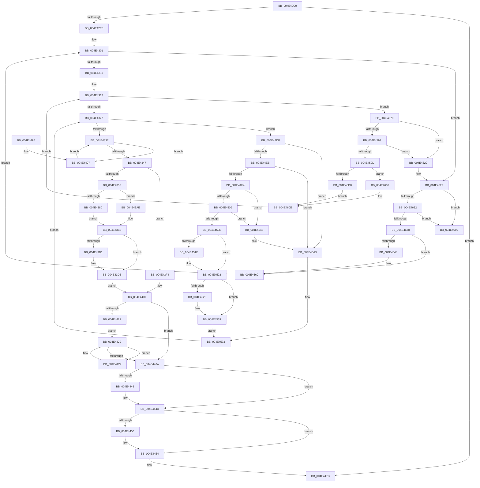

# FsRtlUninitializeOplock

- RVA: `0x004E42C0`–`0x004E4691` (길이 `977` bytes)
- VA: `0x00000001404E42C0`
- 실행 섹션: `.text`
- PDB 이름 있음: `예`; PDB Function 태그: `아니요`
- unwind 정보 RVA: `0x000C60C4`
- 디코드: `253`개 명령, `977/977` bytes 표시
- 미해석 바이트: `0` (있으면 어셈블리에 `.byte`로 보존)

> 이 문서는 커널 이미지의 기계어와 PDB 기호를 분석해 생성했습니다. 4번과 5번은 함수 원형과 자료형을 바이너리 사용 방식에서 추정한 C 해석이며 원본 소스 복구 결과는 아닙니다.

## 1. Dependencies

- 직접 호출 지점: **35**; 고유 호출 대상: **17**
- 직접 호출자로 확인된 함수: **0**
- RIP 상대 이미지 참조: **0**

### Outgoing calls
- `0x004E42F7` → [ExAcquireFastMutexUnsafe](../3F/ExAcquireFastMutexUnsafe_function_003F3720.md) (function, `0x003F3720`)
- `0x004E435D` → [KeAcquireQueuedSpinLock](../27/KeAcquireQueuedSpinLock_function_00273D80.md) (function, `0x00273D80`)
- `0x004E4372` → [KeReleaseQueuedSpinLock](../27/KeReleaseQueuedSpinLock_function_00272540.md) (function, `0x00272540`)
- `0x004E43C0` → [IofCompleteRequest](../29/IofCompleteRequest_function_0029B5C0.md) (function, `0x0029B5C0`)
- `0x004E43D6` → [ObfDereferenceObjectWithTag](../2F/ObfDereferenceObjectWithTag_function_002F78E0.md) (function, `0x002F78E0`)
- `0x004E43E3` → [FsRtlpModifyThreadPriorities](../48/FsRtlpModifyThreadPriorities_function_0048B098.md) (function, `0x0048B098`)
- `0x004E43ED` → [FsRtlpClearOwner](../26/FsRtlpClearOwner_function_00265BE8.md) (function, `0x00265BE8`)
- `0x004E43FB` → [FsRtlpOplockPerfSendData](../../page/6F/FsRtlpOplockPerfSendData_function_006FDB80.md) (function, `0x006FDB80`)
- `0x004E4407` → [FsRtlpSyncWithAckTimeout](../4F/FsRtlpSyncWithAckTimeout_function_004F23C4.md) (function, `0x004F23C4`)
- `0x004E4414` → [ExReleaseFastMutexUnsafe](../25/ExReleaseFastMutexUnsafe_function_002503A0.md) (function, `0x002503A0`)
- `0x004E4419` → [Feature_3609177402__private_IsEnabledDeviceUsageNoInline](../58/Feature_3609177402__private_IsEnabledDeviceUsageNoInline_function_00581D30.md) (function, `0x00581D30`)
- `0x004E4424` → [ZwYieldExecution](../6A/ZwYieldExecution_function_006AD990.md) (function, `0x006AD990`)
- `0x004E4448` → [ExFreePoolWithTag](../../poolcode/B8/ExFreePoolWithTag_function_00B82870.md) (function, `0x00B82870`)
- `0x004E444D` → [Feature_3609177402__private_IsEnabledDeviceUsageNoInline](../58/Feature_3609177402__private_IsEnabledDeviceUsageNoInline_function_00581D30.md) (function, `0x00581D30`)
- `0x004E445F` → [ExFreePoolWithTag](../../poolcode/B8/ExFreePoolWithTag_function_00B82870.md) (function, `0x00B82870`)
- `0x004E446D` → [ExFreePoolWithTag](../../poolcode/B8/ExFreePoolWithTag_function_00B82870.md) (function, `0x00B82870`)
- `0x004E4477` → [ExFreePoolWithTag](../../poolcode/B8/ExFreePoolWithTag_function_00B82870.md) (function, `0x00B82870`)
- `0x004E449A` → [FsRtlpOplockDequeueRH](../42/FsRtlpOplockDequeueRH_function_004258FC.md) (function, `0x004258FC`)
- `0x004E44A8` → [FsRtlpModifyThreadPriorities](../48/FsRtlpModifyThreadPriorities_function_0048B098.md) (function, `0x0048B098`)
- `0x004E44B6` → [ObfDereferenceObjectWithTag](../2F/ObfDereferenceObjectWithTag_function_002F78E0.md) (function, `0x002F78E0`)
- `0x004E44C1` → [FsRtlpClearOwner](../26/FsRtlpClearOwner_function_00265BE8.md) (function, `0x00265BE8`)
- `0x004E44CA` → [FsRtlpOplockPerfSendData](../../page/6F/FsRtlpOplockPerfSendData_function_006FDB80.md) (function, `0x006FDB80`)
- `0x004E44D5` → [FsRtlpFreeRHOpContext](../4F/FsRtlpFreeRHOpContext_function_004F2394.md) (function, `0x004F2394`)
- `0x004E44F7` → [FsRtlpOplockDequeueRH](../42/FsRtlpOplockDequeueRH_function_004258FC.md) (function, `0x004258FC`)
- `0x004E4534` → [FsRtlpClearOwner](../26/FsRtlpClearOwner_function_00265BE8.md) (function, `0x00265BE8`)
- `0x004E453F` → [FsRtlpFreeRHOpContext](../4F/FsRtlpFreeRHOpContext_function_004F2394.md) (function, `0x004F2394`)
- `0x004E456E` → [FsRtlpRemoveAndCompleteRHIrp](../42/FsRtlpRemoveAndCompleteRHIrp_function_00425964.md) (function, `0x00425964`)
- `0x004E45A7` → [KeAcquireQueuedSpinLock](../27/KeAcquireQueuedSpinLock_function_00273D80.md) (function, `0x00273D80`)
- `0x004E45BC` → [KeReleaseQueuedSpinLock](../27/KeReleaseQueuedSpinLock_function_00272540.md) (function, `0x00272540`)
- `0x004E45CA` → [ObfDereferenceObjectWithTag](../2F/ObfDereferenceObjectWithTag_function_002F78E0.md) (function, `0x002F78E0`)
- `0x004E4618` → [IofCompleteRequest](../29/IofCompleteRequest_function_0029B5C0.md) (function, `0x0029B5C0`)
- `0x004E464B` → [KeAcquireQueuedSpinLock](../27/KeAcquireQueuedSpinLock_function_00273D80.md) (function, `0x00273D80`)
- `0x004E4660` → [KeReleaseQueuedSpinLock](../27/KeReleaseQueuedSpinLock_function_00272540.md) (function, `0x00272540`)
- `0x004E4675` → [guard_dispatch_icall](../6B/guard_dispatch_icall_function_006BAAD0.md) (function, `0x006BAAD0`)
- `0x004E467F` → [ExFreePoolWithTag](../../poolcode/B8/ExFreePoolWithTag_function_00B82870.md) (function, `0x00B82870`)

### Direct callers
- 이 함수 시작 RVA로 연결되는 직접 call은 확인되지 않았습니다. 간접 호출은 완전히 역산할 수 없습니다.

### Static image references
- 디코드된 RIP-relative 메모리 참조가 없습니다.

## 2. Other-region calls and transfers

- 다른 실행 섹션으로 향하는 call: **7**
  - `0x004E43FB` → [FsRtlpOplockPerfSendData](../../page/6F/FsRtlpOplockPerfSendData_function_006FDB80.md) (`.text` → `PAGE`)
  - `0x004E4448` → [ExFreePoolWithTag](../../poolcode/B8/ExFreePoolWithTag_function_00B82870.md) (`.text` → `POOLCODE`)
  - `0x004E445F` → [ExFreePoolWithTag](../../poolcode/B8/ExFreePoolWithTag_function_00B82870.md) (`.text` → `POOLCODE`)
  - `0x004E446D` → [ExFreePoolWithTag](../../poolcode/B8/ExFreePoolWithTag_function_00B82870.md) (`.text` → `POOLCODE`)
  - `0x004E4477` → [ExFreePoolWithTag](../../poolcode/B8/ExFreePoolWithTag_function_00B82870.md) (`.text` → `POOLCODE`)
  - `0x004E44CA` → [FsRtlpOplockPerfSendData](../../page/6F/FsRtlpOplockPerfSendData_function_006FDB80.md) (`.text` → `PAGE`)
  - `0x004E467F` → [ExFreePoolWithTag](../../poolcode/B8/ExFreePoolWithTag_function_00B82870.md) (`.text` → `POOLCODE`)
- 별도 외부 분기/꼬리 이동을 확인하지 못했습니다.

## 3. Assembly (complete function range)

```asm
004E42C0  48 89 5C 24 10                  mov qword ptr [rsp + 0x10], rbx
004E42C5  48 89 74 24 18                  mov qword ptr [rsp + 0x18], rsi
004E42CA  48 89 7C 24 20                  mov qword ptr [rsp + 0x20], rdi
004E42CF  41 54                           push r12
004E42D1  41 56                           push r14
004E42D3  41 57                           push r15
004E42D5  48 83 EC 40                     sub rsp, 0x40
004E42D9  48 8B 39                        mov rdi, qword ptr [rcx]
004E42DC  45 33 F6                        xor r14d, r14d
004E42DF  48 85 FF                        test rdi, rdi
004E42E2  0F 84 94 01 00 00               je 0x1404e447c
004E42E8  48 89 7C 24 60                  mov qword ptr [rsp + 0x60], rdi
004E42ED  4C 89 31                        mov qword ptr [rcx], r14
004E42F0  48 8B 8F 98 00 00 00            mov rcx, qword ptr [rdi + 0x98]
004E42F7  E8 24 F4 F0 FF                  call 0x1403f3720
004E42FC  90                              nop
004E42FD  45 8D 66 07                     lea r12d, [r14 + 7]
004E4301  48 8D 47 58                     lea rax, [rdi + 0x58]
004E4305  48 8B 18                        mov rbx, qword ptr [rax]
004E4308  48 3B D8                        cmp rbx, rax
004E430B  0F 85 18 03 00 00               jne 0x1404e4629
004E4311  41 BF 01 00 00 00               mov r15d, 1
004E4317  48 8D 4F 28                     lea rcx, [rdi + 0x28]
004E431B  48 8B 01                        mov rax, qword ptr [rcx]
004E431E  48 3B C1                        cmp rax, rcx
004E4321  0F 85 51 02 00 00               jne 0x1404e4578
004E4327  48 8D 47 38                     lea rax, [rdi + 0x38]
004E432B  48 8B 18                        mov rbx, qword ptr [rax]
004E432E  48 3B D8                        cmp rbx, rax
004E4331  0F 85 A8 01 00 00               jne 0x1404e44df
004E4337  48 8D 47 48                     lea rax, [rdi + 0x48]
004E433B  48 8B 18                        mov rbx, qword ptr [rax]
004E433E  48 3B D8                        cmp rbx, rax
004E4341  0F 85 50 01 00 00               jne 0x1404e4497
004E4347  48 8B 37                        mov rsi, qword ptr [rdi]
004E434A  48 85 F6                        test rsi, rsi
004E434D  0F 84 A1 00 00 00               je 0x1404e43f4
004E4353  48 8B 9E B8 00 00 00            mov rbx, qword ptr [rsi + 0xb8]
004E435A  49 8B CC                        mov rcx, r12
004E435D  E8 1E FA D8 FF                  call 0x140273d80
004E4362  88 46 45                        mov byte ptr [rsi + 0x45], al
004E4365  49 8B C6                        mov rax, r14
004E4368  48 87 46 68                     xchg qword ptr [rsi + 0x68], rax
004E436C  8A 56 45                        mov dl, byte ptr [rsi + 0x45]
004E436F  49 8B CC                        mov rcx, r12
004E4372  E8 C9 E1 D8 FF                  call 0x140272540
004E4377  81 7B 18 40 02 09 00            cmp dword ptr [rbx + 0x18], 0x90240
004E437E  75 2E                           jne 0x1404e43ae
004E4380  48 8B 4E 18                     mov rcx, qword ptr [rsi + 0x18]
004E4384  0F 57 C0                        xorps xmm0, xmm0
004E4387  33 C0                           xor eax, eax
004E4389  0F 11 01                        movups xmmword ptr [rcx], xmm0
004E438C  48 89 41 10                     mov qword ptr [rcx + 0x10], rax
004E4390  C7 01 01 00 18 00               mov dword ptr [rcx], 0x180001
004E4396  8D 50 18                        lea edx, [rax + 0x18]
004E4399  8B 87 90 00 00 00               mov eax, dword ptr [rdi + 0x90]
004E439F  C1 E8 0C                        shr eax, 0xc
004E43A2  41 23 C4                        and eax, r12d
004E43A5  89 41 04                        mov dword ptr [rcx + 4], eax
004E43A8  48 89 56 38                     mov qword ptr [rsi + 0x38], rdx
004E43AC  EB 08                           jmp 0x1404e43b6
004E43AE  48 C7 46 38 08 00 00 00         mov qword ptr [rsi + 0x38], 8
004E43B6  44 89 76 30                     mov dword ptr [rsi + 0x30], r14d
004E43BA  41 8A D7                        mov dl, r15b
004E43BD  48 8B CE                        mov rcx, rsi
004E43C0  E8 FB 71 DB FF                  call 0x14029b5c0
004E43C5  4C 89 37                        mov qword ptr [rdi], r14
004E43C8  48 8B 4F 08                     mov rcx, qword ptr [rdi + 8]
004E43CC  48 85 C9                        test rcx, rcx
004E43CF  74 0A                           je 0x1404e43db
004E43D1  BA 44 66 6C 74                  mov edx, 0x746c6644
004E43D6  E8 05 35 E1 FF                  call 0x1402f78e0
004E43DB  45 33 C0                        xor r8d, r8d
004E43DE  33 D2                           xor edx, edx
004E43E0  48 8B CF                        mov rcx, rdi
004E43E3  E8 B0 6C FA FF                  call 0x14048b098
004E43E8  33 D2                           xor edx, edx
004E43EA  48 8B CF                        mov rcx, rdi
004E43ED  E8 F6 17 D8 FF                  call 0x140265be8
004E43F2  EB 0C                           jmp 0x1404e4400
004E43F4  48 8D 8F A8 00 00 00            lea rcx, [rdi + 0xa8]
004E43FB  E8 80 97 21 00                  call 0x1406fdb80
004E4400  48 8D 8F B8 00 00 00            lea rcx, [rdi + 0xb8]
004E4407  E8 B8 DF 00 00                  call 0x1404f23c4
004E440C  90                              nop
004E440D  48 8B 8F 98 00 00 00            mov rcx, qword ptr [rdi + 0x98]
004E4414  E8 87 BF D6 FF                  call 0x1402503a0
004E4419  E8 12 D9 09 00                  call 0x140581d30
004E441E  85 C0                           test eax, eax
004E4420  74 18                           je 0x1404e443a
004E4422  EB 05                           jmp 0x1404e4429
004E4424  E8 67 95 1C 00                  call 0x1406ad990
004E4429  33 C0                           xor eax, eax
004E442B  48 8B 8F A0 00 00 00            mov rcx, qword ptr [rdi + 0xa0]
004E4432  F0 44 0F B1 71 08               lock cmpxchg dword ptr [rcx + 8], r14d
004E4438  75 EA                           jne 0x1404e4424
004E443A  48 8B 8F 88 00 00 00            mov rcx, qword ptr [rdi + 0x88]
004E4441  48 85 C9                        test rcx, rcx
004E4444  74 07                           je 0x1404e444d
004E4446  33 D2                           xor edx, edx
004E4448  E8 23 E4 69 00                  call 0x140b82870
004E444D  E8 DE D8 09 00                  call 0x140581d30
004E4452  85 C0                           test eax, eax
004E4454  74 0E                           je 0x1404e4464
004E4456  33 D2                           xor edx, edx
004E4458  48 8B 8F A0 00 00 00            mov rcx, qword ptr [rdi + 0xa0]
004E445F  E8 0C E4 69 00                  call 0x140b82870
004E4464  33 D2                           xor edx, edx
004E4466  48 8B 8F 98 00 00 00            mov rcx, qword ptr [rdi + 0x98]
004E446D  E8 FE E3 69 00                  call 0x140b82870
004E4472  33 D2                           xor edx, edx
004E4474  48 8B CF                        mov rcx, rdi
004E4477  E8 F4 E3 69 00                  call 0x140b82870
004E447C  48 8B 5C 24 68                  mov rbx, qword ptr [rsp + 0x68]
004E4481  48 8B 74 24 70                  mov rsi, qword ptr [rsp + 0x70]
004E4486  48 8B 7C 24 78                  mov rdi, qword ptr [rsp + 0x78]
004E448B  48 83 C4 40                     add rsp, 0x40
004E448F  41 5F                           pop r15
004E4491  41 5E                           pop r14
004E4493  41 5C                           pop r12
004E4495  C3                              ret
004E4496  CC                              int3
004E4497  48 8B CB                        mov rcx, rbx
004E449A  E8 5D 14 F4 FF                  call 0x1404258fc
004E449F  45 33 C0                        xor r8d, r8d
004E44A2  48 8B D3                        mov rdx, rbx
004E44A5  48 8B CF                        mov rcx, rdi
004E44A8  E8 EB 6B FA FF                  call 0x14048b098
004E44AD  48 8B 4B 18                     mov rcx, qword ptr [rbx + 0x18]
004E44B1  BA 44 66 6C 74                  mov edx, 0x746c6644
004E44B6  E8 25 34 E1 FF                  call 0x1402f78e0
004E44BB  48 8B D3                        mov rdx, rbx
004E44BE  48 8B CF                        mov rcx, rdi
004E44C1  E8 22 17 D8 FF                  call 0x140265be8
004E44C6  48 8D 4B 48                     lea rcx, [rbx + 0x48]
004E44CA  E8 B1 96 21 00                  call 0x1406fdb80
004E44CF  41 8A D7                        mov dl, r15b
004E44D2  48 8B CB                        mov rcx, rbx
004E44D5  E8 BA DE 00 00                  call 0x1404f2394
004E44DA  E9 58 FE FF FF                  jmp 0x1404e4337
004E44DF  F7 87 90 00 00 00 00 00 01 00   test dword ptr [rdi + 0x90], 0x10000
004E44E9  74 62                           je 0x1404e454d
004E44EB  4C 8D 4B 38                     lea r9, [rbx + 0x38]
004E44EF  4D 39 31                        cmp qword ptr [r9], r14
004E44F2  74 59                           je 0x1404e454d
004E44F4  48 8B CB                        mov rcx, rbx
004E44F7  E8 00 14 F4 FF                  call 0x1404258fc
004E44FC  49 8B 09                        mov rcx, qword ptr [r9]
004E44FF  49 8B 41 08                     mov rax, qword ptr [r9 + 8]
004E4503  4C 39 49 08                     cmp qword ptr [rcx + 8], r9
004E4507  75 3D                           jne 0x1404e4546
004E4509  4C 39 08                        cmp qword ptr [rax], r9
004E450C  75 38                           jne 0x1404e4546
004E450E  48 89 08                        mov qword ptr [rax], rcx
004E4511  48 89 41 08                     mov qword ptr [rcx + 8], rax
004E4515  48 8D 47 78                     lea rax, [rdi + 0x78]
004E4519  48 39 00                        cmp qword ptr [rax], rax
004E451C  75 0A                           jne 0x1404e4528
004E451E  81 A7 90 00 00 00 FF FF FC FF   and dword ptr [rdi + 0x90], 0xfffcffff
004E4528  4C 39 73 28                     cmp qword ptr [rbx + 0x28], r14
004E452C  74 0B                           je 0x1404e4539
004E452E  48 8B D3                        mov rdx, rbx
004E4531  48 8B CF                        mov rcx, rdi
004E4534  E8 AF 16 D8 FF                  call 0x140265be8
004E4539  41 8A D7                        mov dl, r15b
004E453C  48 8B CB                        mov rcx, rbx
004E453F  E8 50 DE 00 00                  call 0x1404f2394
004E4544  EB 2D                           jmp 0x1404e4573
004E4546  B9 03 00 00 00                  mov ecx, 3
004E454B  CD 29                           int 0x29
004E454D  44 88 74 24 38                  mov byte ptr [rsp + 0x38], r14b
004E4552  66 44 89 74 24 30               mov word ptr [rsp + 0x30], r14w
004E4558  44 89 74 24 28                  mov dword ptr [rsp + 0x28], r14d
004E455D  44 89 74 24 20                  mov dword ptr [rsp + 0x20], r14d
004E4562  45 33 C9                        xor r9d, r9d
004E4565  45 33 C0                        xor r8d, r8d
004E4568  48 8B D7                        mov rdx, rdi
004E456B  48 8B CB                        mov rcx, rbx
004E456E  E8 F1 13 F4 FF                  call 0x140425964
004E4573  E9 AF FD FF FF                  jmp 0x1404e4327
004E4578  48 8D 98 58 FF FF FF            lea rbx, [rax - 0xa8]
004E457F  48 8B B3 B8 00 00 00            mov rsi, qword ptr [rbx + 0xb8]
004E4586  48 8B 10                        mov rdx, qword ptr [rax]
004E4589  48 39 48 08                     cmp qword ptr [rax + 8], rcx
004E458D  0F 85 8F 00 00 00               jne 0x1404e4622
004E4593  48 39 42 08                     cmp qword ptr [rdx + 8], rax
004E4597  0F 85 85 00 00 00               jne 0x1404e4622
004E459D  48 89 11                        mov qword ptr [rcx], rdx
004E45A0  48 89 4A 08                     mov qword ptr [rdx + 8], rcx
004E45A4  49 8B CC                        mov rcx, r12
004E45A7  E8 D4 F7 D8 FF                  call 0x140273d80
004E45AC  88 43 45                        mov byte ptr [rbx + 0x45], al
004E45AF  49 8B C6                        mov rax, r14
004E45B2  48 87 43 68                     xchg qword ptr [rbx + 0x68], rax
004E45B6  8A 53 45                        mov dl, byte ptr [rbx + 0x45]
004E45B9  49 8B CC                        mov rcx, r12
004E45BC  E8 7F DF D8 FF                  call 0x140272540
004E45C1  48 8B 4E 30                     mov rcx, qword ptr [rsi + 0x30]
004E45C5  BA 44 66 6C 74                  mov edx, 0x746c6644
004E45CA  E8 11 33 E1 FF                  call 0x1402f78e0
004E45CF  81 7E 18 40 02 09 00            cmp dword ptr [rsi + 0x18], 0x90240
004E45D6  75 2E                           jne 0x1404e4606
004E45D8  48 8B 4B 18                     mov rcx, qword ptr [rbx + 0x18]
004E45DC  0F 57 C0                        xorps xmm0, xmm0
004E45DF  33 C0                           xor eax, eax
004E45E1  0F 11 01                        movups xmmword ptr [rcx], xmm0
004E45E4  48 89 41 10                     mov qword ptr [rcx + 0x10], rax
004E45E8  C7 01 01 00 18 00               mov dword ptr [rcx], 0x180001
004E45EE  8D 70 18                        lea esi, [rax + 0x18]
004E45F1  8B 87 90 00 00 00               mov eax, dword ptr [rdi + 0x90]
004E45F7  C1 E8 0C                        shr eax, 0xc
004E45FA  41 23 C4                        and eax, r12d
004E45FD  89 41 04                        mov dword ptr [rcx + 4], eax
004E4600  48 89 73 38                     mov qword ptr [rbx + 0x38], rsi
004E4604  EB 08                           jmp 0x1404e460e
004E4606  48 C7 43 38 08 00 00 00         mov qword ptr [rbx + 0x38], 8
004E460E  44 89 73 30                     mov dword ptr [rbx + 0x30], r14d
004E4612  41 8A D7                        mov dl, r15b
004E4615  48 8B CB                        mov rcx, rbx
004E4618  E8 A3 6F DB FF                  call 0x14029b5c0
004E461D  E9 F5 FC FF FF                  jmp 0x1404e4317
004E4622  B9 03 00 00 00                  mov ecx, 3
004E4627  CD 29                           int 0x29
004E4629  48 8B 0B                        mov rcx, qword ptr [rbx]
004E462C  48 39 43 08                     cmp qword ptr [rbx + 8], rax
004E4630  75 57                           jne 0x1404e4689
004E4632  48 39 59 08                     cmp qword ptr [rcx + 8], rbx
004E4636  75 51                           jne 0x1404e4689
004E4638  48 89 08                        mov qword ptr [rax], rcx
004E463B  48 89 41 08                     mov qword ptr [rcx + 8], rax
004E463F  48 8B 73 10                     mov rsi, qword ptr [rbx + 0x10]
004E4643  48 85 F6                        test rsi, rsi
004E4646  74 21                           je 0x1404e4669
004E4648  49 8B CC                        mov rcx, r12
004E464B  E8 30 F7 D8 FF                  call 0x140273d80
004E4650  88 46 45                        mov byte ptr [rsi + 0x45], al
004E4653  49 8B C6                        mov rax, r14
004E4656  48 87 46 68                     xchg qword ptr [rsi + 0x68], rax
004E465A  8A 56 45                        mov dl, byte ptr [rsi + 0x45]
004E465D  49 8B CC                        mov rcx, r12
004E4660  E8 DB DE D8 FF                  call 0x140272540
004E4665  4C 89 76 38                     mov qword ptr [rsi + 0x38], r14
004E4669  48 8B 43 18                     mov rax, qword ptr [rbx + 0x18]
004E466D  48 8B 53 10                     mov rdx, qword ptr [rbx + 0x10]
004E4671  48 8B 4B 20                     mov rcx, qword ptr [rbx + 0x20]
004E4675  E8 56 64 1D 00                  call 0x1406baad0
004E467A  33 D2                           xor edx, edx
004E467C  48 8B CB                        mov rcx, rbx
004E467F  E8 EC E1 69 00                  call 0x140b82870
004E4684  E9 78 FC FF FF                  jmp 0x1404e4301
004E4689  B9 03 00 00 00                  mov ecx, 3
004E468E  CD 29                           int 0x29
004E4690  CC                              int3
```

## 4. C-style interpretation (structured pseudocode)

```c
__int64 __fastcall FsRtlUninitializeOplock(__int64 a1, __int64 a2, int a3)
{
    __int64 result;
    __int64 v_r14;
    __int64 v_rsp;
    unsigned __int64 v_stack_p10;
    unsigned __int64 v_stack_p18;
    unsigned __int64 v_stack_p20;
    unsigned int v_stack_p28;
    unsigned __int16 v_stack_p30;
    unsigned __int8 v_stack_p38;
    unsigned __int64 v_stack_p8;

    v_stack_p10 = v_rbx;
    v_stack_p18 = v_rsi;
    v_stack_p20 = v_rdi;
    v_rsp = (v_rsp) - (64);
    v_r14 = 0;
    if (*(unsigned __int64 *)(a1) == 0) goto loc_004E447C;
    v_stack_p8 = *(unsigned __int64 *)(a1);
    *(unsigned __int64 *)(a1) = 0;
    result = ExAcquireFastMutexUnsafe(*(unsigned __int64 *)(*(unsigned __int64 *)(a1) + 152), a2, a3, a4);
loc_004E4301:
    if ((*(unsigned __int64 *)(*(unsigned __int64 *)(a1) + 88)) != (*(unsigned __int64 *)(a1) + 88)) goto loc_004E4629;
loc_004E4317:
    if ((*(unsigned __int64 *)(*(unsigned __int64 *)(a1) + 40)) != (*(unsigned __int64 *)(a1) + 40)) goto loc_004E4578;
loc_004E4327:
    if ((*(unsigned __int64 *)(*(unsigned __int64 *)(a1) + 56)) != (*(unsigned __int64 *)(a1) + 56)) goto loc_004E44DF;
loc_004E4337:
    if ((*(unsigned __int64 *)(*(unsigned __int64 *)(a1) + 72)) != (*(unsigned __int64 *)(a1) + 72)) goto loc_004E4497;
    if (*(unsigned __int64 *)(*(unsigned __int64 *)(a1)) == 0) goto loc_004E43F4;
    result = KeAcquireQueuedSpinLock(v_r14 + 7, a2, a3, a4);
    *(unsigned __int8 *)(*(unsigned __int64 *)(*(unsigned __int64 *)(a1)) + 69) = (unsigned __int8)(result);
    result = KeReleaseQueuedSpinLock(v_r14 + 7, *(unsigned __int8 *)(*(unsigned __int64 *)(*(unsigned __int64 *)(a1)) + 69), a3, a4);
    if ((*(unsigned int *)(*(unsigned __int64 *)(*(unsigned __int64 *)(*(unsigned __int64 *)(a1)) + 184) + 24)) != 0x90240ULL) goto loc_004E43AE;
    result = 0;
    *(unsigned __int64 *)(*(unsigned __int64 *)(*(unsigned __int64 *)(*(unsigned __int64 *)(a1)) + 24)) = v_xmm0;
    *(unsigned __int64 *)(*(unsigned __int64 *)(*(unsigned __int64 *)(*(unsigned __int64 *)(a1)) + 24) + 16) = 0;
    *(unsigned int *)(*(unsigned __int64 *)(*(unsigned __int64 *)(*(unsigned __int64 *)(a1)) + 24)) = 0x180001ULL;
    result = (unsigned int)(((unsigned int)(*(unsigned int *)(*(unsigned __int64 *)(a1) + 144))) >> (12));
    result = (unsigned int)((result) & ((unsigned int)(v_r14 + 7)));
    *(unsigned int *)(*(unsigned __int64 *)(*(unsigned __int64 *)(*(unsigned __int64 *)(a1)) + 24) + 4) = (unsigned int)(result);
    *(unsigned __int64 *)(*(unsigned __int64 *)(*(unsigned __int64 *)(a1)) + 56) = result + 24;
    goto loc_004E43B6;
loc_004E43AE:
    *(unsigned __int64 *)(*(unsigned __int64 *)(*(unsigned __int64 *)(a1)) + 56) = 8;
loc_004E43B6:
    *(unsigned int *)(*(unsigned __int64 *)(*(unsigned __int64 *)(a1)) + 48) = 0;
    result = IofCompleteRequest(*(unsigned __int64 *)(*(unsigned __int64 *)(a1)), 1, a3, a4);
    *(unsigned __int64 *)(*(unsigned __int64 *)(a1)) = 0;
    if (*(unsigned __int64 *)(*(unsigned __int64 *)(a1) + 8) != 0) {
        a2 = 0x746C6644ULL;
        result = ObfDereferenceObjectWithTag(*(unsigned __int64 *)(*(unsigned __int64 *)(a1) + 8), a2, a3, a4);
    }
    a3 = 0;
    a2 = 0;
    result = FsRtlpModifyThreadPriorities(*(unsigned __int64 *)(a1), a2, a3, a4);
    a2 = 0;
    result = FsRtlpClearOwner(*(unsigned __int64 *)(a1), a2, a3, a4);
    goto loc_004E4400;
loc_004E43F4:
    result = FsRtlpOplockPerfSendData(*(unsigned __int64 *)(a1) + 168, a2, a3, a4);
loc_004E4400:
    result = FsRtlpSyncWithAckTimeout(*(unsigned __int64 *)(a1) + 184, a2, a3, a4);
    result = ExReleaseFastMutexUnsafe(*(unsigned __int64 *)(*(unsigned __int64 *)(a1) + 152), a2, a3, a4);
    result = Feature_3609177402__private_IsEnabledDeviceUsageNoInline(*(unsigned __int64 *)(*(unsigned __int64 *)(a1) + 152), a2, a3, a4);
    if ((unsigned int)(result) == 0) goto loc_004E443A;
    goto loc_004E4429;
loc_004E4424:
    result = ZwYieldExecution(*(unsigned __int64 *)(*(unsigned __int64 *)(a1) + 152), a2, a3, a4);
loc_004E4429:
    result = 0;
    if (condition_is_not_equal) goto loc_004E4424;
loc_004E443A:
    if (*(unsigned __int64 *)(*(unsigned __int64 *)(a1) + 136) != 0) {
        a2 = 0;
        result = ExFreePoolWithTag(*(unsigned __int64 *)(*(unsigned __int64 *)(a1) + 136), a2, a3, a4);
    }
    result = Feature_3609177402__private_IsEnabledDeviceUsageNoInline(*(unsigned __int64 *)(*(unsigned __int64 *)(a1) + 136), a2, a3, a4);
    if ((unsigned int)(result) != 0) {
        a2 = 0;
        a1 = *(unsigned __int64 *)(*(unsigned __int64 *)(a1) + 160);
        result = ExFreePoolWithTag(a1, a2, a3, a4);
    }
    a2 = 0;
    result = ExFreePoolWithTag(*(unsigned __int64 *)(*(unsigned __int64 *)(a1) + 152), a2, a3, a4);
    a2 = 0;
    result = ExFreePoolWithTag(*(unsigned __int64 *)(a1), a2, a3, a4);
loc_004E447C:
    v_rsp = (v_rsp) + (64);
    return result;
loc_004E4497:
    result = FsRtlpOplockDequeueRH(v_stack_p10, a2, a3, a4);
    a3 = 0;
    result = FsRtlpModifyThreadPriorities(v_stack_p20, v_stack_p10, a3, a4);
    result = ObfDereferenceObjectWithTag(*(unsigned __int64 *)(v_stack_p10 + 24), (unsigned int)(0x746C6644ULL), a3, a4);
    result = FsRtlpClearOwner(v_stack_p20, v_stack_p10, a3, a4);
    result = FsRtlpOplockPerfSendData(v_stack_p10 + 72, v_stack_p10, a3, a4);
    result = FsRtlpFreeRHOpContext(v_stack_p10, 1, a3, a4);
    goto loc_004E4337;
loc_004E44DF:
    if (((*(unsigned int *)(v_stack_p20 + 144)) & (0x10000ULL)) == 0) goto loc_004E454D;
    if ((*(unsigned __int64 *)(v_stack_p10 + 56)) == 0) goto loc_004E454D;
    result = FsRtlpOplockDequeueRH(v_stack_p10, 1, a3, v_stack_p10 + 56);
    if ((*(unsigned __int64 *)(*(unsigned __int64 *)(v_stack_p10 + 56) + 8)) != (v_stack_p10 + 56)) goto loc_004E4546;
    if ((*(unsigned __int64 *)(*(unsigned __int64 *)(v_stack_p10 + 56 + 8))) != (v_stack_p10 + 56)) goto loc_004E4546;
    *(unsigned __int64 *)(*(unsigned __int64 *)(v_stack_p10 + 56 + 8)) = *(unsigned __int64 *)(v_stack_p10 + 56);
    *(unsigned __int64 *)(*(unsigned __int64 *)(v_stack_p10 + 56) + 8) = *(unsigned __int64 *)(v_stack_p10 + 56 + 8);
    if ((*(unsigned __int64 *)(v_stack_p20 + 120)) == (v_stack_p20 + 120)) {
    }
    result = v_stack_p20 + 120;
    if ((*(unsigned __int64 *)(v_stack_p10 + 40)) != 0) {
        a2 = v_stack_p10;
        a1 = v_stack_p20;
        result = FsRtlpClearOwner(a1, a2, a3, v_stack_p10 + 56);
    }
    result = FsRtlpFreeRHOpContext(v_stack_p10, 1, a3, v_stack_p10 + 56);
    goto loc_004E4573;
loc_004E4546:
loc_004E454D:
    v_stack_p38 = 0;
    v_stack_p30 = 0;
    v_stack_p28 = 0;
    v_stack_p20 = 0;
    a4 = 0;
    a3 = 0;
    result = FsRtlpRemoveAndCompleteRHIrp(v_stack_p10, v_stack_p20, a3, a4);
loc_004E4573:
    goto loc_004E4327;
loc_004E4578:
    if ((*(unsigned __int64 *)(result + 8)) != v_stack_p10) goto loc_004E4622;
    if ((*(unsigned __int64 *)(*(unsigned __int64 *)(result) + 8)) != result) goto loc_004E4622;
    *(unsigned __int64 *)(v_stack_p10) = *(unsigned __int64 *)(result);
    *(unsigned __int64 *)(*(unsigned __int64 *)(result) + 8) = v_stack_p10;
    result = KeAcquireQueuedSpinLock(v_r14 + 7, *(unsigned __int64 *)(result), a3, a4);
    *(unsigned __int8 *)(result - 168 + 69) = (unsigned __int8)(result);
    result = KeReleaseQueuedSpinLock(v_r14 + 7, *(unsigned __int8 *)(result - 168 + 69), a3, a4);
    result = ObfDereferenceObjectWithTag(*(unsigned __int64 *)(*(unsigned __int64 *)(result - 168 + 184) + 48), (unsigned int)(0x746C6644ULL), a3, a4);
    if ((*(unsigned int *)(*(unsigned __int64 *)(result - 168 + 184) + 24)) != 0x90240ULL) goto loc_004E4606;
    result = 0;
    *(unsigned __int64 *)(*(unsigned __int64 *)(result - 168 + 24)) = v_xmm0;
    *(unsigned __int64 *)(*(unsigned __int64 *)(result - 168 + 24) + 16) = 0;
    *(unsigned int *)(*(unsigned __int64 *)(result - 168 + 24)) = 0x180001ULL;
    result = (unsigned int)(((unsigned int)(*(unsigned int *)(v_stack_p20 + 144))) >> (12));
    result = (unsigned int)((result) & ((unsigned int)(v_r14 + 7)));
    *(unsigned int *)(*(unsigned __int64 *)(result - 168 + 24) + 4) = (unsigned int)(result);
    *(unsigned __int64 *)(result - 168 + 56) = result + 24;
    goto loc_004E460E;
loc_004E4606:
    *(unsigned __int64 *)(result - 168 + 56) = 8;
loc_004E460E:
    *(unsigned int *)(result - 168 + 48) = 0;
    result = IofCompleteRequest(result - 168, 1, a3, a4);
    goto loc_004E4317;
loc_004E4622:
loc_004E4629:
    if ((*(unsigned __int64 *)(result - 168 + 8)) != result) goto loc_004E4689;
    if ((*(unsigned __int64 *)(*(unsigned __int64 *)(result - 168) + 8)) != (result - 168)) goto loc_004E4689;
    *(unsigned __int64 *)(result) = *(unsigned __int64 *)(result - 168);
    *(unsigned __int64 *)(*(unsigned __int64 *)(result - 168) + 8) = result;
    if (*(unsigned __int64 *)(result - 168 + 16) != 0) {
        a1 = v_r14 + 7;
        result = KeAcquireQueuedSpinLock(a1, 1, a3, a4);
        *(unsigned __int8 *)(*(unsigned __int64 *)(result - 168 + 16) + 69) = (unsigned __int8)(result);
        result = 0;
        a2 = *(unsigned __int8 *)(*(unsigned __int64 *)(result - 168 + 16) + 69);
        a1 = v_r14 + 7;
        result = KeReleaseQueuedSpinLock(a1, a2, a3, a4);
        *(unsigned __int64 *)(*(unsigned __int64 *)(result - 168 + 16) + 56) = 0;
    }
    result = guard_dispatch_icall(*(unsigned __int64 *)(result - 168 + 32), *(unsigned __int64 *)(result - 168 + 16), a3, a4);
    a2 = 0;
    result = ExFreePoolWithTag(result - 168, a2, a3, a4);
    goto loc_004E4301;
loc_004E4689:
    return result;
}
```

## 5. (Beta) C Style

```c
int64_t FsRtlUninitializeOplock(void *Arg1, int64_t Arg2, int32_t Arg3)
{
    uint8_t *arg1 = (uint8_t *)Arg1;

    int64_t result;
    int64_t local_r14;
    int64_t local_rsp;
    uint64_t v_stack_p10;
    uint64_t v_stack_p18;
    uint64_t v_stack_p20;
    uint32_t v_stack_p28;
    uint16_t v_stack_p30;
    uint8_t v_stack_p38;
    uint64_t v_stack_p8;

    v_stack_p10 = local_rbx;
    v_stack_p18 = local_rsi;
    v_stack_p20 = local_rdi;
    local_rsp = (local_rsp) - (64);
    local_r14 = 0;
    if (*(uint64_t *)(arg1) == 0) goto loc_004E447C;
    v_stack_p8 = *(uint64_t *)(arg1);
    *(uint64_t *)(arg1) = 0;
    result = ExAcquireFastMutexUnsafe(*(uint64_t *)(*(uint64_t *)(arg1) + 0x98), Arg2, Arg3, a4);
loc_004E4301:
    if ((*(uint64_t *)(*(uint64_t *)(arg1) + 0x58)) != (*(uint64_t *)(arg1) + 88)) goto loc_004E4629;
loc_004E4317:
    if ((*(uint64_t *)(*(uint64_t *)(arg1) + 0x28)) != (*(uint64_t *)(arg1) + 40)) goto loc_004E4578;
loc_004E4327:
    if ((*(uint64_t *)(*(uint64_t *)(arg1) + 0x38)) != (*(uint64_t *)(arg1) + 56)) goto loc_004E44DF;
loc_004E4337:
    if ((*(uint64_t *)(*(uint64_t *)(arg1) + 0x48)) != (*(uint64_t *)(arg1) + 72)) goto loc_004E4497;
    if (*(uint64_t *)(*(uint64_t *)(arg1)) == 0) goto loc_004E43F4;
    result = KeAcquireQueuedSpinLock(local_r14 + 7, Arg2, Arg3, a4);
    *(uint8_t *)(*(uint64_t *)(*(uint64_t *)(arg1)) + 0x45) = (uint8_t)(result);
    result = KeReleaseQueuedSpinLock(local_r14 + 7, *(uint8_t *)(*(uint64_t *)(*(uint64_t *)(arg1)) + 0x45), Arg3, a4);
    if ((*(uint32_t *)(*(uint64_t *)(*(uint64_t *)(*(uint64_t *)(arg1)) + 0xB8) + 0x18)) != 0x90240ULL) goto loc_004E43AE;
    result = 0;
    *(uint64_t *)(*(uint64_t *)(*(uint64_t *)(*(uint64_t *)(arg1)) + 0x18)) = v_xmm0;
    *(uint64_t *)(*(uint64_t *)(*(uint64_t *)(*(uint64_t *)(arg1)) + 0x18) + 0x10) = 0;
    *(uint32_t *)(*(uint64_t *)(*(uint64_t *)(*(uint64_t *)(arg1)) + 0x18)) = 0x180001ULL;
    result = (uint32_t)(((uint32_t)(*(uint32_t *)(*(uint64_t *)(arg1) + 0x90))) >> (12));
    result = (uint32_t)((result) & ((uint32_t)(local_r14 + 7)));
    *(uint32_t *)(*(uint64_t *)(*(uint64_t *)(*(uint64_t *)(arg1)) + 0x18) + 0x4) = (uint32_t)(result);
    *(uint64_t *)(*(uint64_t *)(*(uint64_t *)(arg1)) + 0x38) = result + 24;
    goto loc_004E43B6;
loc_004E43AE:
    *(uint64_t *)(*(uint64_t *)(*(uint64_t *)(arg1)) + 0x38) = 8;
loc_004E43B6:
    *(uint32_t *)(*(uint64_t *)(*(uint64_t *)(arg1)) + 0x30) = 0;
    result = IofCompleteRequest(*(uint64_t *)(*(uint64_t *)(arg1)), 1, Arg3, a4);
    *(uint64_t *)(*(uint64_t *)(arg1)) = 0;
    if (*(uint64_t *)(*(uint64_t *)(arg1) + 0x8) != 0) {
        Arg2 = 0x746C6644ULL;
        result = ObfDereferenceObjectWithTag(*(uint64_t *)(*(uint64_t *)(arg1) + 0x8), Arg2, Arg3, a4);
    }
    Arg3 = 0;
    Arg2 = 0;
    result = FsRtlpModifyThreadPriorities(*(uint64_t *)(arg1), Arg2, Arg3, a4);
    Arg2 = 0;
    result = FsRtlpClearOwner(*(uint64_t *)(arg1), Arg2, Arg3, a4);
    goto loc_004E4400;
loc_004E43F4:
    result = FsRtlpOplockPerfSendData(*(uint64_t *)(arg1) + 168, Arg2, Arg3, a4);
loc_004E4400:
    result = FsRtlpSyncWithAckTimeout(*(uint64_t *)(arg1) + 184, Arg2, Arg3, a4);
    result = ExReleaseFastMutexUnsafe(*(uint64_t *)(*(uint64_t *)(arg1) + 0x98), Arg2, Arg3, a4);
    result = Feature_3609177402__private_IsEnabledDeviceUsageNoInline(*(uint64_t *)(*(uint64_t *)(arg1) + 0x98), Arg2, Arg3, a4);
    if ((uint32_t)(result) == 0) goto loc_004E443A;
    goto loc_004E4429;
loc_004E4424:
    result = ZwYieldExecution(*(uint64_t *)(*(uint64_t *)(arg1) + 0x98), Arg2, Arg3, a4);
loc_004E4429:
    result = 0;
    if (condition_is_not_equal) goto loc_004E4424;
loc_004E443A:
    if (*(uint64_t *)(*(uint64_t *)(arg1) + 0x88) != 0) {
        Arg2 = 0;
        result = ExFreePoolWithTag(*(uint64_t *)(*(uint64_t *)(arg1) + 0x88), Arg2, Arg3, a4);
    }
    result = Feature_3609177402__private_IsEnabledDeviceUsageNoInline(*(uint64_t *)(*(uint64_t *)(arg1) + 0x88), Arg2, Arg3, a4);
    if ((uint32_t)(result) != 0) {
        Arg2 = 0;
        Arg1 = *(uint64_t *)(*(uint64_t *)(arg1) + 0xA0);
        result = ExFreePoolWithTag(Arg1, Arg2, Arg3, a4);
    }
    Arg2 = 0;
    result = ExFreePoolWithTag(*(uint64_t *)(*(uint64_t *)(arg1) + 0x98), Arg2, Arg3, a4);
    Arg2 = 0;
    result = ExFreePoolWithTag(*(uint64_t *)(arg1), Arg2, Arg3, a4);
loc_004E447C:
    local_rsp = (local_rsp) + (64);
    return result;
loc_004E4497:
    result = FsRtlpOplockDequeueRH(v_stack_p10, Arg2, Arg3, a4);
    Arg3 = 0;
    result = FsRtlpModifyThreadPriorities(v_stack_p20, v_stack_p10, Arg3, a4);
    result = ObfDereferenceObjectWithTag(*(uint64_t *)(v_stack_p10 + 0x18), (uint32_t)(0x746C6644ULL), Arg3, a4);
    result = FsRtlpClearOwner(v_stack_p20, v_stack_p10, Arg3, a4);
    result = FsRtlpOplockPerfSendData(v_stack_p10 + 72, v_stack_p10, Arg3, a4);
    result = FsRtlpFreeRHOpContext(v_stack_p10, 1, Arg3, a4);
    goto loc_004E4337;
loc_004E44DF:
    if (((*(uint32_t *)(v_stack_p20 + 0x90)) & (0x10000ULL)) == 0) goto loc_004E454D;
    if ((*(uint64_t *)(v_stack_p10 + 0x38)) == 0) goto loc_004E454D;
    result = FsRtlpOplockDequeueRH(v_stack_p10, 1, Arg3, v_stack_p10 + 56);
    if ((*(uint64_t *)(*(uint64_t *)(v_stack_p10 + 0x38) + 0x8)) != (v_stack_p10 + 56)) goto loc_004E4546;
    if ((*(uint64_t *)(*(uint64_t *)(v_stack_p10 + 0x38 + 0x8))) != (v_stack_p10 + 56)) goto loc_004E4546;
    *(uint64_t *)(*(uint64_t *)(v_stack_p10 + 0x38 + 0x8)) = *(uint64_t *)(v_stack_p10 + 0x38);
    *(uint64_t *)(*(uint64_t *)(v_stack_p10 + 0x38) + 0x8) = *(uint64_t *)(v_stack_p10 + 0x38 + 0x8);
    if ((*(uint64_t *)(v_stack_p20 + 0x78)) == (v_stack_p20 + 120)) {
    }
    result = v_stack_p20 + 120;
    if ((*(uint64_t *)(v_stack_p10 + 0x28)) != 0) {
        Arg2 = v_stack_p10;
        Arg1 = v_stack_p20;
        result = FsRtlpClearOwner(Arg1, Arg2, Arg3, v_stack_p10 + 56);
    }
    result = FsRtlpFreeRHOpContext(v_stack_p10, 1, Arg3, v_stack_p10 + 56);
    goto loc_004E4573;
loc_004E4546:
loc_004E454D:
    v_stack_p38 = 0;
    v_stack_p30 = 0;
    v_stack_p28 = 0;
    v_stack_p20 = 0;
    a4 = 0;
    Arg3 = 0;
    result = FsRtlpRemoveAndCompleteRHIrp(v_stack_p10, v_stack_p20, Arg3, a4);
loc_004E4573:
    goto loc_004E4327;
loc_004E4578:
    if ((*(uint64_t *)(result + 0x8)) != v_stack_p10) goto loc_004E4622;
    if ((*(uint64_t *)(*(uint64_t *)(result) + 0x8)) != result) goto loc_004E4622;
    *(uint64_t *)(v_stack_p10) = *(uint64_t *)(result);
    *(uint64_t *)(*(uint64_t *)(result) + 0x8) = v_stack_p10;
    result = KeAcquireQueuedSpinLock(local_r14 + 7, *(uint64_t *)(result), Arg3, a4);
    *(uint8_t *)(result - 0xA8 + 0x45) = (uint8_t)(result);
    result = KeReleaseQueuedSpinLock(local_r14 + 7, *(uint8_t *)(result - 0xA8 + 0x45), Arg3, a4);
    result = ObfDereferenceObjectWithTag(*(uint64_t *)(*(uint64_t *)(result - 0xA8 + 0xB8) + 0x30), (uint32_t)(0x746C6644ULL), Arg3, a4);
    if ((*(uint32_t *)(*(uint64_t *)(result - 0xA8 + 0xB8) + 0x18)) != 0x90240ULL) goto loc_004E4606;
    result = 0;
    *(uint64_t *)(*(uint64_t *)(result - 0xA8 + 0x18)) = v_xmm0;
    *(uint64_t *)(*(uint64_t *)(result - 0xA8 + 0x18) + 0x10) = 0;
    *(uint32_t *)(*(uint64_t *)(result - 0xA8 + 0x18)) = 0x180001ULL;
    result = (uint32_t)(((uint32_t)(*(uint32_t *)(v_stack_p20 + 0x90))) >> (12));
    result = (uint32_t)((result) & ((uint32_t)(local_r14 + 7)));
    *(uint32_t *)(*(uint64_t *)(result - 0xA8 + 0x18) + 0x4) = (uint32_t)(result);
    *(uint64_t *)(result - 0xA8 + 0x38) = result + 24;
    goto loc_004E460E;
loc_004E4606:
    *(uint64_t *)(result - 0xA8 + 0x38) = 8;
loc_004E460E:
    *(uint32_t *)(result - 0xA8 + 0x30) = 0;
    result = IofCompleteRequest(result - 168, 1, Arg3, a4);
    goto loc_004E4317;
loc_004E4622:
loc_004E4629:
    if ((*(uint64_t *)(result - 0xA8 + 0x8)) != result) goto loc_004E4689;
    if ((*(uint64_t *)(*(uint64_t *)(result - 0xA8) + 0x8)) != (result - 168)) goto loc_004E4689;
    *(uint64_t *)(result) = *(uint64_t *)(result - 0xA8);
    *(uint64_t *)(*(uint64_t *)(result - 0xA8) + 0x8) = result;
    if (*(uint64_t *)(result - 0xA8 + 0x10) != 0) {
        Arg1 = local_r14 + 7;
        result = KeAcquireQueuedSpinLock(Arg1, 1, Arg3, a4);
        *(uint8_t *)(*(uint64_t *)(result - 0xA8 + 0x10) + 0x45) = (uint8_t)(result);
        result = 0;
        Arg2 = *(uint8_t *)(*(uint64_t *)(result - 0xA8 + 0x10) + 0x45);
        Arg1 = local_r14 + 7;
        result = KeReleaseQueuedSpinLock(Arg1, Arg2, Arg3, a4);
        *(uint64_t *)(*(uint64_t *)(result - 0xA8 + 0x10) + 0x38) = 0;
    }
    result = guard_dispatch_icall(*(uint64_t *)(result - 0xA8 + 0x20), *(uint64_t *)(result - 0xA8 + 0x10), Arg3, a4);
    Arg2 = 0;
    result = ExFreePoolWithTag(result - 168, Arg2, Arg3, a4);
    goto loc_004E4301;
loc_004E4689:
    return result;
}
```

### 관측된 메모리 오프셋

구조체 형식이 확인되지 않은 접근은 인자 기준의 오프셋으로만 기록했습니다.

| 기준 인자 | 오프셋 표현 | 폭 (bit) | 접근 |
|---|---:|---:|---|
| `Arg1` | `+ 0x0` | `64` | `R` |
| `Arg1` | `+ 0x0` | `64` | `W` |

## 6. Execution-region graph

[열기: 2D/3D 그래프와 함수 탐색 컨트롤 패널](../../../control-panel.html?section=text&rva=0x004E42C0&view=graph)

- 2D 그래프는 위에서 아래로 흐르고, 3D 그래프는 빈 공간을 드래그해 회전합니다. Shift+드래그는 이동, 휠은 확대·축소, 함수 노드 선택은 대상 보고서 이동입니다.

### Static fallback


