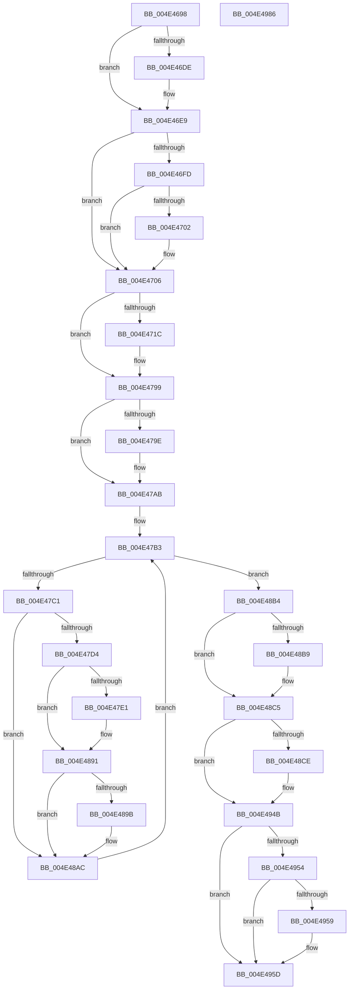

# FsRtlpCancelWaitingIrp

- RVA: `0x004E4698`–`0x004E4987` (길이 `751` bytes)
- VA: `0x00000001404E4698`
- 실행 섹션: `.text`
- PDB 이름 있음: `예`; PDB Function 태그: `아니요`
- unwind 정보 RVA: `0x000C5E68`
- 디코드: `150`개 명령, `751/751` bytes 표시
- 미해석 바이트: `0` (있으면 어셈블리에 `.byte`로 보존)

> 이 문서는 커널 이미지의 기계어와 PDB 기호를 분석해 생성했습니다. 4번과 5번은 함수 원형과 자료형을 바이너리 사용 방식에서 추정한 C 해석이며 원본 소스 복구 결과는 아닙니다.

## 1. Dependencies

- 직접 호출 지점: **11**; 고유 호출 대상: **7**
- 직접 호출자로 확인된 함수: **2**
- RIP 상대 이미지 참조: **5**

### Outgoing calls
- `0x004E46D1` → [Feature_3609177402__private_IsEnabledDeviceUsageNoInline](../58/Feature_3609177402__private_IsEnabledDeviceUsageNoInline_function_00581D30.md) (function, `0x00581D30`)
- `0x004E46F4` → [Feature_3609177402__private_IsEnabledDeviceUsageNoInline](../58/Feature_3609177402__private_IsEnabledDeviceUsageNoInline_function_00581D30.md) (function, `0x00581D30`)
- `0x004E470E` → [KeReleaseQueuedSpinLock](../27/KeReleaseQueuedSpinLock_function_00272540.md) (function, `0x00272540`)
- `0x004E4794` → [tlgWriteTransfer_EtwWriteTransfer](../42/tlgWriteTransfer_EtwWriteTransfer_function_004260E0.md) (function, `0x004260E0`)
- `0x004E47A5` → [ExAcquireFastMutex](../20/ExAcquireFastMutex_function_0020E5A0.md) (function, `0x0020E5A0`)
- `0x004E4886` → [tlgWriteTransfer_EtwWriteTransfer](../42/tlgWriteTransfer_EtwWriteTransfer_function_004260E0.md) (function, `0x004260E0`)
- `0x004E48A7` → [FsRtlpRemoveAndCompleteWaitingIrp](../42/FsRtlpRemoveAndCompleteWaitingIrp_function_00425FC0.md) (function, `0x00425FC0`)
- `0x004E48C0` → [ExReleaseFastMutex](../25/ExReleaseFastMutex_function_002519C0.md) (function, `0x002519C0`)
- `0x004E4946` → [tlgWriteTransfer_EtwWriteTransfer](../42/tlgWriteTransfer_EtwWriteTransfer_function_004260E0.md) (function, `0x004260E0`)
- `0x004E494B` → [Feature_3609177402__private_IsEnabledDeviceUsageNoInline](../58/Feature_3609177402__private_IsEnabledDeviceUsageNoInline_function_00581D30.md) (function, `0x00581D30`)
- `0x004E4968` → [_security_check_cookie](../6A/_security_check_cookie_function_006AC640.md) (function, `0x006AC640`)

### Direct callers
- [FsRtlpWaitOnIrp](FsRtlpWaitOnIrp_function_004E7998.md) at `0x004E7C09`
- [FsRtlpWaitingIrpCancelRoutine](../58/FsRtlpWaitingIrpCancelRoutine_function_00582B10.md) at `0x00582B19`

### Static image references
- `0x004E46B2` → RVA `0x00E0A740` (`.data`; read)
- `0x004E4713` → RVA `0x00E06C50` (`.data`; read)
- `0x004E4786` → RVA `0x0004430B` (`.rdata`; read)
- `0x004E4878` → RVA `0x000442A3` (`.rdata`; read)
- `0x004E4938` → RVA `0x000443AD` (`.rdata`; read)

## 2. Other-region calls and transfers

- 다른 실행 섹션으로 향하는 call: **0**
- 별도 외부 분기/꼬리 이동을 확인하지 못했습니다.

## 3. Assembly (complete function range)

```asm
004E4698  48 89 5C 24 18                  mov qword ptr [rsp + 0x18], rbx
004E469D  48 89 74 24 20                  mov qword ptr [rsp + 0x20], rsi
004E46A2  88 54 24 10                     mov byte ptr [rsp + 0x10], dl
004E46A6  57                              push rdi
004E46A7  41 55                           push r13
004E46A9  41 56                           push r14
004E46AB  48 81 EC 70 01 00 00            sub rsp, 0x170
004E46B2  48 8B 05 87 60 92 00            mov rax, qword ptr [rip + 0x926087]
004E46B9  48 33 C4                        xor rax, rsp
004E46BC  48 89 84 24 60 01 00 00         mov qword ptr [rsp + 0x160], rax
004E46C4  44 8A F2                        mov r14b, dl
004E46C7  48 8B F9                        mov rdi, rcx
004E46CA  33 F6                           xor esi, esi
004E46CC  48 89 74 24 58                  mov qword ptr [rsp + 0x58], rsi
004E46D1  E8 5A D6 09 00                  call 0x140581d30
004E46D6  48 8B 5F 38                     mov rbx, qword ptr [rdi + 0x38]
004E46DA  85 C0                           test eax, eax
004E46DC  74 0B                           je 0x1404e46e9
004E46DE  48 8B F3                        mov rsi, rbx
004E46E1  48 89 5C 24 58                  mov qword ptr [rsp + 0x58], rbx
004E46E6  48 8B 1B                        mov rbx, qword ptr [rbx]
004E46E9  48 89 5C 24 38                  mov qword ptr [rsp + 0x38], rbx
004E46EE  33 C0                           xor eax, eax
004E46F0  48 87 47 68                     xchg qword ptr [rdi + 0x68], rax
004E46F4  E8 37 D6 09 00                  call 0x140581d30
004E46F9  85 C0                           test eax, eax
004E46FB  74 09                           je 0x1404e4706
004E46FD  45 84 F6                        test r14b, r14b
004E4700  75 04                           jne 0x1404e4706
004E4702  F0 FF 46 08                     lock inc dword ptr [rsi + 8]
004E4706  8A 57 45                        mov dl, byte ptr [rdi + 0x45]
004E4709  B9 07 00 00 00                  mov ecx, 7
004E470E  E8 2D DE D8 FF                  call 0x140272540
004E4713  83 3D 36 25 92 00 05            cmp dword ptr [rip + 0x922536], 5
004E471A  76 7D                           jbe 0x1404e4799
004E471C  48 89 5C 24 60                  mov qword ptr [rsp + 0x60], rbx
004E4721  48 8D 44 24 60                  lea rax, [rsp + 0x60]
004E4726  48 89 84 24 40 01 00 00         mov qword ptr [rsp + 0x140], rax
004E472E  C7 84 24 48 01 00 00 08 00 00 00  mov dword ptr [rsp + 0x148], 8
004E4739  83 A4 24 4C 01 00 00 00         and dword ptr [rsp + 0x14c], 0
004E4741  8B 83 90 00 00 00               mov eax, dword ptr [rbx + 0x90]
004E4747  89 44 24 40                     mov dword ptr [rsp + 0x40], eax
004E474B  48 8D 44 24 40                  lea rax, [rsp + 0x40]
004E4750  48 89 84 24 50 01 00 00         mov qword ptr [rsp + 0x150], rax
004E4758  C7 84 24 58 01 00 00 04 00 00 00  mov dword ptr [rsp + 0x158], 4
004E4763  83 A4 24 5C 01 00 00 00         and dword ptr [rsp + 0x15c], 0
004E476B  48 8D 84 24 20 01 00 00         lea rax, [rsp + 0x120]
004E4773  48 89 44 24 28                  mov qword ptr [rsp + 0x28], rax
004E4778  C7 44 24 20 04 00 00 00         mov dword ptr [rsp + 0x20], 4
004E4780  45 33 C9                        xor r9d, r9d
004E4783  45 33 C0                        xor r8d, r8d
004E4786  48 8D 15 7E FB B5 FF            lea rdx, [rip - 0x4a0482]
004E478D  48 8D 0D BC 24 92 00            lea rcx, [rip + 0x9224bc]
004E4794  E8 47 19 F4 FF                  call 0x1404260e0
004E4799  45 84 F6                        test r14b, r14b
004E479C  75 0D                           jne 0x1404e47ab
004E479E  48 8B 8B 98 00 00 00            mov rcx, qword ptr [rbx + 0x98]
004E47A5  E8 F6 9D D2 FF                  call 0x14020e5a0
004E47AA  90                              nop
004E47AB  4C 8D 6B 58                     lea r13, [rbx + 0x58]
004E47AF  49 8B 7D 00                     mov rdi, qword ptr [r13]
004E47B3  48 89 7C 24 50                  mov qword ptr [rsp + 0x50], rdi
004E47B8  49 3B FD                        cmp rdi, r13
004E47BB  0F 84 F3 00 00 00               je 0x1404e48b4
004E47C1  48 8B D7                        mov rdx, rdi
004E47C4  48 8B 4F 10                     mov rcx, qword ptr [rdi + 0x10]
004E47C8  45 33 C0                        xor r8d, r8d
004E47CB  48 85 C9                        test rcx, rcx
004E47CE  0F 84 D8 00 00 00               je 0x1404e48ac
004E47D4  83 3D 75 24 92 00 05            cmp dword ptr [rip + 0x922475], 5
004E47DB  0F 86 B0 00 00 00               jbe 0x1404e4891
004E47E1  48 89 5C 24 68                  mov qword ptr [rsp + 0x68], rbx
004E47E6  48 8D 44 24 68                  lea rax, [rsp + 0x68]
004E47EB  48 89 84 24 E0 00 00 00         mov qword ptr [rsp + 0xe0], rax
004E47F3  48 C7 84 24 E8 00 00 00 08 00 00 00  mov qword ptr [rsp + 0xe8], 8
004E47FF  8B 83 90 00 00 00               mov eax, dword ptr [rbx + 0x90]
004E4805  89 44 24 44                     mov dword ptr [rsp + 0x44], eax
004E4809  48 8D 44 24 44                  lea rax, [rsp + 0x44]
004E480E  48 89 84 24 F0 00 00 00         mov qword ptr [rsp + 0xf0], rax
004E4816  48 C7 84 24 F8 00 00 00 04 00 00 00  mov qword ptr [rsp + 0xf8], 4
004E4822  48 89 4C 24 70                  mov qword ptr [rsp + 0x70], rcx
004E4827  48 8D 44 24 70                  lea rax, [rsp + 0x70]
004E482C  48 89 84 24 00 01 00 00         mov qword ptr [rsp + 0x100], rax
004E4834  48 C7 84 24 08 01 00 00 08 00 00 00  mov qword ptr [rsp + 0x108], 8
004E4840  8A 41 44                        mov al, byte ptr [rcx + 0x44]
004E4843  88 44 24 30                     mov byte ptr [rsp + 0x30], al
004E4847  48 8D 44 24 30                  lea rax, [rsp + 0x30]
004E484C  48 89 84 24 10 01 00 00         mov qword ptr [rsp + 0x110], rax
004E4854  48 C7 84 24 18 01 00 00 01 00 00 00  mov qword ptr [rsp + 0x118], 1
004E4860  48 8D 84 24 C0 00 00 00         lea rax, [rsp + 0xc0]
004E4868  48 89 44 24 28                  mov qword ptr [rsp + 0x28], rax
004E486D  C7 44 24 20 06 00 00 00         mov dword ptr [rsp + 0x20], 6
004E4875  45 33 C9                        xor r9d, r9d
004E4878  48 8D 15 24 FA B5 FF            lea rdx, [rip - 0x4a05dc]
004E487F  48 8D 0D CA 23 92 00            lea rcx, [rip + 0x9223ca]
004E4886  E8 55 18 F4 FF                  call 0x1404260e0
004E488B  48 8B D7                        mov rdx, rdi
004E488E  45 33 C0                        xor r8d, r8d
004E4891  48 8B 47 10                     mov rax, qword ptr [rdi + 0x10]
004E4895  44 38 40 44                     cmp byte ptr [rax + 0x44], r8b
004E4899  74 11                           je 0x1404e48ac
004E489B  48 8B 7F 08                     mov rdi, qword ptr [rdi + 8]
004E489F  48 89 7C 24 50                  mov qword ptr [rsp + 0x50], rdi
004E48A4  48 8B CA                        mov rcx, rdx
004E48A7  E8 14 17 F4 FF                  call 0x140425fc0
004E48AC  48 8B 3F                        mov rdi, qword ptr [rdi]
004E48AF  E9 FF FE FF FF                  jmp 0x1404e47b3
004E48B4  45 84 F6                        test r14b, r14b
004E48B7  75 0C                           jne 0x1404e48c5
004E48B9  48 8B 8B 98 00 00 00            mov rcx, qword ptr [rbx + 0x98]
004E48C0  E8 FB D0 D6 FF                  call 0x1402519c0
004E48C5  83 3D 84 23 92 00 05            cmp dword ptr [rip + 0x922384], 5
004E48CC  76 7D                           jbe 0x1404e494b
004E48CE  48 89 5C 24 48                  mov qword ptr [rsp + 0x48], rbx
004E48D3  48 8D 44 24 48                  lea rax, [rsp + 0x48]
004E48D8  48 89 84 24 A0 00 00 00         mov qword ptr [rsp + 0xa0], rax
004E48E0  C7 84 24 A8 00 00 00 08 00 00 00  mov dword ptr [rsp + 0xa8], 8
004E48EB  83 A4 24 AC 00 00 00 00         and dword ptr [rsp + 0xac], 0
004E48F3  8B 83 90 00 00 00               mov eax, dword ptr [rbx + 0x90]
004E48F9  89 44 24 34                     mov dword ptr [rsp + 0x34], eax
004E48FD  48 8D 44 24 34                  lea rax, [rsp + 0x34]
004E4902  48 89 84 24 B0 00 00 00         mov qword ptr [rsp + 0xb0], rax
004E490A  C7 84 24 B8 00 00 00 04 00 00 00  mov dword ptr [rsp + 0xb8], 4
004E4915  83 A4 24 BC 00 00 00 00         and dword ptr [rsp + 0xbc], 0
004E491D  48 8D 84 24 80 00 00 00         lea rax, [rsp + 0x80]
004E4925  48 89 44 24 28                  mov qword ptr [rsp + 0x28], rax
004E492A  C7 44 24 20 04 00 00 00         mov dword ptr [rsp + 0x20], 4
004E4932  45 33 C9                        xor r9d, r9d
004E4935  45 33 C0                        xor r8d, r8d
004E4938  48 8D 15 6E FA B5 FF            lea rdx, [rip - 0x4a0592]
004E493F  48 8D 0D 0A 23 92 00            lea rcx, [rip + 0x92230a]
004E4946  E8 95 17 F4 FF                  call 0x1404260e0
004E494B  E8 E0 D3 09 00                  call 0x140581d30
004E4950  85 C0                           test eax, eax
004E4952  74 09                           je 0x1404e495d
004E4954  45 84 F6                        test r14b, r14b
004E4957  75 04                           jne 0x1404e495d
004E4959  F0 FF 4E 08                     lock dec dword ptr [rsi + 8]
004E495D  48 8B 8C 24 60 01 00 00         mov rcx, qword ptr [rsp + 0x160]
004E4965  48 33 CC                        xor rcx, rsp
004E4968  E8 D3 7C 1C 00                  call 0x1406ac640
004E496D  4C 8D 9C 24 70 01 00 00         lea r11, [rsp + 0x170]
004E4975  49 8B 5B 30                     mov rbx, qword ptr [r11 + 0x30]
004E4979  49 8B 73 38                     mov rsi, qword ptr [r11 + 0x38]
004E497D  49 8B E3                        mov rsp, r11
004E4980  41 5E                           pop r14
004E4982  41 5D                           pop r13
004E4984  5F                              pop rdi
004E4985  C3                              ret
004E4986  CC                              int3
```

## 4. C-style interpretation (structured pseudocode)

```c
__int64 __fastcall FsRtlpCancelWaitingIrp(__int64 a1, unsigned __int8 a2, int a3, int a4)
{
    __int64 result;
    __int64 v_rbx;
    __int64 v_rdi;
    __int64 v_rsi;
    __int64 v_rsp;
    unsigned __int64 v_stack_m108;
    unsigned __int64 v_stack_m118;
    unsigned __int64 v_stack_m120;
    unsigned __int64 v_stack_m128;
    unsigned __int64 v_stack_m130;
    unsigned __int64 v_stack_m138;
    unsigned __int64 v_stack_m140;
    unsigned int v_stack_m144;
    unsigned int v_stack_m148;
    unsigned __int64 v_stack_m150;
    unsigned int v_stack_m154;
    unsigned __int8 v_stack_m158;
    unsigned __int64 v_stack_m160;
    unsigned int v_stack_m168;
    unsigned __int64 v_stack_m18;
    unsigned __int64 v_stack_m28;
    unsigned int v_stack_m2C;
    unsigned int v_stack_m30;
    unsigned __int64 v_stack_m38;
    unsigned int v_stack_m3C;
    unsigned int v_stack_m40;
    unsigned __int64 v_stack_m48;
    unsigned __int64 v_stack_m68;
    unsigned __int64 v_stack_m70;
    unsigned __int64 v_stack_m78;
    unsigned __int64 v_stack_m80;
    unsigned __int64 v_stack_m88;
    unsigned __int64 v_stack_m90;
    unsigned __int64 v_stack_m98;
    unsigned __int64 v_stack_mA0;
    unsigned __int64 v_stack_mA8;
    unsigned __int64 v_stack_mC8;
    unsigned int v_stack_mCC;
    unsigned int v_stack_mD0;
    unsigned __int64 v_stack_mD8;
    unsigned int v_stack_mDC;
    unsigned int v_stack_mE0;
    unsigned __int64 v_stack_mE8;
    unsigned __int8 v_stack_p10;
    unsigned __int64 v_stack_p18;
    unsigned __int64 v_stack_p20;

    v_stack_p18 = v_rbx;
    v_stack_p20 = v_rsi;
    v_stack_p10 = a2;
    v_rsp = (v_rsp) - (368);
    result = (*(unsigned __int64 *)(v_rip + 9592967)) ^ (v_rsp);
    v_stack_m28 = result;
    v_rsi = 0;
    v_stack_m130 = 0;
    result = Feature_3609177402__private_IsEnabledDeviceUsageNoInline(a1, a2, a3, a4);
    v_rbx = *(unsigned __int64 *)(a1 + 56);
    if ((unsigned int)(result) != 0) {
        v_rsi = *(unsigned __int64 *)(a1 + 56);
        v_stack_m130 = *(unsigned __int64 *)(a1 + 56);
        v_rbx = *(unsigned __int64 *)(*(unsigned __int64 *)(a1 + 56));
    }
    v_stack_m150 = v_rbx;
    result = 0;
    result = Feature_3609177402__private_IsEnabledDeviceUsageNoInline(a1, a2, a3, a4);
    if ((unsigned int)(result) == 0) goto loc_004E4706;
    if (a2 == 0) {
    }
    result = KeReleaseQueuedSpinLock(7, *(unsigned __int8 *)(a1 + 69), a3, a4);
    if ((*(unsigned int *)(v_rip + 9577782)) >= = 5) {
        v_stack_m128 = v_rbx;
        result = v_stack_m128;
        v_stack_m48 = result;
        v_stack_m40 = 8;
        result = *(unsigned int *)(v_rbx + 144);
        v_stack_m148 = (unsigned int)(result);
        result = v_stack_m148;
        v_stack_m38 = result;
        v_stack_m30 = 4;
        result = v_stack_m68;
        v_stack_m160 = result;
        v_stack_m168 = 4;
        a4 = 0;
        a3 = 0;
        a2 = v_rip - 4850818;
        a1 = v_rip + 9577660;
        result = tlgWriteTransfer_EtwWriteTransfer(a1, a2, a3, a4);
    }
    if (a2 == 0) {
        a1 = *(unsigned __int64 *)(v_rbx + 152);
        result = ExAcquireFastMutex(a1, a2, a3, a4);
    }
loc_004E47B3:
    v_stack_m138 = *(unsigned __int64 *)(v_rbx + 88);
    if ((*(unsigned __int64 *)(v_rbx + 88)) == (v_rbx + 88)) goto loc_004E48B4;
    a3 = 0;
    if (*(unsigned __int64 *)(*(unsigned __int64 *)(v_rbx + 88) + 16) == 0) goto loc_004E48AC;
    if ((*(unsigned int *)(v_rip + 9577589)) >= = 5) {
        v_stack_m120 = v_rbx;
        result = v_stack_m120;
        v_stack_mA8 = result;
        v_stack_mA0 = 8;
        result = *(unsigned int *)(v_rbx + 144);
        v_stack_m144 = (unsigned int)(result);
        result = v_stack_m144;
        v_stack_m98 = result;
        v_stack_m90 = 4;
        v_stack_m118 = *(unsigned __int64 *)(*(unsigned __int64 *)(v_rbx + 88) + 16);
        result = v_stack_m118;
        v_stack_m88 = result;
        v_stack_m80 = 8;
        result = *(unsigned __int8 *)(*(unsigned __int64 *)(*(unsigned __int64 *)(v_rbx + 88) + 16) + 68);
        v_stack_m158 = (unsigned __int8)(result);
        result = v_stack_m158;
        v_stack_m78 = result;
        v_stack_m70 = 1;
        result = v_stack_mC8;
        v_stack_m160 = result;
        v_stack_m168 = 6;
        a4 = 0;
        a2 = v_rip - 4851164;
        a1 = v_rip + 9577418;
        result = tlgWriteTransfer_EtwWriteTransfer(a1, a2, a3, a4);
        a2 = *(unsigned __int64 *)(v_rbx + 88);
        a3 = 0;
    }
    result = *(unsigned __int64 *)(*(unsigned __int64 *)(v_rbx + 88) + 16);
    v_rdi = *(unsigned __int64 *)(v_rbx + 88);
    if ((*(unsigned __int8 *)(*(unsigned __int64 *)(*(unsigned __int64 *)(v_rbx + 88) + 16) + 68)) != 0) {
        v_rdi = *(unsigned __int64 *)(*(unsigned __int64 *)(v_rbx + 88) + 8);
        v_stack_m138 = v_rdi;
        a1 = a2;
        result = FsRtlpRemoveAndCompleteWaitingIrp(a1, a2, a3, a4);
    }
    goto loc_004E47B3;
loc_004E48B4:
    if (a2 == 0) {
        a1 = *(unsigned __int64 *)(v_rbx + 152);
        result = ExReleaseFastMutex(a1, a2, a3, a4);
    }
    if ((*(unsigned int *)(v_rip + 9577348)) >= = 5) {
        v_stack_m140 = v_rbx;
        result = v_stack_m140;
        v_stack_mE8 = result;
        v_stack_mE0 = 8;
        result = *(unsigned int *)(v_rbx + 144);
        v_stack_m154 = (unsigned int)(result);
        result = v_stack_m154;
        v_stack_mD8 = result;
        v_stack_mD0 = 4;
        result = v_stack_m108;
        v_stack_m160 = result;
        v_stack_m168 = 4;
        a4 = 0;
        a3 = 0;
        a2 = v_rip - 4851090;
        a1 = v_rip + 9577226;
        result = tlgWriteTransfer_EtwWriteTransfer(a1, a2, a3, a4);
    }
    result = Feature_3609177402__private_IsEnabledDeviceUsageNoInline(a1, a2, a3, a4);
    if ((unsigned int)(result) == 0) goto loc_004E495D;
    if (a2 == 0) {
    }
    a1 = (v_stack_m28) ^ (v_rsp);
    result = _security_check_cookie(a1, a2, a3, a4);
    return result;
}
```

## 5. (Beta) C Style

```c
int64_t FsRtlpCancelWaitingIrp(void *Arg1, uint8_t Arg2, int32_t Arg3, int32_t Arg4)
{
    uint8_t *arg1 = (uint8_t *)Arg1;

    int64_t result;
    int64_t local_rbx;
    int64_t local_rdi;
    int64_t local_rsi;
    int64_t local_rsp;
    uint64_t v_stack_m108;
    uint64_t v_stack_m118;
    uint64_t v_stack_m120;
    uint64_t v_stack_m128;
    uint64_t v_stack_m130;
    uint64_t v_stack_m138;
    uint64_t v_stack_m140;
    uint32_t v_stack_m144;
    uint32_t v_stack_m148;
    uint64_t v_stack_m150;
    uint32_t v_stack_m154;
    uint8_t v_stack_m158;
    uint64_t v_stack_m160;
    uint32_t v_stack_m168;
    uint64_t v_stack_m18;
    uint64_t v_stack_m28;
    uint32_t v_stack_m2C;
    uint32_t v_stack_m30;
    uint64_t v_stack_m38;
    uint32_t v_stack_m3C;
    uint32_t v_stack_m40;
    uint64_t v_stack_m48;
    uint64_t v_stack_m68;
    uint64_t v_stack_m70;
    uint64_t v_stack_m78;
    uint64_t v_stack_m80;
    uint64_t v_stack_m88;
    uint64_t v_stack_m90;
    uint64_t v_stack_m98;
    uint64_t v_stack_mA0;
    uint64_t v_stack_mA8;
    uint64_t v_stack_mC8;
    uint32_t v_stack_mCC;
    uint32_t v_stack_mD0;
    uint64_t v_stack_mD8;
    uint32_t v_stack_mDC;
    uint32_t v_stack_mE0;
    uint64_t v_stack_mE8;
    uint8_t v_stack_p10;
    uint64_t v_stack_p18;
    uint64_t v_stack_p20;

    v_stack_p18 = local_rbx;
    v_stack_p20 = local_rsi;
    v_stack_p10 = Arg2;
    local_rsp = (local_rsp) - (368);
    result = (*(uint64_t *)(v_rip + 0x926087)) ^ (local_rsp);
    v_stack_m28 = result;
    local_rsi = 0;
    v_stack_m130 = 0;
    result = Feature_3609177402__private_IsEnabledDeviceUsageNoInline(Arg1, Arg2, Arg3, Arg4);
    local_rbx = *(uint64_t *)(arg1 + 0x38);
    if ((uint32_t)(result) != 0) {
        local_rsi = *(uint64_t *)(arg1 + 0x38);
        v_stack_m130 = *(uint64_t *)(arg1 + 0x38);
        local_rbx = *(uint64_t *)(*(uint64_t *)(arg1 + 0x38));
    }
    v_stack_m150 = local_rbx;
    result = 0;
    result = Feature_3609177402__private_IsEnabledDeviceUsageNoInline(Arg1, Arg2, Arg3, Arg4);
    if ((uint32_t)(result) == 0) goto loc_004E4706;
    if (Arg2 == 0) {
    }
    result = KeReleaseQueuedSpinLock(7, *(uint8_t *)(arg1 + 0x45), Arg3, Arg4);
    if ((*(uint32_t *)(v_rip + 0x922536)) >= = 5) {
        v_stack_m128 = local_rbx;
        result = v_stack_m128;
        v_stack_m48 = result;
        v_stack_m40 = 8;
        result = *(uint32_t *)(local_rbx + 0x90);
        v_stack_m148 = (uint32_t)(result);
        result = v_stack_m148;
        v_stack_m38 = result;
        v_stack_m30 = 4;
        result = v_stack_m68;
        v_stack_m160 = result;
        v_stack_m168 = 4;
        Arg4 = 0;
        Arg3 = 0;
        Arg2 = v_rip - 4850818;
        Arg1 = v_rip + 9577660;
        result = tlgWriteTransfer_EtwWriteTransfer(Arg1, Arg2, Arg3, Arg4);
    }
    if (Arg2 == 0) {
        Arg1 = *(uint64_t *)(local_rbx + 0x98);
        result = ExAcquireFastMutex(Arg1, Arg2, Arg3, Arg4);
    }
loc_004E47B3:
    v_stack_m138 = *(uint64_t *)(local_rbx + 0x58);
    if ((*(uint64_t *)(local_rbx + 0x58)) == (local_rbx + 88)) goto loc_004E48B4;
    Arg3 = 0;
    if (*(uint64_t *)(*(uint64_t *)(local_rbx + 0x58) + 0x10) == 0) goto loc_004E48AC;
    if ((*(uint32_t *)(v_rip + 0x922475)) >= = 5) {
        v_stack_m120 = local_rbx;
        result = v_stack_m120;
        v_stack_mA8 = result;
        v_stack_mA0 = 8;
        result = *(uint32_t *)(local_rbx + 0x90);
        v_stack_m144 = (uint32_t)(result);
        result = v_stack_m144;
        v_stack_m98 = result;
        v_stack_m90 = 4;
        v_stack_m118 = *(uint64_t *)(*(uint64_t *)(local_rbx + 0x58) + 0x10);
        result = v_stack_m118;
        v_stack_m88 = result;
        v_stack_m80 = 8;
        result = *(uint8_t *)(*(uint64_t *)(*(uint64_t *)(local_rbx + 0x58) + 0x10) + 0x44);
        v_stack_m158 = (uint8_t)(result);
        result = v_stack_m158;
        v_stack_m78 = result;
        v_stack_m70 = 1;
        result = v_stack_mC8;
        v_stack_m160 = result;
        v_stack_m168 = 6;
        Arg4 = 0;
        Arg2 = v_rip - 4851164;
        Arg1 = v_rip + 9577418;
        result = tlgWriteTransfer_EtwWriteTransfer(Arg1, Arg2, Arg3, Arg4);
        Arg2 = *(uint64_t *)(local_rbx + 0x58);
        Arg3 = 0;
    }
    result = *(uint64_t *)(*(uint64_t *)(local_rbx + 0x58) + 0x10);
    local_rdi = *(uint64_t *)(local_rbx + 0x58);
    if ((*(uint8_t *)(*(uint64_t *)(*(uint64_t *)(local_rbx + 0x58) + 0x10) + 0x44)) != 0) {
        local_rdi = *(uint64_t *)(*(uint64_t *)(local_rbx + 0x58) + 0x8);
        v_stack_m138 = local_rdi;
        Arg1 = Arg2;
        result = FsRtlpRemoveAndCompleteWaitingIrp(Arg1, Arg2, Arg3, Arg4);
    }
    goto loc_004E47B3;
loc_004E48B4:
    if (Arg2 == 0) {
        Arg1 = *(uint64_t *)(local_rbx + 0x98);
        result = ExReleaseFastMutex(Arg1, Arg2, Arg3, Arg4);
    }
    if ((*(uint32_t *)(v_rip + 0x922384)) >= = 5) {
        v_stack_m140 = local_rbx;
        result = v_stack_m140;
        v_stack_mE8 = result;
        v_stack_mE0 = 8;
        result = *(uint32_t *)(local_rbx + 0x90);
        v_stack_m154 = (uint32_t)(result);
        result = v_stack_m154;
        v_stack_mD8 = result;
        v_stack_mD0 = 4;
        result = v_stack_m108;
        v_stack_m160 = result;
        v_stack_m168 = 4;
        Arg4 = 0;
        Arg3 = 0;
        Arg2 = v_rip - 4851090;
        Arg1 = v_rip + 9577226;
        result = tlgWriteTransfer_EtwWriteTransfer(Arg1, Arg2, Arg3, Arg4);
    }
    result = Feature_3609177402__private_IsEnabledDeviceUsageNoInline(Arg1, Arg2, Arg3, Arg4);
    if ((uint32_t)(result) == 0) goto loc_004E495D;
    if (Arg2 == 0) {
    }
    Arg1 = (v_stack_m28) ^ (local_rsp);
    result = _security_check_cookie(Arg1, Arg2, Arg3, Arg4);
    return result;
}
```

### 관측된 메모리 오프셋

구조체 형식이 확인되지 않은 접근은 인자 기준의 오프셋으로만 기록했습니다.

| 기준 인자 | 오프셋 표현 | 폭 (bit) | 접근 |
|---|---:|---:|---|
| `Arg1` | `+ 0x38` | `64` | `R` |
| `Arg1` | `+ 0x45` | `8` | `R` |
| `Arg1` | `+ 0x68` | `64` | `R/W` |

## 6. Execution-region graph

[열기: 2D/3D 그래프와 함수 탐색 컨트롤 패널](../../../control-panel.html?section=text&rva=0x004E4698&view=graph)

- 2D 그래프는 위에서 아래로 흐르고, 3D 그래프는 빈 공간을 드래그해 회전합니다. Shift+드래그는 이동, 휠은 확대·축소, 함수 노드 선택은 대상 보고서 이동입니다.

### Static fallback


