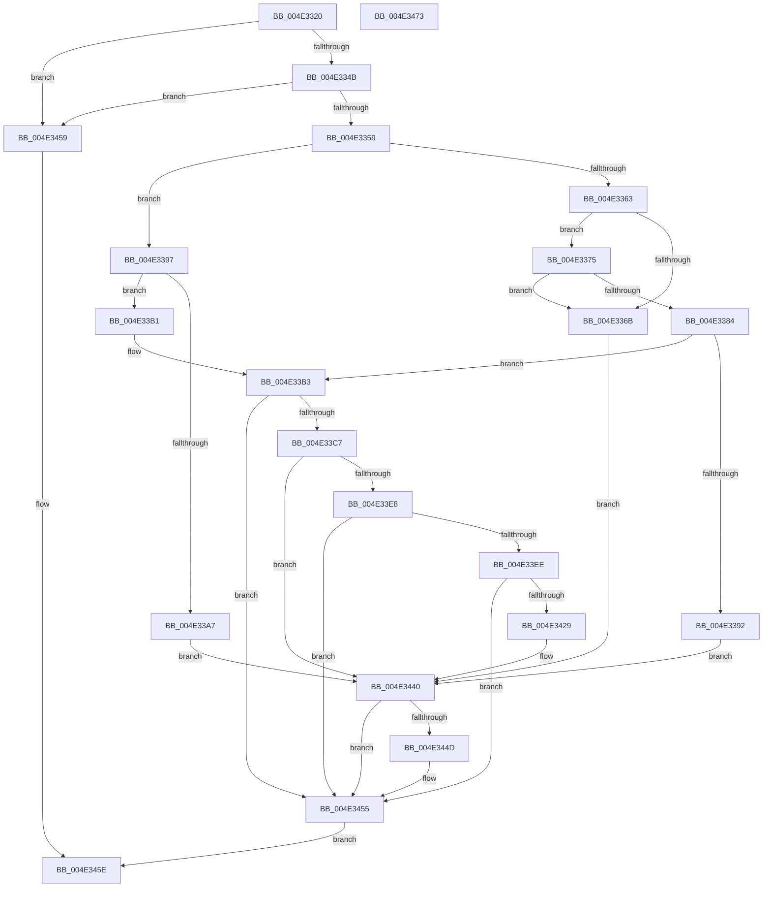

# HalJoinDmaDomain

- RVA: `0x004E3320`–`0x004E3474` (길이 `340` bytes)
- VA: `0x00000001404E3320`
- 실행 섹션: `.text`
- PDB 이름 있음: `예`; PDB Function 태그: `아니요`
- unwind 정보 RVA: `0x0007D3C0`
- 디코드: `86`개 명령, `340/340` bytes 표시
- 미해석 바이트: `0` (있으면 어셈블리에 `.byte`로 보존)

> 이 문서는 커널 이미지의 기계어와 PDB 기호를 분석해 생성했습니다. 4번과 5번은 함수 원형과 자료형을 바이너리 사용 방식에서 추정한 C 해석이며 원본 소스 복구 결과는 아닙니다.

## 1. Dependencies

- 직접 호출 지점: **8**; 고유 호출 대상: **6**
- 직접 호출자로 확인된 함수: **1**
- RIP 상대 이미지 참조: **1**

### Outgoing calls
- `0x004E333D` → [HalpDmaGetAdapterVersion](../3D/HalpDmaGetAdapterVersion_function_003DEC8C.md) (function, `0x003DEC8C`)
- `0x004E337B` → [HalpDmaIsDomainCompatible](../55/HalpDmaIsDomainCompatible_function_00552588.md) (function, `0x00552588`)
- `0x004E3387` → [HalpDmaReferenceDomainObject](../3E/HalpDmaReferenceDomainObject_function_003E9B08.md) (function, `0x003E9B08`)
- `0x004E339A` → [HalpDmaAllocateDomain](../55/HalpDmaAllocateDomain_function_00551C10.md) (function, `0x00551C10`)
- `0x004E33DD` → [guard_dispatch_icall](../6B/guard_dispatch_icall_function_006BAAD0.md) (function, `0x006BAAD0`)
- `0x004E341E` → [guard_dispatch_icall](../6B/guard_dispatch_icall_function_006BAAD0.md) (function, `0x006BAAD0`)
- `0x004E343B` → [guard_dispatch_icall](../6B/guard_dispatch_icall_function_006BAAD0.md) (function, `0x006BAAD0`)
- `0x004E3450` → [HalpDmaDereferenceDomainObject](../3F/HalpDmaDereferenceDomainObject_function_003F69DC.md) (function, `0x003F69DC`)

### Direct callers
- [HalpDmaAllocateChildAdapterV3](../../page/70/HalpDmaAllocateChildAdapterV3_function_007066A0.md) at `0x00706D4B`
- [HalpDmaAllocateChildAdapterV3](../../page/70/HalpDmaAllocateChildAdapterV3_function_007066A0.md) at `0x00706D7E`

### Static image references
- `0x004E33C7` → RVA `0x00FC1778` (`.data`; read)

## 2. Other-region calls and transfers

- 다른 실행 섹션으로 향하는 call: **0**
- 별도 외부 분기/꼬리 이동을 확인하지 못했습니다.

## 3. Assembly (complete function range)

```asm
004E3320  48 89 5C 24 08                  mov qword ptr [rsp + 8], rbx
004E3325  48 89 6C 24 10                  mov qword ptr [rsp + 0x10], rbp
004E332A  48 89 74 24 18                  mov qword ptr [rsp + 0x18], rsi
004E332F  57                              push rdi
004E3330  48 83 EC 40                     sub rsp, 0x40
004E3334  48 8B FA                        mov rdi, rdx
004E3337  48 8B F1                        mov rsi, rcx
004E333A  40 32 ED                        xor bpl, bpl
004E333D  E8 4A B9 EF FF                  call 0x1403dec8c
004E3342  83 F8 03                        cmp eax, 3
004E3345  0F 85 0E 01 00 00               jne 0x1404e3459
004E334B  48 83 BE 00 02 00 00 00         cmp qword ptr [rsi + 0x200], 0
004E3353  0F 85 00 01 00 00               jne 0x1404e3459
004E3359  48 8D 47 FF                     lea rax, [rdi - 1]
004E335D  48 83 F8 FD                     cmp rax, -3
004E3361  77 34                           ja 0x1404e3397
004E3363  48 8B 3F                        mov rdi, qword ptr [rdi]
004E3366  48 85 FF                        test rdi, rdi
004E3369  75 0A                           jne 0x1404e3375
004E336B  BB 0D 00 00 C0                  mov ebx, 0xc000000d
004E3370  E9 CB 00 00 00                  jmp 0x1404e3440
004E3375  48 8B D7                        mov rdx, rdi
004E3378  48 8B CE                        mov rcx, rsi
004E337B  E8 08 F2 06 00                  call 0x140552588
004E3380  84 C0                           test al, al
004E3382  74 E7                           je 0x1404e336b
004E3384  48 8B CF                        mov rcx, rdi
004E3387  E8 7C 67 F0 FF                  call 0x1403e9b08
004E338C  8B D8                           mov ebx, eax
004E338E  85 C0                           test eax, eax
004E3390  79 21                           jns 0x1404e33b3
004E3392  E9 A9 00 00 00                  jmp 0x1404e3440
004E3397  48 8B CE                        mov rcx, rsi
004E339A  E8 71 E8 06 00                  call 0x140551c10
004E339F  48 8B F8                        mov rdi, rax
004E33A2  48 85 C0                        test rax, rax
004E33A5  75 0A                           jne 0x1404e33b1
004E33A7  BB 9A 00 00 C0                  mov ebx, 0xc000009a
004E33AC  E9 8F 00 00 00                  jmp 0x1404e3440
004E33B1  33 DB                           xor ebx, ebx
004E33B3  48 89 BE 00 02 00 00            mov qword ptr [rsi + 0x200], rdi
004E33BA  40 B5 01                        mov bpl, 1
004E33BD  83 7F 30 00                     cmp dword ptr [rdi + 0x30], 0
004E33C1  0F 84 8E 00 00 00               je 0x1404e3455
004E33C7  48 8B 05 AA E3 AD 00            mov rax, qword ptr [rip + 0xade3aa]
004E33CE  48 8B 96 20 02 00 00            mov rdx, qword ptr [rsi + 0x220]
004E33D5  48 8B 4F 28                     mov rcx, qword ptr [rdi + 0x28]
004E33D9  48 8B 40 10                     mov rax, qword ptr [rax + 0x10]
004E33DD  E8 EE 76 1D 00                  call 0x1406baad0
004E33E2  8B D8                           mov ebx, eax
004E33E4  85 C0                           test eax, eax
004E33E6  78 58                           js 0x1404e3440
004E33E8  83 7F 30 03                     cmp dword ptr [rdi + 0x30], 3
004E33EC  75 67                           jne 0x1404e3455
004E33EE  48 8B 05 83 E3 AD 00            mov rax, qword ptr [rip + 0xade383]
004E33F5  48 8D 8E 30 02 00 00            lea rcx, [rsi + 0x230]
004E33FC  8B 96 FC 00 00 00               mov edx, dword ptr [rsi + 0xfc]
004E3402  45 33 C9                        xor r9d, r9d
004E3405  48 89 4C 24 28                  mov qword ptr [rsp + 0x28], rcx
004E340A  45 33 C0                        xor r8d, r8d
004E340D  48 8B 4F 28                     mov rcx, qword ptr [rdi + 0x28]
004E3411  48 8B 80 80 00 00 00            mov rax, qword ptr [rax + 0x80]
004E3418  48 83 64 24 20 00               and qword ptr [rsp + 0x20], 0
004E341E  E8 AD 76 1D 00                  call 0x1406baad0
004E3423  8B D8                           mov ebx, eax
004E3425  85 C0                           test eax, eax
004E3427  79 2C                           jns 0x1404e3455
004E3429  48 8B 05 48 E3 AD 00            mov rax, qword ptr [rip + 0xade348]
004E3430  48 8B 8E 20 02 00 00            mov rcx, qword ptr [rsi + 0x220]
004E3437  48 8B 40 18                     mov rax, qword ptr [rax + 0x18]
004E343B  E8 90 76 1D 00                  call 0x1406baad0
004E3440  48 83 A6 00 02 00 00 00         and qword ptr [rsi + 0x200], 0
004E3448  40 84 ED                        test bpl, bpl
004E344B  74 08                           je 0x1404e3455
004E344D  48 8B CF                        mov rcx, rdi
004E3450  E8 87 35 F1 FF                  call 0x1403f69dc
004E3455  8B C3                           mov eax, ebx
004E3457  EB 05                           jmp 0x1404e345e
004E3459  B8 0D 00 00 C0                  mov eax, 0xc000000d
004E345E  48 8B 5C 24 50                  mov rbx, qword ptr [rsp + 0x50]
004E3463  48 8B 6C 24 58                  mov rbp, qword ptr [rsp + 0x58]
004E3468  48 8B 74 24 60                  mov rsi, qword ptr [rsp + 0x60]
004E346D  48 83 C4 40                     add rsp, 0x40
004E3471  5F                              pop rdi
004E3472  C3                              ret
004E3473  CC                              int3
```

## 4. C-style interpretation (structured pseudocode)

```c
__int64 __fastcall HalJoinDmaDomain(__int64 a1, __int64 a2, int a3, int a4)
{
    __int64 result;
    __int64 v_rbp;
    __int64 v_rbx;
    __int64 v_rsp;
    unsigned __int64 v_stack_m20;
    unsigned __int64 v_stack_m28;
    unsigned __int64 v_stack_p10;
    unsigned __int64 v_stack_p18;
    unsigned __int64 v_stack_p8;

    v_stack_p8 = v_rbx;
    v_stack_p10 = v_rbp;
    v_stack_p18 = v_rsi;
    v_rsp = (v_rsp) - (64);
    v_rbp = 0;
    result = HalpDmaGetAdapterVersion(a1, a2, a3, a4);
    if (((unsigned int)(result)) != 3) goto loc_004E3459;
    if ((*(unsigned __int64 *)(a1 + 512)) != 0) goto loc_004E3459;
    if ((a2 - 1) > -3) goto loc_004E3397;
    if (*(unsigned __int64 *)(a2) != 0) goto loc_004E3375;
loc_004E336B:
    goto loc_004E3440;
loc_004E3375:
    result = HalpDmaIsDomainCompatible(a1, *(unsigned __int64 *)(a2), a3, a4);
    if ((unsigned __int8)(result) == 0) goto loc_004E336B;
    result = HalpDmaReferenceDomainObject(*(unsigned __int64 *)(a2), *(unsigned __int64 *)(a2), a3, a4);
    if (!sign_flag) goto loc_004E33B3;
    goto loc_004E3440;
loc_004E3397:
    result = HalpDmaAllocateDomain(a1, *(unsigned __int64 *)(a2), a3, a4);
    if (result != 0) goto loc_004E33B1;
    goto loc_004E3440;
loc_004E33B1:
    v_rbx = 0;
loc_004E33B3:
    *(unsigned __int64 *)(a1 + 512) = result;
    if ((*(unsigned int *)(result + 48)) == 0) goto loc_004E3455;
    result = guard_dispatch_icall(*(unsigned __int64 *)(result + 40), *(unsigned __int64 *)(a1 + 544), a3, a4);
    if (sign_flag) goto loc_004E3440;
    if ((*(unsigned int *)(result + 48)) != 3) goto loc_004E3455;
    a4 = 0;
    v_stack_m20 = a1 + 560;
    a3 = 0;
    result = guard_dispatch_icall(*(unsigned __int64 *)(result + 40), (unsigned int)(*(unsigned int *)(a1 + 252)), a3, a4);
    if (!sign_flag) goto loc_004E3455;
    result = guard_dispatch_icall(*(unsigned __int64 *)(a1 + 544), (unsigned int)(*(unsigned int *)(a1 + 252)), a3, a4);
loc_004E3440:
    if (1 != 0) {
        a1 = result;
        result = HalpDmaDereferenceDomainObject(a1, (unsigned int)(*(unsigned int *)(a1 + 252)), a3, a4);
    }
    goto loc_004E345E;
loc_004E3459:
loc_004E345E:
    v_rsp = (v_rsp) + (64);
    return (unsigned int)(0xC000000DULL);
}
```

## 5. (Beta) C Style

```c
int64_t HalJoinDmaDomain(void *Arg1, void *Arg2, int32_t Arg3, int32_t Arg4)
{
    uint8_t *arg1 = (uint8_t *)Arg1;
    uint8_t *arg2 = (uint8_t *)Arg2;

    int64_t result;
    int64_t local_rbp;
    int64_t local_rbx;
    int64_t local_rsp;
    uint64_t v_stack_m20;
    uint64_t v_stack_m28;
    uint64_t v_stack_p10;
    uint64_t v_stack_p18;
    uint64_t v_stack_p8;

    v_stack_p8 = local_rbx;
    v_stack_p10 = local_rbp;
    v_stack_p18 = local_rsi;
    local_rsp = (local_rsp) - (64);
    local_rbp = 0;
    result = HalpDmaGetAdapterVersion(Arg1, Arg2, Arg3, Arg4);
    if (((uint32_t)(result)) != 3) goto loc_004E3459;
    if ((*(uint64_t *)(arg1 + 0x200)) != 0) goto loc_004E3459;
    if ((Arg2 - 1) > -3) goto loc_004E3397;
    if (*(uint64_t *)(arg2) != 0) goto loc_004E3375;
loc_004E336B:
    goto loc_004E3440;
loc_004E3375:
    result = HalpDmaIsDomainCompatible(Arg1, *(uint64_t *)(arg2), Arg3, Arg4);
    if ((uint8_t)(result) == 0) goto loc_004E336B;
    result = HalpDmaReferenceDomainObject(*(uint64_t *)(arg2), *(uint64_t *)(arg2), Arg3, Arg4);
    if (!sign_flag) goto loc_004E33B3;
    goto loc_004E3440;
loc_004E3397:
    result = HalpDmaAllocateDomain(Arg1, *(uint64_t *)(arg2), Arg3, Arg4);
    if (result != 0) goto loc_004E33B1;
    goto loc_004E3440;
loc_004E33B1:
    local_rbx = 0;
loc_004E33B3:
    *(uint64_t *)(arg1 + 0x200) = result;
    if ((*(uint32_t *)(result + 0x30)) == 0) goto loc_004E3455;
    result = guard_dispatch_icall(*(uint64_t *)(result + 0x28), *(uint64_t *)(arg1 + 0x220), Arg3, Arg4);
    if (sign_flag) goto loc_004E3440;
    if ((*(uint32_t *)(result + 0x30)) != 3) goto loc_004E3455;
    Arg4 = 0;
    v_stack_m20 = Arg1 + 560;
    Arg3 = 0;
    result = guard_dispatch_icall(*(uint64_t *)(result + 0x28), (uint32_t)(*(uint32_t *)(arg1 + 0xFC)), Arg3, Arg4);
    if (!sign_flag) goto loc_004E3455;
    result = guard_dispatch_icall(*(uint64_t *)(arg1 + 0x220), (uint32_t)(*(uint32_t *)(arg1 + 0xFC)), Arg3, Arg4);
loc_004E3440:
    if (1 != 0) {
        Arg1 = result;
        result = HalpDmaDereferenceDomainObject(Arg1, (uint32_t)(*(uint32_t *)(arg1 + 0xFC)), Arg3, Arg4);
    }
    goto loc_004E345E;
loc_004E3459:
loc_004E345E:
    local_rsp = (local_rsp) + (64);
    return (uint32_t)(0xC000000DULL);
}
```

### 관측된 메모리 오프셋

구조체 형식이 확인되지 않은 접근은 인자 기준의 오프셋으로만 기록했습니다.

| 기준 인자 | 오프셋 표현 | 폭 (bit) | 접근 |
|---|---:|---:|---|
| `Arg1` | `+ 0xFC` | `32` | `R` |
| `Arg1` | `+ 0x200` | `64` | `R` |
| `Arg1` | `+ 0x200` | `64` | `R/W` |
| `Arg1` | `+ 0x200` | `64` | `W` |
| `Arg1` | `+ 0x220` | `64` | `R` |
| `Arg1` | `+ 0x230` | `64` | `R` |
| `Arg2` | `- 0x1` | `64` | `R` |
| `Arg2` | `+ 0x0` | `64` | `R` |

## 6. Execution-region graph

[열기: 2D/3D 그래프와 함수 탐색 컨트롤 패널](../../../control-panel.html?section=text&rva=0x004E3320&view=graph)

- 2D 그래프는 위에서 아래로 흐르고, 3D 그래프는 빈 공간을 드래그해 회전합니다. Shift+드래그는 이동, 휠은 확대·축소, 함수 노드 선택은 대상 보고서 이동입니다.

### Static fallback


