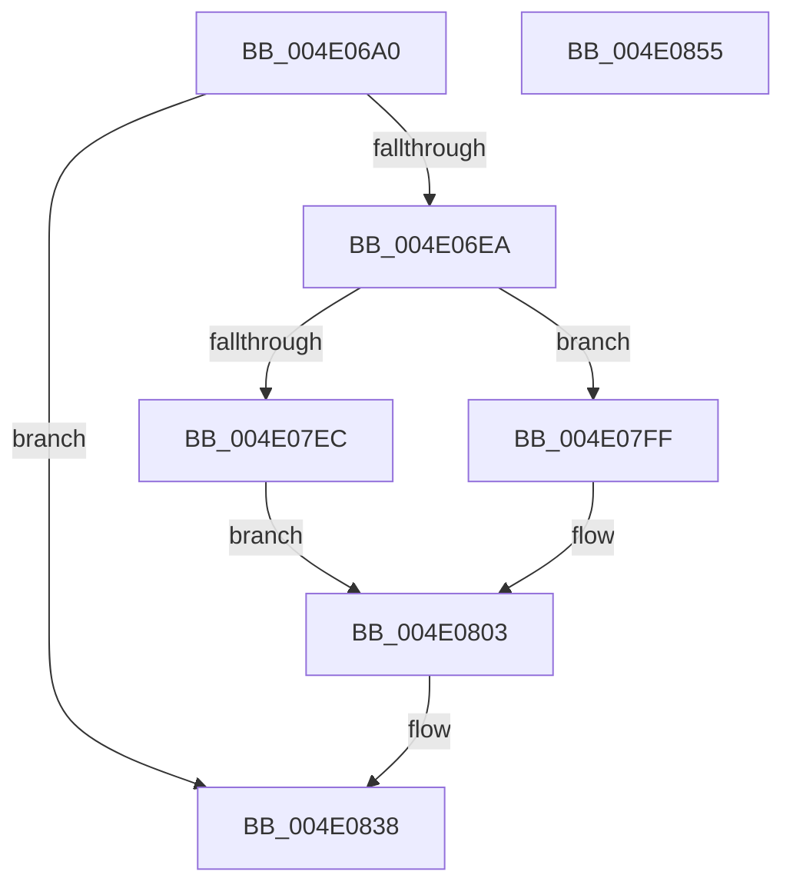

# HalpCmciLoadThresholdConfiguration

- RVA: `0x004E06A0`–`0x004E0856` (길이 `438` bytes)
- VA: `0x00000001404E06A0`
- 실행 섹션: `.text`
- PDB 이름 있음: `예`; PDB Function 태그: `아니요`
- unwind 정보 RVA: `0x000BF024`
- 디코드: `95`개 명령, `438/438` bytes 표시
- 미해석 바이트: `0` (있으면 어셈블리에 `.byte`로 보존)

> 이 문서는 커널 이미지의 기계어와 PDB 기호를 분석해 생성했습니다. 4번과 5번은 함수 원형과 자료형을 바이너리 사용 방식에서 추정한 C 해석이며 원본 소스 복구 결과는 아닙니다.

## 1. Dependencies

- 직접 호출 지점: **6**; 고유 호출 대상: **6**
- 직접 호출자로 확인된 함수: **1**
- RIP 상대 이미지 참조: **11**

### Outgoing calls
- `0x004E06F7` → [memset](../6C/memset_function_006C6C40.md) (function, `0x006C6C40`)
- `0x004E07AC` → [RtlInitUnicodeString](../42/RtlInitUnicodeString_function_0042A780.md) (function, `0x0042A780`)
- `0x004E07B6` → [MmGetSystemRoutineAddress](../../page/90/MmGetSystemRoutineAddress_function_0090EFE0.md) (function, `0x0090EFE0`)
- `0x004E07E3` → [guard_dispatch_icall](../6B/guard_dispatch_icall_function_006BAAD0.md) (function, `0x006BAAD0`)
- `0x004E0818` → [KeQueryPerformanceCounter](../37/KeQueryPerformanceCounter_function_0037E7E0.md) (function, `0x0037E7E0`)
- `0x004E083F` → [_security_check_cookie](../6A/_security_check_cookie_function_006AC640.md) (function, `0x006AC640`)

### Direct callers
- [HalpCmciInit](../../pagelk/B7/HalpCmciInit_function_00B7C348.md) at `0x00B7C38B`

### Static image references
- `0x004E06B2` → RVA `0x00E0A740` (`.data`; read)
- `0x004E06DC` → RVA `0x00E10248` (`.data`; read)
- `0x004E0701` → RVA `0x00023CB8` (`.rdata`; read)
- `0x004E0739` → RVA `0x00023C80` (`.rdata`; read)
- `0x004E0740` → RVA `0x00023CE0` (`.rdata`; read)
- `0x004E0771` → RVA `0x00023D08` (`.rdata`; read)
- `0x004E07BB` → RVA `0x008C8FD0` (`RtlQueryRegistryValues`; read)
- `0x004E07CE` → RVA `0x00023D28` (`.rdata`; read)
- `0x004E0812` → RVA `0x00E100BC` (`.data`; write)
- `0x004E0827` → RVA `0x00E0FBF8` (`.data`; write)
- `0x004E0832` → RVA `0x00E0A76C` (`.data`; write)

## 2. Other-region calls and transfers

- 다른 실행 섹션으로 향하는 call: **1**
  - `0x004E07B6` → [MmGetSystemRoutineAddress](../../page/90/MmGetSystemRoutineAddress_function_0090EFE0.md) (`.text` → `PAGE`)
- 별도 외부 분기/꼬리 이동을 확인하지 못했습니다.

## 3. Assembly (complete function range)

```asm
004E06A0  48 89 5C 24 08                  mov qword ptr [rsp + 8], rbx
004E06A5  55                              push rbp
004E06A6  48 8D 6C 24 B0                  lea rbp, [rsp - 0x50]
004E06AB  48 81 EC 50 01 00 00            sub rsp, 0x150
004E06B2  48 8B 05 87 A0 92 00            mov rax, qword ptr [rip + 0x92a087]
004E06B9  48 33 C4                        xor rax, rsp
004E06BC  48 89 45 40                     mov qword ptr [rbp + 0x40], rax
004E06C0  83 64 24 30 00                  and dword ptr [rsp + 0x30], 0
004E06C5  B9 01 00 00 00                  mov ecx, 1
004E06CA  83 64 24 38 00                  and dword ptr [rsp + 0x38], 0
004E06CF  83 64 24 34 00                  and dword ptr [rsp + 0x34], 0
004E06D4  48 83 64 24 48 00               and qword ptr [rsp + 0x48], 0
004E06DA  33 C0                           xor eax, eax
004E06DC  F0 0F B1 0D 64 FB 92 00         lock cmpxchg dword ptr [rip + 0x92fb64], ecx
004E06E4  0F 85 4E 01 00 00               jne 0x1404e0838
004E06EA  33 D2                           xor edx, edx
004E06EC  48 8D 4C 24 60                  lea rcx, [rsp + 0x60]
004E06F1  41 B8 E0 00 00 00               mov r8d, 0xe0
004E06F7  E8 44 65 1E 00                  call 0x1406c6c40
004E06FC  83 4C 24 44 FF                  or dword ptr [rsp + 0x44], 0xffffffff
004E0701  48 8D 05 B0 35 B4 FF            lea rax, [rip - 0x4bca50]
004E0708  48 89 44 24 70                  mov qword ptr [rsp + 0x70], rax
004E070D  BA 04 00 00 04                  mov edx, 0x4000004
004E0712  41 B8 30 01 00 00               mov r8d, 0x130
004E0718  89 55 80                        mov dword ptr [rbp - 0x80], edx
004E071B  48 8D 44 24 30                  lea rax, [rsp + 0x30]
004E0720  89 55 B8                        mov dword ptr [rbp - 0x48], edx
004E0723  48 89 44 24 78                  mov qword ptr [rsp + 0x78], rax
004E0728  BB 64 00 00 00                  mov ebx, 0x64
004E072D  48 8D 44 24 3C                  lea rax, [rsp + 0x3c]
004E0732  89 55 F0                        mov dword ptr [rbp - 0x10], edx
004E0735  48 89 45 88                     mov qword ptr [rbp - 0x78], rax
004E0739  48 8D 15 40 35 B4 FF            lea rdx, [rip - 0x4bcac0]
004E0740  48 8D 05 99 35 B4 FF            lea rax, [rip - 0x4bca67]
004E0747  C7 44 24 40 3C 00 00 00         mov dword ptr [rsp + 0x40], 0x3c
004E074F  48 89 45 A8                     mov qword ptr [rbp - 0x58], rax
004E0753  8D 4B A0                        lea ecx, [rbx - 0x60]
004E0756  48 8D 44 24 34                  lea rax, [rsp + 0x34]
004E075B  89 4D 90                        mov dword ptr [rbp - 0x70], ecx
004E075E  48 89 45 B0                     mov qword ptr [rbp - 0x50], rax
004E0762  0F 57 C0                        xorps xmm0, xmm0
004E0765  48 8D 44 24 40                  lea rax, [rsp + 0x40]
004E076A  89 4D C8                        mov dword ptr [rbp - 0x38], ecx
004E076D  48 89 45 C0                     mov qword ptr [rbp - 0x40], rax
004E0771  48 8D 05 90 35 B4 FF            lea rax, [rip - 0x4bca70]
004E0778  48 89 45 E0                     mov qword ptr [rbp - 0x20], rax
004E077C  48 8D 44 24 38                  lea rax, [rsp + 0x38]
004E0781  48 89 45 E8                     mov qword ptr [rbp - 0x18], rax
004E0785  48 8D 44 24 44                  lea rax, [rsp + 0x44]
004E078A  89 4D 00                        mov dword ptr [rbp], ecx
004E078D  48 8D 4C 24 50                  lea rcx, [rsp + 0x50]
004E0792  48 89 45 F8                     mov qword ptr [rbp - 8], rax
004E0796  89 5C 24 3C                     mov dword ptr [rsp + 0x3c], ebx
004E079A  44 89 44 24 68                  mov dword ptr [rsp + 0x68], r8d
004E079F  44 89 45 A0                     mov dword ptr [rbp - 0x60], r8d
004E07A3  44 89 45 D8                     mov dword ptr [rbp - 0x28], r8d
004E07A7  0F 11 44 24 50                  movups xmmword ptr [rsp + 0x50], xmm0
004E07AC  E8 CF 9F F4 FF                  call 0x14042a780
004E07B1  48 8D 4C 24 50                  lea rcx, [rsp + 0x50]
004E07B6  E8 25 E8 42 00                  call 0x14090efe0
004E07BB  48 8D 0D 0E 88 3E 00            lea rcx, [rip + 0x3e880e]
004E07C2  48 85 C0                        test rax, rax
004E07C5  4C 8D 44 24 60                  lea r8, [rsp + 0x60]
004E07CA  48 0F 44 C1                     cmove rax, rcx
004E07CE  48 8D 15 53 35 B4 FF            lea rdx, [rip - 0x4bcaad]
004E07D5  48 83 64 24 20 00               and qword ptr [rsp + 0x20], 0
004E07DB  45 33 C9                        xor r9d, r9d
004E07DE  B9 02 00 00 80                  mov ecx, 0x80000002
004E07E3  E8 E8 A2 1D 00                  call 0x1406baad0
004E07E8  85 C0                           test eax, eax
004E07EA  79 13                           jns 0x1404e07ff
004E07EC  83 4C 24 38 FF                  or dword ptr [rsp + 0x38], 0xffffffff
004E07F1  89 5C 24 30                     mov dword ptr [rsp + 0x30], ebx
004E07F5  C7 44 24 34 3C 00 00 00         mov dword ptr [rsp + 0x34], 0x3c
004E07FD  EB 04                           jmp 0x1404e0803
004E07FF  8B 5C 24 30                     mov ebx, dword ptr [rsp + 0x30]
004E0803  B8 02 00 00 00                  mov eax, 2
004E0808  48 8D 4C 24 48                  lea rcx, [rsp + 0x48]
004E080D  3B D8                           cmp ebx, eax
004E080F  0F 47 C3                        cmova eax, ebx
004E0812  89 05 A4 F8 92 00               mov dword ptr [rip + 0x92f8a4], eax
004E0818  E8 C3 DF E9 FF                  call 0x14037e7e0
004E081D  8B 44 24 34                     mov eax, dword ptr [rsp + 0x34]
004E0821  48 0F AF 44 24 48               imul rax, qword ptr [rsp + 0x48]
004E0827  48 89 05 CA F3 92 00            mov qword ptr [rip + 0x92f3ca], rax
004E082E  8B 44 24 38                     mov eax, dword ptr [rsp + 0x38]
004E0832  89 05 34 9F 92 00               mov dword ptr [rip + 0x929f34], eax
004E0838  48 8B 4D 40                     mov rcx, qword ptr [rbp + 0x40]
004E083C  48 33 CC                        xor rcx, rsp
004E083F  E8 FC BD 1C 00                  call 0x1406ac640
004E0844  48 8B 9C 24 60 01 00 00         mov rbx, qword ptr [rsp + 0x160]
004E084C  48 81 C4 50 01 00 00            add rsp, 0x150
004E0853  5D                              pop rbp
004E0854  C3                              ret
004E0855  CC                              int3
```

## 4. C-style interpretation (structured pseudocode)

```c
__int64 __fastcall HalpCmciLoadThresholdConfiguration(__int64 a1, int a2, __int64 a3, int a4)
{
    __int64 result;
    __int64 v_rsp;
    unsigned __int64 v_stack_m108;
    unsigned __int64 v_stack_m110;
    unsigned int v_stack_m114;
    unsigned int v_stack_m118;
    unsigned __int64 v_stack_m11C;
    unsigned int v_stack_m120;
    unsigned int v_stack_m124;
    unsigned int v_stack_m128;
    unsigned __int64 v_stack_m138;
    unsigned __int64 v_stack_m18;
    unsigned __int64 v_stack_m58;
    unsigned __int64 v_stack_m60;
    unsigned int v_stack_m68;
    unsigned __int64 v_stack_m70;
    unsigned __int64 v_stack_m78;
    unsigned int v_stack_m80;
    unsigned int v_stack_m90;
    unsigned __int64 v_stack_m98;
    unsigned int v_stack_mA0;
    unsigned __int64 v_stack_mA8;
    unsigned __int64 v_stack_mB0;
    unsigned int v_stack_mB8;
    unsigned int v_stack_mC8;
    unsigned __int64 v_stack_mD0;
    unsigned int v_stack_mD8;
    unsigned __int64 v_stack_mE0;
    unsigned __int64 v_stack_mE8;
    unsigned int v_stack_mF0;
    unsigned __int64 v_stack_mF8;
    unsigned __int64 v_stack_p8;

    v_stack_p8 = v_rbx;
    v_rsp = (v_rsp) - (336);
    result = (*(unsigned __int64 *)(v_rip + 9609351)) ^ (v_rsp);
    v_stack_m18 = result;
    result = 0;
    if (condition_is_not_equal) goto loc_004E0838;
    a2 = 0;
    result = memset(v_stack_mF8, a2, 224, a4);
    v_stack_mE8 = v_rip - 4966992;
    v_stack_mD8 = (unsigned int)((unsigned int)(0x4000004ULL));
    v_stack_mA0 = (unsigned int)((unsigned int)(0x4000004ULL));
    v_stack_mE0 = v_stack_m128;
    v_stack_m68 = (unsigned int)((unsigned int)(0x4000004ULL));
    v_stack_mD0 = v_stack_m11C;
    v_stack_m118 = 60;
    v_stack_mB0 = v_rip - 4967015;
    v_stack_mC8 = (unsigned int)(100 - 96);
    v_stack_mA8 = v_stack_m124;
    v_stack_m90 = (unsigned int)(100 - 96);
    v_stack_m98 = v_stack_m118;
    v_stack_m78 = v_rip - 4967024;
    v_stack_m70 = v_stack_m120;
    v_stack_m58 = (unsigned int)(100 - 96);
    v_stack_m60 = v_stack_m114;
    v_stack_m11C = 100;
    v_stack_mF0 = 304;
    v_stack_mB8 = 304;
    v_stack_m80 = 304;
    v_stack_m108 = v_xmm0;
    result = RtlInitUnicodeString(v_stack_m108, v_rip - 4967104, 304, a4);
    result = MmGetSystemRoutineAddress(v_stack_m108, v_rip - 4967104, 304, a4);
    if (result == 0) { result = v_rip + 4098062; }
    a4 = 0;
    result = guard_dispatch_icall((unsigned int)(0x80000002ULL), v_rip - 4967085, v_stack_mF8, a4);
    if (!sign_flag) goto loc_004E07FF;
    v_stack_m128 = 100;
    v_stack_m124 = 60;
    goto loc_004E0803;
loc_004E07FF:
loc_004E0803:
    result = 2;
    if (((unsigned int)((unsigned int)(v_stack_m128))) > 2) { result = (unsigned int)((unsigned int)(v_stack_m128)); }
    *(unsigned int *)(v_rip + 9631908) = (unsigned int)(result);
    result = KeQueryPerformanceCounter(v_stack_m110, v_rip - 4967085, v_stack_mF8, a4);
    result = ((unsigned int)(v_stack_m124)) * (v_stack_m110);
    *(unsigned __int64 *)(v_rip + 9630666) = result;
    *(unsigned int *)(v_rip + 9609012) = (unsigned int)((unsigned int)(v_stack_m120));
loc_004E0838:
    a1 = (v_stack_m18) ^ (v_rsp);
    result = _security_check_cookie(a1, v_rip - 4967085, v_stack_mF8, a4);
    v_rsp = (v_rsp) + (336);
    return result;
}
```

## 5. (Beta) C Style

```c
int64_t HalpCmciLoadThresholdConfiguration(int64_t Arg1, int32_t Arg2, int64_t Arg3, int32_t Arg4)
{
    int64_t result;
    int64_t local_rsp;
    uint64_t v_stack_m108;
    uint64_t v_stack_m110;
    uint32_t v_stack_m114;
    uint32_t v_stack_m118;
    uint64_t v_stack_m11C;
    uint32_t v_stack_m120;
    uint32_t v_stack_m124;
    uint32_t v_stack_m128;
    uint64_t v_stack_m138;
    uint64_t v_stack_m18;
    uint64_t v_stack_m58;
    uint64_t v_stack_m60;
    uint32_t v_stack_m68;
    uint64_t v_stack_m70;
    uint64_t v_stack_m78;
    uint32_t v_stack_m80;
    uint32_t v_stack_m90;
    uint64_t v_stack_m98;
    uint32_t v_stack_mA0;
    uint64_t v_stack_mA8;
    uint64_t v_stack_mB0;
    uint32_t v_stack_mB8;
    uint32_t v_stack_mC8;
    uint64_t v_stack_mD0;
    uint32_t v_stack_mD8;
    uint64_t v_stack_mE0;
    uint64_t v_stack_mE8;
    uint32_t v_stack_mF0;
    uint64_t v_stack_mF8;
    uint64_t v_stack_p8;

    v_stack_p8 = local_rbx;
    local_rsp = (local_rsp) - (336);
    result = (*(uint64_t *)(v_rip + 0x92A087)) ^ (local_rsp);
    v_stack_m18 = result;
    result = 0;
    if (condition_is_not_equal) goto loc_004E0838;
    Arg2 = 0;
    result = memset(v_stack_mF8, Arg2, 224, Arg4);
    v_stack_mE8 = v_rip - 4966992;
    v_stack_mD8 = (uint32_t)((uint32_t)(0x4000004ULL));
    v_stack_mA0 = (uint32_t)((uint32_t)(0x4000004ULL));
    v_stack_mE0 = v_stack_m128;
    v_stack_m68 = (uint32_t)((uint32_t)(0x4000004ULL));
    v_stack_mD0 = v_stack_m11C;
    v_stack_m118 = 60;
    v_stack_mB0 = v_rip - 4967015;
    v_stack_mC8 = (uint32_t)(100 - 96);
    v_stack_mA8 = v_stack_m124;
    v_stack_m90 = (uint32_t)(100 - 96);
    v_stack_m98 = v_stack_m118;
    v_stack_m78 = v_rip - 4967024;
    v_stack_m70 = v_stack_m120;
    v_stack_m58 = (uint32_t)(100 - 96);
    v_stack_m60 = v_stack_m114;
    v_stack_m11C = 100;
    v_stack_mF0 = 304;
    v_stack_mB8 = 304;
    v_stack_m80 = 304;
    v_stack_m108 = v_xmm0;
    result = RtlInitUnicodeString(v_stack_m108, v_rip - 4967104, 304, Arg4);
    result = MmGetSystemRoutineAddress(v_stack_m108, v_rip - 4967104, 304, Arg4);
    if (result == 0) { result = v_rip + 4098062; }
    Arg4 = 0;
    result = guard_dispatch_icall((uint32_t)(0x80000002ULL), v_rip - 4967085, v_stack_mF8, Arg4);
    if (!sign_flag) goto loc_004E07FF;
    v_stack_m128 = 100;
    v_stack_m124 = 60;
    goto loc_004E0803;
loc_004E07FF:
loc_004E0803:
    result = 2;
    if (((uint32_t)((uint32_t)(v_stack_m128))) > 2) { result = (uint32_t)((uint32_t)(v_stack_m128)); }
    *(uint32_t *)(v_rip + 0x92F8A4) = (uint32_t)(result);
    result = KeQueryPerformanceCounter(v_stack_m110, v_rip - 4967085, v_stack_mF8, Arg4);
    result = ((uint32_t)(v_stack_m124)) * (v_stack_m110);
    *(uint64_t *)(v_rip + 0x92F3CA) = result;
    *(uint32_t *)(v_rip + 0x929F34) = (uint32_t)((uint32_t)(v_stack_m120));
loc_004E0838:
    Arg1 = (v_stack_m18) ^ (local_rsp);
    result = _security_check_cookie(Arg1, v_rip - 4967085, v_stack_mF8, Arg4);
    local_rsp = (local_rsp) + (336);
    return result;
}
```

## 6. Execution-region graph

[열기: 2D/3D 그래프와 함수 탐색 컨트롤 패널](../../../control-panel.html?section=text&rva=0x004E06A0&view=graph)

- 2D 그래프는 위에서 아래로 흐르고, 3D 그래프는 빈 공간을 드래그해 회전합니다. Shift+드래그는 이동, 휠은 확대·축소, 함수 노드 선택은 대상 보고서 이동입니다.

### Static fallback


