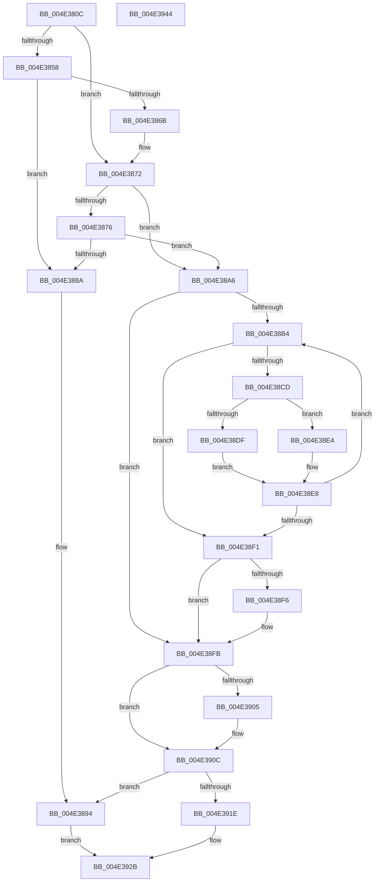

# HalpDmaAllocateScatterPagesFromContiguousPoolV3

- RVA: `0x004E380C`–`0x004E3945` (길이 `313` bytes)
- VA: `0x00000001404E380C`
- 실행 섹션: `.text`
- PDB 이름 있음: `예`; PDB Function 태그: `아니요`
- unwind 정보 RVA: `0x00093E28`
- 디코드: `92`개 명령, `313/313` bytes 표시
- 미해석 바이트: `0` (있으면 어셈블리에 `.byte`로 보존)

> 이 문서는 커널 이미지의 기계어와 PDB 기호를 분석해 생성했습니다. 4번과 5번은 함수 원형과 자료형을 바이너리 사용 방식에서 추정한 C 해석이며 원본 소스 복구 결과는 아닙니다.

## 1. Dependencies

- 직접 호출 지점: **6**; 고유 호출 대상: **5**
- 직접 호출자로 확인된 함수: **2**
- RIP 상대 이미지 참조: **0**

### Outgoing calls
- `0x004E3849` → [KeAcquireInStackQueuedSpinLock](../27/KeAcquireInStackQueuedSpinLock_function_002757A0.md) (function, `0x002757A0`)
- `0x004E387D` → [RtlNumberOfSetBits](../43/RtlNumberOfSetBits_function_00433F70.md) (function, `0x00433F70`)
- `0x004E388F` → [KeReleaseInStackQueuedSpinLock](../34/KeReleaseInStackQueuedSpinLock_function_00342CE0.md) (function, `0x00342CE0`)
- `0x004E38C0` → [RtlFindClearBitsAndSet](../3E/RtlFindClearBitsAndSet_function_003E0CD0.md) (function, `0x003E0CD0`)
- `0x004E38D5` → [HalpDmaIndexToTranslationEntry](../49/HalpDmaIndexToTranslationEntry_function_00495F54.md) (function, `0x00495F54`)
- `0x004E3911` → [KeReleaseInStackQueuedSpinLock](../34/KeReleaseInStackQueuedSpinLock_function_00342CE0.md) (function, `0x00342CE0`)

### Direct callers
- [HalpDmaAllocateScatterPagesFromContiguousPool](../3D/HalpDmaAllocateScatterPagesFromContiguousPool_function_003DC184.md) at `0x003DC1CD`
- [HalpDmaAllocateMapRegisters](../3D/HalpDmaAllocateMapRegisters_function_003DDA0C.md) at `0x003DDD78`

### Static image references
- 디코드된 RIP-relative 메모리 참조가 없습니다.

## 2. Other-region calls and transfers

- 다른 실행 섹션으로 향하는 call: **0**
- 별도 외부 분기/꼬리 이동을 확인하지 못했습니다.

## 3. Assembly (complete function range)

```asm
004E380C  4C 8B DC                        mov r11, rsp
004E380F  49 89 5B 08                     mov qword ptr [r11 + 8], rbx
004E3813  49 89 6B 10                     mov qword ptr [r11 + 0x10], rbp
004E3817  49 89 73 18                     mov qword ptr [r11 + 0x18], rsi
004E381B  57                              push rdi
004E381C  41 56                           push r14
004E381E  41 57                           push r15
004E3820  48 83 EC 40                     sub rsp, 0x40
004E3824  0F 57 C0                        xorps xmm0, xmm0
004E3827  48 8D 8A 80 00 00 00            lea rcx, [rdx + 0x80]
004E382E  48 8B F2                        mov rsi, rdx
004E3831  33 C0                           xor eax, eax
004E3833  0F 11 44 24 20                  movups xmmword ptr [rsp + 0x20], xmm0
004E3838  49 8D 53 C8                     lea rdx, [r11 - 0x38]
004E383C  49 89 43 D8                     mov qword ptr [r11 - 0x28], rax
004E3840  41 8A D9                        mov bl, r9b
004E3843  41 8B F8                        mov edi, r8d
004E3846  45 33 FF                        xor r15d, r15d
004E3849  E8 52 1F D9 FF                  call 0x1402757a0
004E384E  44 38 BC 24 80 00 00 00         cmp byte ptr [rsp + 0x80], r15b
004E3856  74 1A                           je 0x1404e3872
004E3858  8B 86 D8 00 00 00               mov eax, dword ptr [rsi + 0xd8]
004E385E  4C 8B FE                        mov r15, rsi
004E3861  8B 8E DC 00 00 00               mov ecx, dword ptr [rsi + 0xdc]
004E3867  3B C1                           cmp eax, ecx
004E3869  76 1F                           jbe 0x1404e388a
004E386B  2B C1                           sub eax, ecx
004E386D  3B F8                           cmp edi, eax
004E386F  0F 47 F8                        cmova edi, eax
004E3872  84 DB                           test bl, bl
004E3874  74 30                           je 0x1404e38a6
004E3876  48 8B 5E 18                     mov rbx, qword ptr [rsi + 0x18]
004E387A  48 8B CB                        mov rcx, rbx
004E387D  E8 EE 06 F5 FF                  call 0x140433f70
004E3882  8B 0B                           mov ecx, dword ptr [rbx]
004E3884  2B C8                           sub ecx, eax
004E3886  3B CF                           cmp ecx, edi
004E3888  73 1C                           jae 0x1404e38a6
004E388A  48 8D 4C 24 20                  lea rcx, [rsp + 0x20]
004E388F  E8 4C F4 E5 FF                  call 0x140342ce0
004E3894  48 8B 84 24 88 00 00 00         mov rax, qword ptr [rsp + 0x88]
004E389C  83 20 00                        and dword ptr [rax], 0
004E389F  33 C0                           xor eax, eax
004E38A1  E9 85 00 00 00                  jmp 0x1404e392b
004E38A6  45 33 F6                        xor r14d, r14d
004E38A9  33 ED                           xor ebp, ebp
004E38AB  33 DB                           xor ebx, ebx
004E38AD  45 33 D2                        xor r10d, r10d
004E38B0  85 FF                           test edi, edi
004E38B2  74 47                           je 0x1404e38fb
004E38B4  48 8B 4E 18                     mov rcx, qword ptr [rsi + 0x18]
004E38B8  45 8B C2                        mov r8d, r10d
004E38BB  BA 01 00 00 00                  mov edx, 1
004E38C0  E8 0B D4 EF FF                  call 0x1403e0cd0
004E38C5  44 8B D0                        mov r10d, eax
004E38C8  83 F8 FF                        cmp eax, -1
004E38CB  74 24                           je 0x1404e38f1
004E38CD  45 33 C0                        xor r8d, r8d
004E38D0  8B D0                           mov edx, eax
004E38D2  48 8B CE                        mov rcx, rsi
004E38D5  E8 7A 26 FB FF                  call 0x140495f54
004E38DA  4D 85 F6                        test r14, r14
004E38DD  75 05                           jne 0x1404e38e4
004E38DF  4C 8B F0                        mov r14, rax
004E38E2  EB 04                           jmp 0x1404e38e8
004E38E4  48 89 45 08                     mov qword ptr [rbp + 8], rax
004E38E8  FF C3                           inc ebx
004E38EA  48 8B E8                        mov rbp, rax
004E38ED  3B DF                           cmp ebx, edi
004E38EF  72 C3                           jb 0x1404e38b4
004E38F1  48 85 ED                        test rbp, rbp
004E38F4  74 05                           je 0x1404e38fb
004E38F6  48 83 65 08 00                  and qword ptr [rbp + 8], 0
004E38FB  80 BC 24 80 00 00 00 00         cmp byte ptr [rsp + 0x80], 0
004E3903  74 07                           je 0x1404e390c
004E3905  41 29 9F D8 00 00 00            sub dword ptr [r15 + 0xd8], ebx
004E390C  48 8D 4C 24 20                  lea rcx, [rsp + 0x20]
004E3911  E8 CA F3 E5 FF                  call 0x140342ce0
004E3916  85 DB                           test ebx, ebx
004E3918  0F 84 76 FF FF FF               je 0x1404e3894
004E391E  48 8B 8C 24 88 00 00 00         mov rcx, qword ptr [rsp + 0x88]
004E3926  49 8B C6                        mov rax, r14
004E3929  89 19                           mov dword ptr [rcx], ebx
004E392B  48 8B 5C 24 60                  mov rbx, qword ptr [rsp + 0x60]
004E3930  48 8B 6C 24 68                  mov rbp, qword ptr [rsp + 0x68]
004E3935  48 8B 74 24 70                  mov rsi, qword ptr [rsp + 0x70]
004E393A  48 83 C4 40                     add rsp, 0x40
004E393E  41 5F                           pop r15
004E3940  41 5E                           pop r14
004E3942  5F                              pop rdi
004E3943  C3                              ret
004E3944  CC                              int3
```

## 4. C-style interpretation (structured pseudocode)

```c
__int64 __fastcall HalpDmaAllocateScatterPagesFromContiguousPoolV3(__int64 a1, __int64 a2, int a3, unsigned __int8 a4, unsigned __int8 a5, __int64 a6)
{
    __int64 result;
    __int64 v_r10;
    __int64 v_r14;
    __int64 v_r15;
    __int64 v_rbp;
    __int64 v_rbx;
    __int64 v_rdi;
    __int64 v_rsp;
    unsigned __int64 v_stack_m38;
    unsigned __int64 v_stack_p10;
    unsigned __int64 v_stack_p18;
    unsigned __int64 v_stack_p8;

    *(unsigned __int64 *)(v_rsp + 8) = v_rbx;
    *(unsigned __int64 *)(v_rsp + 16) = v_rbp;
    *(unsigned __int64 *)(v_rsp + 24) = v_rsi;
    v_rsp = (v_rsp) - (64);
    result = 0;
    v_stack_m38 = v_xmm0;
    *(unsigned __int64 *)(v_rsp - 40) = 0;
    v_r15 = 0;
    result = KeAcquireInStackQueuedSpinLock(a2 + 128, v_rsp - 56, a3, a4);
    if (a5 == 0) goto loc_004E3872;
    if (((unsigned int)((unsigned int)(*(unsigned int *)(a2 + 216)))) <= ((unsigned int)((unsigned int)(*(unsigned int *)(a2 + 220))))) goto loc_004E388A;
    result = (unsigned int)(((unsigned int)(*(unsigned int *)(a2 + 216))) - ((unsigned int)((unsigned int)(*(unsigned int *)(a2 + 220)))));
    v_rdi = (unsigned int)(a3);
    if (((unsigned int)((unsigned int)(a3))) > ((unsigned int)(result))) { v_rdi = (unsigned int)(result); }
loc_004E3872:
    if (a4 == 0) goto loc_004E38A6;
    result = RtlNumberOfSetBits(*(unsigned __int64 *)(a2 + 24), v_rsp - 56, a3, a4);
    a1 = (unsigned int)(((unsigned int)(*(unsigned int *)(*(unsigned __int64 *)(a2 + 24)))) - ((unsigned int)(result)));
    if (((unsigned int)(a1)) >= ((unsigned int)(v_rdi))) goto loc_004E38A6;
loc_004E388A:
    result = KeReleaseInStackQueuedSpinLock(v_stack_m38, v_rsp - 56, a3, a4);
loc_004E3894:
    result = 0;
    goto loc_004E392B;
loc_004E38A6:
    v_r14 = 0;
    v_rbp = 0;
    v_rbx = 0;
    v_r10 = 0;
    if ((unsigned int)(v_rdi) == 0) goto loc_004E38FB;
loc_004E38B4:
    result = RtlFindClearBitsAndSet(*(unsigned __int64 *)(a2 + 24), 1, 0, a4);
    if (((unsigned int)(result)) == -1) goto loc_004E38F1;
    a3 = 0;
    result = HalpDmaIndexToTranslationEntry(a2, (unsigned int)((unsigned int)(result)), a3, a4);
    if (0 != 0) goto loc_004E38E4;
    goto loc_004E38E8;
loc_004E38E4:
    *(unsigned __int64 *)(v_rbp + 8) = result;
loc_004E38E8:
    v_rbx = (unsigned int)((v_rbx) + 1);
    if (((unsigned int)(v_rbx)) < ((unsigned int)(v_rdi))) goto loc_004E38B4;
loc_004E38F1:
    if (result != 0) {
    }
    if (a5 != 0) {
    }
    result = KeReleaseInStackQueuedSpinLock(v_stack_m38, (unsigned int)((unsigned int)(result)), a3, a4);
    if ((unsigned int)(v_rbx) == 0) goto loc_004E3894;
    *(unsigned int *)(a6) = (unsigned int)(v_rbx);
loc_004E392B:
    v_rsp = (v_rsp) + (64);
    return result;
}
```

## 5. (Beta) C Style

```c
int64_t HalpDmaAllocateScatterPagesFromContiguousPoolV3(int64_t Arg1, void *Arg2, int32_t Arg3, uint8_t Arg4, uint8_t Arg5, void *Arg6)
{
    uint8_t *arg2 = (uint8_t *)Arg2;
    uint8_t *arg6 = (uint8_t *)Arg6;

    int64_t result;
    int64_t local_r10;
    int64_t local_r14;
    int64_t local_r15;
    int64_t local_rbp;
    int64_t local_rbx;
    int64_t local_rdi;
    int64_t local_rsp;
    uint64_t v_stack_m38;
    uint64_t v_stack_p10;
    uint64_t v_stack_p18;
    uint64_t v_stack_p8;

    *(uint64_t *)(local_rsp + 0x8) = local_rbx;
    *(uint64_t *)(local_rsp + 0x10) = local_rbp;
    *(uint64_t *)(local_rsp + 0x18) = local_rsi;
    local_rsp = (local_rsp) - (64);
    result = 0;
    v_stack_m38 = v_xmm0;
    *(uint64_t *)(local_rsp - 0x28) = 0;
    local_r15 = 0;
    result = KeAcquireInStackQueuedSpinLock(Arg2 + 128, local_rsp - 56, Arg3, Arg4);
    if (Arg5 == 0) goto loc_004E3872;
    if (((uint32_t)((uint32_t)(*(uint32_t *)(arg2 + 0xD8)))) <= ((uint32_t)((uint32_t)(*(uint32_t *)(arg2 + 0xDC))))) goto loc_004E388A;
    result = (uint32_t)(((uint32_t)(*(uint32_t *)(arg2 + 0xD8))) - ((uint32_t)((uint32_t)(*(uint32_t *)(arg2 + 0xDC)))));
    local_rdi = (uint32_t)(Arg3);
    if (((uint32_t)((uint32_t)(Arg3))) > ((uint32_t)(result))) { local_rdi = (uint32_t)(result); }
loc_004E3872:
    if (Arg4 == 0) goto loc_004E38A6;
    result = RtlNumberOfSetBits(*(uint64_t *)(arg2 + 0x18), local_rsp - 56, Arg3, Arg4);
    Arg1 = (uint32_t)(((uint32_t)(*(uint32_t *)(*(uint64_t *)(arg2 + 0x18)))) - ((uint32_t)(result)));
    if (((uint32_t)(Arg1)) >= ((uint32_t)(local_rdi))) goto loc_004E38A6;
loc_004E388A:
    result = KeReleaseInStackQueuedSpinLock(v_stack_m38, local_rsp - 56, Arg3, Arg4);
loc_004E3894:
    result = 0;
    goto loc_004E392B;
loc_004E38A6:
    local_r14 = 0;
    local_rbp = 0;
    local_rbx = 0;
    local_r10 = 0;
    if ((uint32_t)(local_rdi) == 0) goto loc_004E38FB;
loc_004E38B4:
    result = RtlFindClearBitsAndSet(*(uint64_t *)(arg2 + 0x18), 1, 0, Arg4);
    if (((uint32_t)(result)) == -1) goto loc_004E38F1;
    Arg3 = 0;
    result = HalpDmaIndexToTranslationEntry(Arg2, (uint32_t)((uint32_t)(result)), Arg3, Arg4);
    if (0 != 0) goto loc_004E38E4;
    goto loc_004E38E8;
loc_004E38E4:
    *(uint64_t *)(local_rbp + 0x8) = result;
loc_004E38E8:
    local_rbx = (uint32_t)((local_rbx) + 1);
    if (((uint32_t)(local_rbx)) < ((uint32_t)(local_rdi))) goto loc_004E38B4;
loc_004E38F1:
    if (result != 0) {
    }
    if (Arg5 != 0) {
    }
    result = KeReleaseInStackQueuedSpinLock(v_stack_m38, (uint32_t)((uint32_t)(result)), Arg3, Arg4);
    if ((uint32_t)(local_rbx) == 0) goto loc_004E3894;
    *(uint32_t *)(arg6) = (uint32_t)(local_rbx);
loc_004E392B:
    local_rsp = (local_rsp) + (64);
    return result;
}
```

### 관측된 메모리 오프셋

구조체 형식이 확인되지 않은 접근은 인자 기준의 오프셋으로만 기록했습니다.

| 기준 인자 | 오프셋 표현 | 폭 (bit) | 접근 |
|---|---:|---:|---|
| `Arg2` | `+ 0x18` | `64` | `R` |
| `Arg2` | `+ 0x80` | `64` | `R` |
| `Arg2` | `+ 0xD8` | `32` | `R` |
| `Arg2` | `+ 0xDC` | `32` | `R` |
| `Arg6` | `+ 0x0` | `32` | `R/W` |
| `Arg6` | `+ 0x0` | `32` | `W` |

## 6. Execution-region graph

[열기: 2D/3D 그래프와 함수 탐색 컨트롤 패널](../../../control-panel.html?section=text&rva=0x004E380C&view=graph)

- 2D 그래프는 위에서 아래로 흐르고, 3D 그래프는 빈 공간을 드래그해 회전합니다. Shift+드래그는 이동, 휠은 확대·축소, 함수 노드 선택은 대상 보고서 이동입니다.

### Static fallback


