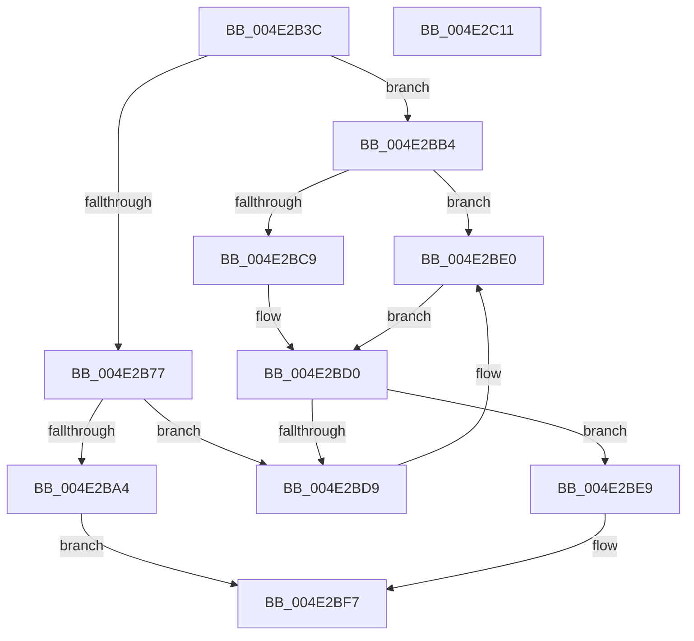

# HalpDmaQueueAdapter

- RVA: `0x004E2B3C`–`0x004E2C12` (길이 `214` bytes)
- VA: `0x00000001404E2B3C`
- 실행 섹션: `.text`
- PDB 이름 있음: `예`; PDB Function 태그: `아니요`
- unwind 정보 RVA: `0x000718AC`
- 디코드: `55`개 명령, `214/214` bytes 표시
- 미해석 바이트: `0` (있으면 어셈블리에 `.byte`로 보존)

> 이 문서는 커널 이미지의 기계어와 PDB 기호를 분석해 생성했습니다. 4번과 5번은 함수 원형과 자료형을 바이너리 사용 방식에서 추정한 C 해석이며 원본 소스 복구 결과는 아닙니다.

## 1. Dependencies

- 직접 호출 지점: **3**; 고유 호출 대상: **2**
- 직접 호출자로 확인된 함수: **5**
- RIP 상대 이미지 참조: **1**

### Outgoing calls
- `0x004E2B96` → [KeAcquireInStackQueuedSpinLock](../27/KeAcquireInStackQueuedSpinLock_function_002757A0.md) (function, `0x002757A0`)
- `0x004E2BBB` → [KeAcquireInStackQueuedSpinLock](../27/KeAcquireInStackQueuedSpinLock_function_002757A0.md) (function, `0x002757A0`)
- `0x004E2BFC` → [KeReleaseInStackQueuedSpinLock](../34/KeReleaseInStackQueuedSpinLock_function_00342CE0.md) (function, `0x00342CE0`)

### Direct callers
- [HalpAllocateDmaResourcesInternal](../3D/HalpAllocateDmaResourcesInternal_function_003DA7C4.md) at `0x003DA98C`
- [HalAllocateAdapterChannelV2](../3D/HalAllocateAdapterChannelV2_function_003DC714.md) at `0x003DC8BC`
- [sub_003DD598](../3D/Unknown_function_003DD598.md) at `0x003DD697`
- [IoFreeAdapterChannelV2](../3D/IoFreeAdapterChannelV2_function_003DE3B0.md) at `0x003DE4B4`
- [HalpDmaProcessMapRegisterQueueV2](../3D/HalpDmaProcessMapRegisterQueueV2_function_003DF50C.md) at `0x003DF5B0`

### Static image references
- `0x004E2B60` → RVA `0x00FC18A0` (`.data`; read)

## 2. Other-region calls and transfers

- 다른 실행 섹션으로 향하는 call: **0**
- 별도 외부 분기/꼬리 이동을 확인하지 못했습니다.

## 3. Assembly (complete function range)

```asm
004E2B3C  4C 8B DC                        mov r11, rsp
004E2B3F  49 89 5B 08                     mov qword ptr [r11 + 8], rbx
004E2B43  49 89 73 10                     mov qword ptr [r11 + 0x10], rsi
004E2B47  57                              push rdi
004E2B48  48 83 EC 40                     sub rsp, 0x40
004E2B4C  48 8B B1 A0 00 00 00            mov rsi, qword ptr [rcx + 0xa0]
004E2B53  48 8D 99 A8 00 00 00            lea rbx, [rcx + 0xa8]
004E2B5A  33 C0                           xor eax, eax
004E2B5C  49 8D 53 D8                     lea rdx, [r11 - 0x28]
004E2B60  38 05 3A ED AD 00               cmp byte ptr [rip + 0xaded3a], al
004E2B66  0F 57 C0                        xorps xmm0, xmm0
004E2B69  0F 11 44 24 20                  movups xmmword ptr [rsp + 0x20], xmm0
004E2B6E  49 89 43 E8                     mov qword ptr [r11 - 0x18], rax
004E2B72  48 8B F9                        mov rdi, rcx
004E2B75  74 3D                           je 0x1404e2bb4
004E2B77  8A 81 BA 01 00 00               mov al, byte ptr [rcx + 0x1ba]
004E2B7D  48 8D 8E A0 00 00 00            lea rcx, [rsi + 0xa0]
004E2B84  F6 D8                           neg al
004E2B86  48 1B FF                        sbb rdi, rdi
004E2B89  83 E7 10                        and edi, 0x10
004E2B8C  48 81 C7 A8 00 00 00            add rdi, 0xa8
004E2B93  48 03 FE                        add rdi, rsi
004E2B96  E8 05 2C D9 FF                  call 0x1402757a0
004E2B9B  48 8B 47 08                     mov rax, qword ptr [rdi + 8]
004E2B9F  48 39 38                        cmp qword ptr [rax], rdi
004E2BA2  75 35                           jne 0x1404e2bd9
004E2BA4  48 89 3B                        mov qword ptr [rbx], rdi
004E2BA7  48 89 43 08                     mov qword ptr [rbx + 8], rax
004E2BAB  48 89 18                        mov qword ptr [rax], rbx
004E2BAE  48 89 5F 08                     mov qword ptr [rdi + 8], rbx
004E2BB2  EB 43                           jmp 0x1404e2bf7
004E2BB4  48 8D 8E 80 00 00 00            lea rcx, [rsi + 0x80]
004E2BBB  E8 E0 2B D9 FF                  call 0x1402757a0
004E2BC0  80 BF BA 01 00 00 00            cmp byte ptr [rdi + 0x1ba], 0
004E2BC7  74 17                           je 0x1404e2be0
004E2BC9  48 8D 86 B8 00 00 00            lea rax, [rsi + 0xb8]
004E2BD0  48 8B 48 08                     mov rcx, qword ptr [rax + 8]
004E2BD4  48 39 01                        cmp qword ptr [rcx], rax
004E2BD7  74 10                           je 0x1404e2be9
004E2BD9  B9 03 00 00 00                  mov ecx, 3
004E2BDE  CD 29                           int 0x29
004E2BE0  48 8D 86 A8 00 00 00            lea rax, [rsi + 0xa8]
004E2BE7  EB E7                           jmp 0x1404e2bd0
004E2BE9  48 89 03                        mov qword ptr [rbx], rax
004E2BEC  48 89 4B 08                     mov qword ptr [rbx + 8], rcx
004E2BF0  48 89 19                        mov qword ptr [rcx], rbx
004E2BF3  48 89 58 08                     mov qword ptr [rax + 8], rbx
004E2BF7  48 8D 4C 24 20                  lea rcx, [rsp + 0x20]
004E2BFC  E8 DF 00 E6 FF                  call 0x140342ce0
004E2C01  48 8B 5C 24 50                  mov rbx, qword ptr [rsp + 0x50]
004E2C06  48 8B 74 24 58                  mov rsi, qword ptr [rsp + 0x58]
004E2C0B  48 83 C4 40                     add rsp, 0x40
004E2C0F  5F                              pop rdi
004E2C10  C3                              ret
004E2C11  CC                              int3
```

## 4. C-style interpretation (structured pseudocode)

```c
__int64 __fastcall HalpDmaQueueAdapter(__int64 a1)
{
    __int64 result;
    __int64 v_rdi;
    __int64 v_rsp;
    unsigned __int64 v_stack_m28;
    unsigned __int64 v_stack_p10;
    unsigned __int64 v_stack_p8;

    *(unsigned __int64 *)(v_rsp + 8) = v_rbx;
    *(unsigned __int64 *)(v_rsp + 16) = v_rsi;
    v_rsp = (v_rsp) - (64);
    result = 0;
    v_stack_m28 = v_xmm0;
    *(unsigned __int64 *)(v_rsp - 24) = 0;
    if ((*(unsigned __int8 *)(v_rip + 11398458)) == 0) goto loc_004E2BB4;
    result = (unsigned __int8)(-(*(unsigned __int8 *)(a1 + 442)));
    v_rdi = (unsigned int)((a1) & (16));
    v_rdi = (v_rdi) + (168);
    v_rdi = (v_rdi) + (*(unsigned __int64 *)(a1 + 160));
    result = KeAcquireInStackQueuedSpinLock(*(unsigned __int64 *)(a1 + 160) + 160, v_rsp - 40, a3, a4);
    if ((*(unsigned __int64 *)(*(unsigned __int64 *)(v_rdi + 8))) != v_rdi) goto loc_004E2BD9;
    *(unsigned __int64 *)(a1 + 168) = v_rdi;
    *(unsigned __int64 *)(a1 + 168 + 8) = *(unsigned __int64 *)(v_rdi + 8);
    *(unsigned __int64 *)(*(unsigned __int64 *)(v_rdi + 8)) = a1 + 168;
    *(unsigned __int64 *)(v_rdi + 8) = a1 + 168;
    goto loc_004E2BF7;
loc_004E2BB4:
    result = KeAcquireInStackQueuedSpinLock(*(unsigned __int64 *)(a1 + 160) + 128, v_rsp - 40, a3, a4);
    if ((*(unsigned __int8 *)(v_rdi + 442)) == 0) goto loc_004E2BE0;
loc_004E2BD0:
    if ((*(unsigned __int64 *)(*(unsigned __int64 *)(*(unsigned __int64 *)(a1 + 160) + 184 + 8))) == (*(unsigned __int64 *)(a1 + 160) + 184)) goto loc_004E2BE9;
loc_004E2BD9:
loc_004E2BE0:
    goto loc_004E2BD0;
loc_004E2BE9:
    *(unsigned __int64 *)(a1 + 168) = *(unsigned __int64 *)(a1 + 160) + 168;
    *(unsigned __int64 *)(a1 + 168 + 8) = 3;
    *(unsigned __int64 *)(3) = a1 + 168;
    *(unsigned __int64 *)(*(unsigned __int64 *)(a1 + 160) + 168 + 8) = a1 + 168;
loc_004E2BF7:
    result = KeReleaseInStackQueuedSpinLock(v_stack_m28, v_rsp - 40, a3, a4);
    v_rsp = (v_rsp) + (64);
    return result;
}
```

## 5. (Beta) C Style

```c
int64_t HalpDmaQueueAdapter(void *Arg1)
{
    uint8_t *arg1 = (uint8_t *)Arg1;

    int64_t result;
    int64_t local_rdi;
    int64_t local_rsp;
    uint64_t v_stack_m28;
    uint64_t v_stack_p10;
    uint64_t v_stack_p8;

    *(uint64_t *)(local_rsp + 0x8) = local_rbx;
    *(uint64_t *)(local_rsp + 0x10) = local_rsi;
    local_rsp = (local_rsp) - (64);
    result = 0;
    v_stack_m28 = v_xmm0;
    *(uint64_t *)(local_rsp - 0x18) = 0;
    if ((*(uint8_t *)(v_rip + 0xADED3A)) == 0) goto loc_004E2BB4;
    result = (uint8_t)(-(*(uint8_t *)(arg1 + 0x1BA)));
    local_rdi = (uint32_t)((Arg1) & (16));
    local_rdi = (local_rdi) + (168);
    local_rdi = (local_rdi) + (*(uint64_t *)(arg1 + 0xA0));
    result = KeAcquireInStackQueuedSpinLock(*(uint64_t *)(arg1 + 0xA0) + 160, local_rsp - 40, a3, a4);
    if ((*(uint64_t *)(*(uint64_t *)(local_rdi + 0x8))) != local_rdi) goto loc_004E2BD9;
    *(uint64_t *)(arg1 + 0xA8) = local_rdi;
    *(uint64_t *)(arg1 + 0xA8 + 0x8) = *(uint64_t *)(local_rdi + 0x8);
    *(void **)(*(uint64_t *)(local_rdi + 0x8)) = Arg1 + 168;
    *(void **)(local_rdi + 0x8) = Arg1 + 168;
    goto loc_004E2BF7;
loc_004E2BB4:
    result = KeAcquireInStackQueuedSpinLock(*(uint64_t *)(arg1 + 0xA0) + 128, local_rsp - 40, a3, a4);
    if ((*(uint8_t *)(local_rdi + 0x1BA)) == 0) goto loc_004E2BE0;
loc_004E2BD0:
    if ((*(uint64_t *)(*(uint64_t *)(*(uint64_t *)(arg1 + 0xA0) + 0xB8 + 0x8))) == (*(uint64_t *)(arg1 + 0xA0) + 184)) goto loc_004E2BE9;
loc_004E2BD9:
loc_004E2BE0:
    goto loc_004E2BD0;
loc_004E2BE9:
    *(uint64_t *)(arg1 + 0xA8) = *(uint64_t *)(arg1 + 0xA0) + 168;
    *(uint64_t *)(arg1 + 0xA8 + 0x8) = 3;
    *(void **)(3) = Arg1 + 168;
    *(void **)(*(uint64_t *)(arg1 + 0xA0) + 0xA8 + 0x8) = Arg1 + 168;
loc_004E2BF7:
    result = KeReleaseInStackQueuedSpinLock(v_stack_m28, local_rsp - 40, a3, a4);
    local_rsp = (local_rsp) + (64);
    return result;
}
```

### 관측된 메모리 오프셋

구조체 형식이 확인되지 않은 접근은 인자 기준의 오프셋으로만 기록했습니다.

| 기준 인자 | 오프셋 표현 | 폭 (bit) | 접근 |
|---|---:|---:|---|
| `Arg1` | `+ 0x0` | `64` | `W` |
| `Arg1` | `+ 0x8` | `64` | `W` |
| `Arg1` | `+ 0xA0` | `64` | `R` |
| `Arg1` | `+ 0xA8` | `64` | `R` |
| `Arg1` | `+ 0x1BA` | `8` | `R` |

## 6. Execution-region graph

[열기: 2D/3D 그래프와 함수 탐색 컨트롤 패널](../../../control-panel.html?section=text&rva=0x004E2B3C&view=graph)

- 2D 그래프는 위에서 아래로 흐르고, 3D 그래프는 빈 공간을 드래그해 회전합니다. Shift+드래그는 이동, 휠은 확대·축소, 함수 노드 선택은 대상 보고서 이동입니다.

### Static fallback


