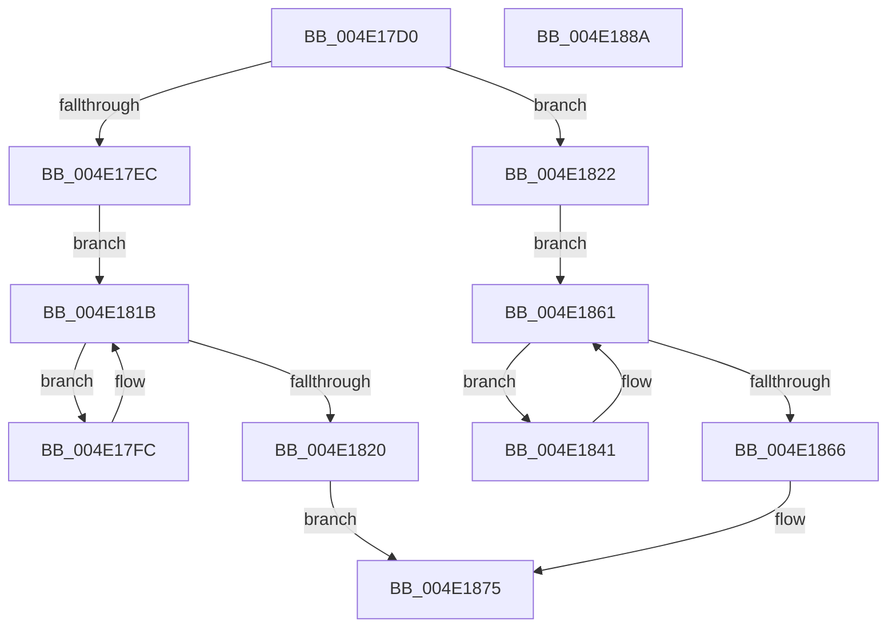

# HalpExtEnvMarkHiberRegions

- RVA: `0x004E17D0`–`0x004E188B` (길이 `187` bytes)
- VA: `0x00000001404E17D0`
- 실행 섹션: `.text`
- PDB 이름 있음: `예`; PDB Function 태그: `아니요`
- unwind 정보 RVA: `0x00066400`
- 디코드: `46`개 명령, `187/187` bytes 표시
- 미해석 바이트: `0` (있으면 어셈블리에 `.byte`로 보존)

> 이 문서는 커널 이미지의 기계어와 PDB 기호를 분석해 생성했습니다. 4번과 5번은 함수 원형과 자료형을 바이너리 사용 방식에서 추정한 C 해석이며 원본 소스 복구 결과는 아닙니다.

## 1. Dependencies

- 직접 호출 지점: **4**; 고유 호출 대상: **3**
- 직접 호출자로 확인된 함수: **1**
- RIP 상대 이미지 참조: **3**

### Outgoing calls
- `0x004E1813` → [PoSetHiberRange](../47/PoSetHiberRange_function_0047C580.md) (function, `0x0047C580`)
- `0x004E1829` → [KeAcquireSpinLockRaiseToDpc](../20/KeAcquireSpinLockRaiseToDpc_function_00208470.md) (function, `0x00208470`)
- `0x004E1859` → [PoSetHiberRange](../47/PoSetHiberRange_function_0047C580.md) (function, `0x0047C580`)
- `0x004E1870` → [KeReleaseSpinLock](../39/KeReleaseSpinLock_function_00392BA0.md) (function, `0x00392BA0`)

### Direct callers
- [HaliLocateHiberRanges](../../pagelk/B5/HaliLocateHiberRanges_function_00B5CE50.md) at `0x00B5CF47`
- [HaliLocateHiberRanges](../../pagelk/B5/HaliLocateHiberRanges_function_00B5CE50.md) at `0x00B5CF6E`

### Static image references
- `0x004E17EC` → RVA `0x00F8FC30` (`.data`; read)
- `0x004E1822` → RVA `0x00F8FC40` (`.data`; read)
- `0x004E182E` → RVA `0x00F8FC20` (`.data`; read)

## 2. Other-region calls and transfers

- 다른 실행 섹션으로 향하는 call: **0**
- 별도 외부 분기/꼬리 이동을 확인하지 못했습니다.

## 3. Assembly (complete function range)

```asm
004E17D0  48 89 5C 24 08                  mov qword ptr [rsp + 8], rbx
004E17D5  48 89 6C 24 10                  mov qword ptr [rsp + 0x10], rbp
004E17DA  48 89 74 24 18                  mov qword ptr [rsp + 0x18], rsi
004E17DF  57                              push rdi
004E17E0  48 83 EC 30                     sub rsp, 0x30
004E17E4  48 8B F9                        mov rdi, rcx
004E17E7  48 85 C9                        test rcx, rcx
004E17EA  75 36                           jne 0x1404e1822
004E17EC  48 8B 1D 3D E4 AA 00            mov rbx, qword ptr [rip + 0xaae43d]
004E17F3  48 8D 3D 36 E4 AA 00            lea rdi, [rip + 0xaae436]
004E17FA  EB 1F                           jmp 0x1404e181b
004E17FC  4C 8B 4B 28                     mov r9, qword ptr [rbx + 0x28]
004E1800  BA 00 00 01 00                  mov edx, 0x10000
004E1805  4C 8B 43 10                     mov r8, qword ptr [rbx + 0x10]
004E1809  33 C9                           xor ecx, ecx
004E180B  C7 44 24 20 48 61 6C 49         mov dword ptr [rsp + 0x20], 0x496c6148
004E1813  E8 68 AD F9 FF                  call 0x14047c580
004E1818  48 8B 1B                        mov rbx, qword ptr [rbx]
004E181B  48 3B DF                        cmp rbx, rdi
004E181E  75 DC                           jne 0x1404e17fc
004E1820  EB 53                           jmp 0x1404e1875
004E1822  48 8D 0D 17 E4 AA 00            lea rcx, [rip + 0xaae417]
004E1829  E8 42 6C D2 FF                  call 0x140208470
004E182E  48 8B 1D EB E3 AA 00            mov rbx, qword ptr [rip + 0xaae3eb]
004E1835  48 8D 2D E4 E3 AA 00            lea rbp, [rip + 0xaae3e4]
004E183C  40 8A F0                        mov sil, al
004E183F  EB 20                           jmp 0x1404e1861
004E1841  BA 02 00 00 00                  mov edx, 2
004E1846  C7 44 24 20 48 61 6C 49         mov dword ptr [rsp + 0x20], 0x496c6148
004E184E  4C 8D 43 10                     lea r8, [rbx + 0x10]
004E1852  48 8B CF                        mov rcx, rdi
004E1855  44 8D 4A 06                     lea r9d, [rdx + 6]
004E1859  E8 22 AD F9 FF                  call 0x14047c580
004E185E  48 8B 1B                        mov rbx, qword ptr [rbx]
004E1861  48 3B DD                        cmp rbx, rbp
004E1864  75 DB                           jne 0x1404e1841
004E1866  40 8A D6                        mov dl, sil
004E1869  48 8D 0D D0 E3 AA 00            lea rcx, [rip + 0xaae3d0]
004E1870  E8 2B 13 EB FF                  call 0x140392ba0
004E1875  48 8B 5C 24 40                  mov rbx, qword ptr [rsp + 0x40]
004E187A  48 8B 6C 24 48                  mov rbp, qword ptr [rsp + 0x48]
004E187F  48 8B 74 24 50                  mov rsi, qword ptr [rsp + 0x50]
004E1884  48 83 C4 30                     add rsp, 0x30
004E1888  5F                              pop rdi
004E1889  C3                              ret
004E188A  CC                              int3
```

## 4. C-style interpretation (structured pseudocode)

```c
__int64 __fastcall HalpExtEnvMarkHiberRegions(__int64 a1)
{
    __int64 result;
    __int64 v_rsp;
    unsigned int v_stack_m18;
    unsigned __int64 v_stack_p10;
    unsigned __int64 v_stack_p18;
    unsigned __int64 v_stack_p8;

    v_stack_p8 = v_rbx;
    v_stack_p10 = v_rbp;
    v_stack_p18 = v_rsi;
    v_rsp = (v_rsp) - (48);
    if (a1 != 0) goto loc_004E1822;
    goto loc_004E181B;
loc_004E17FC:
    a1 = 0;
    v_stack_m18 = 0x496C6148ULL;
    result = PoSetHiberRange(a1, (unsigned int)(0x10000ULL), *(unsigned __int64 *)(*(unsigned __int64 *)(v_rip + 11199549) + 16), *(unsigned __int64 *)(*(unsigned __int64 *)(v_rip + 11199549) + 40));
loc_004E181B:
    if ((*(unsigned __int64 *)(*(unsigned __int64 *)(v_rip + 11199549))) != (v_rip + 11199542)) goto loc_004E17FC;
    goto loc_004E1875;
loc_004E1822:
    result = KeAcquireSpinLockRaiseToDpc(v_rip + 11199511, (unsigned int)(0x10000ULL), *(unsigned __int64 *)(*(unsigned __int64 *)(v_rip + 11199549) + 16), *(unsigned __int64 *)(*(unsigned __int64 *)(v_rip + 11199549) + 40));
    goto loc_004E1861;
loc_004E1841:
    v_stack_m18 = 0x496C6148ULL;
    result = PoSetHiberRange(v_rip + 11199542, 2, *(unsigned __int64 *)(v_rip + 11199467) + 16, 2 + 6);
loc_004E1861:
    if ((*(unsigned __int64 *)(*(unsigned __int64 *)(v_rip + 11199467))) != (v_rip + 11199460)) goto loc_004E1841;
    result = KeReleaseSpinLock(v_rip + 11199440, (unsigned __int8)((unsigned __int8)(result)), *(unsigned __int64 *)(v_rip + 11199467) + 16, 2 + 6);
loc_004E1875:
    v_rsp = (v_rsp) + (48);
    return result;
}
```

## 5. (Beta) C Style

```c
int64_t HalpExtEnvMarkHiberRegions(int64_t Arg1)
{
    int64_t result;
    int64_t local_rsp;
    uint32_t v_stack_m18;
    uint64_t v_stack_p10;
    uint64_t v_stack_p18;
    uint64_t v_stack_p8;

    v_stack_p8 = local_rbx;
    v_stack_p10 = local_rbp;
    v_stack_p18 = local_rsi;
    local_rsp = (local_rsp) - (48);
    if (Arg1 != 0) goto loc_004E1822;
    goto loc_004E181B;
loc_004E17FC:
    Arg1 = 0;
    v_stack_m18 = 0x496C6148ULL;
    result = PoSetHiberRange(Arg1, (uint32_t)(0x10000ULL), *(uint64_t *)(*(uint64_t *)(v_rip + 0xAAE43D) + 0x10), *(uint64_t *)(*(uint64_t *)(v_rip + 0xAAE43D) + 0x28));
loc_004E181B:
    if ((*(uint64_t *)(*(uint64_t *)(v_rip + 0xAAE43D))) != (v_rip + 11199542)) goto loc_004E17FC;
    goto loc_004E1875;
loc_004E1822:
    result = KeAcquireSpinLockRaiseToDpc(v_rip + 11199511, (uint32_t)(0x10000ULL), *(uint64_t *)(*(uint64_t *)(v_rip + 0xAAE43D) + 0x10), *(uint64_t *)(*(uint64_t *)(v_rip + 0xAAE43D) + 0x28));
    goto loc_004E1861;
loc_004E1841:
    v_stack_m18 = 0x496C6148ULL;
    result = PoSetHiberRange(v_rip + 11199542, 2, *(uint64_t *)(v_rip + 0xAAE3EB) + 16, 2 + 6);
loc_004E1861:
    if ((*(uint64_t *)(*(uint64_t *)(v_rip + 0xAAE3EB))) != (v_rip + 11199460)) goto loc_004E1841;
    result = KeReleaseSpinLock(v_rip + 11199440, (uint8_t)((uint8_t)(result)), *(uint64_t *)(v_rip + 0xAAE3EB) + 16, 2 + 6);
loc_004E1875:
    local_rsp = (local_rsp) + (48);
    return result;
}
```

## 6. Execution-region graph

[열기: 2D/3D 그래프와 함수 탐색 컨트롤 패널](../../../control-panel.html?section=text&rva=0x004E17D0&view=graph)

- 2D 그래프는 위에서 아래로 흐르고, 3D 그래프는 빈 공간을 드래그해 회전합니다. Shift+드래그는 이동, 휠은 확대·축소, 함수 노드 선택은 대상 보고서 이동입니다.

### Static fallback


