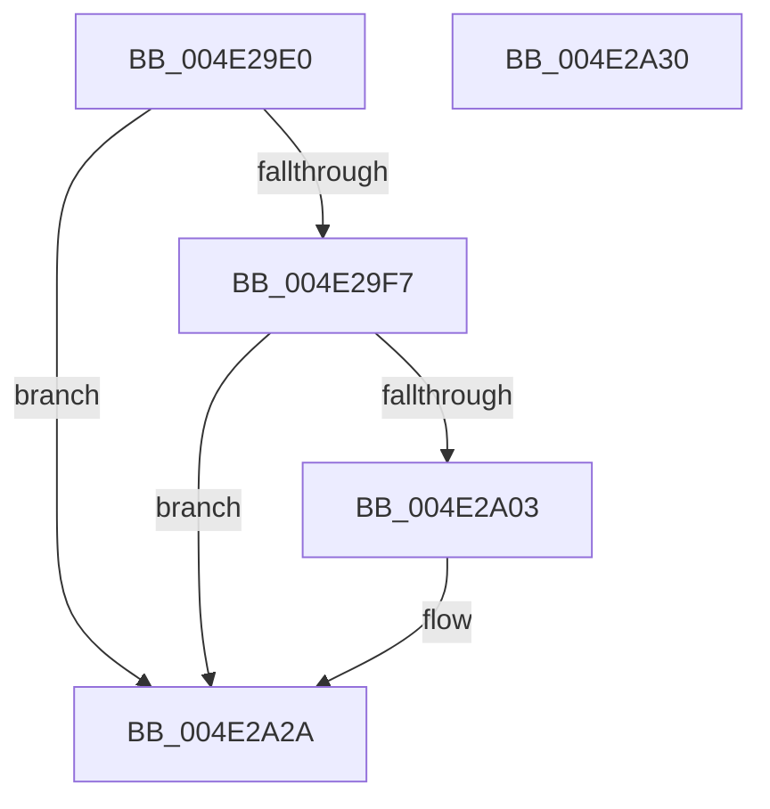

# HalpInterruptReinitializeThisProcessor

- RVA: `0x004E29E0`–`0x004E2A31` (길이 `81` bytes)
- VA: `0x00000001404E29E0`
- 실행 섹션: `.text`
- PDB 이름 있음: `예`; PDB Function 태그: `아니요`
- unwind 정보 RVA: `0x00064C80`
- 디코드: `22`개 명령, `81/81` bytes 표시
- 미해석 바이트: `0` (있으면 어셈블리에 `.byte`로 보존)

> 이 문서는 커널 이미지의 기계어와 PDB 기호를 분석해 생성했습니다. 4번과 5번은 함수 원형과 자료형을 바이너리 사용 방식에서 추정한 C 해석이며 원본 소스 복구 결과는 아닙니다.

## 1. Dependencies

- 직접 호출 지점: **2**; 고유 호출 대상: **2**
- 직접 호출자로 확인된 함수: **3**
- RIP 상대 이미지 참조: **2**

### Outgoing calls
- `0x004E29FA` → [HalpInterruptInitializeLocalUnit](../55/HalpInterruptInitializeLocalUnit_function_00557A2C.md) (function, `0x00557A2C`)
- `0x004E2A24` → [KeBugCheckEx](../4F/KeBugCheckEx_function_004FD660.md) (function, `0x004FD660`)

### Direct callers
- [HalpInitializeInterruptsPn](../54/HalpInitializeInterruptsPn_function_00543E38.md) at `0x00543F2C`
- [HalpPostSleepMP](../../pagelk/B5/HalpPostSleepMP_function_00B5ECC4.md) at `0x00B5ECEA`
- [HalpDpPostReplaceInitialization](../../pagelk/B5/HalpDpPostReplaceInitialization_function_00B5FE3C.md) at `0x00B5FE5C`

### Static image references
- `0x004E29E6` → RVA `0x00E101F0` (`.data`; read)
- `0x004E2A10` → RVA `0x00F90694` (`.data`; read)

## 2. Other-region calls and transfers

- 다른 실행 섹션으로 향하는 call: **0**
- 별도 외부 분기/꼬리 이동을 확인하지 못했습니다.

## 3. Assembly (complete function range)

```asm
004E29E0  40 53                           push rbx
004E29E2  48 83 EC 30                     sub rsp, 0x30
004E29E6  48 8B 1D 03 D8 92 00            mov rbx, qword ptr [rip + 0x92d803]
004E29ED  8B 83 F4 00 00 00               mov eax, dword ptr [rbx + 0xf4]
004E29F3  A8 01                           test al, 1
004E29F5  74 33                           je 0x1404e2a2a
004E29F7  48 8B CB                        mov rcx, rbx
004E29FA  E8 2D 50 07 00                  call 0x140557a2c
004E29FF  85 C0                           test eax, eax
004E2A01  79 27                           jns 0x1404e2a2a
004E2A03  65 8B 04 25 A4 01 00 00         mov eax, dword ptr gs:[0x1a4]
004E2A0B  BA 00 02 00 00                  mov edx, 0x200
004E2A10  4C 63 05 7D DC AA 00            movsxd r8, dword ptr [rip + 0xaadc7d]
004E2A17  B9 5C 00 00 00                  mov ecx, 0x5c
004E2A1C  44 8B C8                        mov r9d, eax
004E2A1F  48 89 5C 24 20                  mov qword ptr [rsp + 0x20], rbx
004E2A24  E8 37 AC 01 00                  call 0x1404fd660
004E2A29  CC                              int3
004E2A2A  48 83 C4 30                     add rsp, 0x30
004E2A2E  5B                              pop rbx
004E2A2F  C3                              ret
004E2A30  CC                              int3
```

## 4. C-style interpretation (structured pseudocode)

```c
__int64 __fastcall HalpInterruptReinitializeThisProcessor(void)
{
    __int64 result;
    __int64 v_rsp;
    unsigned __int64 v_stack_m18;

    v_rsp = (v_rsp) - (48);
    if ((((unsigned __int8)((unsigned int)(*(unsigned int *)(*(unsigned __int64 *)(v_rip + 9623555) + 244)))) & (1)) == 0) goto loc_004E2A2A;
    result = HalpInterruptInitializeLocalUnit(*(unsigned __int64 *)(v_rip + 9623555), a2, a3, a4);
    if (sign_flag) {
        result = *(unsigned int *)(gs_base + (0 + 420));
        a2 = 512;
        a3 = (int)(*(unsigned int *)(v_rip + 11197565));
        a1 = 92;
        a4 = (unsigned int)(result);
        v_stack_m18 = *(unsigned __int64 *)(v_rip + 9623555);
        result = KeBugCheckEx(a1, a2, a3, a4);
    }
    v_rsp = (v_rsp) + (48);
    return result;
}
```

## 5. (Beta) C Style

```c
void HalpInterruptReinitializeThisProcessor(void)
{
    int64_t result;
    int64_t local_rsp;
    uint64_t v_stack_m18;

    local_rsp = (local_rsp) - (48);
    if ((((uint8_t)((uint32_t)(*(uint32_t *)(*(uint64_t *)(v_rip + 0x92D803) + 0xF4)))) & (1)) == 0) goto loc_004E2A2A;
    result = HalpInterruptInitializeLocalUnit(*(uint64_t *)(v_rip + 0x92D803), a2, a3, a4);
    if (sign_flag) {
        result = *(uint32_t *)(gs_base + (0 + 0x1A4));
        a2 = 512;
        a3 = (int32_t)(*(uint32_t *)(v_rip + 0xAADC7D));
        a1 = 92;
        a4 = (uint32_t)(result);
        v_stack_m18 = *(uint64_t *)(v_rip + 0x92D803);
        result = KeBugCheckEx(a1, a2, a3, a4);
    }
    local_rsp = (local_rsp) + (48);
    return result;
}
```

## 6. Execution-region graph

[열기: 2D/3D 그래프와 함수 탐색 컨트롤 패널](../../../control-panel.html?section=text&rva=0x004E29E0&view=graph)

- 2D 그래프는 위에서 아래로 흐르고, 3D 그래프는 빈 공간을 드래그해 회전합니다. Shift+드래그는 이동, 휠은 확대·축소, 함수 노드 선택은 대상 보고서 이동입니다.

### Static fallback


