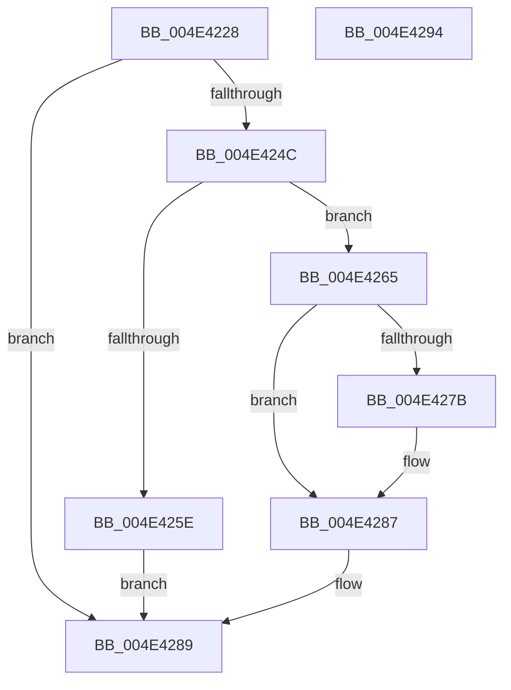

# HalpIommuCloneDeviceId

- RVA: `0x004E4228`–`0x004E4295` (길이 `109` bytes)
- VA: `0x00000001404E4228`
- 실행 섹션: `.text`
- PDB 이름 있음: `예`; PDB Function 태그: `아니요`
- unwind 정보 RVA: `0x0005CAAC`
- 디코드: `33`개 명령, `109/109` bytes 표시
- 미해석 바이트: `0` (있으면 어셈블리에 `.byte`로 보존)

> 이 문서는 커널 이미지의 기계어와 PDB 기호를 분석해 생성했습니다. 4번과 5번은 함수 원형과 자료형을 바이너리 사용 방식에서 추정한 C 해석이며 원본 소스 복구 결과는 아닙니다.

## 1. Dependencies

- 직접 호출 지점: **4**; 고유 호출 대상: **4**
- 직접 호출자로 확인된 함수: **2**
- RIP 상대 이미지 참조: **0**

### Outgoing calls
- `0x004E4243` → [IidGetDeviceIdBufferSize](../../page/AB/IidGetDeviceIdBufferSize_function_00ABBED0.md) (function, `0x00ABBED0`)
- `0x004E4251` → [HalpMmAllocCtxAlloc](../3E/HalpMmAllocCtxAlloc_function_003E10B8.md) (function, `0x003E10B8`)
- `0x004E4270` → [IidCloneDeviceId](../../page/82/IidCloneDeviceId_function_008289F8.md) (function, `0x008289F8`)
- `0x004E427E` → [HalpMmAllocCtxFree](../3E/HalpMmAllocCtxFree_function_003E1904.md) (function, `0x003E1904`)

### Direct callers
- [HalpIommuCreateDevice](../54/HalpIommuCreateDevice_function_0054ED60.md) at `0x0054F067`
- [HalpIommuCreateDevice](../54/HalpIommuCreateDevice_function_0054ED60.md) at `0x0054F0EB`
- [HalpIommuCreateDevice](../54/HalpIommuCreateDevice_function_0054ED60.md) at `0x0054F1D6`
- [HalpIommuCreateIncreaseAliasTrack](../55/HalpIommuCreateIncreaseAliasTrack_function_00554CB0.md) at `0x00554D43`

### Static image references
- 디코드된 RIP-relative 메모리 참조가 없습니다.

## 2. Other-region calls and transfers

- 다른 실행 섹션으로 향하는 call: **2**
  - `0x004E4243` → [IidGetDeviceIdBufferSize](../../page/AB/IidGetDeviceIdBufferSize_function_00ABBED0.md) (`.text` → `PAGE`)
  - `0x004E4270` → [IidCloneDeviceId](../../page/82/IidCloneDeviceId_function_008289F8.md) (`.text` → `PAGE`)
- 별도 외부 분기/꼬리 이동을 확인하지 못했습니다.

## 3. Assembly (complete function range)

```asm
004E4228  48 89 5C 24 08                  mov qword ptr [rsp + 8], rbx
004E422D  57                              push rdi
004E422E  48 83 EC 20                     sub rsp, 0x20
004E4232  48 83 64 24 40 00               and qword ptr [rsp + 0x40], 0
004E4238  48 8B DA                        mov rbx, rdx
004E423B  48 8D 54 24 40                  lea rdx, [rsp + 0x40]
004E4240  48 8B F9                        mov rdi, rcx
004E4243  E8 88 7C 5D 00                  call 0x140abbed0
004E4248  85 C0                           test eax, eax
004E424A  78 3D                           js 0x1404e4289
004E424C  48 8B 54 24 40                  mov rdx, qword ptr [rsp + 0x40]
004E4251  E8 62 CE EF FF                  call 0x1403e10b8
004E4256  48 89 03                        mov qword ptr [rbx], rax
004E4259  48 85 C0                        test rax, rax
004E425C  75 07                           jne 0x1404e4265
004E425E  B8 9A 00 00 C0                  mov eax, 0xc000009a
004E4263  EB 24                           jmp 0x1404e4289
004E4265  4C 8B 44 24 40                  mov r8, qword ptr [rsp + 0x40]
004E426A  48 8B D0                        mov rdx, rax
004E426D  48 8B CF                        mov rcx, rdi
004E4270  E8 83 47 34 00                  call 0x1408289f8
004E4275  8B F8                           mov edi, eax
004E4277  85 C0                           test eax, eax
004E4279  79 0C                           jns 0x1404e4287
004E427B  48 8B 13                        mov rdx, qword ptr [rbx]
004E427E  E8 81 D6 EF FF                  call 0x1403e1904
004E4283  48 83 23 00                     and qword ptr [rbx], 0
004E4287  8B C7                           mov eax, edi
004E4289  48 8B 5C 24 30                  mov rbx, qword ptr [rsp + 0x30]
004E428E  48 83 C4 20                     add rsp, 0x20
004E4292  5F                              pop rdi
004E4293  C3                              ret
004E4294  CC                              int3
```

## 4. C-style interpretation (structured pseudocode)

```c
__int64 __fastcall HalpIommuCloneDeviceId(__int64 a1, __int64 a2)
{
    __int64 result;
    __int64 v_rsp;
    unsigned __int64 v_stack_p18;
    unsigned __int64 v_stack_p8;

    v_stack_p8 = v_rbx;
    v_rsp = (v_rsp) - (32);
    result = IidGetDeviceIdBufferSize(a1, v_stack_p18, a3, a4);
    if (sign_flag) goto loc_004E4289;
    result = HalpMmAllocCtxAlloc(a1, v_stack_p18, a3, a4);
    *(unsigned __int64 *)(a2) = result;
    if (result != 0) goto loc_004E4265;
    goto loc_004E4289;
loc_004E4265:
    result = IidCloneDeviceId(a1, (unsigned int)(0xC000009AULL), v_stack_p18, a4);
    if (sign_flag) {
        a2 = *(unsigned __int64 *)(a2);
        result = HalpMmAllocCtxFree(a1, a2, v_stack_p18, a4);
    }
loc_004E4289:
    v_rsp = (v_rsp) + (32);
    return (unsigned int)((unsigned int)((unsigned int)((unsigned int)(result))));
}
```

## 5. (Beta) C Style

```c
int64_t HalpIommuCloneDeviceId(int64_t Arg1, void *Arg2)
{
    uint8_t *arg2 = (uint8_t *)Arg2;

    int64_t result;
    int64_t local_rsp;
    uint64_t v_stack_p18;
    uint64_t v_stack_p8;

    v_stack_p8 = local_rbx;
    local_rsp = (local_rsp) - (32);
    result = IidGetDeviceIdBufferSize(Arg1, v_stack_p18, a3, a4);
    if (sign_flag) goto loc_004E4289;
    result = HalpMmAllocCtxAlloc(Arg1, v_stack_p18, a3, a4);
    *(uint64_t *)(arg2) = result;
    if (result != 0) goto loc_004E4265;
    goto loc_004E4289;
loc_004E4265:
    result = IidCloneDeviceId(Arg1, (uint32_t)(0xC000009AULL), v_stack_p18, a4);
    if (sign_flag) {
        Arg2 = *(uint64_t *)(arg2);
        result = HalpMmAllocCtxFree(Arg1, Arg2, v_stack_p18, a4);
    }
loc_004E4289:
    local_rsp = (local_rsp) + (32);
    return (uint32_t)((uint32_t)((uint32_t)((uint32_t)(result))));
}
```

### 관측된 메모리 오프셋

구조체 형식이 확인되지 않은 접근은 인자 기준의 오프셋으로만 기록했습니다.

| 기준 인자 | 오프셋 표현 | 폭 (bit) | 접근 |
|---|---:|---:|---|
| `Arg2` | `+ 0x0` | `64` | `R` |
| `Arg2` | `+ 0x0` | `64` | `R/W` |
| `Arg2` | `+ 0x0` | `64` | `W` |

## 6. Execution-region graph

[열기: 2D/3D 그래프와 함수 탐색 컨트롤 패널](../../../control-panel.html?section=text&rva=0x004E4228&view=graph)

- 2D 그래프는 위에서 아래로 흐르고, 3D 그래프는 빈 공간을 드래그해 회전합니다. Shift+드래그는 이동, 휠은 확대·축소, 함수 노드 선택은 대상 보고서 이동입니다.

### Static fallback


