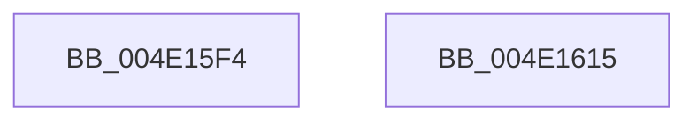

# HalpPassIrpFromFdoToPdo

- RVA: `0x004E15F4`–`0x004E1616` (길이 `34` bytes)
- VA: `0x00000001404E15F4`
- 실행 섹션: `.text`
- PDB 이름 있음: `예`; PDB Function 태그: `아니요`
- unwind 정보 RVA: `0x0005C788`
- 디코드: `9`개 명령, `34/34` bytes 표시
- 미해석 바이트: `0` (있으면 어셈블리에 `.byte`로 보존)

> 이 문서는 커널 이미지의 기계어와 PDB 기호를 분석해 생성했습니다. 4번과 5번은 함수 원형과 자료형을 바이너리 사용 방식에서 추정한 C 해석이며 원본 소스 복구 결과는 아닙니다.

## 1. Dependencies

- 직접 호출 지점: **1**; 고유 호출 대상: **1**
- 직접 호출자로 확인된 함수: **3**
- RIP 상대 이미지 참조: **0**

### Outgoing calls
- `0x004E160B` → [IofCallDriver](../29/IofCallDriver_function_0029B4B0.md) (function, `0x0029B4B0`)

### Direct callers
- [HalpDispatchWmi](../../page/70/HalpDispatchWmi_function_00708330.md) at `0x00708345`
- [sub_00B46B8A](../../page/B4/Unknown_function_00B46B8A.md) at `0x00B46BCC`
- [sub_00B811F2](../../pagelk/B8/Unknown_function_00B811F2.md) at `0x00B81225`

### Static image references
- 디코드된 RIP-relative 메모리 참조가 없습니다.

## 2. Other-region calls and transfers

- 다른 실행 섹션으로 향하는 call: **0**
- 별도 외부 분기/꼬리 이동을 확인하지 못했습니다.

## 3. Assembly (complete function range)

```asm
004E15F4  48 83 EC 28                     sub rsp, 0x28
004E15F8  48 8B 49 40                     mov rcx, qword ptr [rcx + 0x40]
004E15FC  FE 42 43                        inc byte ptr [rdx + 0x43]
004E15FF  48 83 82 B8 00 00 00 48         add qword ptr [rdx + 0xb8], 0x48
004E1607  48 8B 49 20                     mov rcx, qword ptr [rcx + 0x20]
004E160B  E8 A0 9E DB FF                  call 0x14029b4b0
004E1610  48 83 C4 28                     add rsp, 0x28
004E1614  C3                              ret
004E1615  CC                              int3
```

## 4. C-style interpretation (structured pseudocode)

```c
__int64 __fastcall HalpPassIrpFromFdoToPdo(__int64 a1, __int64 a2)
{
    __int64 result;
    __int64 v_rsp;

    v_rsp = (v_rsp) - (40);
    result = IofCallDriver(*(unsigned __int64 *)(*(unsigned __int64 *)(a1 + 64) + 32), a2, a3, a4);
    v_rsp = (v_rsp) + (40);
    return result;
}
```

## 5. (Beta) C Style

```c
int64_t HalpPassIrpFromFdoToPdo(void *Arg1, void *Arg2)
{
    uint8_t *arg1 = (uint8_t *)Arg1;
    uint8_t *arg2 = (uint8_t *)Arg2;

    int64_t result;
    int64_t local_rsp;

    local_rsp = (local_rsp) - (40);
    result = IofCallDriver(*(uint64_t *)(*(uint64_t *)(arg1 + 0x40) + 0x20), Arg2, a3, a4);
    local_rsp = (local_rsp) + (40);
    return result;
}
```

### 관측된 메모리 오프셋

구조체 형식이 확인되지 않은 접근은 인자 기준의 오프셋으로만 기록했습니다.

| 기준 인자 | 오프셋 표현 | 폭 (bit) | 접근 |
|---|---:|---:|---|
| `Arg1` | `+ 0x40` | `64` | `R` |
| `Arg2` | `+ 0x43` | `8` | `R/W` |
| `Arg2` | `+ 0xB8` | `64` | `R/W` |

## 6. Execution-region graph

[열기: 2D/3D 그래프와 함수 탐색 컨트롤 패널](../../../control-panel.html?section=text&rva=0x004E15F4&view=graph)

- 2D 그래프는 위에서 아래로 흐르고, 3D 그래프는 빈 공간을 드래그해 회전합니다. Shift+드래그는 이동, 휠은 확대·축소, 함수 노드 선택은 대상 보고서 이동입니다.

### Static fallback


