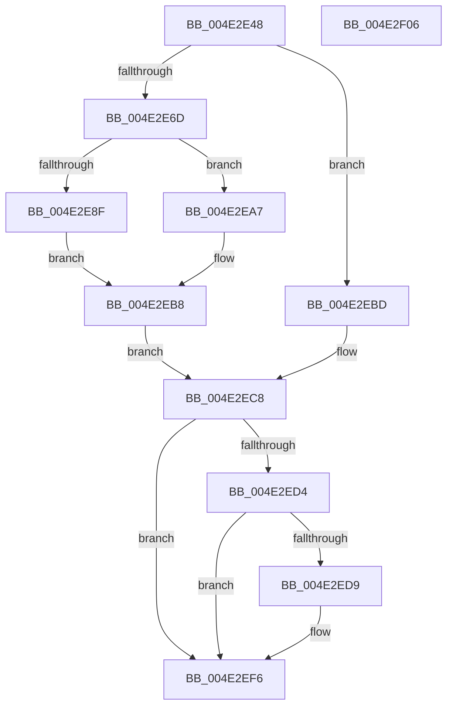

# HalpTimerGetSavedPerformanceCounter

- RVA: `0x004E2E48`–`0x004E2F07` (길이 `191` bytes)
- VA: `0x00000001404E2E48`
- 실행 섹션: `.text`
- PDB 이름 있음: `예`; PDB Function 태그: `아니요`
- unwind 정보 RVA: `0x00060BC4`
- 디코드: `47`개 명령, `191/191` bytes 표시
- 미해석 바이트: `0` (있으면 어셈블리에 `.byte`로 보존)

> 이 문서는 커널 이미지의 기계어와 PDB 기호를 분석해 생성했습니다. 4번과 5번은 함수 원형과 자료형을 바이너리 사용 방식에서 추정한 C 해석이며 원본 소스 복구 결과는 아닙니다.

## 1. Dependencies

- 직접 호출 지점: **2**; 고유 호출 대상: **1**
- 직접 호출자로 확인된 함수: **1**
- RIP 상대 이미지 참조: **3**

### Outgoing calls
- `0x004E2EA0` → [HalpTimerScaleCounter](../37/HalpTimerScaleCounter_function_0037B354.md) (function, `0x0037B354`)
- `0x004E2EF1` → [HalpTimerScaleCounter](../37/HalpTimerScaleCounter_function_0037B354.md) (function, `0x0037B354`)

### Direct callers
- [HalpAcpiPreSleep](../../pagelk/B7/HalpAcpiPreSleep_function_00B7BFD4.md) at `0x00B7C011`

### Static image references
- `0x004E2E57` → RVA `0x00FC3FD0` (`.data`; read)
- `0x004E2E83` → RVA `0x00FC40E0` (`.data`; read)
- `0x004E2EC8` → RVA `0x00FC3FC8` (`.data`; read)

## 2. Other-region calls and transfers

- 다른 실행 섹션으로 향하는 call: **0**
- 별도 외부 분기/꼬리 이동을 확인하지 못했습니다.

## 3. Assembly (complete function range)

```asm
004E2E48  48 89 5C 24 08                  mov qword ptr [rsp + 8], rbx
004E2E4D  48 89 74 24 10                  mov qword ptr [rsp + 0x10], rsi
004E2E52  57                              push rdi
004E2E53  48 83 EC 20                     sub rsp, 0x20
004E2E57  4C 8B 1D 72 11 AE 00            mov r11, qword ptr [rip + 0xae1172]
004E2E5E  BE 80 96 98 00                  mov esi, 0x989680
004E2E63  41 83 BB E4 00 00 00 05         cmp dword ptr [r11 + 0xe4], 5
004E2E6B  75 50                           jne 0x1404e2ebd
004E2E6D  49 8B 93 D0 00 00 00            mov rdx, qword ptr [r11 + 0xd0]
004E2E74  48 BF B8 03 00 00 80 F7 FF FF   movabs rdi, 0xfffff780000003b8
004E2E7E  8B DE                           mov ebx, esi
004E2E80  48 8B 3F                        mov rdi, qword ptr [rdi]
004E2E83  48 8B 05 56 12 AE 00            mov rax, qword ptr [rip + 0xae1256]
004E2E8A  48 85 C0                        test rax, rax
004E2E8D  75 18                           jne 0x1404e2ea7
004E2E8F  49 8B 4B 10                     mov rcx, qword ptr [r11 + 0x10]
004E2E93  44 8B C6                        mov r8d, esi
004E2E96  48 2B CA                        sub rcx, rdx
004E2E99  49 8B 93 C0 00 00 00            mov rdx, qword ptr [r11 + 0xc0]
004E2EA0  E8 AF 84 E9 FF                  call 0x14037b354
004E2EA5  EB 11                           jmp 0x1404e2eb8
004E2EA7  48 8B 40 08                     mov rax, qword ptr [rax + 8]
004E2EAB  49 8B 4B 10                     mov rcx, qword ptr [r11 + 0x10]
004E2EAF  48 2B CA                        sub rcx, rdx
004E2EB2  48 F7 E1                        mul rcx
004E2EB5  48 8B C2                        mov rax, rdx
004E2EB8  48 03 C7                        add rax, rdi
004E2EBB  EB 0B                           jmp 0x1404e2ec8
004E2EBD  49 8B 9B C0 00 00 00            mov rbx, qword ptr [r11 + 0xc0]
004E2EC4  49 8B 43 10                     mov rax, qword ptr [r11 + 0x10]
004E2EC8  48 8B 0D F9 10 AE 00            mov rcx, qword ptr [rip + 0xae10f9]
004E2ECF  4C 3B D9                        cmp r11, rcx
004E2ED2  74 22                           je 0x1404e2ef6
004E2ED4  48 85 C9                        test rcx, rcx
004E2ED7  74 1D                           je 0x1404e2ef6
004E2ED9  83 B9 E4 00 00 00 05            cmp dword ptr [rcx + 0xe4], 5
004E2EE0  48 8B D3                        mov rdx, rbx
004E2EE3  4C 8B 81 C0 00 00 00            mov r8, qword ptr [rcx + 0xc0]
004E2EEA  48 8B C8                        mov rcx, rax
004E2EED  4C 0F 44 C6                     cmove r8, rsi
004E2EF1  E8 5E 84 E9 FF                  call 0x14037b354
004E2EF6  48 8B 5C 24 30                  mov rbx, qword ptr [rsp + 0x30]
004E2EFB  48 8B 74 24 38                  mov rsi, qword ptr [rsp + 0x38]
004E2F00  48 83 C4 20                     add rsp, 0x20
004E2F04  5F                              pop rdi
004E2F05  C3                              ret
004E2F06  CC                              int3
```

## 4. C-style interpretation (structured pseudocode)

```c
__int64 __fastcall HalpTimerGetSavedPerformanceCounter(void)
{
    __int64 result;
    __int64 v_rsp;
    unsigned __int64 v_stack_p10;
    unsigned __int64 v_stack_p8;

    v_stack_p8 = v_rbx;
    v_stack_p10 = v_rsi;
    v_rsp = (v_rsp) - (32);
    if ((*(unsigned int *)(*(unsigned __int64 *)(v_rip + 11407730) + 228)) != 5) goto loc_004E2EBD;
    if (*(unsigned __int64 *)(v_rip + 11407958) != 0) goto loc_004E2EA7;
    a1 = (*(unsigned __int64 *)(*(unsigned __int64 *)(v_rip + 11407730) + 16)) - (*(unsigned __int64 *)(*(unsigned __int64 *)(v_rip + 11407730) + 208));
    result = HalpTimerScaleCounter(a1, *(unsigned __int64 *)(*(unsigned __int64 *)(v_rip + 11407730) + 192), (unsigned int)((unsigned int)((unsigned int)(0x989680ULL))), a4);
    goto loc_004E2EB8;
loc_004E2EA7:
    a1 = (*(unsigned __int64 *)(*(unsigned __int64 *)(v_rip + 11407730) + 16)) - (*(unsigned __int64 *)(*(unsigned __int64 *)(v_rip + 11407730) + 192));
loc_004E2EB8:
    result = (*(unsigned __int64 *)(*(unsigned __int64 *)(v_rip + 11407730) + 192)) + (*(unsigned __int64 *)(v_rdi));
    goto loc_004E2EC8;
loc_004E2EBD:
loc_004E2EC8:
    if ((*(unsigned __int64 *)(v_rip + 11407730)) == (*(unsigned __int64 *)(v_rip + 11407609))) goto loc_004E2EF6;
    result = *(unsigned __int64 *)(*(unsigned __int64 *)(v_rip + 11407730) + 16);
    if (*(unsigned __int64 *)(v_rip + 11407609) != 0) {
        a2 = *(unsigned __int64 *)(*(unsigned __int64 *)(v_rip + 11407730) + 192);
        a3 = *(unsigned __int64 *)(*(unsigned __int64 *)(v_rip + 11407609) + 192);
        a1 = *(unsigned __int64 *)(*(unsigned __int64 *)(v_rip + 11407730) + 16);
        if ((*(unsigned int *)(*(unsigned __int64 *)(v_rip + 11407609) + 228)) == 5) { a3 = (unsigned int)(0x989680ULL); }
        result = HalpTimerScaleCounter(a1, a2, a3, a4);
    }
    v_rsp = (v_rsp) + (32);
    return result;
}
```

## 5. (Beta) C Style

```c
void HalpTimerGetSavedPerformanceCounter(void)
{
    int64_t result;
    int64_t local_rsp;
    uint64_t v_stack_p10;
    uint64_t v_stack_p8;

    v_stack_p8 = local_rbx;
    v_stack_p10 = local_rsi;
    local_rsp = (local_rsp) - (32);
    if ((*(uint32_t *)(*(uint64_t *)(v_rip + 0xAE1172) + 0xE4)) != 5) goto loc_004E2EBD;
    if (*(uint64_t *)(v_rip + 0xAE1256) != 0) goto loc_004E2EA7;
    a1 = (*(uint64_t *)(*(uint64_t *)(v_rip + 0xAE1172) + 0x10)) - (*(uint64_t *)(*(uint64_t *)(v_rip + 0xAE1172) + 0xD0));
    result = HalpTimerScaleCounter(a1, *(uint64_t *)(*(uint64_t *)(v_rip + 0xAE1172) + 0xC0), (uint32_t)((uint32_t)((uint32_t)(0x989680ULL))), a4);
    goto loc_004E2EB8;
loc_004E2EA7:
    a1 = (*(uint64_t *)(*(uint64_t *)(v_rip + 0xAE1172) + 0x10)) - (*(uint64_t *)(*(uint64_t *)(v_rip + 0xAE1172) + 0xC0));
loc_004E2EB8:
    result = (*(uint64_t *)(*(uint64_t *)(v_rip + 0xAE1172) + 0xC0)) + (*(uint64_t *)(local_rdi));
    goto loc_004E2EC8;
loc_004E2EBD:
loc_004E2EC8:
    if ((*(uint64_t *)(v_rip + 0xAE1172)) == (*(uint64_t *)(v_rip + 0xAE10F9))) goto loc_004E2EF6;
    result = *(uint64_t *)(*(uint64_t *)(v_rip + 0xAE1172) + 0x10);
    if (*(uint64_t *)(v_rip + 0xAE10F9) != 0) {
        a2 = *(uint64_t *)(*(uint64_t *)(v_rip + 0xAE1172) + 0xC0);
        a3 = *(uint64_t *)(*(uint64_t *)(v_rip + 0xAE10F9) + 0xC0);
        a1 = *(uint64_t *)(*(uint64_t *)(v_rip + 0xAE1172) + 0x10);
        if ((*(uint32_t *)(*(uint64_t *)(v_rip + 0xAE10F9) + 0xE4)) == 5) { a3 = (uint32_t)(0x989680ULL); }
        result = HalpTimerScaleCounter(a1, a2, a3, a4);
    }
    local_rsp = (local_rsp) + (32);
    return result;
}
```

## 6. Execution-region graph

[열기: 2D/3D 그래프와 함수 탐색 컨트롤 패널](../../../control-panel.html?section=text&rva=0x004E2E48&view=graph)

- 2D 그래프는 위에서 아래로 흐르고, 3D 그래프는 빈 공간을 드래그해 회전합니다. Shift+드래그는 이동, 휠은 확대·축소, 함수 노드 선택은 대상 보고서 이동입니다.

### Static fallback


