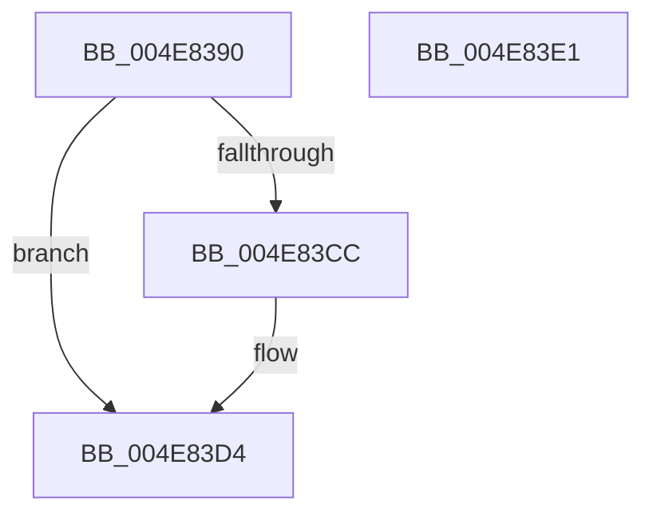

# IoTryQueueWorkItem

- RVA: `0x004E8390`–`0x004E83E2` (길이 `82` bytes)
- VA: `0x00000001404E8390`
- 실행 섹션: `.text`
- PDB 이름 있음: `예`; PDB Function 태그: `아니요`
- unwind 정보 RVA: `0x0005CAAC`
- 디코드: `25`개 명령, `82/82` bytes 표시
- 미해석 바이트: `0` (있으면 어셈블리에 `.byte`로 보존)

> 이 문서는 커널 이미지의 기계어와 PDB 기호를 분석해 생성했습니다. 4번과 5번은 함수 원형과 자료형을 바이너리 사용 방식에서 추정한 C 해석이며 원본 소스 복구 결과는 아닙니다.

## 1. Dependencies

- 직접 호출 지점: **3**; 고유 호출 대상: **3**
- 직접 호출자로 확인된 함수: **0**
- RIP 상대 이미지 참조: **1**

### Outgoing calls
- `0x004E83A5` → [IopQueueWorkItemProlog](../43/IopQueueWorkItemProlog_function_0043C9B0.md) (function, `0x0043C9B0`)
- `0x004E83C1` → [ExpTryQueueWorkItem](../39/ExpTryQueueWorkItem_function_0039801C.md) (function, `0x0039801C`)
- `0x004E83CF` → [IopQueueWorkItemNotInsertedEpilog](../59/IopQueueWorkItemNotInsertedEpilog_function_00598404.md) (function, `0x00598404`)

### Direct callers
- 이 함수 시작 RVA로 연결되는 직접 call은 확인되지 않았습니다. 간접 호출은 완전히 역산할 수 없습니다.

### Static image references
- `0x004E83AA` → RVA `0x00FC6EA0` (`ALMOSTRO`; read)

## 2. Other-region calls and transfers

- 다른 실행 섹션으로 향하는 call: **0**
- 별도 외부 분기/꼬리 이동을 확인하지 못했습니다.

## 3. Assembly (complete function range)

```asm
004E8390  48 89 5C 24 08                  mov qword ptr [rsp + 8], rbx
004E8395  57                              push rdi
004E8396  48 83 EC 20                     sub rsp, 0x20
004E839A  41 8B D8                        mov ebx, r8d
004E839D  48 8B F9                        mov rdi, rcx
004E83A0  4C 8B C2                        mov r8, rdx
004E83A3  8B D3                           mov edx, ebx
004E83A5  E8 06 46 F5 FF                  call 0x14043c9b0
004E83AA  48 8B 0D EF EA AD 00            mov rcx, qword ptr [rip + 0xadeaef]
004E83B1  41 B9 01 00 00 00               mov r9d, 1
004E83B7  44 8B C3                        mov r8d, ebx
004E83BA  48 8B D0                        mov rdx, rax
004E83BD  48 8B 49 10                     mov rcx, qword ptr [rcx + 0x10]
004E83C1  E8 56 FC EA FF                  call 0x14039801c
004E83C6  8A D8                           mov bl, al
004E83C8  84 C0                           test al, al
004E83CA  75 08                           jne 0x1404e83d4
004E83CC  48 8B CF                        mov rcx, rdi
004E83CF  E8 30 00 0B 00                  call 0x140598404
004E83D4  8A C3                           mov al, bl
004E83D6  48 8B 5C 24 30                  mov rbx, qword ptr [rsp + 0x30]
004E83DB  48 83 C4 20                     add rsp, 0x20
004E83DF  5F                              pop rdi
004E83E0  C3                              ret
004E83E1  CC                              int3
```

## 4. C-style interpretation (structured pseudocode)

```c
__int64 __fastcall IoTryQueueWorkItem(__int64 a1, __int64 a2, int a3)
{
    __int64 result;
    __int64 v_rsp;
    unsigned __int64 v_stack_p8;

    v_stack_p8 = v_rbx;
    v_rsp = (v_rsp) - (32);
    result = IopQueueWorkItemProlog(a1, (unsigned int)((unsigned int)((unsigned int)(a3))), a2, a4);
    result = ExpTryQueueWorkItem(*(unsigned __int64 *)(*(unsigned __int64 *)(v_rip + 11397871) + 16), result, (unsigned int)((unsigned int)((unsigned int)(a3))), 1);
    if ((unsigned __int8)(result) == 0) {
        a1 = a1;
        result = IopQueueWorkItemNotInsertedEpilog(a1, result, (unsigned int)((unsigned int)((unsigned int)(a3))), 1);
    }
    v_rsp = (v_rsp) + (32);
    return (unsigned __int8)((unsigned __int8)(result));
}
```

## 5. (Beta) C Style

```c
int64_t IoTryQueueWorkItem(int64_t Arg1, int64_t Arg2, int32_t Arg3)
{
    int64_t result;
    int64_t local_rsp;
    uint64_t v_stack_p8;

    v_stack_p8 = local_rbx;
    local_rsp = (local_rsp) - (32);
    result = IopQueueWorkItemProlog(Arg1, (uint32_t)((uint32_t)((uint32_t)(Arg3))), Arg2, a4);
    result = ExpTryQueueWorkItem(*(uint64_t *)(*(uint64_t *)(v_rip + 0xADEAEF) + 0x10), result, (uint32_t)((uint32_t)((uint32_t)(Arg3))), 1);
    if ((uint8_t)(result) == 0) {
        Arg1 = Arg1;
        result = IopQueueWorkItemNotInsertedEpilog(Arg1, result, (uint32_t)((uint32_t)((uint32_t)(Arg3))), 1);
    }
    local_rsp = (local_rsp) + (32);
    return (uint8_t)((uint8_t)(result));
}
```

## 6. Execution-region graph

[열기: 2D/3D 그래프와 함수 탐색 컨트롤 패널](../../../control-panel.html?section=text&rva=0x004E8390&view=graph)

- 2D 그래프는 위에서 아래로 흐르고, 3D 그래프는 빈 공간을 드래그해 회전합니다. Shift+드래그는 이동, 휠은 확대·축소, 함수 노드 선택은 대상 보고서 이동입니다.

### Static fallback


