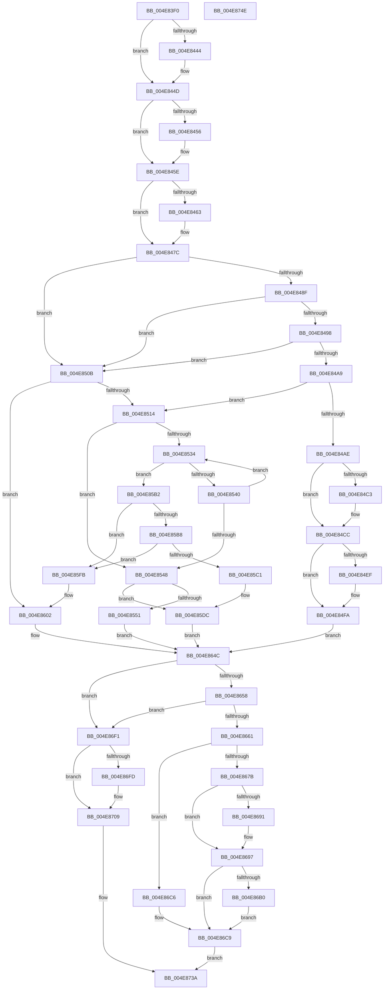

# IopCopyCompleteReadIrp

- RVA: `0x004E83F0`–`0x004E874F` (길이 `863` bytes)
- VA: `0x00000001404E83F0`
- 실행 섹션: `.text`
- PDB 이름 있음: `예`; PDB Function 태그: `아니요`
- unwind 정보 RVA: `0x000BECA4`
- 디코드: `226`개 명령, `863/863` bytes 표시
- 미해석 바이트: `0` (있으면 어셈블리에 `.byte`로 보존)

> 이 문서는 커널 이미지의 기계어와 PDB 기호를 분석해 생성했습니다. 4번과 5번은 함수 원형과 자료형을 바이너리 사용 방식에서 추정한 C 해석이며 원본 소스 복구 결과는 아닙니다.

## 1. Dependencies

- 직접 호출 지점: **21**; 고유 호출 대상: **18**
- 직접 호출자로 확인된 함수: **0**
- RIP 상대 이미지 참조: **5**

### Outgoing calls
- `0x004E8444` → [IopUnlockAndFreeMdl](../29/IopUnlockAndFreeMdl_function_0029F200.md) (function, `0x0029F200`)
- `0x004E844D` → [Feature_1042264378__private_IsEnabledDeviceUsageNoInline](../59/Feature_1042264378__private_IsEnabledDeviceUsageNoInline_function_005989BC.md) (function, `0x005989BC`)
- `0x004E8459` → [IopProcessBufferedIoCompletion](../3E/IopProcessBufferedIoCompletion_function_003ED220.md) (function, `0x003ED220`)
- `0x004E846D` → [KeAcquireSpinLockRaiseToDpc](../20/KeAcquireSpinLockRaiseToDpc_function_00208470.md) (function, `0x00208470`)
- `0x004E8477` → [KeReleaseSpinLock](../39/KeReleaseSpinLock_function_00392BA0.md) (function, `0x00392BA0`)
- `0x004E848F` → [KeAreAllApcsDisabled](../2F/KeAreAllApcsDisabled_function_002F7AC0.md) (function, `0x002F7AC0`)
- `0x004E84C7` → [KiRaiseIrqlProcessIrqlFlags](../4F/KiRaiseIrqlProcessIrqlFlags_function_004F56FC.md) (function, `0x004F56FC`)
- `0x004E84E2` → [IopCopyCompleteReadRequest](IopCopyCompleteReadRequest_function_004E8760.md) (function, `0x004E8760`)
- `0x004E84F5` → [KiLowerIrqlProcessIrqlFlags](../4F/KiLowerIrqlProcessIrqlFlags_function_004F5698.md) (function, `0x004F5698`)
- `0x004E8519` → [KeAcquireQueuedSpinLock](../27/KeAcquireQueuedSpinLock_function_00273D80.md) (function, `0x00273D80`)
- `0x004E857F` → [KeInitializeApc](../42/KeInitializeApc_function_00428510.md) (function, `0x00428510`)
- `0x004E859B` → [KeInsertQueueApc](../20/KeInsertQueueApc_function_00203F10.md) (function, `0x00203F10`)
- `0x004E85A8` → [KeReleaseQueuedSpinLock](../27/KeReleaseQueuedSpinLock_function_00272540.md) (function, `0x00272540`)
- `0x004E85D7` → [ObfDereferenceObjectWithTag](../2F/ObfDereferenceObjectWithTag_function_002F78E0.md) (function, `0x002F78E0`)
- `0x004E85E4` → [KeReleaseQueuedSpinLock](../27/KeReleaseQueuedSpinLock_function_00272540.md) (function, `0x00272540`)
- `0x004E85F4` → [IopDropIrp](../21/IopDropIrp_function_002107B0.md) (function, `0x002107B0`)
- `0x004E8630` → [KeInitializeApc](../42/KeInitializeApc_function_00428510.md) (function, `0x00428510`)
- `0x004E8647` → [KeInsertQueueApc](../20/KeInsertQueueApc_function_00203F10.md) (function, `0x00203F10`)
- `0x004E86BF` → [memset](../6C/memset_function_006C6C40.md) (function, `0x006C6C40`)
- `0x004E86E5` → [ExQueueWorkItem](../2F/ExQueueWorkItem_function_002F9520.md) (function, `0x002F9520`)
- `0x004E8735` → [IopFreeIrpExtension](../24/IopFreeIrpExtension_function_0024EDB0.md) (function, `0x0024EDB0`)

### Direct callers
- 이 함수 시작 RVA로 연결되는 직접 call은 확인되지 않았습니다. 간접 호출은 완전히 역산할 수 없습니다.

### Static image references
- `0x004E84BB` → RVA `0x00FC6D20` (`ALMOSTRO`; read)
- `0x004E851E` → RVA `0x00F8D470` (`.data`; read)
- `0x004E8556` → RVA `0x00598A70` (`IopCopyAbortCopyReadRequest`; read)
- `0x004E8562` → RVA `0x004E8760` (`IopCopyCompleteReadRequest`; read)
- `0x004E86CC` → RVA `0x00492EA0` (`IopQueueCopyWrite`; read)

## 2. Other-region calls and transfers

- 다른 실행 섹션으로 향하는 call: **0**
- 별도 외부 분기/꼬리 이동을 확인하지 못했습니다.

## 3. Assembly (complete function range)

```asm
004E83F0  44 89 44 24 18                  mov dword ptr [rsp + 0x18], r8d
004E83F5  48 89 54 24 10                  mov qword ptr [rsp + 0x10], rdx
004E83FA  48 89 4C 24 08                  mov qword ptr [rsp + 8], rcx
004E83FF  53                              push rbx
004E8400  55                              push rbp
004E8401  56                              push rsi
004E8402  57                              push rdi
004E8403  41 54                           push r12
004E8405  41 55                           push r13
004E8407  41 56                           push r14
004E8409  41 57                           push r15
004E840B  48 83 EC 58                     sub rsp, 0x58
004E840F  48 8B 29                        mov rbp, qword ptr [rcx]
004E8412  33 FF                           xor edi, edi
004E8414  45 8B E8                        mov r13d, r8d
004E8417  8B 45 30                        mov eax, dword ptr [rbp + 0x30]
004E841A  48 8B 4D 08                     mov rcx, qword ptr [rbp + 8]
004E841E  44 8B 7D 38                     mov r15d, dword ptr [rbp + 0x38]
004E8422  44 8A 65 44                     mov r12b, byte ptr [rbp + 0x44]
004E8426  4C 8B B5 98 00 00 00            mov r14, qword ptr [rbp + 0x98]
004E842D  48 8B 75 70                     mov rsi, qword ptr [rbp + 0x70]
004E8431  89 44 24 40                     mov dword ptr [rsp + 0x40], eax
004E8435  8A 45 41                        mov al, byte ptr [rbp + 0x41]
004E8438  88 84 24 B8 00 00 00            mov byte ptr [rsp + 0xb8], al
004E843F  48 85 C9                        test rcx, rcx
004E8442  74 09                           je 0x1404e844d
004E8444  E8 B7 6D DB FF                  call 0x14029f200
004E8449  48 89 7D 08                     mov qword ptr [rbp + 8], rdi
004E844D  E8 6A 05 0B 00                  call 0x1405989bc
004E8452  85 C0                           test eax, eax
004E8454  74 08                           je 0x1404e845e
004E8456  48 8B CD                        mov rcx, rbp
004E8459  E8 C2 4D F0 FF                  call 0x1403ed220
004E845E  4D 85 F6                        test r14, r14
004E8461  74 19                           je 0x1404e847c
004E8463  49 8D 9E 18 06 00 00            lea rbx, [r14 + 0x618]
004E846A  48 8B CB                        mov rcx, rbx
004E846D  E8 FE FF D1 FF                  call 0x140208470
004E8472  8A D0                           mov dl, al
004E8474  48 8B CB                        mov rcx, rbx
004E8477  E8 24 A7 EA FF                  call 0x140392ba0
004E847C  65 48 8B 04 25 88 01 00 00      mov rax, qword ptr gs:[0x188]
004E8485  BB 01 00 00 00                  mov ebx, 1
004E848A  4C 3B F0                        cmp r14, rax
004E848D  75 7C                           jne 0x1404e850b
004E848F  E8 2C F6 E0 FF                  call 0x1402f7ac0
004E8494  84 C0                           test al, al
004E8496  75 73                           jne 0x1404e850b
004E8498  65 48 8B 04 25 88 01 00 00      mov rax, qword ptr gs:[0x188]
004E84A1  38 98 4A 02 00 00               cmp byte ptr [rax + 0x24a], bl
004E84A7  74 62                           je 0x1404e850b
004E84A9  45 84 E4                        test r12b, r12b
004E84AC  75 66                           jne 0x1404e8514
004E84AE  44 0F 20 C3                     mov rbx, cr8
004E84B2  B8 01 00 00 00                  mov eax, 1
004E84B7  44 0F 22 C0                     mov cr8, rax
004E84BB  39 3D 5F E8 AD 00               cmp dword ptr [rip + 0xade85f], edi
004E84C1  74 09                           je 0x1404e84cc
004E84C3  8A D0                           mov dl, al
004E84C5  8A CB                           mov cl, bl
004E84C7  E8 30 D2 00 00                  call 0x1404f56fc
004E84CC  48 8D 4D 78                     lea rcx, [rbp + 0x78]
004E84D0  48 89 7C 24 20                  mov qword ptr [rsp + 0x20], rdi
004E84D5  4C 8D 8C 24 A8 00 00 00         lea r9, [rsp + 0xa8]
004E84DD  45 33 C0                        xor r8d, r8d
004E84E0  33 D2                           xor edx, edx
004E84E2  E8 79 02 00 00                  call 0x1404e8760
004E84E7  39 3D 33 E8 AD 00               cmp dword ptr [rip + 0xade833], edi
004E84ED  74 0B                           je 0x1404e84fa
004E84EF  44 0F 20 C1                     mov rcx, cr8
004E84F3  8A D3                           mov dl, bl
004E84F5  E8 9E D1 00 00                  call 0x1404f5698
004E84FA  0F B6 C3                        movzx eax, bl
004E84FD  44 0F 22 C0                     mov cr8, rax
004E8501  BB 01 00 00 00                  mov ebx, 1
004E8506  E9 41 01 00 00                  jmp 0x1404e864c
004E850B  45 84 E4                        test r12b, r12b
004E850E  0F 84 EE 00 00 00               je 0x1404e8602
004E8514  B9 0B 00 00 00                  mov ecx, 0xb
004E8519  E8 62 B8 D8 FF                  call 0x140273d80
004E851E  48 8B 15 4B 4F AA 00            mov rdx, qword ptr [rip + 0xaa4f4b]
004E8525  44 8A E8                        mov r13b, al
004E8528  48 8D 05 41 4F AA 00            lea rax, [rip + 0xaa4f41]
004E852F  48 3B D0                        cmp rdx, rax
004E8532  74 14                           je 0x1404e8548
004E8534  4C 8B 02                        mov r8, qword ptr [rdx]
004E8537  48 8D 4A E0                     lea rcx, [rdx - 0x20]
004E853B  48 3B CD                        cmp rcx, rbp
004E853E  74 72                           je 0x1404e85b2
004E8540  49 8B D0                        mov rdx, r8
004E8543  4C 3B C0                        cmp r8, rax
004E8546  75 EC                           jne 0x1404e8534
004E8548  4D 85 F6                        test r14, r14
004E854B  0F 84 8B 00 00 00               je 0x1404e85dc
004E8551  44 0F BE 45 46                  movsx r8d, byte ptr [rbp + 0x46]
004E8556  48 8D 05 13 05 0B 00            lea rax, [rip + 0xb0513]
004E855D  48 89 7C 24 38                  mov qword ptr [rsp + 0x38], rdi
004E8562  4C 8D 0D F7 01 00 00            lea r9, [rip + 0x1f7]
004E8569  40 88 7C 24 30                  mov byte ptr [rsp + 0x30], dil
004E856E  48 8D 4D 78                     lea rcx, [rbp + 0x78]
004E8572  48 89 7C 24 28                  mov qword ptr [rsp + 0x28], rdi
004E8577  49 8B D6                        mov rdx, r14
004E857A  48 89 44 24 20                  mov qword ptr [rsp + 0x20], rax
004E857F  E8 8C FF F3 FF                  call 0x140428510
004E8584  44 8B 8C 24 B0 00 00 00         mov r9d, dword ptr [rsp + 0xb0]
004E858C  48 8D 4D 78                     lea rcx, [rbp + 0x78]
004E8590  48 8B 94 24 A8 00 00 00         mov rdx, qword ptr [rsp + 0xa8]
004E8598  45 33 C0                        xor r8d, r8d
004E859B  E8 70 B9 D1 FF                  call 0x140203f10
004E85A0  41 8A D5                        mov dl, r13b
004E85A3  B9 0B 00 00 00                  mov ecx, 0xb
004E85A8  E8 93 9F D8 FF                  call 0x140272540
004E85AD  E9 9A 00 00 00                  jmp 0x1404e864c
004E85B2  49 39 50 08                     cmp qword ptr [r8 + 8], rdx
004E85B6  75 43                           jne 0x1404e85fb
004E85B8  48 8B 42 08                     mov rax, qword ptr [rdx + 8]
004E85BC  48 39 10                        cmp qword ptr [rax], rdx
004E85BF  75 3A                           jne 0x1404e85fb
004E85C1  4C 89 00                        mov qword ptr [rax], r8
004E85C4  49 8B CE                        mov rcx, r14
004E85C7  49 89 40 08                     mov qword ptr [r8 + 8], rax
004E85CB  48 89 52 08                     mov qword ptr [rdx + 8], rdx
004E85CF  48 89 12                        mov qword ptr [rdx], rdx
004E85D2  BA 44 66 6C 74                  mov edx, 0x746c6644
004E85D7  E8 04 F3 E0 FF                  call 0x1402f78e0
004E85DC  41 8A D5                        mov dl, r13b
004E85DF  B9 0B 00 00 00                  mov ecx, 0xb
004E85E4  E8 57 9F D8 FF                  call 0x140272540
004E85E9  48 8B 94 24 A8 00 00 00         mov rdx, qword ptr [rsp + 0xa8]
004E85F1  48 8B CD                        mov rcx, rbp
004E85F4  E8 B7 81 D2 FF                  call 0x1402107b0
004E85F9  EB 51                           jmp 0x1404e864c
004E85FB  B9 03 00 00 00                  mov ecx, 3
004E8600  CD 29                           int 0x29
004E8602  44 0F BE 45 46                  movsx r8d, byte ptr [rbp + 0x46]
004E8607  48 8D 05 62 04 0B 00            lea rax, [rip + 0xb0462]
004E860E  48 89 7C 24 38                  mov qword ptr [rsp + 0x38], rdi
004E8613  4C 8D 0D 46 01 00 00            lea r9, [rip + 0x146]
004E861A  40 88 7C 24 30                  mov byte ptr [rsp + 0x30], dil
004E861F  48 8D 4D 78                     lea rcx, [rbp + 0x78]
004E8623  48 89 7C 24 28                  mov qword ptr [rsp + 0x28], rdi
004E8628  49 8B D6                        mov rdx, r14
004E862B  48 89 44 24 20                  mov qword ptr [rsp + 0x20], rax
004E8630  E8 DB FE F3 FF                  call 0x140428510
004E8635  48 8B 94 24 A8 00 00 00         mov rdx, qword ptr [rsp + 0xa8]
004E863D  48 8D 4D 78                     lea rcx, [rbp + 0x78]
004E8641  45 8B CD                        mov r9d, r13d
004E8644  45 33 C0                        xor r8d, r8d
004E8647  E8 C4 B8 D1 FF                  call 0x140203f10
004E864C  8B 54 24 40                     mov edx, dword ptr [rsp + 0x40]
004E8650  85 D2                           test edx, edx
004E8652  0F 88 99 00 00 00               js 0x1404e86f1
004E8658  45 84 E4                        test r12b, r12b
004E865B  0F 85 90 00 00 00               jne 0x1404e86f1
004E8661  48 8B 46 E0                     mov rax, qword ptr [rsi - 0x20]
004E8665  4C 8D 76 D0                     lea r14, [rsi - 0x30]
004E8669  4D 8B 0E                        mov r9, qword ptr [r14]
004E866C  8B 48 50                        mov ecx, dword ptr [rax + 0x50]
004E866F  49 8B A9 B8 00 00 00            mov rbp, qword ptr [r9 + 0xb8]
004E8676  F6 C1 08                        test cl, 8
004E8679  74 4B                           je 0x1404e86c6
004E867B  48 8B 46 D8                     mov rax, qword ptr [rsi - 0x28]
004E867F  8B 5D C0                        mov ebx, dword ptr [rbp - 0x40]
004E8682  0F B7 88 30 01 00 00            movzx ecx, word ptr [rax + 0x130]
004E8689  44 8B C1                        mov r8d, ecx
004E868C  66 85 C9                        test cx, cx
004E868F  75 06                           jne 0x1404e8697
004E8691  41 B8 00 10 00 00               mov r8d, 0x1000
004E8697  33 D2                           xor edx, edx
004E8699  8D 4B FF                        lea ecx, [rbx - 1]
004E869C  41 03 C8                        add ecx, r8d
004E869F  8B C1                           mov eax, ecx
004E86A1  41 F7 F0                        div r8d
004E86A4  2B CA                           sub ecx, edx
004E86A6  3B CB                           cmp ecx, ebx
004E86A8  0F 42 D9                        cmovb ebx, ecx
004E86AB  44 3B FB                        cmp r15d, ebx
004E86AE  73 19                           jae 0x1404e86c9
004E86B0  44 8B C3                        mov r8d, ebx
004E86B3  49 8B CF                        mov rcx, r15
004E86B6  49 03 49 70                     add rcx, qword ptr [r9 + 0x70]
004E86BA  45 2B C7                        sub r8d, r15d
004E86BD  33 D2                           xor edx, edx
004E86BF  E8 7C E5 1D 00                  call 0x1406c6c40
004E86C4  EB 03                           jmp 0x1404e86c9
004E86C6  41 8B DF                        mov ebx, r15d
004E86C9  89 5D C0                        mov dword ptr [rbp - 0x40], ebx
004E86CC  48 8D 05 CD A7 FA FF            lea rax, [rip - 0x55833]
004E86D3  33 D2                           xor edx, edx
004E86D5  48 89 46 C0                     mov qword ptr [rsi - 0x40], rax
004E86D9  48 8D 4E B0                     lea rcx, [rsi - 0x50]
004E86DD  4C 89 76 C8                     mov qword ptr [rsi - 0x38], r14
004E86E1  48 89 7E B0                     mov qword ptr [rsi - 0x50], rdi
004E86E5  E8 36 0E E1 FF                  call 0x1402f9520
004E86EA  BF 01 00 00 00                  mov edi, 1
004E86EF  EB 49                           jmp 0x1404e873a
004E86F1  48 8B 46 D0                     mov rax, qword ptr [rsi - 0x30]
004E86F5  48 8B 48 58                     mov rcx, qword ptr [rax + 0x58]
004E86F9  84 CB                           test bl, cl
004E86FB  74 0C                           je 0x1404e8709
004E86FD  80 48 47 10                     or byte ptr [rax + 0x47], 0x10
004E8701  48 83 E1 FE                     and rcx, 0xfffffffffffffffe
004E8705  48 89 48 58                     mov qword ptr [rax + 0x58], rcx
004E8709  48 8B 4E D0                     mov rcx, qword ptr [rsi - 0x30]
004E870D  44 8A C3                        mov r8b, bl
004E8710  8A 84 24 B8 00 00 00            mov al, byte ptr [rsp + 0xb8]
004E8717  89 51 30                        mov dword ptr [rcx + 0x30], edx
004E871A  BA 09 00 00 00                  mov edx, 9
004E871F  48 8B 4E D0                     mov rcx, qword ptr [rsi - 0x30]
004E8723  88 41 41                        mov byte ptr [rcx + 0x41], al
004E8726  48 8B 84 24 A0 00 00 00         mov rax, qword ptr [rsp + 0xa0]
004E872E  48 8B 4E D0                     mov rcx, qword ptr [rsi - 0x30]
004E8732  48 89 08                        mov qword ptr [rax], rcx
004E8735  E8 76 66 D6 FF                  call 0x14024edb0
004E873A  40 8A C7                        mov al, dil
004E873D  48 83 C4 58                     add rsp, 0x58
004E8741  41 5F                           pop r15
004E8743  41 5E                           pop r14
004E8745  41 5D                           pop r13
004E8747  41 5C                           pop r12
004E8749  5F                              pop rdi
004E874A  5E                              pop rsi
004E874B  5D                              pop rbp
004E874C  5B                              pop rbx
004E874D  C3                              ret
004E874E  CC                              int3
```

## 4. C-style interpretation (structured pseudocode)

```c
__int64 __fastcall IopCopyCompleteReadIrp(__int64 a1, __int64 a2, int a3)
{
    __int64 result;
    __int64 v_rbx;
    __int64 v_rdi;
    __int64 v_rsp;
    unsigned int v_stack_m58;
    unsigned __int64 v_stack_m60;
    unsigned __int8 v_stack_m68;
    unsigned __int64 v_stack_m70;
    unsigned __int64 v_stack_m78;
    unsigned __int64 v_stack_p10;
    unsigned int v_stack_p18;
    unsigned __int8 v_stack_p20;
    unsigned __int64 v_stack_p8;

    v_stack_p18 = a3;
    v_stack_p10 = a2;
    v_stack_p8 = a1;
    v_rsp = (v_rsp) - (88);
    v_rdi = 0;
    v_stack_m58 = (unsigned int)((unsigned int)(*(unsigned int *)(*(unsigned __int64 *)(a1) + 48)));
    v_stack_p20 = (unsigned __int8)(*(unsigned __int8 *)(*(unsigned __int64 *)(a1) + 65));
    result = *(unsigned __int8 *)(*(unsigned __int64 *)(a1) + 65);
    if (*(unsigned __int64 *)(*(unsigned __int64 *)(a1) + 8) != 0) {
        result = IopUnlockAndFreeMdl(*(unsigned __int64 *)(*(unsigned __int64 *)(a1) + 8), a2, a3, a4);
        *(unsigned __int64 *)(*(unsigned __int64 *)(a1) + 8) = 0;
    }
    result = Feature_1042264378__private_IsEnabledDeviceUsageNoInline(*(unsigned __int64 *)(*(unsigned __int64 *)(a1) + 8), a2, a3, a4);
    if ((unsigned int)(result) != 0) {
        a1 = *(unsigned __int64 *)(a1);
        result = IopProcessBufferedIoCompletion(a1, a2, a3, a4);
    }
    if (*(unsigned __int64 *)(*(unsigned __int64 *)(a1) + 152) != 0) {
        v_rbx = *(unsigned __int64 *)(*(unsigned __int64 *)(a1) + 152) + 1560;
        a1 = v_rbx;
        result = KeAcquireSpinLockRaiseToDpc(a1, a2, a3, a4);
        a2 = (unsigned __int8)(result);
        a1 = v_rbx;
        result = KeReleaseSpinLock(a1, a2, a3, a4);
    }
    if ((*(unsigned __int64 *)(*(unsigned __int64 *)(a1) + 152)) != (*(unsigned __int64 *)(gs_base + (0 + 392)))) goto loc_004E850B;
    result = KeAreAllApcsDisabled(a1, a2, a3, a4);
    if ((unsigned __int8)(result) != 0) goto loc_004E850B;
    if ((*(unsigned __int8 *)(*(unsigned __int64 *)(gs_base + (0 + 392)) + 586)) == 1) goto loc_004E850B;
    if ((unsigned __int8)(*(unsigned __int8 *)(*(unsigned __int64 *)(a1) + 68)) != 0) goto loc_004E8514;
    result = 1;
    if ((*(unsigned int *)(v_rip + 11397215)) != 0) {
        a2 = 1;
        a1 = (unsigned __int8)(v_cr8);
        result = KiRaiseIrqlProcessIrqlFlags(a1, a2, a3, a4);
    }
    v_stack_m78 = 0;
    a3 = 0;
    a2 = 0;
    result = IopCopyCompleteReadRequest(*(unsigned __int64 *)(a1) + 120, a2, a3, v_stack_p10);
    if ((*(unsigned int *)(v_rip + 11397171)) != 0) {
        a1 = 1;
        a2 = (unsigned __int8)(v_cr8);
        result = KiLowerIrqlProcessIrqlFlags(a1, a2, a3, v_stack_p10);
    }
    goto loc_004E864C;
loc_004E850B:
    if ((unsigned __int8)(*(unsigned __int8 *)(*(unsigned __int64 *)(a1) + 68)) == 0) goto loc_004E8602;
loc_004E8514:
    result = KeAcquireQueuedSpinLock(11, a2, a3, v_stack_p10);
    if ((*(unsigned __int64 *)(v_rip + 11161419)) == (v_rip + 11161409)) goto loc_004E8548;
loc_004E8534:
    if ((*(unsigned __int64 *)(v_rip + 11161419) - 32) == (*(unsigned __int64 *)(a1))) goto loc_004E85B2;
    if ((*(unsigned __int64 *)(*(unsigned __int64 *)(v_rip + 11161419))) != (v_rip + 11161409)) goto loc_004E8534;
loc_004E8548:
    if (*(unsigned __int64 *)(*(unsigned __int64 *)(a1) + 152) == 0) goto loc_004E85DC;
    v_stack_m60 = 0;
    v_stack_m68 = 0;
    v_stack_m70 = 0;
    v_stack_m78 = v_rip + 722195;
    result = KeInitializeApc(*(unsigned __int64 *)(a1) + 120, *(unsigned __int64 *)(*(unsigned __int64 *)(a1) + 152), (__int8)(*(unsigned __int8 *)(*(unsigned __int64 *)(a1) + 70)), v_rip + 503);
    a3 = 0;
    result = KeInsertQueueApc(*(unsigned __int64 *)(a1) + 120, v_stack_p10, a3, (unsigned int)(v_stack_p18));
    result = KeReleaseQueuedSpinLock(11, (unsigned __int8)((unsigned __int8)(result)), a3, (unsigned int)(v_stack_p18));
    goto loc_004E864C;
loc_004E85B2:
    if ((*(unsigned __int64 *)(a3 + 8)) != ((unsigned __int8)((unsigned __int8)(result)))) goto loc_004E85FB;
    if ((*(unsigned __int64 *)(*(unsigned __int64 *)((unsigned __int8)((unsigned __int8)(result)) + 8))) != ((unsigned __int8)((unsigned __int8)(result)))) goto loc_004E85FB;
    *(unsigned __int64 *)(*(unsigned __int64 *)((unsigned __int8)((unsigned __int8)(result)) + 8)) = 0;
    *(unsigned __int64 *)(a3 + 8) = *(unsigned __int64 *)((unsigned __int8)((unsigned __int8)(result)) + 8);
    *(unsigned __int64 *)((unsigned __int8)((unsigned __int8)(result)) + 8) = (unsigned __int8)((unsigned __int8)(result));
    *(unsigned __int64 *)((unsigned __int8)((unsigned __int8)(result))) = (unsigned __int8)((unsigned __int8)(result));
    result = ObfDereferenceObjectWithTag(*(unsigned __int64 *)(*(unsigned __int64 *)(a1) + 152), (unsigned int)(0x746C6644ULL), a3, (unsigned int)(v_stack_p18));
loc_004E85DC:
    result = KeReleaseQueuedSpinLock(11, (unsigned __int8)((unsigned __int8)(result)), a3, (unsigned int)(v_stack_p18));
    result = IopDropIrp(*(unsigned __int64 *)(a1), v_stack_p10, a3, (unsigned int)(v_stack_p18));
    goto loc_004E864C;
loc_004E85FB:
loc_004E8602:
    v_stack_m60 = 0;
    v_stack_m68 = 0;
    v_stack_m70 = 0;
    v_stack_m78 = v_rip + 722018;
    result = KeInitializeApc(*(unsigned __int64 *)(a1) + 120, *(unsigned __int64 *)(*(unsigned __int64 *)(a1) + 152), (__int8)(*(unsigned __int8 *)(*(unsigned __int64 *)(a1) + 70)), v_rip + 326);
    a3 = 0;
    result = KeInsertQueueApc(*(unsigned __int64 *)(a1) + 120, v_stack_p10, a3, (unsigned int)((unsigned int)((unsigned __int8)(result))));
loc_004E864C:
    if (sign_flag) goto loc_004E86F1;
    if ((unsigned __int8)(*(unsigned __int8 *)(*(unsigned __int64 *)(a1) + 68)) != 0) goto loc_004E86F1;
    if ((((unsigned __int8)((unsigned int)(*(unsigned int *)(*(unsigned __int64 *)(*(unsigned __int64 *)(*(unsigned __int64 *)(a1) + 112) - 32) + 80)))) & (8)) == 0) goto loc_004E86C6;
    if ((unsigned __int16)(*(unsigned __int16 *)(*(unsigned __int64 *)(*(unsigned __int64 *)(*(unsigned __int64 *)(a1) + 112) - 40) + 304)) == 0) {
        a3 = 0x1000ULL;
    }
    a2 = 0;
    a1 = (unsigned int)(((unsigned int)(*(unsigned int *)(*(unsigned __int64 *)(*(unsigned __int64 *)(*(unsigned __int64 *)(*(unsigned __int64 *)(a1) + 112) - 48) + 184) - 64)) - 1) + (a3));
    a1 = (unsigned int)((a1) - (0));
    v_rbx = (unsigned int)(*(unsigned int *)(*(unsigned __int64 *)(*(unsigned __int64 *)(*(unsigned __int64 *)(*(unsigned __int64 *)(a1) + 112) - 48) + 184) - 64));
    if (((unsigned int)(a1)) < ((unsigned int)((unsigned int)(*(unsigned int *)(*(unsigned __int64 *)(*(unsigned __int64 *)(*(unsigned __int64 *)(*(unsigned __int64 *)(a1) + 112) - 48) + 184) - 64))))) { v_rbx = (unsigned int)(a1); }
    if (((unsigned int)((unsigned int)(*(unsigned int *)(*(unsigned __int64 *)(a1) + 56)))) >= ((unsigned int)(v_rbx))) goto loc_004E86C9;
    a1 = ((unsigned int)(*(unsigned int *)(*(unsigned __int64 *)(a1) + 56))) + (*(unsigned __int64 *)(*(unsigned __int64 *)(*(unsigned __int64 *)(*(unsigned __int64 *)(a1) + 112) - 48) + 112));
    a3 = (unsigned int)(((unsigned int)((unsigned int)(v_rbx))) - ((unsigned int)((unsigned int)(*(unsigned int *)(*(unsigned __int64 *)(a1) + 56)))));
    a2 = 0;
    result = memset(a1, a2, a3, *(unsigned __int64 *)(*(unsigned __int64 *)(*(unsigned __int64 *)(a1) + 112) - 48));
    goto loc_004E86C9;
loc_004E86C6:
loc_004E86C9:
    *(unsigned int *)(*(unsigned __int64 *)(*(unsigned __int64 *)(*(unsigned __int64 *)(*(unsigned __int64 *)(a1) + 112) - 48) + 184) - 64) = (unsigned int)((unsigned int)((unsigned int)((unsigned int)(*(unsigned int *)(*(unsigned __int64 *)(a1) + 56)))));
    a2 = 0;
    *(unsigned __int64 *)(*(unsigned __int64 *)(*(unsigned __int64 *)(a1) + 112) - 64) = v_rip - 350259;
    *(unsigned __int64 *)(*(unsigned __int64 *)(*(unsigned __int64 *)(a1) + 112) - 56) = *(unsigned __int64 *)(*(unsigned __int64 *)(a1) + 112) - 48;
    *(unsigned __int64 *)(*(unsigned __int64 *)(*(unsigned __int64 *)(a1) + 112) - 80) = 0;
    result = ExQueueWorkItem(*(unsigned __int64 *)(*(unsigned __int64 *)(a1) + 112) - 80, a2, a3, *(unsigned __int64 *)(*(unsigned __int64 *)(*(unsigned __int64 *)(a1) + 112) - 48));
    goto loc_004E873A;
loc_004E86F1:
    if ((((unsigned __int8)((unsigned int)((unsigned int)((unsigned int)(*(unsigned int *)(*(unsigned __int64 *)(a1) + 56)))))) & ((unsigned __int8)(*(unsigned __int64 *)(*(unsigned __int64 *)(*(unsigned __int64 *)(*(unsigned __int64 *)(a1) + 112) - 48) + 88)))) != 0) {
        a1 = (*(unsigned __int64 *)(*(unsigned __int64 *)(*(unsigned __int64 *)(*(unsigned __int64 *)(a1) + 112) - 48) + 88)) & (-2);
        *(unsigned __int64 *)(*(unsigned __int64 *)(*(unsigned __int64 *)(*(unsigned __int64 *)(a1) + 112) - 48) + 88) = a1;
    }
    *(unsigned int *)(*(unsigned __int64 *)(*(unsigned __int64 *)(*(unsigned __int64 *)(a1) + 112) - 48) + 48) = 0;
    *(unsigned __int8 *)(*(unsigned __int64 *)(*(unsigned __int64 *)(*(unsigned __int64 *)(a1) + 112) - 48) + 65) = (unsigned __int8)(v_stack_p20);
    *(unsigned __int64 *)(v_stack_p8) = *(unsigned __int64 *)(*(unsigned __int64 *)(*(unsigned __int64 *)(a1) + 112) - 48);
    result = IopFreeIrpExtension(*(unsigned __int64 *)(*(unsigned __int64 *)(*(unsigned __int64 *)(a1) + 112) - 48), 9, (unsigned __int8)((unsigned int)((unsigned int)((unsigned int)(*(unsigned int *)(*(unsigned __int64 *)(a1) + 56))))), *(unsigned __int64 *)(*(unsigned __int64 *)(*(unsigned __int64 *)(a1) + 112) - 48));
loc_004E873A:
    v_rsp = (v_rsp) + (88);
    return 1;
}
```

## 5. (Beta) C Style

```c
int64_t IopCopyCompleteReadIrp(void *Arg1, int64_t Arg2, int32_t Arg3)
{
    uint8_t *arg1 = (uint8_t *)Arg1;

    int64_t result;
    int64_t local_rbx;
    int64_t local_rdi;
    int64_t local_rsp;
    uint32_t v_stack_m58;
    uint64_t v_stack_m60;
    uint8_t v_stack_m68;
    uint64_t v_stack_m70;
    uint64_t v_stack_m78;
    uint64_t v_stack_p10;
    uint32_t v_stack_p18;
    uint8_t v_stack_p20;
    uint64_t v_stack_p8;

    v_stack_p18 = Arg3;
    v_stack_p10 = Arg2;
    v_stack_p8 = Arg1;
    local_rsp = (local_rsp) - (88);
    local_rdi = 0;
    v_stack_m58 = (uint32_t)((uint32_t)(*(uint32_t *)(*(uint64_t *)(arg1) + 0x30)));
    v_stack_p20 = (uint8_t)(*(uint8_t *)(*(uint64_t *)(arg1) + 0x41));
    result = *(uint8_t *)(*(uint64_t *)(arg1) + 0x41);
    if (*(uint64_t *)(*(uint64_t *)(arg1) + 0x8) != 0) {
        result = IopUnlockAndFreeMdl(*(uint64_t *)(*(uint64_t *)(arg1) + 0x8), Arg2, Arg3, a4);
        *(uint64_t *)(*(uint64_t *)(arg1) + 0x8) = 0;
    }
    result = Feature_1042264378__private_IsEnabledDeviceUsageNoInline(*(uint64_t *)(*(uint64_t *)(arg1) + 0x8), Arg2, Arg3, a4);
    if ((uint32_t)(result) != 0) {
        Arg1 = *(uint64_t *)(arg1);
        result = IopProcessBufferedIoCompletion(Arg1, Arg2, Arg3, a4);
    }
    if (*(uint64_t *)(*(uint64_t *)(arg1) + 0x98) != 0) {
        local_rbx = *(uint64_t *)(*(uint64_t *)(arg1) + 0x98) + 1560;
        Arg1 = local_rbx;
        result = KeAcquireSpinLockRaiseToDpc(Arg1, Arg2, Arg3, a4);
        Arg2 = (uint8_t)(result);
        Arg1 = local_rbx;
        result = KeReleaseSpinLock(Arg1, Arg2, Arg3, a4);
    }
    if ((*(uint64_t *)(*(uint64_t *)(arg1) + 0x98)) != (*(uint64_t *)(gs_base + (0 + 0x188)))) goto loc_004E850B;
    result = KeAreAllApcsDisabled(Arg1, Arg2, Arg3, a4);
    if ((uint8_t)(result) != 0) goto loc_004E850B;
    if ((*(uint8_t *)(*(uint64_t *)(gs_base + (0 + 0x188)) + 0x24A)) == 1) goto loc_004E850B;
    if ((uint8_t)(*(uint8_t *)(*(uint64_t *)(arg1) + 0x44)) != 0) goto loc_004E8514;
    result = 1;
    if ((*(uint32_t *)(v_rip + 0xADE85F)) != 0) {
        Arg2 = 1;
        Arg1 = (uint8_t)(v_cr8);
        result = KiRaiseIrqlProcessIrqlFlags(Arg1, Arg2, Arg3, a4);
    }
    v_stack_m78 = 0;
    Arg3 = 0;
    Arg2 = 0;
    result = IopCopyCompleteReadRequest(*(uint64_t *)(arg1) + 120, Arg2, Arg3, v_stack_p10);
    if ((*(uint32_t *)(v_rip + 0xADE833)) != 0) {
        Arg1 = 1;
        Arg2 = (uint8_t)(v_cr8);
        result = KiLowerIrqlProcessIrqlFlags(Arg1, Arg2, Arg3, v_stack_p10);
    }
    goto loc_004E864C;
loc_004E850B:
    if ((uint8_t)(*(uint8_t *)(*(uint64_t *)(arg1) + 0x44)) == 0) goto loc_004E8602;
loc_004E8514:
    result = KeAcquireQueuedSpinLock(11, Arg2, Arg3, v_stack_p10);
    if ((*(uint64_t *)(v_rip + 0xAA4F4B)) == (v_rip + 11161409)) goto loc_004E8548;
loc_004E8534:
    if ((*(uint64_t *)(v_rip + 0xAA4F4B) - 32) == (*(uint64_t *)(arg1))) goto loc_004E85B2;
    if ((*(uint64_t *)(*(uint64_t *)(v_rip + 0xAA4F4B))) != (v_rip + 11161409)) goto loc_004E8534;
loc_004E8548:
    if (*(uint64_t *)(*(uint64_t *)(arg1) + 0x98) == 0) goto loc_004E85DC;
    v_stack_m60 = 0;
    v_stack_m68 = 0;
    v_stack_m70 = 0;
    v_stack_m78 = v_rip + 722195;
    result = KeInitializeApc(*(uint64_t *)(arg1) + 120, *(uint64_t *)(*(uint64_t *)(arg1) + 0x98), (int8_t)(*(uint8_t *)(*(uint64_t *)(arg1) + 0x46)), v_rip + 503);
    Arg3 = 0;
    result = KeInsertQueueApc(*(uint64_t *)(arg1) + 120, v_stack_p10, Arg3, (uint32_t)(v_stack_p18));
    result = KeReleaseQueuedSpinLock(11, (uint8_t)((uint8_t)(result)), Arg3, (uint32_t)(v_stack_p18));
    goto loc_004E864C;
loc_004E85B2:
    if ((*(uint64_t *)(Arg3 + 0x8)) != ((uint8_t)((uint8_t)(result)))) goto loc_004E85FB;
    if ((*(uint64_t *)(*(uint64_t *)((uint8_t)((uint8_t)(result)) + 0x8))) != ((uint8_t)((uint8_t)(result)))) goto loc_004E85FB;
    *(uint64_t *)(*(uint64_t *)((uint8_t)((uint8_t)(result)) + 0x8)) = 0;
    *(uint64_t *)(Arg3 + 0x8) = *(uint64_t *)((uint8_t)((uint8_t)(result)) + 0x8);
    *(uint64_t *)((uint8_t)((uint8_t)(result)) + 0x8) = (uint8_t)((uint8_t)(result));
    *(uint64_t *)((uint8_t)((uint8_t)(result))) = (uint8_t)((uint8_t)(result));
    result = ObfDereferenceObjectWithTag(*(uint64_t *)(*(uint64_t *)(arg1) + 0x98), (uint32_t)(0x746C6644ULL), Arg3, (uint32_t)(v_stack_p18));
loc_004E85DC:
    result = KeReleaseQueuedSpinLock(11, (uint8_t)((uint8_t)(result)), Arg3, (uint32_t)(v_stack_p18));
    result = IopDropIrp(*(uint64_t *)(arg1), v_stack_p10, Arg3, (uint32_t)(v_stack_p18));
    goto loc_004E864C;
loc_004E85FB:
loc_004E8602:
    v_stack_m60 = 0;
    v_stack_m68 = 0;
    v_stack_m70 = 0;
    v_stack_m78 = v_rip + 722018;
    result = KeInitializeApc(*(uint64_t *)(arg1) + 120, *(uint64_t *)(*(uint64_t *)(arg1) + 0x98), (int8_t)(*(uint8_t *)(*(uint64_t *)(arg1) + 0x46)), v_rip + 326);
    Arg3 = 0;
    result = KeInsertQueueApc(*(uint64_t *)(arg1) + 120, v_stack_p10, Arg3, (uint32_t)((uint32_t)((uint8_t)(result))));
loc_004E864C:
    if (sign_flag) goto loc_004E86F1;
    if ((uint8_t)(*(uint8_t *)(*(uint64_t *)(arg1) + 0x44)) != 0) goto loc_004E86F1;
    if ((((uint8_t)((uint32_t)(*(uint32_t *)(*(uint64_t *)(*(uint64_t *)(*(uint64_t *)(arg1) + 0x70) - 0x20) + 0x50)))) & (8)) == 0) goto loc_004E86C6;
    if ((uint16_t)(*(uint16_t *)(*(uint64_t *)(*(uint64_t *)(*(uint64_t *)(arg1) + 0x70) - 0x28) + 0x130)) == 0) {
        Arg3 = 0x1000ULL;
    }
    Arg2 = 0;
    Arg1 = (uint32_t)(((uint32_t)(*(uint32_t *)(*(uint64_t *)(*(uint64_t *)(*(uint64_t *)(*(uint64_t *)(arg1) + 0x70) - 0x30) + 0xB8) - 0x40)) - 1) + (Arg3));
    Arg1 = (uint32_t)((Arg1) - (0));
    local_rbx = (uint32_t)(*(uint32_t *)(*(uint64_t *)(*(uint64_t *)(*(uint64_t *)(*(uint64_t *)(arg1) + 0x70) - 0x30) + 0xB8) - 0x40));
    if (((uint32_t)(Arg1)) < ((uint32_t)((uint32_t)(*(uint32_t *)(*(uint64_t *)(*(uint64_t *)(*(uint64_t *)(*(uint64_t *)(arg1) + 0x70) - 0x30) + 0xB8) - 0x40))))) { local_rbx = (uint32_t)(Arg1); }
    if (((uint32_t)((uint32_t)(*(uint32_t *)(*(uint64_t *)(arg1) + 0x38)))) >= ((uint32_t)(local_rbx))) goto loc_004E86C9;
    Arg1 = ((uint32_t)(*(uint32_t *)(*(uint64_t *)(arg1) + 0x38))) + (*(uint64_t *)(*(uint64_t *)(*(uint64_t *)(*(uint64_t *)(arg1) + 0x70) - 0x30) + 0x70));
    Arg3 = (uint32_t)(((uint32_t)((uint32_t)(local_rbx))) - ((uint32_t)((uint32_t)(*(uint32_t *)(*(uint64_t *)(arg1) + 0x38)))));
    Arg2 = 0;
    result = memset(Arg1, Arg2, Arg3, *(uint64_t *)(*(uint64_t *)(*(uint64_t *)(arg1) + 0x70) - 0x30));
    goto loc_004E86C9;
loc_004E86C6:
loc_004E86C9:
    *(uint32_t *)(*(uint64_t *)(*(uint64_t *)(*(uint64_t *)(*(uint64_t *)(arg1) + 0x70) - 0x30) + 0xB8) - 0x40) = (uint32_t)((uint32_t)((uint32_t)((uint32_t)(*(uint32_t *)(*(uint64_t *)(arg1) + 0x38)))));
    Arg2 = 0;
    *(uint64_t *)(*(uint64_t *)(*(uint64_t *)(arg1) + 0x70) - 0x40) = v_rip - 350259;
    *(uint64_t *)(*(uint64_t *)(*(uint64_t *)(arg1) + 0x70) - 0x38) = *(uint64_t *)(*(uint64_t *)(arg1) + 0x70) - 48;
    *(uint64_t *)(*(uint64_t *)(*(uint64_t *)(arg1) + 0x70) - 0x50) = 0;
    result = ExQueueWorkItem(*(uint64_t *)(*(uint64_t *)(arg1) + 0x70) - 80, Arg2, Arg3, *(uint64_t *)(*(uint64_t *)(*(uint64_t *)(arg1) + 0x70) - 0x30));
    goto loc_004E873A;
loc_004E86F1:
    if ((((uint8_t)((uint32_t)((uint32_t)((uint32_t)(*(uint32_t *)(*(uint64_t *)(arg1) + 0x38)))))) & ((uint8_t)(*(uint64_t *)(*(uint64_t *)(*(uint64_t *)(*(uint64_t *)(arg1) + 0x70) - 0x30) + 0x58)))) != 0) {
        Arg1 = (*(uint64_t *)(*(uint64_t *)(*(uint64_t *)(*(uint64_t *)(arg1) + 0x70) - 0x30) + 0x58)) & (-2);
        *(void **)(*(uint64_t *)(*(uint64_t *)(*(uint64_t *)(arg1) + 0x70) - 0x30) + 0x58) = Arg1;
    }
    *(uint32_t *)(*(uint64_t *)(*(uint64_t *)(*(uint64_t *)(arg1) + 0x70) - 0x30) + 0x30) = 0;
    *(uint8_t *)(*(uint64_t *)(*(uint64_t *)(*(uint64_t *)(arg1) + 0x70) - 0x30) + 0x41) = (uint8_t)(v_stack_p20);
    *(uint64_t *)(v_stack_p8) = *(uint64_t *)(*(uint64_t *)(*(uint64_t *)(arg1) + 0x70) - 0x30);
    result = IopFreeIrpExtension(*(uint64_t *)(*(uint64_t *)(*(uint64_t *)(arg1) + 0x70) - 0x30), 9, (uint8_t)((uint32_t)((uint32_t)((uint32_t)(*(uint32_t *)(*(uint64_t *)(arg1) + 0x38))))), *(uint64_t *)(*(uint64_t *)(*(uint64_t *)(arg1) + 0x70) - 0x30));
loc_004E873A:
    local_rsp = (local_rsp) + (88);
    return 1;
}
```

### 관측된 메모리 오프셋

구조체 형식이 확인되지 않은 접근은 인자 기준의 오프셋으로만 기록했습니다.

| 기준 인자 | 오프셋 표현 | 폭 (bit) | 접근 |
|---|---:|---:|---|
| `Arg1` | `+ 0x0` | `64` | `R` |

## 6. Execution-region graph

[열기: 2D/3D 그래프와 함수 탐색 컨트롤 패널](../../../control-panel.html?section=text&rva=0x004E83F0&view=graph)

- 2D 그래프는 위에서 아래로 흐르고, 3D 그래프는 빈 공간을 드래그해 회전합니다. Shift+드래그는 이동, 휠은 확대·축소, 함수 노드 선택은 대상 보고서 이동입니다.

### Static fallback


