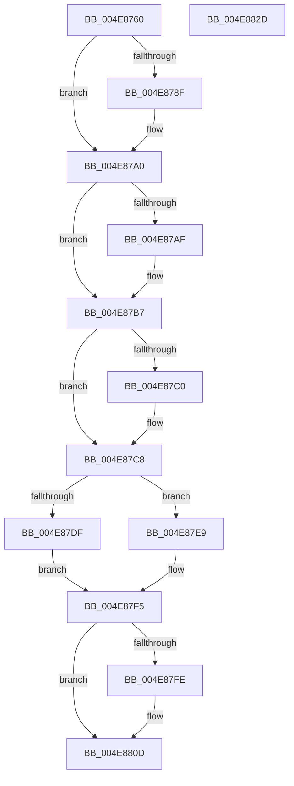

# IopCopyCompleteReadRequest

- RVA: `0x004E8760`–`0x004E882E` (길이 `206` bytes)
- VA: `0x00000001404E8760`
- 실행 섹션: `.text`
- PDB 이름 있음: `예`; PDB Function 태그: `아니요`
- unwind 정보 RVA: `0x0005C954`
- 디코드: `53`개 명령, `206/206` bytes 표시
- 미해석 바이트: `0` (있으면 어셈블리에 `.byte`로 보존)

> 이 문서는 커널 이미지의 기계어와 PDB 기호를 분석해 생성했습니다. 4번과 5번은 함수 원형과 자료형을 바이너리 사용 방식에서 추정한 C 해석이며 원본 소스 복구 결과는 아닙니다.

## 1. Dependencies

- 직접 호출 지점: **8**; 고유 호출 대상: **8**
- 직접 호출자로 확인된 함수: **2**
- RIP 상대 이미지 참조: **0**

### Outgoing calls
- `0x004E879B` → [KeSetEvent](../33/KeSetEvent_function_0033F310.md) (function, `0x0033F310`)
- `0x004E87B7` → [Feature_1042264378__private_IsEnabledDeviceUsageNoInline](../59/Feature_1042264378__private_IsEnabledDeviceUsageNoInline_function_005989BC.md) (function, `0x005989BC`)
- `0x004E87C3` → [IopProcessBufferedIoCompletion](../3E/IopProcessBufferedIoCompletion_function_003ED220.md) (function, `0x003ED220`)
- `0x004E87CE` → [IopUpdateIrpTransferCount](../3E/IopUpdateIrpTransferCount_function_003ED420.md) (function, `0x003ED420`)
- `0x004E87E2` → [IopDequeueIrpFromFileObject](../3E/IopDequeueIrpFromFileObject_function_003ED548.md) (function, `0x003ED548`)
- `0x004E87F0` → [IopDequeueIrpFromThread](../20/IopDequeueIrpFromThread_function_00207B20.md) (function, `0x00207B20`)
- `0x004E8803` → [ObfDereferenceObjectWithTag](../2F/ObfDereferenceObjectWithTag_function_002F78E0.md) (function, `0x002F78E0`)
- `0x004E8813` → [IopDropIrp](../21/IopDropIrp_function_002107B0.md) (function, `0x002107B0`)

### Direct callers
- [IopCopyCompleteReadIrp](IopCopyCompleteReadIrp_function_004E83F0.md) at `0x004E84E2`
- [IopCopyAbortCopyReadRequest](../59/IopCopyAbortCopyReadRequest_function_00598A70.md) at `0x00598A89`

### Static image references
- 디코드된 RIP-relative 메모리 참조가 없습니다.

## 2. Other-region calls and transfers

- 다른 실행 섹션으로 향하는 call: **0**
- 별도 외부 분기/꼬리 이동을 확인하지 못했습니다.

## 3. Assembly (complete function range)

```asm
004E8760  48 89 5C 24 08                  mov qword ptr [rsp + 8], rbx
004E8765  48 89 6C 24 10                  mov qword ptr [rsp + 0x10], rbp
004E876A  48 89 74 24 18                  mov qword ptr [rsp + 0x18], rsi
004E876F  57                              push rdi
004E8770  48 83 EC 20                     sub rsp, 0x20
004E8774  65 48 8B 2C 25 88 01 00 00      mov rbp, qword ptr gs:[0x188]
004E877D  48 8D 59 88                     lea rbx, [rcx - 0x78]
004E8781  49 8B 39                        mov rdi, qword ptr [r9]
004E8784  33 F6                           xor esi, esi
004E8786  F7 47 50 00 00 00 04            test dword ptr [rdi + 0x50], 0x4000000
004E878D  75 11                           jne 0x1404e87a0
004E878F  48 8D 8F 98 00 00 00            lea rcx, [rdi + 0x98]
004E8796  45 33 C0                        xor r8d, r8d
004E8799  33 D2                           xor edx, edx
004E879B  E8 70 6B E5 FF                  call 0x14033f310
004E87A0  8B 43 30                        mov eax, dword ptr [rbx + 0x30]
004E87A3  89 47 38                        mov dword ptr [rdi + 0x38], eax
004E87A6  F7 43 10 00 20 00 00            test dword ptr [rbx + 0x10], 0x2000
004E87AD  74 08                           je 0x1404e87b7
004E87AF  48 8B 73 58                     mov rsi, qword ptr [rbx + 0x58]
004E87B3  48 83 E6 F9                     and rsi, 0xfffffffffffffff9
004E87B7  E8 00 02 0B 00                  call 0x1405989bc
004E87BC  85 C0                           test eax, eax
004E87BE  75 08                           jne 0x1404e87c8
004E87C0  48 8B CB                        mov rcx, rbx
004E87C3  E8 58 4A F0 FF                  call 0x1403ed220
004E87C8  48 8B D6                        mov rdx, rsi
004E87CB  48 8B CB                        mov rcx, rbx
004E87CE  E8 4D 4C F0 FF                  call 0x1403ed420
004E87D3  F7 43 10 00 20 00 00            test dword ptr [rbx + 0x10], 0x2000
004E87DA  48 8B CB                        mov rcx, rbx
004E87DD  74 0A                           je 0x1404e87e9
004E87DF  48 8B D7                        mov rdx, rdi
004E87E2  E8 61 4D F0 FF                  call 0x1403ed548
004E87E7  EB 0C                           jmp 0x1404e87f5
004E87E9  48 89 AB 98 00 00 00            mov qword ptr [rbx + 0x98], rbp
004E87F0  E8 2B F3 D1 FF                  call 0x140207b20
004E87F5  48 8B 4B 50                     mov rcx, qword ptr [rbx + 0x50]
004E87F9  48 85 C9                        test rcx, rcx
004E87FC  74 0F                           je 0x1404e880d
004E87FE  BA 44 66 6C 74                  mov edx, 0x746c6644
004E8803  E8 D8 F0 E0 FF                  call 0x1402f78e0
004E8808  48 83 63 50 00                  and qword ptr [rbx + 0x50], 0
004E880D  48 8B D7                        mov rdx, rdi
004E8810  48 8B CB                        mov rcx, rbx
004E8813  E8 98 7F D2 FF                  call 0x1402107b0
004E8818  48 8B 5C 24 30                  mov rbx, qword ptr [rsp + 0x30]
004E881D  48 8B 6C 24 38                  mov rbp, qword ptr [rsp + 0x38]
004E8822  48 8B 74 24 40                  mov rsi, qword ptr [rsp + 0x40]
004E8827  48 83 C4 20                     add rsp, 0x20
004E882B  5F                              pop rdi
004E882C  C3                              ret
004E882D  CC                              int3
```

## 4. C-style interpretation (structured pseudocode)

```c
__int64 __fastcall IopCopyCompleteReadRequest(__int64 a1, int a2, int a3, __int64 a4)
{
    __int64 result;
    __int64 v_rsi;
    __int64 v_rsp;
    unsigned __int64 v_stack_p10;
    unsigned __int64 v_stack_p18;
    unsigned __int64 v_stack_p8;

    v_stack_p8 = v_rbx;
    v_stack_p10 = v_rbp;
    v_stack_p18 = v_rsi;
    v_rsp = (v_rsp) - (32);
    v_rsi = 0;
    if (((*(unsigned int *)(*(unsigned __int64 *)(a4) + 80)) & (0x4000000ULL)) == 0) {
        a1 = *(unsigned __int64 *)(a4) + 152;
        a3 = 0;
        a2 = 0;
        result = KeSetEvent(a1, a2, a3, a4);
    }
    *(unsigned int *)(*(unsigned __int64 *)(a4) + 56) = (unsigned int)((unsigned int)(*(unsigned int *)(a1 - 120 + 48)));
    if (((*(unsigned int *)(a1 - 120 + 16)) & (0x2000ULL)) != 0) {
        v_rsi = *(unsigned __int64 *)(a1 - 120 + 88);
        v_rsi = (v_rsi) & (-7);
    }
    result = Feature_1042264378__private_IsEnabledDeviceUsageNoInline(a1, a2, a3, a4);
    if ((unsigned int)(result) == 0) {
        a1 = a1 - 120;
        result = IopProcessBufferedIoCompletion(a1, a2, a3, a4);
    }
    result = IopUpdateIrpTransferCount(a1 - 120, v_rsi, a3, a4);
    if (((*(unsigned int *)(a1 - 120 + 16)) & (0x2000ULL)) == 0) goto loc_004E87E9;
    result = IopDequeueIrpFromFileObject(a1 - 120, *(unsigned __int64 *)(a4), a3, a4);
    goto loc_004E87F5;
loc_004E87E9:
    *(unsigned __int64 *)(a1 - 120 + 152) = *(unsigned __int64 *)(gs_base + (0 + 392));
    result = IopDequeueIrpFromThread(a1 - 120, *(unsigned __int64 *)(a4), a3, a4);
loc_004E87F5:
    if (*(unsigned __int64 *)(a1 - 120 + 80) != 0) {
        a2 = 0x746C6644ULL;
        result = ObfDereferenceObjectWithTag(*(unsigned __int64 *)(a1 - 120 + 80), a2, a3, a4);
    }
    result = IopDropIrp(a1 - 120, *(unsigned __int64 *)(a4), a3, a4);
    v_rsp = (v_rsp) + (32);
    return result;
}
```

## 5. (Beta) C Style

```c
int64_t IopCopyCompleteReadRequest(void *Arg1, int32_t Arg2, int32_t Arg3, void *Arg4)
{
    uint8_t *arg1 = (uint8_t *)Arg1;
    uint8_t *arg4 = (uint8_t *)Arg4;

    int64_t result;
    int64_t local_rsi;
    int64_t local_rsp;
    uint64_t v_stack_p10;
    uint64_t v_stack_p18;
    uint64_t v_stack_p8;

    v_stack_p8 = local_rbx;
    v_stack_p10 = local_rbp;
    v_stack_p18 = local_rsi;
    local_rsp = (local_rsp) - (32);
    local_rsi = 0;
    if (((*(uint32_t *)(*(uint64_t *)(arg4) + 0x50)) & (0x4000000ULL)) == 0) {
        Arg1 = *(uint64_t *)(arg4) + 152;
        Arg3 = 0;
        Arg2 = 0;
        result = KeSetEvent(Arg1, Arg2, Arg3, Arg4);
    }
    *(uint32_t *)(*(uint64_t *)(arg4) + 0x38) = (uint32_t)((uint32_t)(*(uint32_t *)(arg1 - 0x78 + 0x30)));
    if (((*(uint32_t *)(arg1 - 0x78 + 0x10)) & (0x2000ULL)) != 0) {
        local_rsi = *(uint64_t *)(arg1 - 0x78 + 0x58);
        local_rsi = (local_rsi) & (-7);
    }
    result = Feature_1042264378__private_IsEnabledDeviceUsageNoInline(Arg1, Arg2, Arg3, Arg4);
    if ((uint32_t)(result) == 0) {
        Arg1 = Arg1 - 120;
        result = IopProcessBufferedIoCompletion(Arg1, Arg2, Arg3, Arg4);
    }
    result = IopUpdateIrpTransferCount(Arg1 - 120, local_rsi, Arg3, Arg4);
    if (((*(uint32_t *)(arg1 - 0x78 + 0x10)) & (0x2000ULL)) == 0) goto loc_004E87E9;
    result = IopDequeueIrpFromFileObject(Arg1 - 120, *(uint64_t *)(arg4), Arg3, Arg4);
    goto loc_004E87F5;
loc_004E87E9:
    *(uint64_t *)(arg1 - 0x78 + 0x98) = *(uint64_t *)(gs_base + (0 + 0x188));
    result = IopDequeueIrpFromThread(Arg1 - 120, *(uint64_t *)(arg4), Arg3, Arg4);
loc_004E87F5:
    if (*(uint64_t *)(arg1 - 0x78 + 0x50) != 0) {
        Arg2 = 0x746C6644ULL;
        result = ObfDereferenceObjectWithTag(*(uint64_t *)(arg1 - 0x78 + 0x50), Arg2, Arg3, Arg4);
    }
    result = IopDropIrp(Arg1 - 120, *(uint64_t *)(arg4), Arg3, Arg4);
    local_rsp = (local_rsp) + (32);
    return result;
}
```

### 관측된 메모리 오프셋

구조체 형식이 확인되지 않은 접근은 인자 기준의 오프셋으로만 기록했습니다.

| 기준 인자 | 오프셋 표현 | 폭 (bit) | 접근 |
|---|---:|---:|---|
| `Arg1` | `- 0x78` | `64` | `R` |
| `Arg1` | `+ 0x10` | `32` | `R` |
| `Arg1` | `+ 0x30` | `32` | `R` |
| `Arg1` | `+ 0x50` | `64` | `R` |
| `Arg1` | `+ 0x50` | `64` | `R/W` |
| `Arg1` | `+ 0x58` | `64` | `R` |
| `Arg1` | `+ 0x98` | `64` | `W` |
| `Arg4` | `+ 0x0` | `64` | `R` |

## 6. Execution-region graph

[열기: 2D/3D 그래프와 함수 탐색 컨트롤 패널](../../../control-panel.html?section=text&rva=0x004E8760&view=graph)

- 2D 그래프는 위에서 아래로 흐르고, 3D 그래프는 빈 공간을 드래그해 회전합니다. Shift+드래그는 이동, 휠은 확대·축소, 함수 노드 선택은 대상 보고서 이동입니다.

### Static fallback


