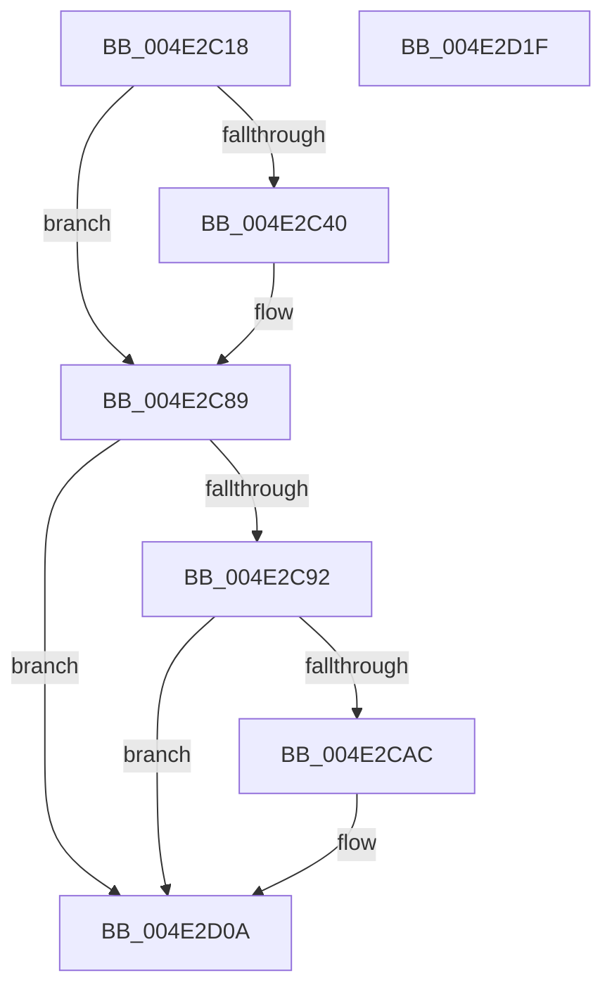

# IopDumpTraceLoadCrashDumpDriverFailure

- RVA: `0x004E2C18`–`0x004E2D20` (길이 `264` bytes)
- VA: `0x00000001404E2C18`
- 실행 섹션: `.text`
- PDB 이름 있음: `예`; PDB Function 태그: `아니요`
- unwind 정보 RVA: `0x000BF3A4`
- 디코드: `57`개 명령, `264/264` bytes 표시
- 미해석 바이트: `0` (있으면 어셈블리에 `.byte`로 보존)

> 이 문서는 커널 이미지의 기계어와 PDB 기호를 분석해 생성했습니다. 4번과 5번은 함수 원형과 자료형을 바이너리 사용 방식에서 추정한 C 해석이며 원본 소스 복구 결과는 아닙니다.

## 1. Dependencies

- 직접 호출 지점: **5**; 고유 호출 대상: **5**
- 직접 호출자로 확인된 함수: **2**
- RIP 상대 이미지 참조: **5**

### Outgoing calls
- `0x004E2C37` → [IopDumpIsTracingEnabled](../4F/IopDumpIsTracingEnabled_function_004FC5D0.md) (function, `0x004FC5D0`)
- `0x004E2C84` → [EtwWriteEx](../25/EtwWriteEx_function_0025F0D0.md) (function, `0x0025F0D0`)
- `0x004E2CA3` → [tlgKeywordOn](../42/tlgKeywordOn_function_0042EAA0.md) (function, `0x0042EAA0`)
- `0x004E2D05` → [tlgWriteTransfer_EtwWriteTransfer](../42/tlgWriteTransfer_EtwWriteTransfer_function_004260E0.md) (function, `0x004260E0`)
- `0x004E2D11` → [_security_check_cookie](../6A/_security_check_cookie_function_006AC640.md) (function, `0x006AC640`)

### Direct callers
- [IopInitializeCrashDump](../../page/71/IopInitializeCrashDump_function_0071A270.md) at `0x0071A2ED`
- [IoGetDumpStack](../../page/AD/IoGetDumpStack_function_00AD9D6C.md) at `0x00AD9D8E`

### Static image references
- `0x004E2C29` → RVA `0x00E0A740` (`.data`; read)
- `0x004E2C48` → RVA `0x00E65EF0` (`.data`; read)
- `0x004E2C4F` → RVA `0x000233D0` (`.rdata`; read)
- `0x004E2C89` → RVA `0x00E06DE8` (`.data`; read)
- `0x004E2CB8` → RVA `0x00045C26` (`.rdata`; read)

## 2. Other-region calls and transfers

- 다른 실행 섹션으로 향하는 call: **0**
- 별도 외부 분기/꼬리 이동을 확인하지 못했습니다.

## 3. Assembly (complete function range)

```asm
004E2C18  89 4C 24 08                     mov dword ptr [rsp + 8], ecx
004E2C1C  55                              push rbp
004E2C1D  48 8D 6C 24 A9                  lea rbp, [rsp - 0x57]
004E2C22  48 81 EC B0 00 00 00            sub rsp, 0xb0
004E2C29  48 8B 05 10 7B 92 00            mov rax, qword ptr [rip + 0x927b10]
004E2C30  48 33 C4                        xor rax, rsp
004E2C33  48 89 45 47                     mov qword ptr [rbp + 0x47], rax
004E2C37  E8 94 99 01 00                  call 0x1404fc5d0
004E2C3C  84 C0                           test al, al
004E2C3E  74 49                           je 0x1404e2c89
004E2C40  83 65 03 00                     and dword ptr [rbp + 3], 0
004E2C44  48 8D 45 67                     lea rax, [rbp + 0x67]
004E2C48  48 8B 0D A1 32 98 00            mov rcx, qword ptr [rip + 0x9832a1]
004E2C4F  48 8D 15 7A 07 B4 FF            lea rdx, [rip - 0x4bf886]
004E2C56  48 89 45 F7                     mov qword ptr [rbp - 9], rax
004E2C5A  45 33 C9                        xor r9d, r9d
004E2C5D  48 8D 45 F7                     lea rax, [rbp - 9]
004E2C61  C7 45 FF 04 00 00 00            mov dword ptr [rbp - 1], 4
004E2C68  48 89 44 24 38                  mov qword ptr [rsp + 0x38], rax
004E2C6D  45 33 C0                        xor r8d, r8d
004E2C70  C7 44 24 30 01 00 00 00         mov dword ptr [rsp + 0x30], 1
004E2C78  48 83 64 24 28 00               and qword ptr [rsp + 0x28], 0
004E2C7E  48 83 64 24 20 00               and qword ptr [rsp + 0x20], 0
004E2C84  E8 47 C4 D7 FF                  call 0x14025f0d0
004E2C89  83 3D 58 41 92 00 05            cmp dword ptr [rip + 0x924158], 5
004E2C90  76 78                           jbe 0x1404e2d0a
004E2C92  48 BA 00 00 00 00 00 40 00 00   movabs rdx, 0x400000000000
004E2C9C  48 8D 0D 45 41 92 00            lea rcx, [rip + 0x924145]
004E2CA3  E8 F8 BD F4 FF                  call 0x14042eaa0
004E2CA8  84 C0                           test al, al
004E2CAA  74 5E                           je 0x1404e2d0a
004E2CAC  83 65 33 00                     and dword ptr [rbp + 0x33], 0
004E2CB0  48 8D 45 EF                     lea rax, [rbp - 0x11]
004E2CB4  83 65 43 00                     and dword ptr [rbp + 0x43], 0
004E2CB8  48 8D 15 67 2F B6 FF            lea rdx, [rip - 0x49d099]
004E2CBF  48 89 45 27                     mov qword ptr [rbp + 0x27], rax
004E2CC3  48 8D 0D 1E 41 92 00            lea rcx, [rip + 0x92411e]
004E2CCA  8B 45 67                        mov eax, dword ptr [rbp + 0x67]
004E2CCD  45 33 C9                        xor r9d, r9d
004E2CD0  89 45 E7                        mov dword ptr [rbp - 0x19], eax
004E2CD3  45 33 C0                        xor r8d, r8d
004E2CD6  48 8D 45 E7                     lea rax, [rbp - 0x19]
004E2CDA  48 C7 45 EF 00 00 00 01         mov qword ptr [rbp - 0x11], 0x1000000
004E2CE2  48 89 45 37                     mov qword ptr [rbp + 0x37], rax
004E2CE6  48 8D 45 07                     lea rax, [rbp + 7]
004E2CEA  48 89 44 24 28                  mov qword ptr [rsp + 0x28], rax
004E2CEF  C7 44 24 20 04 00 00 00         mov dword ptr [rsp + 0x20], 4
004E2CF7  C7 45 2F 08 00 00 00            mov dword ptr [rbp + 0x2f], 8
004E2CFE  C7 45 3F 04 00 00 00            mov dword ptr [rbp + 0x3f], 4
004E2D05  E8 D6 33 F4 FF                  call 0x1404260e0
004E2D0A  48 8B 4D 47                     mov rcx, qword ptr [rbp + 0x47]
004E2D0E  48 33 CC                        xor rcx, rsp
004E2D11  E8 2A 99 1C 00                  call 0x1406ac640
004E2D16  48 81 C4 B0 00 00 00            add rsp, 0xb0
004E2D1D  5D                              pop rbp
004E2D1E  C3                              ret
004E2D1F  CC                              int3
```

## 4. C-style interpretation (structured pseudocode)

```c
__int64 __fastcall IopDumpTraceLoadCrashDumpDriverFailure(int a1, __int64 a2, int a3, int a4)
{
    __int64 result;
    __int64 v_rsp;
    unsigned __int64 v_stack_m18;
    unsigned int v_stack_m1C;
    unsigned int v_stack_m20;
    unsigned __int64 v_stack_m28;
    unsigned int v_stack_m2C;
    unsigned int v_stack_m30;
    unsigned __int64 v_stack_m38;
    unsigned __int64 v_stack_m58;
    unsigned int v_stack_m5C;
    unsigned __int64 v_stack_m5F;
    unsigned int v_stack_m60;
    unsigned __int64 v_stack_m68;
    unsigned __int64 v_stack_m70;
    unsigned int v_stack_m78;
    unsigned __int64 v_stack_m80;
    unsigned int v_stack_m88;
    unsigned __int64 v_stack_m90;
    unsigned __int64 v_stack_m98;
    unsigned int v_stack_p8;

    v_stack_p8 = a1;
    v_rsp = (v_rsp) - (176);
    result = (*(unsigned __int64 *)(v_rip + 9599760)) ^ (v_rsp);
    v_stack_m18 = result;
    result = IopDumpIsTracingEnabled(a1, a2, a3, a4);
    if ((unsigned __int8)(result) != 0) {
        result = v_stack_p8;
        a1 = *(unsigned __int64 *)(v_rip + 9974433);
        a2 = v_rip - 4978822;
        v_stack_m68 = result;
        a4 = 0;
        result = v_stack_m68;
        v_stack_m60 = 4;
        v_stack_m80 = result;
        a3 = 0;
        v_stack_m88 = 1;
        result = EtwWriteEx(a1, a2, a3, a4);
    }
    if ((*(unsigned int *)(v_rip + 9584984)) <= 5) goto loc_004E2D0A;
    result = tlgKeywordOn(v_rip + 9584965, a2, a3, a4);
    if ((unsigned __int8)(result) != 0) {
        result = v_stack_m70;
        a2 = v_rip - 4837529;
        v_stack_m38 = result;
        a1 = v_rip + 9584926;
        result = v_stack_p8;
        a4 = 0;
        v_stack_m78 = (unsigned int)(result);
        a3 = 0;
        result = v_stack_m78;
        v_stack_m70 = 0x1000000ULL;
        v_stack_m28 = result;
        result = v_stack_m58;
        v_stack_m90 = result;
        v_stack_m98 = 4;
        v_stack_m30 = 8;
        v_stack_m20 = 4;
        result = tlgWriteTransfer_EtwWriteTransfer(a1, a2, a3, a4);
    }
    a1 = (v_stack_m18) ^ (v_rsp);
    result = _security_check_cookie(a1, a2, a3, a4);
    v_rsp = (v_rsp) + (176);
    return result;
}
```

## 5. (Beta) C Style

```c
int64_t IopDumpTraceLoadCrashDumpDriverFailure(int32_t Arg1, int64_t Arg2, int32_t Arg3, int32_t Arg4)
{
    int64_t result;
    int64_t local_rsp;
    uint64_t v_stack_m18;
    uint32_t v_stack_m1C;
    uint32_t v_stack_m20;
    uint64_t v_stack_m28;
    uint32_t v_stack_m2C;
    uint32_t v_stack_m30;
    uint64_t v_stack_m38;
    uint64_t v_stack_m58;
    uint32_t v_stack_m5C;
    uint64_t v_stack_m5F;
    uint32_t v_stack_m60;
    uint64_t v_stack_m68;
    uint64_t v_stack_m70;
    uint32_t v_stack_m78;
    uint64_t v_stack_m80;
    uint32_t v_stack_m88;
    uint64_t v_stack_m90;
    uint64_t v_stack_m98;
    uint32_t v_stack_p8;

    v_stack_p8 = Arg1;
    local_rsp = (local_rsp) - (176);
    result = (*(uint64_t *)(v_rip + 0x927B10)) ^ (local_rsp);
    v_stack_m18 = result;
    result = IopDumpIsTracingEnabled(Arg1, Arg2, Arg3, Arg4);
    if ((uint8_t)(result) != 0) {
        result = v_stack_p8;
        Arg1 = *(uint64_t *)(v_rip + 0x9832A1);
        Arg2 = v_rip - 4978822;
        v_stack_m68 = result;
        Arg4 = 0;
        result = v_stack_m68;
        v_stack_m60 = 4;
        v_stack_m80 = result;
        Arg3 = 0;
        v_stack_m88 = 1;
        result = EtwWriteEx(Arg1, Arg2, Arg3, Arg4);
    }
    if ((*(uint32_t *)(v_rip + 0x924158)) <= 5) goto loc_004E2D0A;
    result = tlgKeywordOn(v_rip + 9584965, Arg2, Arg3, Arg4);
    if ((uint8_t)(result) != 0) {
        result = v_stack_m70;
        Arg2 = v_rip - 4837529;
        v_stack_m38 = result;
        Arg1 = v_rip + 9584926;
        result = v_stack_p8;
        Arg4 = 0;
        v_stack_m78 = (uint32_t)(result);
        Arg3 = 0;
        result = v_stack_m78;
        v_stack_m70 = 0x1000000ULL;
        v_stack_m28 = result;
        result = v_stack_m58;
        v_stack_m90 = result;
        v_stack_m98 = 4;
        v_stack_m30 = 8;
        v_stack_m20 = 4;
        result = tlgWriteTransfer_EtwWriteTransfer(Arg1, Arg2, Arg3, Arg4);
    }
    Arg1 = (v_stack_m18) ^ (local_rsp);
    result = _security_check_cookie(Arg1, Arg2, Arg3, Arg4);
    local_rsp = (local_rsp) + (176);
    return result;
}
```

## 6. Execution-region graph

[열기: 2D/3D 그래프와 함수 탐색 컨트롤 패널](../../../control-panel.html?section=text&rva=0x004E2C18&view=graph)

- 2D 그래프는 위에서 아래로 흐르고, 3D 그래프는 빈 공간을 드래그해 회전합니다. Shift+드래그는 이동, 휠은 확대·축소, 함수 노드 선택은 대상 보고서 이동입니다.

### Static fallback


