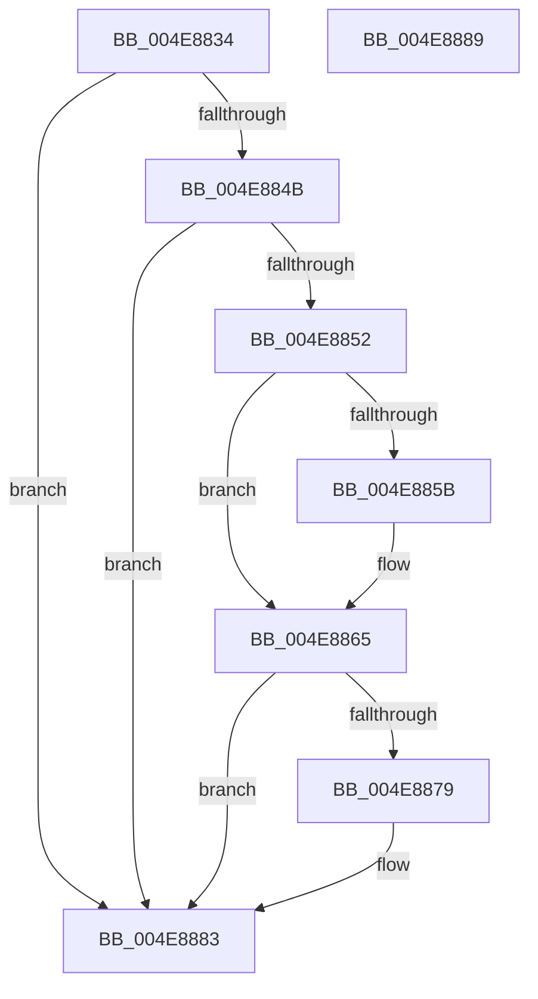

# IopFreeCopyObjectsFromIrp

- RVA: `0x004E8834`–`0x004E888A` (길이 `86` bytes)
- VA: `0x00000001404E8834`
- 실행 섹션: `.text`
- PDB 이름 있음: `예`; PDB Function 태그: `아니요`
- unwind 정보 RVA: `0x0005CF00`
- 디코드: `26`개 명령, `86/86` bytes 표시
- 미해석 바이트: `0` (있으면 어셈블리에 `.byte`로 보존)

> 이 문서는 커널 이미지의 기계어와 PDB 기호를 분석해 생성했습니다. 4번과 5번은 함수 원형과 자료형을 바이너리 사용 방식에서 추정한 C 해석이며 원본 소스 복구 결과는 아닙니다.

## 1. Dependencies

- 직접 호출 지점: **4**; 고유 호출 대상: **4**
- 직접 호출자로 확인된 함수: **1**
- RIP 상대 이미지 참조: **0**

### Outgoing calls
- `0x004E8842` → [IopIrpHasExtensionType](../3F/IopIrpHasExtensionType_function_003F4080.md) (function, `0x003F4080`)
- `0x004E885B` → [IopUnlockAndFreeMdl](../29/IopUnlockAndFreeMdl_function_0029F200.md) (function, `0x0029F200`)
- `0x004E886B` → [IopFreeCopyObjectsFromDataBuffer](../4C/IopFreeCopyObjectsFromDataBuffer_function_004C201C.md) (function, `0x004C201C`)
- `0x004E8870` → [Feature_3741482297__private_IsEnabledDeviceUsageNoInline](../59/Feature_3741482297__private_IsEnabledDeviceUsageNoInline_function_00598A10.md) (function, `0x00598A10`)

### Direct callers
- [IopFreeIrpExtension](../24/IopFreeIrpExtension_function_0024EDB0.md) at `0x0024EEC7`

### Static image references
- 디코드된 RIP-relative 메모리 참조가 없습니다.

## 2. Other-region calls and transfers

- 다른 실행 섹션으로 향하는 call: **0**
- 별도 외부 분기/꼬리 이동을 확인하지 못했습니다.

## 3. Assembly (complete function range)

```asm
004E8834  40 53                           push rbx
004E8836  48 83 EC 20                     sub rsp, 0x20
004E883A  BA 09 00 00 00                  mov edx, 9
004E883F  48 8B D9                        mov rbx, rcx
004E8842  E8 39 B8 F0 FF                  call 0x1403f4080
004E8847  84 C0                           test al, al
004E8849  74 38                           je 0x1404e8883
004E884B  48 83 7B 70 00                  cmp qword ptr [rbx + 0x70], 0
004E8850  74 31                           je 0x1404e8883
004E8852  48 8B 4B 08                     mov rcx, qword ptr [rbx + 8]
004E8856  48 85 C9                        test rcx, rcx
004E8859  74 0A                           je 0x1404e8865
004E885B  E8 A0 69 DB FF                  call 0x14029f200
004E8860  48 83 63 08 00                  and qword ptr [rbx + 8], 0
004E8865  48 8B 4B 70                     mov rcx, qword ptr [rbx + 0x70]
004E8869  33 D2                           xor edx, edx
004E886B  E8 AC 97 FD FF                  call 0x1404c201c
004E8870  E8 9B 01 0B 00                  call 0x140598a10
004E8875  85 C0                           test eax, eax
004E8877  74 0A                           je 0x1404e8883
004E8879  48 83 63 18 00                  and qword ptr [rbx + 0x18], 0
004E887E  48 83 63 70 00                  and qword ptr [rbx + 0x70], 0
004E8883  48 83 C4 20                     add rsp, 0x20
004E8887  5B                              pop rbx
004E8888  C3                              ret
004E8889  CC                              int3
```

## 4. C-style interpretation (structured pseudocode)

```c
__int64 __fastcall IopFreeCopyObjectsFromIrp(__int64 a1)
{
    __int64 result;
    __int64 v_rsp;

    v_rsp = (v_rsp) - (32);
    result = IopIrpHasExtensionType(a1, 9, a3, a4);
    if ((unsigned __int8)(result) == 0) goto loc_004E8883;
    if ((*(unsigned __int64 *)(a1 + 112)) == 0) goto loc_004E8883;
    if (*(unsigned __int64 *)(a1 + 8) != 0) {
        result = IopUnlockAndFreeMdl(*(unsigned __int64 *)(a1 + 8), 9, a3, a4);
    }
    a2 = 0;
    result = IopFreeCopyObjectsFromDataBuffer(*(unsigned __int64 *)(a1 + 112), a2, a3, a4);
    result = Feature_3741482297__private_IsEnabledDeviceUsageNoInline(*(unsigned __int64 *)(a1 + 112), a2, a3, a4);
    if ((unsigned int)(result) != 0) {
    }
    v_rsp = (v_rsp) + (32);
    return result;
}
```

## 5. (Beta) C Style

```c
int64_t IopFreeCopyObjectsFromIrp(void *Arg1)
{
    uint8_t *arg1 = (uint8_t *)Arg1;

    int64_t result;
    int64_t local_rsp;

    local_rsp = (local_rsp) - (32);
    result = IopIrpHasExtensionType(Arg1, 9, a3, a4);
    if ((uint8_t)(result) == 0) goto loc_004E8883;
    if ((*(uint64_t *)(arg1 + 0x70)) == 0) goto loc_004E8883;
    if (*(uint64_t *)(arg1 + 0x8) != 0) {
        result = IopUnlockAndFreeMdl(*(uint64_t *)(arg1 + 0x8), 9, a3, a4);
    }
    a2 = 0;
    result = IopFreeCopyObjectsFromDataBuffer(*(uint64_t *)(arg1 + 0x70), a2, a3, a4);
    result = Feature_3741482297__private_IsEnabledDeviceUsageNoInline(*(uint64_t *)(arg1 + 0x70), a2, a3, a4);
    if ((uint32_t)(result) != 0) {
    }
    local_rsp = (local_rsp) + (32);
    return result;
}
```

### 관측된 메모리 오프셋

구조체 형식이 확인되지 않은 접근은 인자 기준의 오프셋으로만 기록했습니다.

| 기준 인자 | 오프셋 표현 | 폭 (bit) | 접근 |
|---|---:|---:|---|
| `Arg1` | `+ 0x8` | `64` | `R` |
| `Arg1` | `+ 0x8` | `64` | `R/W` |
| `Arg1` | `+ 0x18` | `64` | `R/W` |
| `Arg1` | `+ 0x70` | `64` | `R` |
| `Arg1` | `+ 0x70` | `64` | `R/W` |

## 6. Execution-region graph

[열기: 2D/3D 그래프와 함수 탐색 컨트롤 패널](../../../control-panel.html?section=text&rva=0x004E8834&view=graph)

- 2D 그래프는 위에서 아래로 흐르고, 3D 그래프는 빈 공간을 드래그해 회전합니다. Shift+드래그는 이동, 휠은 확대·축소, 함수 노드 선택은 대상 보고서 이동입니다.

### Static fallback


