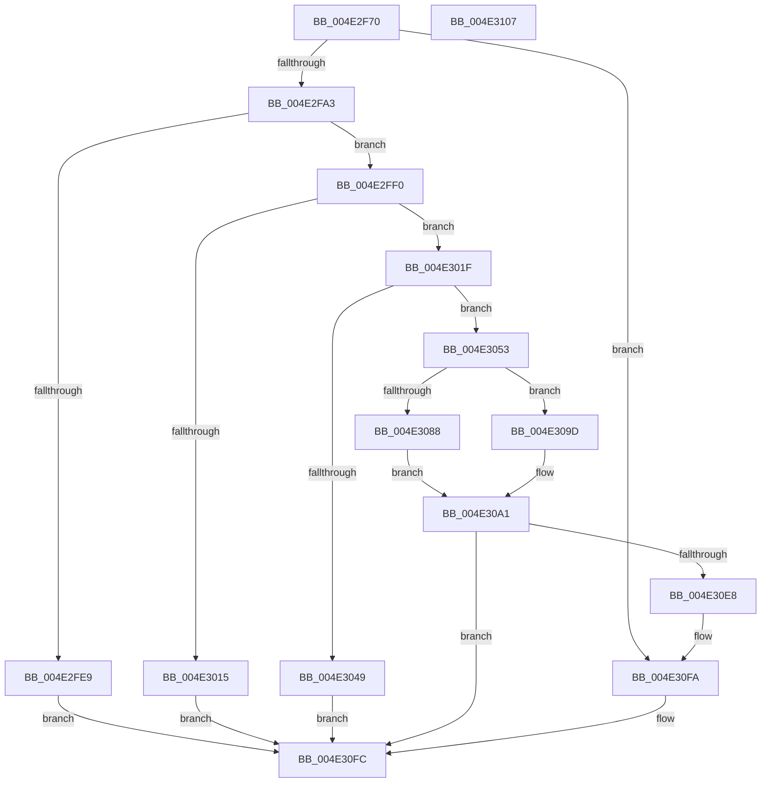

# IopLoadCrashdumpDriver

- RVA: `0x004E2F70`–`0x004E3108` (길이 `408` bytes)
- VA: `0x00000001404E2F70`
- 실행 섹션: `.text`
- PDB 이름 있음: `예`; PDB Function 태그: `아니요`
- unwind 정보 RVA: `0x000BF3E8`
- 디코드: `97`개 명령, `408/408` bytes 표시
- 미해석 바이트: `0` (있으면 어셈블리에 `.byte`로 보존)

> 이 문서는 커널 이미지의 기계어와 PDB 기호를 분석해 생성했습니다. 4번과 5번은 함수 원형과 자료형을 바이너리 사용 방식에서 추정한 C 해석이며 원본 소스 복구 결과는 아닙니다.

## 1. Dependencies

- 직접 호출 지점: **5**; 고유 호출 대상: **5**
- 직접 호출자로 확인된 함수: **2**
- RIP 상대 이미지 참조: **19**

### Outgoing calls
- `0x004E2FAE` → [RtlInitUnicodeString](../42/RtlInitUnicodeString_function_0042A780.md) (function, `0x0042A780`)
- `0x004E2FD6` → [MmLoadSystemImageEx](../../page/99/MmLoadSystemImageEx_function_00999B8C.md) (function, `0x00999B8C`)
- `0x004E3007` → [RtlImageNtHeaderEx](../41/RtlImageNtHeaderEx_function_0041EAA0.md) (function, `0x0041EAA0`)
- `0x004E303B` → [IopGetPhysicalMemoryBlock](../59/IopGetPhysicalMemoryBlock_function_00595690.md) (function, `0x00595690`)
- `0x004E30DF` → [guard_dispatch_icall](../6B/guard_dispatch_icall_function_006BAAD0.md) (function, `0x006BAAD0`)

### Direct callers
- [IopInitializeCrashDump](../../page/71/IopInitializeCrashDump_function_0071A270.md) at `0x0071A2E2`
- [IoGetDumpStack](../../page/AD/IoGetDumpStack_function_00AD9D6C.md) at `0x00AD9D81`

### Static image references
- `0x004E2F91` → RVA `0x00E66058` (`.data`; read)
- `0x004E2FA3` → RVA `0x006C9B60` (` ?? ::FNODOBFM::`string'`; read)
- `0x004E3022` → RVA `0x00FDA098` (`PAGEDATA`; read)
- `0x004E3030` → RVA `0x00F0CFD0` (`.data`; read)
- `0x004E3053` → RVA `0x00FC6A84` (`ALMOSTRO`; read)
- `0x004E305A` → RVA `0x00ADA790` (`IopLoadCrashdmpImage`; read)
- `0x004E3065` → RVA `0x00AA2F60` (`MmUnloadSystemImage`; read)
- `0x004E3070` → RVA `0x00F8E968` (`.data`; read)
- `0x004E307B` → RVA `0x0058B6D0` (`HvlGetEncryptedData`; read)
- `0x004E3088` → RVA `0x00FC6A90` (`ALMOSTRO`; read)
- `0x004E30A1` → RVA `0x00596720` (`IopWheaSelLogCheckPoint`; read)
- `0x004E30A8` → RVA `0x00E65FD0` (`.data`; write)
- `0x004E30B2` → RVA `0x00E66048` (`.data`; write)
- `0x004E30B9` → RVA `0x00E65FD0` (`.data`; read)
- `0x004E30C0` → RVA `0x00596760` (`IopWheaSelLogError`; read)
- `0x004E30C7` → RVA `0x00E65FD4` (`.data`; write)
- `0x004E30D1` → RVA `0x00E66040` (`.data`; write)
- `0x004E30EC` → RVA `0x00E66058` (`.data`; write)
- `0x004E30F3` → RVA `0x00E66060` (`.data`; write)

## 2. Other-region calls and transfers

- 다른 실행 섹션으로 향하는 call: **1**
  - `0x004E2FD6` → [MmLoadSystemImageEx](../../page/99/MmLoadSystemImageEx_function_00999B8C.md) (`.text` → `PAGE`)
- 별도 외부 분기/꼬리 이동을 확인하지 못했습니다.

## 3. Assembly (complete function range)

```asm
004E2F70  40 55                           push rbp
004E2F72  53                              push rbx
004E2F73  57                              push rdi
004E2F74  48 8D 6C 24 B9                  lea rbp, [rsp - 0x47]
004E2F79  48 81 EC 90 00 00 00            sub rsp, 0x90
004E2F80  48 83 65 77 00                  and qword ptr [rbp + 0x77], 0
004E2F85  0F 57 C0                        xorps xmm0, xmm0
004E2F88  83 65 3B 00                     and dword ptr [rbp + 0x3b], 0
004E2F8C  48 83 65 67 00                  and qword ptr [rbp + 0x67], 0
004E2F91  48 83 3D BF 30 98 00 00         cmp qword ptr [rip + 0x9830bf], 0
004E2F99  0F 11 45 F7                     movups xmmword ptr [rbp - 9], xmm0
004E2F9D  0F 85 57 01 00 00               jne 0x1404e30fa
004E2FA3  48 8D 15 B6 6B 1E 00            lea rdx, [rip + 0x1e6bb6]
004E2FAA  48 8D 4D F7                     lea rcx, [rbp - 9]
004E2FAE  E8 CD 77 F4 FF                  call 0x14042a780
004E2FB3  48 8D 45 67                     lea rax, [rbp + 0x67]
004E2FB7  45 33 C9                        xor r9d, r9d
004E2FBA  48 89 44 24 30                  mov qword ptr [rsp + 0x30], rax
004E2FBF  48 8D 4D F7                     lea rcx, [rbp - 9]
004E2FC3  48 8D 45 77                     lea rax, [rbp + 0x77]
004E2FC7  45 33 C0                        xor r8d, r8d
004E2FCA  48 89 44 24 28                  mov qword ptr [rsp + 0x28], rax
004E2FCF  33 D2                           xor edx, edx
004E2FD1  83 64 24 20 00                  and dword ptr [rsp + 0x20], 0
004E2FD6  E8 B1 6B 4B 00                  call 0x140999b8c
004E2FDB  33 C9                           xor ecx, ecx
004E2FDD  3D 0E 01 00 C0                  cmp eax, 0xc000010e
004E2FE2  0F 45 C8                        cmovne ecx, eax
004E2FE5  85 C9                           test ecx, ecx
004E2FE7  79 07                           jns 0x1404e2ff0
004E2FE9  8B C1                           mov eax, ecx
004E2FEB  E9 0C 01 00 00                  jmp 0x1404e30fc
004E2FF0  48 8B 5D 67                     mov rbx, qword ptr [rbp + 0x67]
004E2FF4  4C 8D 4D 6F                     lea r9, [rbp + 0x6f]
004E2FF8  48 83 65 6F 00                  and qword ptr [rbp + 0x6f], 0
004E2FFD  45 33 C0                        xor r8d, r8d
004E3000  48 8B D3                        mov rdx, rbx
004E3003  41 8D 48 01                     lea ecx, [r8 + 1]
004E3007  E8 94 BA F3 FF                  call 0x14041eaa0
004E300C  48 8B 45 6F                     mov rax, qword ptr [rbp + 0x6f]
004E3010  48 85 C0                        test rax, rax
004E3013  75 0A                           jne 0x1404e301f
004E3015  B8 01 00 00 C0                  mov eax, 0xc0000001
004E301A  E9 DD 00 00 00                  jmp 0x1404e30fc
004E301F  8B 78 28                        mov edi, dword ptr [rax + 0x28]
004E3022  48 8D 05 6F 70 AF 00            lea rax, [rip + 0xaf706f]
004E3029  48 89 45 07                     mov qword ptr [rbp + 7], rax
004E302D  48 03 FB                        add rdi, rbx
004E3030  48 8D 05 99 9F A2 00            lea rax, [rip + 0xa29f99]
004E3037  48 89 45 3F                     mov qword ptr [rbp + 0x3f], rax
004E303B  E8 50 26 0B 00                  call 0x140595690
004E3040  48 89 45 0F                     mov qword ptr [rbp + 0xf], rax
004E3044  48 85 C0                        test rax, rax
004E3047  75 0A                           jne 0x1404e3053
004E3049  B8 9A 00 00 C0                  mov eax, 0xc000009a
004E304E  E9 A9 00 00 00                  jmp 0x1404e30fc
004E3053  80 3D 2A 3A AE 00 00            cmp byte ptr [rip + 0xae3a2a], 0
004E305A  48 8D 05 2F 77 5F 00            lea rax, [rip + 0x5f772f]
004E3061  48 89 45 17                     mov qword ptr [rbp + 0x17], rax
004E3065  48 8D 05 F4 FE 5B 00            lea rax, [rip + 0x5bfef4]
004E306C  48 89 45 1F                     mov qword ptr [rbp + 0x1f], rax
004E3070  48 8B 05 F1 B8 AA 00            mov rax, qword ptr [rip + 0xaab8f1]
004E3077  48 89 45 2F                     mov qword ptr [rbp + 0x2f], rax
004E307B  48 8D 05 4E 86 0A 00            lea rax, [rip + 0xa864e]
004E3082  48 89 45 27                     mov qword ptr [rbp + 0x27], rax
004E3086  74 15                           je 0x1404e309d
004E3088  8A 05 02 3A AE 00               mov al, byte ptr [rip + 0xae3a02]
004E308E  24 02                           and al, 2
004E3090  F6 D8                           neg al
004E3092  1B C9                           sbb ecx, ecx
004E3094  F7 D9                           neg ecx
004E3096  FF C1                           inc ecx
004E3098  89 4D 37                        mov dword ptr [rbp + 0x37], ecx
004E309B  EB 04                           jmp 0x1404e30a1
004E309D  83 65 37 00                     and dword ptr [rbp + 0x37], 0
004E30A1  48 8D 05 78 36 0B 00            lea rax, [rip + 0xb3678]
004E30A8  C7 05 1E 2F 98 00 01 00 00 00   mov dword ptr [rip + 0x982f1e], 1
004E30B2  48 89 05 8F 2F 98 00            mov qword ptr [rip + 0x982f8f], rax
004E30B9  48 8D 15 10 2F 98 00            lea rdx, [rip + 0x982f10]
004E30C0  48 8D 05 99 36 0B 00            lea rax, [rip + 0xb3699]
004E30C7  C7 05 03 2F 98 00 0D 00 00 00   mov dword ptr [rip + 0x982f03], 0xd
004E30D1  48 89 05 68 2F 98 00            mov qword ptr [rip + 0x982f68], rax
004E30D8  48 8D 4D 07                     lea rcx, [rbp + 7]
004E30DC  48 8B C7                        mov rax, rdi
004E30DF  E8 EC 79 1D 00                  call 0x1406baad0
004E30E4  85 C0                           test eax, eax
004E30E6  78 14                           js 0x1404e30fc
004E30E8  48 8B 45 77                     mov rax, qword ptr [rbp + 0x77]
004E30EC  48 89 05 65 2F 98 00            mov qword ptr [rip + 0x982f65], rax
004E30F3  48 89 1D 66 2F 98 00            mov qword ptr [rip + 0x982f66], rbx
004E30FA  33 C0                           xor eax, eax
004E30FC  48 81 C4 90 00 00 00            add rsp, 0x90
004E3103  5F                              pop rdi
004E3104  5B                              pop rbx
004E3105  5D                              pop rbp
004E3106  C3                              ret
004E3107  CC                              int3
```

## 4. C-style interpretation (structured pseudocode)

```c
__int64 __fastcall IopLoadCrashdumpDriver(__int64 a1, __int64 a2, int a3, int a4)
{
    __int64 result;
    __int64 v_rdi;
    __int64 v_rsp;
    unsigned __int64 v_stack_m20;
    unsigned int v_stack_m24;
    unsigned int v_stack_m28;
    unsigned __int64 v_stack_m30;
    unsigned __int64 v_stack_m38;
    unsigned __int64 v_stack_m40;
    unsigned __int64 v_stack_m48;
    unsigned __int64 v_stack_m50;
    unsigned __int64 v_stack_m58;
    unsigned __int64 v_stack_m5F;
    unsigned __int64 v_stack_m68;
    unsigned __int64 v_stack_m78;
    unsigned __int64 v_stack_m80;
    unsigned int v_stack_m88;
    unsigned __int64 v_stack_p10;
    unsigned __int64 v_stack_p18;
    unsigned __int64 v_stack_p8;

    v_rsp = (v_rsp) - (144);
    v_stack_m68 = v_xmm0;
    if ((*(unsigned __int64 *)(v_rip + 9973951)) != 0) goto loc_004E30FA;
    result = RtlInitUnicodeString(v_stack_m68, v_rip + 1993654, a3, a4);
    a4 = 0;
    v_stack_m78 = v_stack_p8;
    a3 = 0;
    v_stack_m80 = v_stack_p18;
    a2 = 0;
    result = MmLoadSystemImageEx(v_stack_m68, a2, a3, a4);
    a1 = 0;
    if (((unsigned int)(result)) != 0xC000010EULL) { a1 = (unsigned int)(result); }
    if (!sign_flag) goto loc_004E2FF0;
    goto loc_004E30FC;
loc_004E2FF0:
    a3 = 0;
    result = RtlImageNtHeaderEx(a3 + 1, v_stack_p8, a3, v_stack_p10);
    if (v_stack_p10 != 0) goto loc_004E301F;
    goto loc_004E30FC;
loc_004E301F:
    v_stack_m58 = v_rip + 11497583;
    v_rdi = ((unsigned int)(*(unsigned int *)((unsigned int)(0xC0000001ULL) + 40))) + (v_stack_p8);
    v_stack_m20 = v_rip + 10657689;
    result = IopGetPhysicalMemoryBlock(a3 + 1, v_stack_p8, a3, v_stack_p10);
    v_stack_m50 = result;
    if (result != 0) goto loc_004E3053;
    goto loc_004E30FC;
loc_004E3053:
    v_stack_m48 = v_rip + 6256431;
    v_stack_m40 = v_rip + 6029044;
    v_stack_m30 = *(unsigned __int64 *)(v_rip + 11188465);
    v_stack_m38 = v_rip + 689742;
    if ((*(unsigned __int8 *)(v_rip + 11418154)) == 0) goto loc_004E309D;
    result = (unsigned __int8)((*(unsigned __int8 *)(v_rip + 11418114)) & (2));
    result = (unsigned __int8)(-(result));
    a1 = (unsigned int)(-(a3 + 1));
    a1 = (unsigned int)((a1) + 1);
    v_stack_m28 = (unsigned int)(a1);
    goto loc_004E30A1;
loc_004E309D:
loc_004E30A1:
    *(unsigned int *)(v_rip + 9973534) = 1;
    *(unsigned __int64 *)(v_rip + 9973647) = v_rip + 734840;
    *(unsigned int *)(v_rip + 9973507) = 13;
    *(unsigned __int64 *)(v_rip + 9973608) = v_rip + 734873;
    result = guard_dispatch_icall(v_stack_m58, v_rip + 9973520, a3, v_stack_p10);
    if (sign_flag) goto loc_004E30FC;
    *(unsigned __int64 *)(v_rip + 9973605) = v_stack_p18;
    *(unsigned __int64 *)(v_rip + 9973606) = v_stack_p8;
loc_004E30FA:
    result = 0;
loc_004E30FC:
    v_rsp = (v_rsp) + (144);
    return result;
}
```

## 5. (Beta) C Style

```c
int64_t IopLoadCrashdumpDriver(int64_t Arg1, int64_t Arg2, int32_t Arg3, int32_t Arg4)
{
    int64_t result;
    int64_t local_rdi;
    int64_t local_rsp;
    uint64_t v_stack_m20;
    uint32_t v_stack_m24;
    uint32_t v_stack_m28;
    uint64_t v_stack_m30;
    uint64_t v_stack_m38;
    uint64_t v_stack_m40;
    uint64_t v_stack_m48;
    uint64_t v_stack_m50;
    uint64_t v_stack_m58;
    uint64_t v_stack_m5F;
    uint64_t v_stack_m68;
    uint64_t v_stack_m78;
    uint64_t v_stack_m80;
    uint32_t v_stack_m88;
    uint64_t v_stack_p10;
    uint64_t v_stack_p18;
    uint64_t v_stack_p8;

    local_rsp = (local_rsp) - (144);
    v_stack_m68 = v_xmm0;
    if ((*(uint64_t *)(v_rip + 0x9830BF)) != 0) goto loc_004E30FA;
    result = RtlInitUnicodeString(v_stack_m68, v_rip + 1993654, Arg3, Arg4);
    Arg4 = 0;
    v_stack_m78 = v_stack_p8;
    Arg3 = 0;
    v_stack_m80 = v_stack_p18;
    Arg2 = 0;
    result = MmLoadSystemImageEx(v_stack_m68, Arg2, Arg3, Arg4);
    Arg1 = 0;
    if (((uint32_t)(result)) != 0xC000010EULL) { Arg1 = (uint32_t)(result); }
    if (!sign_flag) goto loc_004E2FF0;
    goto loc_004E30FC;
loc_004E2FF0:
    Arg3 = 0;
    result = RtlImageNtHeaderEx(Arg3 + 1, v_stack_p8, Arg3, v_stack_p10);
    if (v_stack_p10 != 0) goto loc_004E301F;
    goto loc_004E30FC;
loc_004E301F:
    v_stack_m58 = v_rip + 11497583;
    local_rdi = ((uint32_t)(*(uint32_t *)((uint32_t)(0xC0000001ULL) + 0x28))) + (v_stack_p8);
    v_stack_m20 = v_rip + 10657689;
    result = IopGetPhysicalMemoryBlock(Arg3 + 1, v_stack_p8, Arg3, v_stack_p10);
    v_stack_m50 = result;
    if (result != 0) goto loc_004E3053;
    goto loc_004E30FC;
loc_004E3053:
    v_stack_m48 = v_rip + 6256431;
    v_stack_m40 = v_rip + 6029044;
    v_stack_m30 = *(uint64_t *)(v_rip + 0xAAB8F1);
    v_stack_m38 = v_rip + 689742;
    if ((*(uint8_t *)(v_rip + 0xAE3A2A)) == 0) goto loc_004E309D;
    result = (uint8_t)((*(uint8_t *)(v_rip + 0xAE3A02)) & (2));
    result = (uint8_t)(-(result));
    Arg1 = (uint32_t)(-(Arg3 + 1));
    Arg1 = (uint32_t)((Arg1) + 1);
    v_stack_m28 = (uint32_t)(Arg1);
    goto loc_004E30A1;
loc_004E309D:
loc_004E30A1:
    *(uint32_t *)(v_rip + 0x982F1E) = 1;
    *(uint64_t *)(v_rip + 0x982F8F) = v_rip + 734840;
    *(uint32_t *)(v_rip + 0x982F03) = 13;
    *(uint64_t *)(v_rip + 0x982F68) = v_rip + 734873;
    result = guard_dispatch_icall(v_stack_m58, v_rip + 9973520, Arg3, v_stack_p10);
    if (sign_flag) goto loc_004E30FC;
    *(uint64_t *)(v_rip + 0x982F65) = v_stack_p18;
    *(uint64_t *)(v_rip + 0x982F66) = v_stack_p8;
loc_004E30FA:
    result = 0;
loc_004E30FC:
    local_rsp = (local_rsp) + (144);
    return result;
}
```

## 6. Execution-region graph

[열기: 2D/3D 그래프와 함수 탐색 컨트롤 패널](../../../control-panel.html?section=text&rva=0x004E2F70&view=graph)

- 2D 그래프는 위에서 아래로 흐르고, 3D 그래프는 빈 공간을 드래그해 회전합니다. Shift+드래그는 이동, 휠은 확대·축소, 함수 노드 선택은 대상 보고서 이동입니다.

### Static fallback


