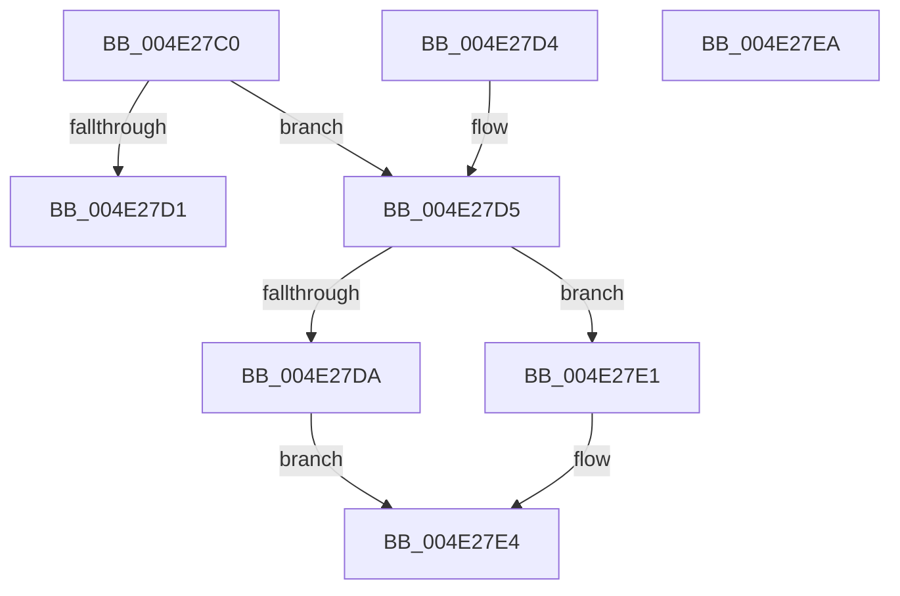

# IopValidateSectionSize

- RVA: `0x004E27C0`–`0x004E27EB` (길이 `43` bytes)
- VA: `0x00000001404E27C0`
- 실행 섹션: `.text`
- PDB 이름 있음: `예`; PDB Function 태그: `예`
- unwind 정보 RVA: `0x000DB714`
- 디코드: `18`개 명령, `43/43` bytes 표시
- 미해석 바이트: `0` (있으면 어셈블리에 `.byte`로 보존)

> 이 문서는 커널 이미지의 기계어와 PDB 기호를 분석해 생성했습니다. 4번과 5번은 함수 원형과 자료형을 바이너리 사용 방식에서 추정한 C 해석이며 원본 소스 복구 결과는 아닙니다.

## 1. Dependencies

- 직접 호출 지점: **0**; 고유 호출 대상: **0**
- 직접 호출자로 확인된 함수: **3**
- RIP 상대 이미지 참조: **0**

### Outgoing calls
- 직접 디코드된 call 명령이 없습니다.

### Direct callers
- [KeCapturePersistentThreadState](../43/KeCapturePersistentThreadState_function_00435D90.md) at `0x00436210`
- [IopAddCodeRegion](../59/IopAddCodeRegion_function_005941B4.md) at `0x0059420B`
- [sub_006EEE7E](../6E/Unknown_function_006EEE7E.md) at `0x006EEF13`
- [sub_006EEE7E](../6E/Unknown_function_006EEE7E.md) at `0x006EEF3E`

### Static image references
- 디코드된 RIP-relative 메모리 참조가 없습니다.

## 2. Other-region calls and transfers

- 다른 실행 섹션으로 향하는 call: **0**
- 별도 외부 분기/꼬리 이동을 확인하지 못했습니다.

## 3. Assembly (complete function range)

```asm
004E27C0  44 8B 02                        mov r8d, dword ptr [rdx]
004E27C3  41 B9 FC FF 03 00               mov r9d, 0x3fffc
004E27C9  44 03 C1                        add r8d, ecx
004E27CC  45 3B C1                        cmp r8d, r9d
004E27CF  73 04                           jae 0x1404e27d5
004E27D1  B0 01                           mov al, 1
004E27D3  C3                              ret
004E27D4  CC                              int3
004E27D5  41 3B C9                        cmp ecx, r9d
004E27D8  73 07                           jae 0x1404e27e1
004E27DA  8B C1                           mov eax, ecx
004E27DC  4C 2B C8                        sub r9, rax
004E27DF  EB 03                           jmp 0x1404e27e4
004E27E1  45 33 C9                        xor r9d, r9d
004E27E4  44 89 0A                        mov dword ptr [rdx], r9d
004E27E7  32 C0                           xor al, al
004E27E9  C3                              ret
004E27EA  CC                              int3
```

## 4. C-style interpretation (structured pseudocode)

```c
__int64 __fastcall IopValidateSectionSize(int a1, __int64 a2)
{
    __int64 result;

    a3 = (unsigned int)(((unsigned int)(*(unsigned int *)(a2))) + (a1));
    if (((unsigned int)(a3)) >= ((unsigned int)((unsigned int)(0x3FFFCULL)))) goto loc_004E27D5;
    return 1;
loc_004E27D5:
    if (a1 >= ((unsigned int)((unsigned int)(0x3FFFCULL)))) goto loc_004E27E1;
    a4 = ((unsigned int)(0x3FFFCULL)) - ((unsigned int)(a1));
    goto loc_004E27E4;
loc_004E27E1:
    a4 = 0;
loc_004E27E4:
    *(unsigned int *)(a2) = 0;
    result = 0;
    return result;
}
```

## 5. (Beta) C Style

```c
int64_t IopValidateSectionSize(int32_t Arg1, void *Arg2)
{
    uint8_t *arg2 = (uint8_t *)Arg2;

    int64_t result;

    a3 = (uint32_t)(((uint32_t)(*(uint32_t *)(arg2))) + (Arg1));
    if (((uint32_t)(a3)) >= ((uint32_t)((uint32_t)(0x3FFFCULL)))) goto loc_004E27D5;
    return 1;
loc_004E27D5:
    if (Arg1 >= ((uint32_t)((uint32_t)(0x3FFFCULL)))) goto loc_004E27E1;
    a4 = ((uint32_t)(0x3FFFCULL)) - ((uint32_t)(Arg1));
    goto loc_004E27E4;
loc_004E27E1:
    a4 = 0;
loc_004E27E4:
    *(uint32_t *)(arg2) = 0;
    result = 0;
    return result;
}
```

### 관측된 메모리 오프셋

구조체 형식이 확인되지 않은 접근은 인자 기준의 오프셋으로만 기록했습니다.

| 기준 인자 | 오프셋 표현 | 폭 (bit) | 접근 |
|---|---:|---:|---|
| `Arg2` | `+ 0x0` | `32` | `R` |
| `Arg2` | `+ 0x0` | `32` | `W` |

## 6. Execution-region graph

[열기: 2D/3D 그래프와 함수 탐색 컨트롤 패널](../../../control-panel.html?section=text&rva=0x004E27C0&view=graph)

- 2D 그래프는 위에서 아래로 흐르고, 3D 그래프는 빈 공간을 드래그해 회전합니다. Shift+드래그는 이동, 휠은 확대·축소, 함수 노드 선택은 대상 보고서 이동입니다.

### Static fallback


