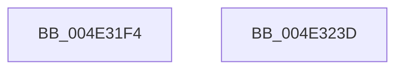

# IvtBuildContextEntry

- RVA: `0x004E31F4`–`0x004E323E` (길이 `74` bytes)
- VA: `0x00000001404E31F4`
- 실행 섹션: `.text`
- PDB 이름 있음: `예`; PDB Function 태그: `아니요`
- unwind 정보 RVA: `0x000DB714`
- 디코드: `19`개 명령, `74/74` bytes 표시
- 미해석 바이트: `0` (있으면 어셈블리에 `.byte`로 보존)

> 이 문서는 커널 이미지의 기계어와 PDB 기호를 분석해 생성했습니다. 4번과 5번은 함수 원형과 자료형을 바이너리 사용 방식에서 추정한 C 해석이며 원본 소스 복구 결과는 아닙니다.

## 1. Dependencies

- 직접 호출 지점: **0**; 고유 호출 대상: **0**
- 직접 호출자로 확인된 함수: **1**
- RIP 상대 이미지 참조: **0**

### Outgoing calls
- 직접 디코드된 call 명령이 없습니다.

### Direct callers
- [IvtInitializeIommu](../../pagelk/B6/IvtInitializeIommu_function_00B61FE0.md) at `0x00B6242C`

### Static image references
- 디코드된 RIP-relative 메모리 참조가 없습니다.

## 2. Other-region calls and transfers

- 다른 실행 섹션으로 향하는 call: **0**
- 별도 외부 분기/꼬리 이동을 확인하지 못했습니다.

## 3. Assembly (complete function range)

```asm
004E31F4  4C 8B 5C 24 28                  mov r11, qword ptr [rsp + 0x28]
004E31F9  41 0F B7 C0                     movzx eax, r8w
004E31FD  48 C1 E0 08                     shl rax, 8
004E3201  49 C1 E1 0C                     shl r9, 0xc
004E3205  49 83 23 00                     and qword ptr [r11], 0
004E3209  44 8B 91 F8 00 00 00            mov r10d, dword ptr [rcx + 0xf8]
004E3210  41 8B 0B                        mov ecx, dword ptr [r11]
004E3213  41 83 E2 07                     and r10d, 7
004E3217  4C 0B D0                        or r10, rax
004E321A  81 E1 F2 0F 00 00               and ecx, 0xff2
004E3220  48 8D 04 95 00 00 00 00         lea rax, [rdx*4]
004E3228  4D 89 53 08                     mov qword ptr [r11 + 8], r10
004E322C  49 0B C9                        or rcx, r9
004E322F  83 E0 0C                        and eax, 0xc
004E3232  48 33 C8                        xor rcx, rax
004E3235  48 83 C9 01                     or rcx, 1
004E3239  49 89 0B                        mov qword ptr [r11], rcx
004E323C  C3                              ret
004E323D  CC                              int3
```

## 4. C-style interpretation (structured pseudocode)

```c
__int64 __fastcall IvtBuildContextEntry(__int64 a1, __int64 a2, unsigned __int16 a3, __int64 a4, __int64 a5)
{
    __int64 result;
    __int64 v_r10;

    result = (a3) << (8);
    a4 = (a4) << (12);
    v_r10 = (unsigned int)(((unsigned int)(*(unsigned int *)(a1 + 248))) & (7));
    v_r10 = (v_r10) | (result);
    a1 = (unsigned int)(((unsigned int)(*(unsigned int *)(a5))) & (0xFF2ULL));
    *(unsigned __int64 *)(a5 + 8) = v_r10;
    a1 = (a1) | (a4);
    result = (unsigned int)((a2 * 4) & (12));
    a1 = (a1) ^ (result);
    a1 = (a1) | (1);
    *(unsigned __int64 *)(a5) = a1;
    return result;
}
```

## 5. (Beta) C Style

```c
int64_t IvtBuildContextEntry(void *Arg1, int64_t Arg2, uint16_t Arg3, int64_t Arg4, void *Arg5)
{
    uint8_t *arg1 = (uint8_t *)Arg1;
    uint8_t *arg5 = (uint8_t *)Arg5;

    int64_t result;
    int64_t local_r10;

    result = (Arg3) << (8);
    Arg4 = (Arg4) << (12);
    local_r10 = (uint32_t)(((uint32_t)(*(uint32_t *)(arg1 + 0xF8))) & (7));
    local_r10 = (local_r10) | (result);
    Arg1 = (uint32_t)(((uint32_t)(*(uint32_t *)(arg5))) & (0xFF2ULL));
    *(uint64_t *)(arg5 + 0x8) = local_r10;
    Arg1 = (Arg1) | (Arg4);
    result = (uint32_t)((Arg2 * 4) & (12));
    Arg1 = (Arg1) ^ (result);
    Arg1 = (Arg1) | (1);
    *(void **)(arg5) = Arg1;
    return result;
}
```

### 관측된 메모리 오프셋

구조체 형식이 확인되지 않은 접근은 인자 기준의 오프셋으로만 기록했습니다.

| 기준 인자 | 오프셋 표현 | 폭 (bit) | 접근 |
|---|---:|---:|---|
| `Arg1` | `+ 0xF8` | `32` | `R` |
| `Arg5` | `+ 0x0` | `32` | `R` |
| `Arg5` | `+ 0x0` | `64` | `R/W` |
| `Arg5` | `+ 0x0` | `64` | `W` |
| `Arg5` | `+ 0x8` | `64` | `W` |

## 6. Execution-region graph

[열기: 2D/3D 그래프와 함수 탐색 컨트롤 패널](../../../control-panel.html?section=text&rva=0x004E31F4&view=graph)

- 2D 그래프는 위에서 아래로 흐르고, 3D 그래프는 빈 공간을 드래그해 회전합니다. Shift+드래그는 이동, 휠은 확대·축소, 함수 노드 선택은 대상 보고서 이동입니다.

### Static fallback


