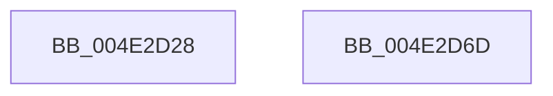

# IvtBuildScalableModePasidDirectoryEntry

- RVA: `0x004E2D28`–`0x004E2D6E` (길이 `70` bytes)
- VA: `0x00000001404E2D28`
- 실행 섹션: `.text`
- PDB 이름 있음: `예`; PDB Function 태그: `아니요`
- unwind 정보 RVA: `0x0005CF00`
- 디코드: `19`개 명령, `70/70` bytes 표시
- 미해석 바이트: `0` (있으면 어셈블리에 `.byte`로 보존)

> 이 문서는 커널 이미지의 기계어와 PDB 기호를 분석해 생성했습니다. 4번과 5번은 함수 원형과 자료형을 바이너리 사용 방식에서 추정한 C 해석이며 원본 소스 복구 결과는 아닙니다.

## 1. Dependencies

- 직접 호출 지점: **1**; 고유 호출 대상: **1**
- 직접 호출자로 확인된 함수: **2**
- RIP 상대 이미지 참조: **0**

### Outgoing calls
- `0x004E2D4C` → [MmGetPhysicalAddress](../23/MmGetPhysicalAddress_function_0023A500.md) (function, `0x0023A500`)

### Direct callers
- [IvtInitializeScalableModePasidTables](../57/IvtInitializeScalableModePasidTables_function_00570728.md) at `0x00570816`
- [IvtLegacyInitializeScalableModePasidTables](../57/IvtLegacyInitializeScalableModePasidTables_function_00571DE4.md) at `0x00571E97`

### Static image references
- 디코드된 RIP-relative 메모리 참조가 없습니다.

## 2. Other-region calls and transfers

- 다른 실행 섹션으로 향하는 call: **0**
- 별도 외부 분기/꼬리 이동을 확인하지 못했습니다.

## 3. Assembly (complete function range)

```asm
004E2D28  40 53                           push rbx
004E2D2A  48 83 EC 20                     sub rsp, 0x20
004E2D2E  48 8B 5C 24 50                  mov rbx, qword ptr [rsp + 0x50]
004E2D33  41 8B C8                        mov ecx, r8d
004E2D36  48 C1 E9 06                     shr rcx, 6
004E2D3A  81 E1 FF 3F 00 00               and ecx, 0x3fff
004E2D40  48 C7 03 01 00 00 00            mov qword ptr [rbx], 1
004E2D47  48 8B 4C CA 40                  mov rcx, qword ptr [rdx + rcx*8 + 0x40]
004E2D4C  E8 AF 77 D5 FF                  call 0x14023a500
004E2D51  48 8B 0B                        mov rcx, qword ptr [rbx]
004E2D54  48 8B D1                        mov rdx, rcx
004E2D57  48 33 D0                        xor rdx, rax
004E2D5A  48 81 E2 00 F0 FF FF            and rdx, 0xfffffffffffff000
004E2D61  48 33 D1                        xor rdx, rcx
004E2D64  48 89 13                        mov qword ptr [rbx], rdx
004E2D67  48 83 C4 20                     add rsp, 0x20
004E2D6B  5B                              pop rbx
004E2D6C  C3                              ret
004E2D6D  CC                              int3
```

## 4. C-style interpretation (structured pseudocode)

```c
__int64 __fastcall IvtBuildScalableModePasidDirectoryEntry(__int64 a1, __int64 a2, int a3, __int64 a4, __int64 a5)
{
    __int64 result;
    __int64 v_rsp;

    v_rsp = (v_rsp) - (32);
    a1 = ((unsigned int)(a3)) >> (6);
    a1 = (unsigned int)((a1) & (0x3FFFULL));
    *(unsigned __int64 *)(a5) = 1;
    result = MmGetPhysicalAddress(*(unsigned __int64 *)(a2 + a1 * 8 + 64), a2, a3, a4);
    a2 = (*(unsigned __int64 *)(a5)) ^ (result);
    a2 = (a2) & (0xFFFFFFFFFFFFF000ULL);
    a2 = (a2) ^ (*(unsigned __int64 *)(a5));
    *(unsigned __int64 *)(a5) = a2;
    v_rsp = (v_rsp) + (32);
    return result;
}
```

## 5. (Beta) C Style

```c
int64_t IvtBuildScalableModePasidDirectoryEntry(int64_t Arg1, void *Arg2, int32_t Arg3, int64_t Arg4, void *Arg5)
{
    uint8_t *arg2 = (uint8_t *)Arg2;
    uint8_t *arg5 = (uint8_t *)Arg5;

    int64_t result;
    int64_t local_rsp;

    local_rsp = (local_rsp) - (32);
    Arg1 = ((uint32_t)(Arg3)) >> (6);
    Arg1 = (uint32_t)((Arg1) & (0x3FFFULL));
    *(uint64_t *)(arg5) = 1;
    result = MmGetPhysicalAddress(*(uint64_t *)(arg2 + Arg1 * 8 + 0x40), Arg2, Arg3, Arg4);
    Arg2 = (*(uint64_t *)(arg5)) ^ (result);
    Arg2 = (Arg2) & (0xFFFFFFFFFFFFF000ULL);
    Arg2 = (Arg2) ^ (*(uint64_t *)(arg5));
    *(void **)(arg5) = Arg2;
    local_rsp = (local_rsp) + (32);
    return result;
}
```

### 관측된 메모리 오프셋

구조체 형식이 확인되지 않은 접근은 인자 기준의 오프셋으로만 기록했습니다.

| 기준 인자 | 오프셋 표현 | 폭 (bit) | 접근 |
|---|---:|---:|---|
| `Arg2` | `+ 0x40 + rcx*8` | `64` | `R` |
| `Arg5` | `+ 0x0` | `64` | `R` |
| `Arg5` | `+ 0x0` | `64` | `W` |

## 6. Execution-region graph

[열기: 2D/3D 그래프와 함수 탐색 컨트롤 패널](../../../control-panel.html?section=text&rva=0x004E2D28&view=graph)

- 2D 그래프는 위에서 아래로 흐르고, 3D 그래프는 빈 공간을 드래그해 회전합니다. Shift+드래그는 이동, 휠은 확대·축소, 함수 노드 선택은 대상 보고서 이동입니다.

### Static fallback


