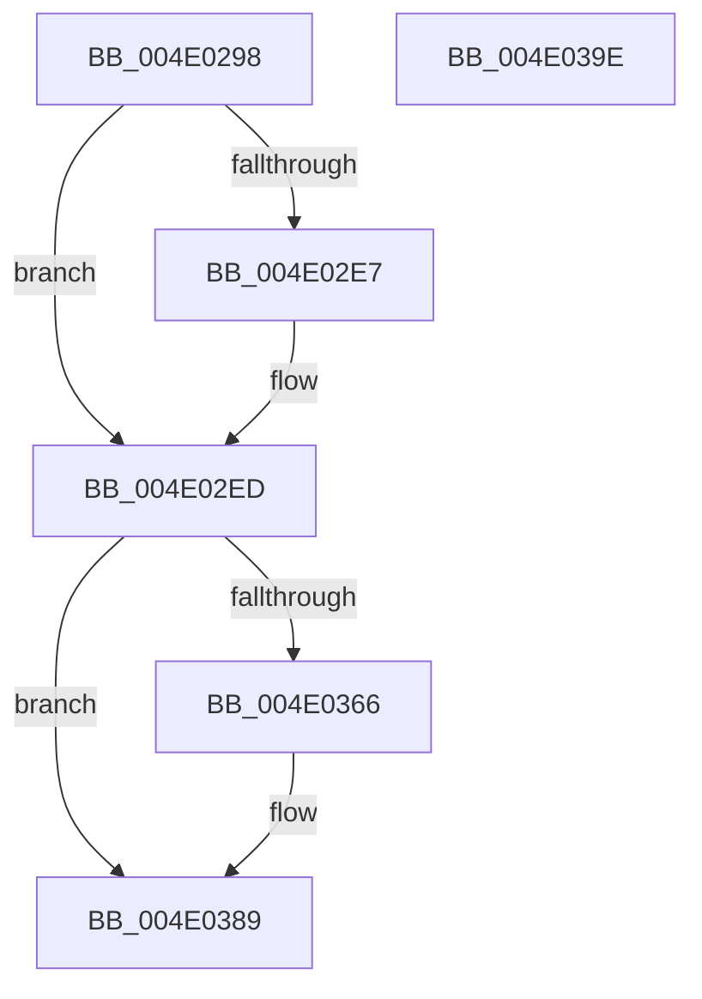

# KdpSetCommonState

- RVA: `0x004E0298`–`0x004E039F` (길이 `263` bytes)
- VA: `0x00000001404E0298`
- 실행 섹션: `.text`
- PDB 이름 있음: `예`; PDB Function 태그: `아니요`
- unwind 정보 RVA: `0x000A118C`
- 디코드: `62`개 명령, `263/263` bytes 표시
- 미해석 바이트: `0` (있으면 어셈블리에 `.byte`로 보존)

> 이 문서는 커널 이미지의 기계어와 PDB 기호를 분석해 생성했습니다. 4번과 5번은 함수 원형과 자료형을 바이너리 사용 방식에서 추정한 C 해석이며 원본 소스 복구 결과는 아닙니다.

## 1. Dependencies

- 직접 호출 지점: **4**; 고유 호출 대상: **3**
- 직접 호출자로 확인된 함수: **3**
- RIP 상대 이미지 참조: **1**

### Outgoing calls
- `0x004E02D7` → [KeQueryActiveProcessorCountEx](../24/KeQueryActiveProcessorCountEx_function_00249EF0.md) (function, `0x00249EF0`)
- `0x004E0343` → [KdpCopyMemoryChunks](../../pagekd/B8/KdpCopyMemoryChunks_function_00B8AACC.md) (function, `0x00B8AACC`)
- `0x004E035D` → [KdpDeleteBreakpointRange](../../pagekd/B8/KdpDeleteBreakpointRange_function_00B8A15C.md) (function, `0x00B8A15C`)
- `0x004E0384` → [KdpCopyMemoryChunks](../../pagekd/B8/KdpCopyMemoryChunks_function_00B8AACC.md) (function, `0x00B8AACC`)

### Direct callers
- [KdpReportCommandStringStateChange](../../pagekd/B8/KdpReportCommandStringStateChange_function_00B87AAC.md) at `0x00B87B1C`
- [KdpReportLoadSymbolsStateChange](../../pagekd/B8/KdpReportLoadSymbolsStateChange_function_00B87C44.md) at `0x00B87CAE`
- [KdpReportExceptionStateChange](../../pagekd/B8/KdpReportExceptionStateChange_function_00B8A1E0.md) at `0x00B8A24B`

### Static image references
- `0x004E02B3` → RVA `0x00FC6BE8` (`ALMOSTRO`; read)

## 2. Other-region calls and transfers

- 다른 실행 섹션으로 향하는 call: **3**
  - `0x004E0343` → [KdpCopyMemoryChunks](../../pagekd/B8/KdpCopyMemoryChunks_function_00B8AACC.md) (`.text` → `PAGEKD`)
  - `0x004E035D` → [KdpDeleteBreakpointRange](../../pagekd/B8/KdpDeleteBreakpointRange_function_00B8A15C.md) (`.text` → `PAGEKD`)
  - `0x004E0384` → [KdpCopyMemoryChunks](../../pagekd/B8/KdpCopyMemoryChunks_function_00B8AACC.md) (`.text` → `PAGEKD`)
- 별도 외부 분기/꼬리 이동을 확인하지 못했습니다.

## 3. Assembly (complete function range)

```asm
004E0298  48 8B C4                        mov rax, rsp
004E029B  48 89 58 10                     mov qword ptr [rax + 0x10], rbx
004E029F  48 89 68 18                     mov qword ptr [rax + 0x18], rbp
004E02A3  48 89 70 20                     mov qword ptr [rax + 0x20], rsi
004E02A7  57                              push rdi
004E02A8  48 83 EC 30                     sub rsp, 0x30
004E02AC  83 60 08 00                     and dword ptr [rax + 8], 0
004E02B0  49 8B D8                        mov rbx, r8
004E02B3  0F B7 05 2E 69 AE 00            movzx eax, word ptr [rip + 0xae692e]
004E02BA  48 8B FA                        mov rdi, rdx
004E02BD  41 89 08                        mov dword ptr [r8], ecx
004E02C0  B9 FF FF 00 00                  mov ecx, 0xffff
004E02C5  66 41 89 40 04                  mov word ptr [r8 + 4], ax
004E02CA  65 8B 04 25 A4 01 00 00         mov eax, dword ptr gs:[0x1a4]
004E02D2  66 41 89 40 06                  mov word ptr [r8 + 6], ax
004E02D7  E8 14 9C D6 FF                  call 0x140249ef0
004E02DC  0F B7 4B 06                     movzx ecx, word ptr [rbx + 6]
004E02E0  89 43 08                        mov dword ptr [rbx + 8], eax
004E02E3  3B C1                           cmp eax, ecx
004E02E5  77 06                           ja 0x1404e02ed
004E02E7  8D 41 01                        lea eax, [rcx + 1]
004E02EA  89 43 08                        mov dword ptr [rbx + 8], eax
004E02ED  65 48 8B 04 25 88 01 00 00      mov rax, qword ptr gs:[0x188]
004E02F6  48 8D AB D8 00 00 00            lea rbp, [rbx + 0xd8]
004E02FD  48 89 43 10                     mov qword ptr [rbx + 0x10], rax
004E0301  0F 57 C0                        xorps xmm0, xmm0
004E0304  48 8B BF F8 00 00 00            mov rdi, qword ptr [rdi + 0xf8]
004E030B  48 8D 44 24 40                  lea rax, [rsp + 0x40]
004E0310  48 89 7B 18                     mov qword ptr [rbx + 0x18], rdi
004E0314  45 33 C9                        xor r9d, r9d
004E0317  0F 11 83 C0 00 00 00            movups xmmword ptr [rbx + 0xc0], xmm0
004E031E  48 89 44 24 28                  mov qword ptr [rsp + 0x28], rax
004E0323  48 8B D5                        mov rdx, rbp
004E0326  0F 11 83 D0 00 00 00            movups xmmword ptr [rbx + 0xd0], xmm0
004E032D  45 8D 41 10                     lea r8d, [r9 + 0x10]
004E0331  C7 44 24 20 04 00 00 00         mov dword ptr [rsp + 0x20], 4
004E0339  48 8B CF                        mov rcx, rdi
004E033C  0F 11 83 E0 00 00 00            movups xmmword ptr [rbx + 0xe0], xmm0
004E0343  E8 84 A7 6A 00                  call 0x140b8aacc
004E0348  8B 74 24 40                     mov esi, dword ptr [rsp + 0x40]
004E034C  48 8B CF                        mov rcx, rdi
004E034F  66 89 B3 D4 00 00 00            mov word ptr [rbx + 0xd4], si
004E0356  48 8D 56 FF                     lea rdx, [rsi - 1]
004E035A  48 03 D7                        add rdx, rdi
004E035D  E8 FA 9D 6A 00                  call 0x140b8a15c
004E0362  84 C0                           test al, al
004E0364  74 23                           je 0x1404e0389
004E0366  48 8D 44 24 40                  lea rax, [rsp + 0x40]
004E036B  45 33 C9                        xor r9d, r9d
004E036E  48 89 44 24 28                  mov qword ptr [rsp + 0x28], rax
004E0373  44 8B C6                        mov r8d, esi
004E0376  48 8B D5                        mov rdx, rbp
004E0379  C7 44 24 20 04 00 00 00         mov dword ptr [rsp + 0x20], 4
004E0381  48 8B CF                        mov rcx, rdi
004E0384  E8 43 A7 6A 00                  call 0x140b8aacc
004E0389  48 8B 5C 24 48                  mov rbx, qword ptr [rsp + 0x48]
004E038E  48 8B 6C 24 50                  mov rbp, qword ptr [rsp + 0x50]
004E0393  48 8B 74 24 58                  mov rsi, qword ptr [rsp + 0x58]
004E0398  48 83 C4 30                     add rsp, 0x30
004E039C  5F                              pop rdi
004E039D  C3                              ret
004E039E  CC                              int3
```

## 4. C-style interpretation (structured pseudocode)

```c
__int64 __fastcall KdpSetCommonState(int a1, __int64 a2, __int64 a3, int a4)
{
    __int64 result;
    __int64 v_rsp;
    unsigned __int64 v_stack_m10;
    unsigned int v_stack_m18;
    unsigned __int64 v_stack_p10;
    unsigned __int64 v_stack_p18;
    unsigned __int64 v_stack_p20;
    unsigned __int64 v_stack_p8;

    *(unsigned __int64 *)(v_rsp + 16) = v_rbx;
    *(unsigned __int64 *)(v_rsp + 24) = v_rbp;
    *(unsigned __int64 *)(v_rsp + 32) = v_rsi;
    v_rsp = (v_rsp) - (48);
    *(unsigned int *)(a3) = a1;
    *(unsigned __int16 *)(a3 + 4) = (unsigned __int16)(*(unsigned __int16 *)(v_rip + 11430190));
    *(unsigned __int16 *)(a3 + 6) = (unsigned __int16)((unsigned int)(*(unsigned int *)(gs_base + (0 + 420))));
    result = KeQueryActiveProcessorCountEx((unsigned int)(0xFFFFULL), a2, a3, a4);
    *(unsigned int *)(a3 + 8) = (unsigned int)(result);
    if (((unsigned int)(result)) <= ((unsigned int)(*(unsigned __int16 *)(a3 + 6)))) {
        result = *(unsigned __int16 *)(a3 + 6) + 1;
        *(unsigned int *)(a3 + 8) = (unsigned int)(result);
    }
    *(unsigned __int64 *)(a3 + 16) = *(unsigned __int64 *)(gs_base + (0 + 392));
    *(unsigned __int64 *)(a3 + 24) = *(unsigned __int64 *)(a2 + 248);
    a4 = 0;
    *(unsigned __int64 *)(a3 + 192) = v_xmm0;
    v_stack_m10 = v_stack_p8;
    *(unsigned __int64 *)(a3 + 208) = v_xmm0;
    v_stack_m18 = 4;
    *(unsigned __int64 *)(a3 + 224) = v_xmm0;
    result = KdpCopyMemoryChunks(*(unsigned __int64 *)(a2 + 248), a3 + 216, a4 + 16, a4);
    *(unsigned __int16 *)(a3 + 212) = (unsigned __int16)((unsigned int)(v_stack_p8));
    a2 = ((unsigned int)(v_stack_p8) - 1) + (*(unsigned __int64 *)(a2 + 248));
    result = KdpDeleteBreakpointRange(*(unsigned __int64 *)(a2 + 248), a2, a4 + 16, a4);
    if ((unsigned __int8)(result) != 0) {
        result = v_stack_p8;
        a4 = 0;
        v_stack_m10 = result;
        a3 = (unsigned int)((unsigned int)(v_stack_p8));
        a2 = a3 + 216;
        v_stack_m18 = 4;
        a1 = *(unsigned __int64 *)(a2 + 248);
        result = KdpCopyMemoryChunks(a1, a2, a3, a4);
    }
    v_rsp = (v_rsp) + (48);
    return result;
}
```

## 5. (Beta) C Style

```c
int64_t KdpSetCommonState(int32_t Arg1, void *Arg2, void *Arg3, int32_t Arg4)
{
    uint8_t *arg2 = (uint8_t *)Arg2;
    uint8_t *arg3 = (uint8_t *)Arg3;

    int64_t result;
    int64_t local_rsp;
    uint64_t v_stack_m10;
    uint32_t v_stack_m18;
    uint64_t v_stack_p10;
    uint64_t v_stack_p18;
    uint64_t v_stack_p20;
    uint64_t v_stack_p8;

    *(uint64_t *)(local_rsp + 0x10) = local_rbx;
    *(uint64_t *)(local_rsp + 0x18) = local_rbp;
    *(uint64_t *)(local_rsp + 0x20) = local_rsi;
    local_rsp = (local_rsp) - (48);
    *(uint32_t *)(arg3) = Arg1;
    *(uint16_t *)(arg3 + 0x4) = (uint16_t)(*(uint16_t *)(v_rip + 0xAE692E));
    *(uint16_t *)(arg3 + 0x6) = (uint16_t)((uint32_t)(*(uint32_t *)(gs_base + (0 + 0x1A4))));
    result = KeQueryActiveProcessorCountEx((uint32_t)(0xFFFFULL), Arg2, Arg3, Arg4);
    *(uint32_t *)(arg3 + 0x8) = (uint32_t)(result);
    if (((uint32_t)(result)) <= ((uint32_t)(*(uint16_t *)(arg3 + 0x6)))) {
        result = *(uint16_t *)(arg3 + 0x6) + 1;
        *(uint32_t *)(arg3 + 0x8) = (uint32_t)(result);
    }
    *(uint64_t *)(arg3 + 0x10) = *(uint64_t *)(gs_base + (0 + 0x188));
    *(uint64_t *)(arg3 + 0x18) = *(uint64_t *)(arg2 + 0xF8);
    Arg4 = 0;
    *(uint64_t *)(arg3 + 0xC0) = v_xmm0;
    v_stack_m10 = v_stack_p8;
    *(uint64_t *)(arg3 + 0xD0) = v_xmm0;
    v_stack_m18 = 4;
    *(uint64_t *)(arg3 + 0xE0) = v_xmm0;
    result = KdpCopyMemoryChunks(*(uint64_t *)(arg2 + 0xF8), Arg3 + 216, Arg4 + 16, Arg4);
    *(uint16_t *)(arg3 + 0xD4) = (uint16_t)((uint32_t)(v_stack_p8));
    Arg2 = ((uint32_t)(v_stack_p8) - 1) + (*(uint64_t *)(arg2 + 0xF8));
    result = KdpDeleteBreakpointRange(*(uint64_t *)(arg2 + 0xF8), Arg2, Arg4 + 16, Arg4);
    if ((uint8_t)(result) != 0) {
        result = v_stack_p8;
        Arg4 = 0;
        v_stack_m10 = result;
        Arg3 = (uint32_t)((uint32_t)(v_stack_p8));
        Arg2 = Arg3 + 216;
        v_stack_m18 = 4;
        Arg1 = *(uint64_t *)(arg2 + 0xF8);
        result = KdpCopyMemoryChunks(Arg1, Arg2, Arg3, Arg4);
    }
    local_rsp = (local_rsp) + (48);
    return result;
}
```

### 관측된 메모리 오프셋

구조체 형식이 확인되지 않은 접근은 인자 기준의 오프셋으로만 기록했습니다.

| 기준 인자 | 오프셋 표현 | 폭 (bit) | 접근 |
|---|---:|---:|---|
| `Arg2` | `+ 0xF8` | `64` | `R` |
| `Arg3` | `+ 0x0` | `32` | `W` |
| `Arg3` | `+ 0x4` | `16` | `W` |
| `Arg3` | `+ 0x6` | `16` | `R` |
| `Arg3` | `+ 0x6` | `16` | `W` |
| `Arg3` | `+ 0x8` | `32` | `W` |
| `Arg3` | `+ 0x10` | `64` | `W` |
| `Arg3` | `+ 0x18` | `64` | `W` |
| `Arg3` | `+ 0xC0` | `128` | `R` |
| `Arg3` | `+ 0xD0` | `128` | `R` |
| `Arg3` | `+ 0xD4` | `16` | `W` |
| `Arg3` | `+ 0xD8` | `64` | `R` |
| `Arg3` | `+ 0xE0` | `128` | `R` |

## 6. Execution-region graph

[열기: 2D/3D 그래프와 함수 탐색 컨트롤 패널](../../../control-panel.html?section=text&rva=0x004E0298&view=graph)

- 2D 그래프는 위에서 아래로 흐르고, 3D 그래프는 빈 공간을 드래그해 회전합니다. Shift+드래그는 이동, 휠은 확대·축소, 함수 노드 선택은 대상 보고서 이동입니다.

### Static fallback


