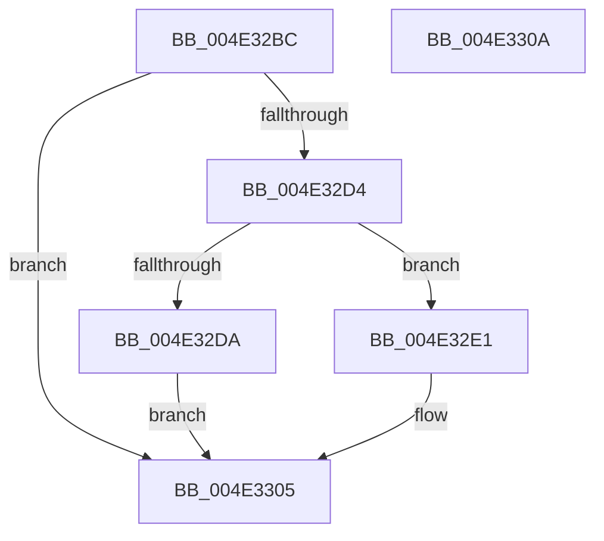

# KeDisableProfiling

- RVA: `0x004E32BC`–`0x004E330B` (길이 `79` bytes)
- VA: `0x00000001404E32BC`
- 실행 섹션: `.text`
- PDB 이름 있음: `예`; PDB Function 태그: `아니요`
- unwind 정보 RVA: `0x0005C788`
- 디코드: `20`개 명령, `79/79` bytes 표시
- 미해석 바이트: `0` (있으면 어셈블리에 `.byte`로 보존)

> 이 문서는 커널 이미지의 기계어와 PDB 기호를 분석해 생성했습니다. 4번과 5번은 함수 원형과 자료형을 바이너리 사용 방식에서 추정한 C 해석이며 원본 소스 복구 결과는 아닙니다.

## 1. Dependencies

- 직접 호출 지점: **1**; 고유 호출 대상: **1**
- 직접 호출자로 확인된 함수: **2**
- RIP 상대 이미지 참조: **0**

### Outgoing calls
- `0x004E32FE` → [ExFreePoolWithTag](../../poolcode/B8/ExFreePoolWithTag_function_00B82870.md) (function, `0x00B82870`)

### Direct callers
- [KeTerminateThread](../35/KeTerminateThread_function_00355138.md) at `0x00355464`
- [sub_00B1B2E4](../../page/B1/Unknown_function_00B1B2E4.md) at `0x00B1B3A0`

### Static image references
- 디코드된 RIP-relative 메모리 참조가 없습니다.

## 2. Other-region calls and transfers

- 다른 실행 섹션으로 향하는 call: **1**
  - `0x004E32FE` → [ExFreePoolWithTag](../../poolcode/B8/ExFreePoolWithTag_function_00B82870.md) (`.text` → `POOLCODE`)
- 별도 외부 분기/꼬리 이동을 확인하지 못했습니다.

## 3. Assembly (complete function range)

```asm
004E32BC  48 83 EC 28                     sub rsp, 0x28
004E32C0  4C 8B C1                        mov r8, rcx
004E32C3  B8 02 03 00 C0                  mov eax, 0xc0000302
004E32C8  48 8B 89 68 01 00 00            mov rcx, qword ptr [rcx + 0x168]
004E32CF  48 85 C9                        test rcx, rcx
004E32D2  74 31                           je 0x1404e3305
004E32D4  48 39 51 08                     cmp qword ptr [rcx + 8], rdx
004E32D8  74 07                           je 0x1404e32e1
004E32DA  B8 0D 00 00 C0                  mov eax, 0xc000000d
004E32DF  EB 24                           jmp 0x1404e3305
004E32E1  F0 41 0F BA 30 11               lock btr dword ptr [r8], 0x11
004E32E7  F0 41 0F BA 30 10               lock btr dword ptr [r8], 0x10
004E32ED  49 8B 88 68 01 00 00            mov rcx, qword ptr [r8 + 0x168]
004E32F4  33 D2                           xor edx, edx
004E32F6  49 83 A0 68 01 00 00 00         and qword ptr [r8 + 0x168], 0
004E32FE  E8 6D F5 69 00                  call 0x140b82870
004E3303  33 C0                           xor eax, eax
004E3305  48 83 C4 28                     add rsp, 0x28
004E3309  C3                              ret
004E330A  CC                              int3
```

## 4. C-style interpretation (structured pseudocode)

```c
__int64 __fastcall KeDisableProfiling(__int64 a1, __int64 a2)
{
    __int64 result;
    __int64 v_rsp;

    v_rsp = (v_rsp) - (40);
    if (*(unsigned __int64 *)(a1 + 360) == 0) goto loc_004E3305;
    if ((*(unsigned __int64 *)(*(unsigned __int64 *)(a1 + 360) + 8)) == a2) goto loc_004E32E1;
    goto loc_004E3305;
loc_004E32E1:
    a2 = 0;
    result = ExFreePoolWithTag(*(unsigned __int64 *)(a1 + 360), a2, a1, a4);
    result = 0;
loc_004E3305:
    v_rsp = (v_rsp) + (40);
    return result;
}
```

## 5. (Beta) C Style

```c
int64_t KeDisableProfiling(void *Arg1, int64_t Arg2)
{
    uint8_t *arg1 = (uint8_t *)Arg1;

    int64_t result;
    int64_t local_rsp;

    local_rsp = (local_rsp) - (40);
    if (*(uint64_t *)(arg1 + 0x168) == 0) goto loc_004E3305;
    if ((*(uint64_t *)(*(uint64_t *)(arg1 + 0x168) + 0x8)) == Arg2) goto loc_004E32E1;
    goto loc_004E3305;
loc_004E32E1:
    Arg2 = 0;
    result = ExFreePoolWithTag(*(uint64_t *)(arg1 + 0x168), Arg2, Arg1, a4);
    result = 0;
loc_004E3305:
    local_rsp = (local_rsp) + (40);
    return result;
}
```

### 관측된 메모리 오프셋

구조체 형식이 확인되지 않은 접근은 인자 기준의 오프셋으로만 기록했습니다.

| 기준 인자 | 오프셋 표현 | 폭 (bit) | 접근 |
|---|---:|---:|---|
| `Arg1` | `+ 0x0` | `32` | `R/W` |
| `Arg1` | `+ 0x168` | `64` | `R` |
| `Arg1` | `+ 0x168` | `64` | `R/W` |

## 6. Execution-region graph

[열기: 2D/3D 그래프와 함수 탐색 컨트롤 패널](../../../control-panel.html?section=text&rva=0x004E32BC&view=graph)

- 2D 그래프는 위에서 아래로 흐르고, 3D 그래프는 빈 공간을 드래그해 회전합니다. Shift+드래그는 이동, 휠은 확대·축소, 함수 노드 선택은 대상 보고서 이동입니다.

### Static fallback


