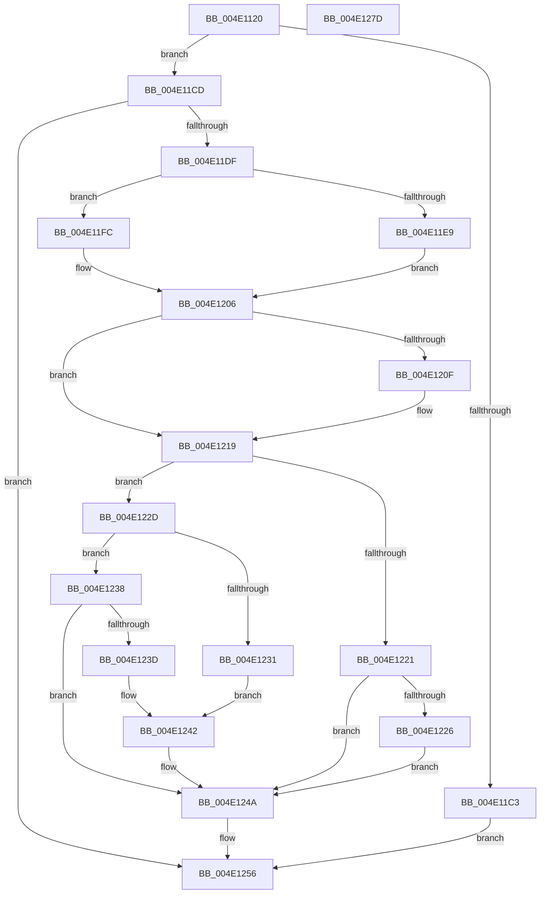

# KeStartProfile

- RVA: `0x004E1120`–`0x004E127E` (길이 `350` bytes)
- VA: `0x00000001404E1120`
- 실행 섹션: `.text`
- PDB 이름 있음: `예`; PDB Function 태그: `아니요`
- unwind 정보 RVA: `0x000BF104`
- 디코드: `87`개 명령, `350/350` bytes 표시
- 미해석 바이트: `0` (있으면 어셈블리에 `.byte`로 보존)

> 이 문서는 커널 이미지의 기계어와 PDB 기호를 분석해 생성했습니다. 4번과 5번은 함수 원형과 자료형을 바이너리 사용 방식에서 추정한 C 해석이며 원본 소스 복구 결과는 아닙니다.

## 1. Dependencies

- 직접 호출 지점: **11**; 고유 호출 대상: **9**
- 직접 호출자로 확인된 함수: **5**
- RIP 상대 이미지 참조: **5**

### Outgoing calls
- `0x004E1159` → [memset](../6C/memset_function_006C6C40.md) (function, `0x006C6C40`)
- `0x004E1196` → [memset](../6C/memset_function_006C6C40.md) (function, `0x006C6C40`)
- `0x004E11A0` → [KeQueryMaximumProcessorCountEx](../26/KeQueryMaximumProcessorCountEx_function_00264D60.md) (function, `0x00264D60`)
- `0x004E11B5` → [ExAllocatePool2](../../poolcode/B8/ExAllocatePool2_function_00B820F0.md) (function, `0x00B820F0`)
- `0x004E11D4` → [guard_dispatch_icall](../6B/guard_dispatch_icall_function_006BAAD0.md) (function, `0x006BAAD0`)
- `0x004E11F5` → [KeIpiGenericCall](../47/KeIpiGenericCall_function_00471720.md) (function, `0x00471720`)
- `0x004E1201` → [KiStartProfileTarget](../4A/KiStartProfileTarget_function_004A53F0.md) (function, `0x004A53F0`)
- `0x004E1214` → [ExFreePoolWithTag](../../poolcode/B8/ExFreePoolWithTag_function_00B82870.md) (function, `0x00B82870`)
- `0x004E1245` → [KeStopProfile](../5C/KeStopProfile_function_005C0640.md) (function, `0x005C0640`)
- `0x004E1251` → [guard_dispatch_icall](../6B/guard_dispatch_icall_function_006BAAD0.md) (function, `0x006BAAD0`)
- `0x004E125F` → [_security_check_cookie](../6A/_security_check_cookie_function_006AC640.md) (function, `0x006AC640`)

### Direct callers
- [EtwpTimeProfileStart](../../page/6F/EtwpTimeProfileStart_function_006FF5E0.md) at `0x006FF611`
- [EtwpCoverageSamplerStart](../../page/7C/EtwpCoverageSamplerStart_function_007C2248.md) at `0x007C24DE`
- [NtStartProfile](../../page/7D/NtStartProfile_function_007D22C0.md) at `0x007D2514`
- [sub_00B3C5BA](../../page/B3/Unknown_function_00B3C5BA.md) at `0x00B3C5E0`
- [KiInitializeCacheErrataSupport](../../init/C3/KiInitializeCacheErrataSupport_function_00C3A0D0.md) at `0x00C3A1B0`

### Static image references
- `0x004E113B` → RVA `0x00E0A740` (`.data`; read)
- `0x004E115E` → RVA `0x00FC6A80` (`ALMOSTRO`; read)
- `0x004E11CD` → RVA `0x00E00CE0` (`.data`; read)
- `0x004E11EE` → RVA `0x004A53F0` (`KiStartProfileTarget`; read)
- `0x004E124A` → RVA `0x00E00CF0` (`.data`; read)

## 2. Other-region calls and transfers

- 다른 실행 섹션으로 향하는 call: **2**
  - `0x004E11B5` → [ExAllocatePool2](../../poolcode/B8/ExAllocatePool2_function_00B820F0.md) (`.text` → `POOLCODE`)
  - `0x004E1214` → [ExFreePoolWithTag](../../poolcode/B8/ExFreePoolWithTag_function_00B82870.md) (`.text` → `POOLCODE`)
- 별도 외부 분기/꼬리 이동을 확인하지 못했습니다.

## 3. Assembly (complete function range)

```asm
004E1120  48 8B C4                        mov rax, rsp
004E1123  48 89 58 10                     mov qword ptr [rax + 0x10], rbx
004E1127  48 89 70 18                     mov qword ptr [rax + 0x18], rsi
004E112B  48 89 78 20                     mov qword ptr [rax + 0x20], rdi
004E112F  55                              push rbp
004E1130  48 8D 68 88                     lea rbp, [rax - 0x78]
004E1134  48 81 EC 70 01 00 00            sub rsp, 0x170
004E113B  48 8B 05 FE 95 92 00            mov rax, qword ptr [rip + 0x9295fe]
004E1142  48 33 C4                        xor rax, rsp
004E1145  48 89 45 60                     mov qword ptr [rbp + 0x60], rax
004E1149  48 8B F9                        mov rdi, rcx
004E114C  33 D2                           xor edx, edx
004E114E  48 8D 4C 24 20                  lea rcx, [rsp + 0x20]
004E1153  41 B8 38 01 00 00               mov r8d, 0x138
004E1159  E8 E2 5A 1E 00                  call 0x1406c6c40
004E115E  8B 05 1C 59 AE 00               mov eax, dword ptr [rip + 0xae591c]
004E1164  48 8D 4C 24 40                  lea rcx, [rsp + 0x40]
004E1169  89 44 24 2C                     mov dword ptr [rsp + 0x2c], eax
004E116D  33 D2                           xor edx, edx
004E116F  8B 05 0B 59 AE 00               mov eax, dword ptr [rip + 0xae590b]
004E1175  41 B8 00 01 00 00               mov r8d, 0x100
004E117B  83 64 24 3C 00                  and dword ptr [rsp + 0x3c], 0
004E1180  BE 01 00 00 00                  mov esi, 1
004E1185  89 44 24 28                     mov dword ptr [rsp + 0x28], eax
004E1189  C7 44 24 38 01 00 20 00         mov dword ptr [rsp + 0x38], 0x200001
004E1191  48 89 7C 24 20                  mov qword ptr [rsp + 0x20], rdi
004E1196  E8 A5 5A 1E 00                  call 0x1406c6c40
004E119B  B9 FF FF 00 00                  mov ecx, 0xffff
004E11A0  E8 BB 3B D8 FF                  call 0x140264d60
004E11A5  8D 4E 3F                        lea ecx, [rsi + 0x3f]
004E11A8  41 B8 50 72 6F 66               mov r8d, 0x666f7250
004E11AE  8D 14 85 24 01 00 00            lea edx, [rax*4 + 0x124]
004E11B5  E8 36 0F 6A 00                  call 0x140b820f0
004E11BA  48 89 45 40                     mov qword ptr [rbp + 0x40], rax
004E11BE  48 85 C0                        test rax, rax
004E11C1  75 0A                           jne 0x1404e11cd
004E11C3  BB 9A 00 00 C0                  mov ebx, 0xc000009a
004E11C8  E9 89 00 00 00                  jmp 0x1404e1256
004E11CD  48 8B 05 0C FB 91 00            mov rax, qword ptr [rip + 0x91fb0c]
004E11D4  E8 F7 98 1D 00                  call 0x1406baad0
004E11D9  8B D8                           mov ebx, eax
004E11DB  85 C0                           test eax, eax
004E11DD  78 77                           js 0x1404e1256
004E11DF  8B 0D 9B 58 AE 00               mov ecx, dword ptr [rip + 0xae589b]
004E11E5  3B CE                           cmp ecx, esi
004E11E7  76 13                           jbe 0x1404e11fc
004E11E9  48 8D 54 24 20                  lea rdx, [rsp + 0x20]
004E11EE  48 8D 0D FB 41 FC FF            lea rcx, [rip - 0x3be05]
004E11F5  E8 26 05 F9 FF                  call 0x140471720
004E11FA  EB 0A                           jmp 0x1404e1206
004E11FC  48 8D 4C 24 20                  lea rcx, [rsp + 0x20]
004E1201  E8 EA 41 FC FF                  call 0x1404a53f0
004E1206  48 8B 4D 40                     mov rcx, qword ptr [rbp + 0x40]
004E120A  48 85 C9                        test rcx, rcx
004E120D  74 0A                           je 0x1404e1219
004E120F  BA 50 72 6F 66                  mov edx, 0x666f7250
004E1214  E8 57 16 6A 00                  call 0x140b82870
004E1219  8B 44 24 30                     mov eax, dword ptr [rsp + 0x30]
004E121D  85 C0                           test eax, eax
004E121F  75 0C                           jne 0x1404e122d
004E1221  38 45 50                        cmp byte ptr [rbp + 0x50], al
004E1224  75 24                           jne 0x1404e124a
004E1226  BB FF 00 00 00                  mov ebx, 0xff
004E122B  EB 1D                           jmp 0x1404e124a
004E122D  A8 02                           test al, 2
004E122F  74 07                           je 0x1404e1238
004E1231  BB BB 00 00 C0                  mov ebx, 0xc00000bb
004E1236  EB 0A                           jmp 0x1404e1242
004E1238  40 84 C6                        test sil, al
004E123B  74 0D                           je 0x1404e124a
004E123D  BB 11 00 00 80                  mov ebx, 0x80000011
004E1242  48 8B CF                        mov rcx, rdi
004E1245  E8 F6 F3 0D 00                  call 0x1405c0640
004E124A  48 8B 05 9F FA 91 00            mov rax, qword ptr [rip + 0x91fa9f]
004E1251  E8 7A 98 1D 00                  call 0x1406baad0
004E1256  8B C3                           mov eax, ebx
004E1258  48 8B 4D 60                     mov rcx, qword ptr [rbp + 0x60]
004E125C  48 33 CC                        xor rcx, rsp
004E125F  E8 DC B3 1C 00                  call 0x1406ac640
004E1264  4C 8D 9C 24 70 01 00 00         lea r11, [rsp + 0x170]
004E126C  49 8B 5B 18                     mov rbx, qword ptr [r11 + 0x18]
004E1270  49 8B 73 20                     mov rsi, qword ptr [r11 + 0x20]
004E1274  49 8B 7B 28                     mov rdi, qword ptr [r11 + 0x28]
004E1278  49 8B E3                        mov rsp, r11
004E127B  5D                              pop rbp
004E127C  C3                              ret
004E127D  CC                              int3
```

## 4. C-style interpretation (structured pseudocode)

```c
__int64 __fastcall KeStartProfile(__int64 a1, int a2)
{
    __int64 result;
    __int64 v_rsp;
    unsigned __int64 v_stack_m138;
    unsigned int v_stack_m13C;
    unsigned int v_stack_m140;
    unsigned int v_stack_m148;
    unsigned int v_stack_m14C;
    unsigned int v_stack_m150;
    unsigned __int64 v_stack_m158;
    unsigned __int64 v_stack_m8;

    *(unsigned __int64 *)(v_rsp + 16) = v_rbx;
    *(unsigned __int64 *)(v_rsp + 24) = v_rsi;
    *(unsigned __int64 *)(v_rsp + 32) = v_rdi;
    v_rsp = (v_rsp) - (368);
    result = (*(unsigned __int64 *)(v_rip + 9606654)) ^ (v_rsp);
    *(unsigned __int64 *)(v_rsp - 120 + 96) = result;
    a2 = 0;
    result = memset(v_stack_m158, a2, 312, a4);
    v_stack_m14C = (unsigned int)((unsigned int)(*(unsigned int *)(v_rip + 11426076)));
    a2 = 0;
    v_stack_m150 = (unsigned int)((unsigned int)(*(unsigned int *)(v_rip + 11426059)));
    v_stack_m140 = 0x200001ULL;
    v_stack_m158 = a1;
    result = memset(v_stack_m138, a2, 256, a4);
    result = KeQueryMaximumProcessorCountEx((unsigned int)(0xFFFFULL), a2, 256, a4);
    result = ExAllocatePool2(1 + 63, result * 4 + 292, (unsigned int)(0x666F7250ULL), a4);
    *(unsigned __int64 *)(v_rsp - 120 + 64) = result;
    if (result != 0) goto loc_004E11CD;
    goto loc_004E1256;
loc_004E11CD:
    result = guard_dispatch_icall(1 + 63, result * 4 + 292, (unsigned int)(0x666F7250ULL), a4);
    if (sign_flag) goto loc_004E1256;
    if (((unsigned int)((unsigned int)(*(unsigned int *)(v_rip + 11425947)))) <= 1) goto loc_004E11FC;
    result = KeIpiGenericCall(v_rip - 245253, v_stack_m158, (unsigned int)(0x666F7250ULL), a4);
    goto loc_004E1206;
loc_004E11FC:
    result = KiStartProfileTarget(v_stack_m158, v_stack_m158, (unsigned int)(0x666F7250ULL), a4);
loc_004E1206:
    if (*(unsigned __int64 *)(v_rsp - 120 + 64) != 0) {
        a2 = 0x666F7250ULL;
        result = ExFreePoolWithTag(*(unsigned __int64 *)(v_rsp - 120 + 64), a2, (unsigned int)(0x666F7250ULL), a4);
    }
    if ((unsigned int)((unsigned int)(v_stack_m148)) != 0) goto loc_004E122D;
    if ((*(unsigned __int8 *)(v_rsp - 120 + 80)) != ((unsigned __int8)((unsigned int)(v_stack_m148)))) goto loc_004E124A;
    goto loc_004E124A;
loc_004E122D:
    if ((((unsigned __int8)((unsigned int)(v_stack_m148))) & (2)) == 0) goto loc_004E1238;
    goto loc_004E1242;
loc_004E1238:
    if (((1) & ((unsigned __int8)((unsigned int)(v_stack_m148)))) == 0) goto loc_004E124A;
loc_004E1242:
    result = KeStopProfile(a1, a2, (unsigned int)(0x666F7250ULL), a4);
loc_004E124A:
    result = guard_dispatch_icall(a1, a2, (unsigned int)(0x666F7250ULL), a4);
loc_004E1256:
    a1 = (*(unsigned __int64 *)(v_rsp - 120 + 96)) ^ (v_rsp);
    result = _security_check_cookie(a1, a2, (unsigned int)(0x666F7250ULL), a4);
    return result;
}
```

## 5. (Beta) C Style

```c
int64_t KeStartProfile(int64_t Arg1, int32_t Arg2)
{
    int64_t result;
    int64_t local_rsp;
    uint64_t v_stack_m138;
    uint32_t v_stack_m13C;
    uint32_t v_stack_m140;
    uint32_t v_stack_m148;
    uint32_t v_stack_m14C;
    uint32_t v_stack_m150;
    uint64_t v_stack_m158;
    uint64_t v_stack_m8;

    *(uint64_t *)(local_rsp + 0x10) = local_rbx;
    *(uint64_t *)(local_rsp + 0x18) = local_rsi;
    *(uint64_t *)(local_rsp + 0x20) = local_rdi;
    local_rsp = (local_rsp) - (368);
    result = (*(uint64_t *)(v_rip + 0x9295FE)) ^ (local_rsp);
    *(uint64_t *)(local_rsp - 0x78 + 0x60) = result;
    Arg2 = 0;
    result = memset(v_stack_m158, Arg2, 312, a4);
    v_stack_m14C = (uint32_t)((uint32_t)(*(uint32_t *)(v_rip + 0xAE591C)));
    Arg2 = 0;
    v_stack_m150 = (uint32_t)((uint32_t)(*(uint32_t *)(v_rip + 0xAE590B)));
    v_stack_m140 = 0x200001ULL;
    v_stack_m158 = Arg1;
    result = memset(v_stack_m138, Arg2, 256, a4);
    result = KeQueryMaximumProcessorCountEx((uint32_t)(0xFFFFULL), Arg2, 256, a4);
    result = ExAllocatePool2(1 + 63, result * 4 + 292, (uint32_t)(0x666F7250ULL), a4);
    *(uint64_t *)(local_rsp - 0x78 + 0x40) = result;
    if (result != 0) goto loc_004E11CD;
    goto loc_004E1256;
loc_004E11CD:
    result = guard_dispatch_icall(1 + 63, result * 4 + 292, (uint32_t)(0x666F7250ULL), a4);
    if (sign_flag) goto loc_004E1256;
    if (((uint32_t)((uint32_t)(*(uint32_t *)(v_rip + 0xAE589B)))) <= 1) goto loc_004E11FC;
    result = KeIpiGenericCall(v_rip - 245253, v_stack_m158, (uint32_t)(0x666F7250ULL), a4);
    goto loc_004E1206;
loc_004E11FC:
    result = KiStartProfileTarget(v_stack_m158, v_stack_m158, (uint32_t)(0x666F7250ULL), a4);
loc_004E1206:
    if (*(uint64_t *)(local_rsp - 0x78 + 0x40) != 0) {
        Arg2 = 0x666F7250ULL;
        result = ExFreePoolWithTag(*(uint64_t *)(local_rsp - 0x78 + 0x40), Arg2, (uint32_t)(0x666F7250ULL), a4);
    }
    if ((uint32_t)((uint32_t)(v_stack_m148)) != 0) goto loc_004E122D;
    if ((*(uint8_t *)(local_rsp - 0x78 + 0x50)) != ((uint8_t)((uint32_t)(v_stack_m148)))) goto loc_004E124A;
    goto loc_004E124A;
loc_004E122D:
    if ((((uint8_t)((uint32_t)(v_stack_m148))) & (2)) == 0) goto loc_004E1238;
    goto loc_004E1242;
loc_004E1238:
    if (((1) & ((uint8_t)((uint32_t)(v_stack_m148)))) == 0) goto loc_004E124A;
loc_004E1242:
    result = KeStopProfile(Arg1, Arg2, (uint32_t)(0x666F7250ULL), a4);
loc_004E124A:
    result = guard_dispatch_icall(Arg1, Arg2, (uint32_t)(0x666F7250ULL), a4);
loc_004E1256:
    Arg1 = (*(uint64_t *)(local_rsp - 0x78 + 0x60)) ^ (local_rsp);
    result = _security_check_cookie(Arg1, Arg2, (uint32_t)(0x666F7250ULL), a4);
    return result;
}
```

## 6. Execution-region graph

[열기: 2D/3D 그래프와 함수 탐색 컨트롤 패널](../../../control-panel.html?section=text&rva=0x004E1120&view=graph)

- 2D 그래프는 위에서 아래로 흐르고, 3D 그래프는 빈 공간을 드래그해 회전합니다. Shift+드래그는 이동, 휠은 확대·축소, 함수 노드 선택은 대상 보고서 이동입니다.

### Static fallback


