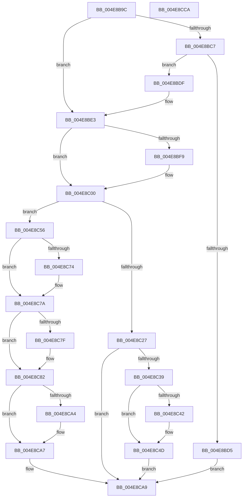

# KeSuspendThread

- RVA: `0x004E8B9C`–`0x004E8CCB` (길이 `303` bytes)
- VA: `0x00000001404E8B9C`
- 실행 섹션: `.text`
- PDB 이름 있음: `예`; PDB Function 태그: `아니요`
- unwind 정보 RVA: `0x000847EC`
- 디코드: `83`개 명령, `303/303` bytes 표시
- 미해석 바이트: `0` (있으면 어셈블리에 `.byte`로 보존)

> 이 문서는 커널 이미지의 기계어와 PDB 기호를 분석해 생성했습니다. 4번과 5번은 함수 원형과 자료형을 바이너리 사용 방식에서 추정한 C 해석이며 원본 소스 복구 결과는 아닙니다.

## 1. Dependencies

- 직접 호출 지점: **5**; 고유 호출 대상: **5**
- 직접 호출자로 확인된 함수: **2**
- RIP 상대 이미지 참조: **1**

### Outgoing calls
- `0x004E8BFB` → [KiRaiseIrqlProcessIrqlFlags](../4F/KiRaiseIrqlProcessIrqlFlags_function_004F56FC.md) (function, `0x004F56FC`)
- `0x004E8C13` → [KiAcquireKobjectLockSafe](../25/KiAcquireKobjectLockSafe_function_00251C90.md) (function, `0x00251C90`)
- `0x004E8C48` → [KiLowerIrqlProcessIrqlFlags](../4F/KiLowerIrqlProcessIrqlFlags_function_004F5698.md) (function, `0x004F5698`)
- `0x004E8C6B` → [KiSuspendThread](../46/KiSuspendThread_function_0046B964.md) (function, `0x0046B964`)
- `0x004E8C9A` → [KiExitDispatcher](../25/KiExitDispatcher_function_00251CF0.md) (function, `0x00251CF0`)

### Direct callers
- [PspSuspendThread](../../page/78/PspSuspendThread_function_00787A0C.md) at `0x00787AA2`
- [PspInsertThread](../../page/9F/PspInsertThread_function_009F0314.md) at `0x009F0891`

### Static image references
- `0x004E8BF0` → RVA `0x00FC6D20` (`ALMOSTRO`; read)

## 2. Other-region calls and transfers

- 다른 실행 섹션으로 향하는 call: **0**
- 별도 외부 분기/꼬리 이동을 확인하지 못했습니다.

## 3. Assembly (complete function range)

```asm
004E8B9C  48 8B C4                        mov rax, rsp
004E8B9F  48 89 58 08                     mov qword ptr [rax + 8], rbx
004E8BA3  48 89 68 10                     mov qword ptr [rax + 0x10], rbp
004E8BA7  48 89 70 18                     mov qword ptr [rax + 0x18], rsi
004E8BAB  48 89 78 20                     mov qword ptr [rax + 0x20], rdi
004E8BAF  41 54                           push r12
004E8BB1  41 56                           push r14
004E8BB3  41 57                           push r15
004E8BB5  48 83 EC 30                     sub rsp, 0x30
004E8BB9  4D 8B F0                        mov r14, r8
004E8BBC  48 8B F2                        mov rsi, rdx
004E8BBF  48 8B F9                        mov rdi, rcx
004E8BC2  48 85 D2                        test rdx, rdx
004E8BC5  74 1C                           je 0x1404e8be3
004E8BC7  65 48 8B 04 25 88 01 00 00      mov rax, qword ptr gs:[0x188]
004E8BD0  48 3B C8                        cmp rcx, rax
004E8BD3  75 0A                           jne 0x1404e8bdf
004E8BD5  BF 0D 00 00 C0                  mov edi, 0xc000000d
004E8BDA  E9 CA 00 00 00                  jmp 0x1404e8ca9
004E8BDF  33 C0                           xor eax, eax
004E8BE1  88 02                           mov byte ptr [rdx], al
004E8BE3  44 0F 20 C3                     mov rbx, cr8
004E8BE7  BA 02 00 00 00                  mov edx, 2
004E8BEC  44 0F 22 C2                     mov cr8, rdx
004E8BF0  83 3D 29 E1 AD 00 00            cmp dword ptr [rip + 0xade129], 0
004E8BF7  74 07                           je 0x1404e8c00
004E8BF9  8A CB                           mov cl, bl
004E8BFB  E8 FC CA 00 00                  call 0x1404f56fc
004E8C00  65 4C 8B 24 25 20 00 00 00      mov r12, qword ptr gs:[0x20]
004E8C09  48 8D AF E0 02 00 00            lea rbp, [rdi + 0x2e0]
004E8C10  48 8B CD                        mov rcx, rbp
004E8C13  E8 78 90 D6 FF                  call 0x140251c90
004E8C18  0F BE 87 84 02 00 00            movsx eax, byte ptr [rdi + 0x284]
004E8C1F  44 8B F8                        mov r15d, eax
004E8C22  83 F8 7F                        cmp eax, 0x7f
004E8C25  75 2F                           jne 0x1404e8c56
004E8C27  BF 4A 00 00 C0                  mov edi, 0xc000004a
004E8C2C  F0 81 65 00 7F FF FF FF         lock and dword ptr [rbp], 0xffffff7f
004E8C34  80 FB FF                        cmp bl, 0xff
004E8C37  74 70                           je 0x1404e8ca9
004E8C39  83 3D E0 E0 AD 00 00            cmp dword ptr [rip + 0xade0e0], 0
004E8C40  74 0B                           je 0x1404e8c4d
004E8C42  44 0F 20 C1                     mov rcx, cr8
004E8C46  8A D3                           mov dl, bl
004E8C48  E8 4B CA 00 00                  call 0x1404f5698
004E8C4D  0F B6 C3                        movzx eax, bl
004E8C50  44 0F 22 C0                     mov cr8, rax
004E8C54  EB 53                           jmp 0x1404e8ca9
004E8C56  FE C0                           inc al
004E8C58  49 8B D4                        mov rdx, r12
004E8C5B  48 85 F6                        test rsi, rsi
004E8C5E  88 87 84 02 00 00               mov byte ptr [rdi + 0x284], al
004E8C64  48 8B CF                        mov rcx, rdi
004E8C67  41 0F 95 C0                     setne r8b
004E8C6B  E8 F4 2C F8 FF                  call 0x14046b964
004E8C70  84 C0                           test al, al
004E8C72  75 06                           jne 0x1404e8c7a
004E8C74  FE 8F 84 02 00 00               dec byte ptr [rdi + 0x284]
004E8C7A  48 85 F6                        test rsi, rsi
004E8C7D  74 03                           je 0x1404e8c82
004E8C7F  C6 06 01                        mov byte ptr [rsi], 1
004E8C82  F0 81 65 00 7F FF FF FF         lock and dword ptr [rbp], 0xffffff7f
004E8C8A  45 33 C9                        xor r9d, r9d
004E8C8D  88 5C 24 20                     mov byte ptr [rsp + 0x20], bl
004E8C91  33 D2                           xor edx, edx
004E8C93  49 8B CC                        mov rcx, r12
004E8C96  45 8D 41 01                     lea r8d, [r9 + 1]
004E8C9A  E8 51 90 D6 FF                  call 0x140251cf0
004E8C9F  4D 85 F6                        test r14, r14
004E8CA2  74 03                           je 0x1404e8ca7
004E8CA4  45 89 3E                        mov dword ptr [r14], r15d
004E8CA7  33 FF                           xor edi, edi
004E8CA9  48 8B 5C 24 50                  mov rbx, qword ptr [rsp + 0x50]
004E8CAE  8B C7                           mov eax, edi
004E8CB0  48 8B 7C 24 68                  mov rdi, qword ptr [rsp + 0x68]
004E8CB5  48 8B 6C 24 58                  mov rbp, qword ptr [rsp + 0x58]
004E8CBA  48 8B 74 24 60                  mov rsi, qword ptr [rsp + 0x60]
004E8CBF  48 83 C4 30                     add rsp, 0x30
004E8CC3  41 5F                           pop r15
004E8CC5  41 5E                           pop r14
004E8CC7  41 5C                           pop r12
004E8CC9  C3                              ret
004E8CCA  CC                              int3
```

## 4. C-style interpretation (structured pseudocode)

```c
__int64 __fastcall KeSuspendThread(__int64 a1, __int64 a2, __int64 a3, int a4)
{
    __int64 result;
    __int64 v_rdi;
    __int64 v_rsp;
    unsigned __int8 v_stack_m28;
    unsigned __int64 v_stack_p10;
    unsigned __int64 v_stack_p18;
    unsigned __int64 v_stack_p20;
    unsigned __int64 v_stack_p8;

    *(unsigned __int64 *)(v_rsp + 8) = v_rbx;
    *(unsigned __int64 *)(v_rsp + 16) = v_rbp;
    *(unsigned __int64 *)(v_rsp + 24) = v_rsi;
    *(unsigned __int64 *)(v_rsp + 32) = v_rdi;
    v_rsp = (v_rsp) - (48);
    if (a2 == 0) goto loc_004E8BE3;
    if (a1 != (*(unsigned __int64 *)(gs_base + (0 + 392)))) goto loc_004E8BDF;
    goto loc_004E8CA9;
loc_004E8BDF:
    result = 0;
    *(unsigned __int8 *)(a2) = 0;
loc_004E8BE3:
    if ((*(unsigned int *)(v_rip + 11395369)) != 0) {
        a1 = (unsigned __int8)(v_cr8);
        result = KiRaiseIrqlProcessIrqlFlags(a1, 2, a3, a4);
    }
    result = KiAcquireKobjectLockSafe((unsigned int)(0xC000000DULL) + 736, 2, a3, a4);
    if (((unsigned int)((__int8)(*(unsigned __int8 *)((unsigned int)(0xC000000DULL) + 644)))) != 127) goto loc_004E8C56;
    if (((unsigned __int8)(v_cr8)) == 255) goto loc_004E8CA9;
    result = (__int8)(*(unsigned __int8 *)((unsigned int)(0xC000000DULL) + 644));
    if ((*(unsigned int *)(v_rip + 11395296)) != 0) {
        a1 = 2;
        a2 = (unsigned __int8)(v_cr8);
        result = KiLowerIrqlProcessIrqlFlags(a1, a2, a3, a4);
    }
    goto loc_004E8CA9;
loc_004E8C56:
    result = (unsigned __int8)(((unsigned __int8)(v_cr8)) + 1);
    *(unsigned __int8 *)((unsigned int)(0xC000004AULL) + 644) = (unsigned __int8)(result);
    a3 = (a2 != 0) ? 1 : 0;
    result = KiSuspendThread((unsigned int)(0xC000004AULL), *(unsigned __int64 *)(gs_base + (0 + 32)), a3, a4);
    if ((unsigned __int8)(result) == 0) {
    }
    if (a2 != 0) {
        *(unsigned __int8 *)(a2) = 1;
    }
    a4 = 0;
    v_stack_m28 = (unsigned __int8)(v_cr8);
    a2 = 0;
    result = KiExitDispatcher(*(unsigned __int64 *)(gs_base + (0 + 32)), a2, a4 + 1, a4);
    if (a3 != 0) {
        *(unsigned int *)(a3) = (unsigned int)((unsigned int)((unsigned int)((__int8)(*(unsigned __int8 *)((unsigned int)(0xC000000DULL) + 644)))));
    }
    v_rdi = 0;
loc_004E8CA9:
    v_rsp = (v_rsp) + (48);
    return 0;
}
```

## 5. (Beta) C Style

```c
int64_t KeSuspendThread(void *Arg1, int64_t Arg2, int64_t Arg3, int32_t Arg4)
{
    uint8_t *arg1 = (uint8_t *)Arg1;

    int64_t result;
    int64_t local_rdi;
    int64_t local_rsp;
    uint8_t v_stack_m28;
    uint64_t v_stack_p10;
    uint64_t v_stack_p18;
    uint64_t v_stack_p20;
    uint64_t v_stack_p8;

    *(uint64_t *)(local_rsp + 0x8) = local_rbx;
    *(uint64_t *)(local_rsp + 0x10) = local_rbp;
    *(uint64_t *)(local_rsp + 0x18) = local_rsi;
    *(uint64_t *)(local_rsp + 0x20) = local_rdi;
    local_rsp = (local_rsp) - (48);
    if (Arg2 == 0) goto loc_004E8BE3;
    if (Arg1 != (*(uint64_t *)(gs_base + (0 + 0x188)))) goto loc_004E8BDF;
    goto loc_004E8CA9;
loc_004E8BDF:
    result = 0;
    *(uint8_t *)(Arg2) = 0;
loc_004E8BE3:
    if ((*(uint32_t *)(v_rip + 0xADE129)) != 0) {
        Arg1 = (uint8_t)(v_cr8);
        result = KiRaiseIrqlProcessIrqlFlags(Arg1, 2, Arg3, Arg4);
    }
    result = KiAcquireKobjectLockSafe((uint32_t)(0xC000000DULL) + 736, 2, Arg3, Arg4);
    if (((uint32_t)((int8_t)(*(uint8_t *)((uint32_t)(0xC000000DULL) + 0x284)))) != 127) goto loc_004E8C56;
    if (((uint8_t)(v_cr8)) == 255) goto loc_004E8CA9;
    result = (int8_t)(*(uint8_t *)((uint32_t)(0xC000000DULL) + 0x284));
    if ((*(uint32_t *)(v_rip + 0xADE0E0)) != 0) {
        Arg1 = 2;
        Arg2 = (uint8_t)(v_cr8);
        result = KiLowerIrqlProcessIrqlFlags(Arg1, Arg2, Arg3, Arg4);
    }
    goto loc_004E8CA9;
loc_004E8C56:
    result = (uint8_t)(((uint8_t)(v_cr8)) + 1);
    *(uint8_t *)((uint32_t)(0xC000004AULL) + 0x284) = (uint8_t)(result);
    Arg3 = (Arg2 != 0) ? 1 : 0;
    result = KiSuspendThread((uint32_t)(0xC000004AULL), *(uint64_t *)(gs_base + (0 + 0x20)), Arg3, Arg4);
    if ((uint8_t)(result) == 0) {
    }
    if (Arg2 != 0) {
        *(uint8_t *)(Arg2) = 1;
    }
    Arg4 = 0;
    v_stack_m28 = (uint8_t)(v_cr8);
    Arg2 = 0;
    result = KiExitDispatcher(*(uint64_t *)(gs_base + (0 + 0x20)), Arg2, Arg4 + 1, Arg4);
    if (Arg3 != 0) {
        *(uint32_t *)(Arg3) = (uint32_t)((uint32_t)((uint32_t)((int8_t)(*(uint8_t *)((uint32_t)(0xC000000DULL) + 0x284)))));
    }
    local_rdi = 0;
loc_004E8CA9:
    local_rsp = (local_rsp) + (48);
    return 0;
}
```

### 관측된 메모리 오프셋

구조체 형식이 확인되지 않은 접근은 인자 기준의 오프셋으로만 기록했습니다.

| 기준 인자 | 오프셋 표현 | 폭 (bit) | 접근 |
|---|---:|---:|---|
| `Arg1` | `+ 0x0` | `32` | `R/W` |
| `Arg1` | `+ 0x284` | `8` | `R` |
| `Arg1` | `+ 0x284` | `8` | `R/W` |
| `Arg1` | `+ 0x284` | `8` | `W` |
| `Arg1` | `+ 0x2E0` | `64` | `R` |

## 6. Execution-region graph

[열기: 2D/3D 그래프와 함수 탐색 컨트롤 패널](../../../control-panel.html?section=text&rva=0x004E8B9C&view=graph)

- 2D 그래프는 위에서 아래로 흐르고, 3D 그래프는 빈 공간을 드래그해 회전합니다. Shift+드래그는 이동, 휠은 확대·축소, 함수 노드 선택은 대상 보고서 이동입니다.

### Static fallback


