# KiAdjustTimerDueTimes

- RVA: `0x004E8CD4`–`0x004E8F9A` (길이 `710` bytes)
- VA: `0x00000001404E8CD4`
- 실행 섹션: `.text`
- PDB 이름 있음: `예`; PDB Function 태그: `아니요`
- unwind 정보 RVA: `0x000CAAE4`
- 디코드: `206`개 명령, `710/710` bytes 표시
- 미해석 바이트: `0` (있으면 어셈블리에 `.byte`로 보존)

> 이 문서는 커널 이미지의 기계어와 PDB 기호를 분석해 생성했습니다. 4번과 5번은 함수 원형과 자료형을 바이너리 사용 방식에서 추정한 C 해석이며 원본 소스 복구 결과는 아닙니다.

## 1. Dependencies

- 직접 호출 지점: **6**; 고유 호출 대상: **6**
- 직접 호출자로 확인된 함수: **2**
- RIP 상대 이미지 참조: **3**

### Outgoing calls
- `0x004E8D30` → [KeYieldProcessorEx](../3F/KeYieldProcessorEx_function_003FBD00.md) (function, `0x003FBD00`)
- `0x004E8D85` → [KiRemoveEntryTimer](../40/KiRemoveEntryTimer_function_00401740.md) (function, `0x00401740`)
- `0x004E8F21` → [KiInsertTimerTable](../23/KiInsertTimerTable_function_00233400.md) (function, `0x00233400`)
- `0x004E8F3D` → [KiTraceSetTimer](../22/KiTraceSetTimer_function_0022FB08.md) (function, `0x0022FB08`)
- `0x004E8F53` → [KiTimerWaitTest](../23/KiTimerWaitTest_function_002337D0.md) (function, `0x002337D0`)
- `0x004E8F7C` → [KiAdjustTimer2DueTimes](../3A/KiAdjustTimer2DueTimes_function_003A3550.md) (function, `0x003A3550`)

### Direct callers
- [KiSetSystemTimeDpc](../48/KiSetSystemTimeDpc_function_00486130.md) at `0x0048644B`
- [KiAdjustTimersAfterDripsExit](../5B/KiAdjustTimersAfterDripsExit_function_005BB490.md) at `0x005BB564`

### Static image references
- `0x004E8E4E` → RVA `0x00FC6F78` (`ALMOSTRO`; read)
- `0x004E8E70` → RVA `0x00FC7250` (`ALMOSTRO`; read)
- `0x004E8F2A` → RVA `0x00FC6B08` (`ALMOSTRO`; read)

## 2. Other-region calls and transfers

- 다른 실행 섹션으로 향하는 call: **0**
- 별도 외부 분기/꼬리 이동을 확인하지 못했습니다.

## 3. Assembly (complete function range)

```asm
004E8CD4  4C 89 44 24 18                  mov qword ptr [rsp + 0x18], r8
004E8CD9  48 89 54 24 10                  mov qword ptr [rsp + 0x10], rdx
004E8CDE  48 89 4C 24 08                  mov qword ptr [rsp + 8], rcx
004E8CE3  55                              push rbp
004E8CE4  53                              push rbx
004E8CE5  56                              push rsi
004E8CE6  57                              push rdi
004E8CE7  41 54                           push r12
004E8CE9  41 55                           push r13
004E8CEB  41 56                           push r14
004E8CED  41 57                           push r15
004E8CEF  48 8B EC                        mov rbp, rsp
004E8CF2  48 83 EC 78                     sub rsp, 0x78
004E8CF6  48 8D 45 C8                     lea rax, [rbp - 0x38]
004E8CFA  45 33 ED                        xor r13d, r13d
004E8CFD  48 89 45 D0                     mov qword ptr [rbp - 0x30], rax
004E8D01  4C 8D A2 00 02 00 00            lea r12, [rdx + 0x200]
004E8D08  48 8D 45 C8                     lea rax, [rbp - 0x38]
004E8D0C  44 88 6D 60                     mov byte ptr [rbp + 0x60], r13b
004E8D10  48 89 45 C8                     mov qword ptr [rbp - 0x38], rax
004E8D14  45 8B FD                        mov r15d, r13d
004E8D17  45 8B F5                        mov r14d, r13d
004E8D1A  49 8B DC                        mov rbx, r12
004E8D1D  45 33 ED                        xor r13d, r13d
004E8D20  44 89 6D B8                     mov dword ptr [rbp - 0x48], r13d
004E8D24  F0 48 0F BA 2B 00               lock bts qword ptr [rbx], 0
004E8D2A  73 13                           jae 0x1404e8d3f
004E8D2C  48 8D 4D B8                     lea rcx, [rbp - 0x48]
004E8D30  E8 CB 2F F1 FF                  call 0x1403fbd00
004E8D35  48 8B 03                        mov rax, qword ptr [rbx]
004E8D38  48 85 C0                        test rax, rax
004E8D3B  75 EF                           jne 0x1404e8d2c
004E8D3D  EB E5                           jmp 0x1404e8d24
004E8D3F  4C 8D 6B 08                     lea r13, [rbx + 8]
004E8D43  48 89 5D C0                     mov qword ptr [rbp - 0x40], rbx
004E8D47  49 8B 7D 00                     mov rdi, qword ptr [r13]
004E8D4B  48 8B C3                        mov rax, rbx
004E8D4E  49 3B FD                        cmp rdi, r13
004E8D51  74 63                           je 0x1404e8db6
004E8D53  48 8B 45 58                     mov rax, qword ptr [rbp + 0x58]
004E8D57  48 8D 57 E0                     lea rdx, [rdi - 0x20]
004E8D5B  44 8A 42 01                     mov r8b, byte ptr [rdx + 1]
004E8D5F  48 8B F7                        mov rsi, rdi
004E8D62  48 8B 3F                        mov rdi, qword ptr [rdi]
004E8D65  8A 08                           mov cl, byte ptr [rax]
004E8D67  41 8A C0                        mov al, r8b
004E8D6A  24 01                           and al, 1
004E8D6C  3A C1                           cmp al, cl
004E8D6E  74 3D                           je 0x1404e8dad
004E8D70  84 C9                           test cl, cl
004E8D72  74 06                           je 0x1404e8d7a
004E8D74  41 F6 C0 02                     test r8b, 2
004E8D78  75 33                           jne 0x1404e8dad
004E8D7A  48 8B 4D 50                     mov rcx, qword ptr [rbp + 0x50]
004E8D7E  4C 8D 4D C0                     lea r9, [rbp - 0x40]
004E8D82  45 8B C6                        mov r8d, r14d
004E8D85  E8 B6 89 F1 FF                  call 0x140401740
004E8D8A  48 8B 45 D0                     mov rax, qword ptr [rbp - 0x30]
004E8D8E  48 8D 4D C8                     lea rcx, [rbp - 0x38]
004E8D92  48 39 08                        cmp qword ptr [rax], rcx
004E8D95  0F 85 F8 01 00 00               jne 0x1404e8f93
004E8D9B  48 89 46 08                     mov qword ptr [rsi + 8], rax
004E8D9F  48 8D 4D C8                     lea rcx, [rbp - 0x38]
004E8DA3  48 89 0E                        mov qword ptr [rsi], rcx
004E8DA6  48 89 30                        mov qword ptr [rax], rsi
004E8DA9  48 89 75 D0                     mov qword ptr [rbp - 0x30], rsi
004E8DAD  49 3B FD                        cmp rdi, r13
004E8DB0  75 A1                           jne 0x1404e8d53
004E8DB2  48 8B 45 C0                     mov rax, qword ptr [rbp - 0x40]
004E8DB6  45 33 ED                        xor r13d, r13d
004E8DB9  F0 4C 21 28                     lock and qword ptr [rax], r13
004E8DBD  41 FF C6                        inc r14d
004E8DC0  48 83 C3 20                     add rbx, 0x20
004E8DC4  41 81 FE 00 01 00 00            cmp r14d, 0x100
004E8DCB  0F 82 4C FF FF FF               jb 0x1404e8d1d
004E8DD1  41 FF C7                        inc r15d
004E8DD4  49 81 C4 00 20 00 00            add r12, 0x2000
004E8DDB  41 83 FF 02                     cmp r15d, 2
004E8DDF  0F 82 32 FF FF FF               jb 0x1404e8d17
004E8DE5  48 8B 45 C8                     mov rax, qword ptr [rbp - 0x38]
004E8DE9  48 8D 4D C8                     lea rcx, [rbp - 0x38]
004E8DED  48 8B 75 58                     mov rsi, qword ptr [rbp + 0x58]
004E8DF1  48 3B C1                        cmp rax, rcx
004E8DF4  0F 84 6F 01 00 00               je 0x1404e8f69
004E8DFA  41 BF 7F FF FF FF               mov r15d, 0xffffff7f
004E8E00  48 8D 58 E0                     lea rbx, [rax - 0x20]
004E8E04  48 8D 43 20                     lea rax, [rbx + 0x20]
004E8E08  48 8B 10                        mov rdx, qword ptr [rax]
004E8E0B  48 39 42 08                     cmp qword ptr [rdx + 8], rax
004E8E0F  0F 85 7E 01 00 00               jne 0x1404e8f93
004E8E15  48 8B 48 08                     mov rcx, qword ptr [rax + 8]
004E8E19  48 39 01                        cmp qword ptr [rcx], rax
004E8E1C  0F 85 71 01 00 00               jne 0x1404e8f93
004E8E22  48 89 11                        mov qword ptr [rcx], rdx
004E8E25  48 89 4A 08                     mov qword ptr [rdx + 8], rcx
004E8E29  48 8B 4E 18                     mov rcx, qword ptr [rsi + 0x18]
004E8E2D  48 8B 53 18                     mov rdx, qword ptr [rbx + 0x18]
004E8E31  48 8B C2                        mov rax, rdx
004E8E34  48 2B C1                        sub rax, rcx
004E8E37  48 85 C9                        test rcx, rcx
004E8E3A  79 0B                           jns 0x1404e8e47
004E8E3C  48 3B C2                        cmp rax, rdx
004E8E3F  73 0D                           jae 0x1404e8e4e
004E8E41  48 83 C8 FF                     or rax, 0xffffffffffffffff
004E8E45  EB 07                           jmp 0x1404e8e4e
004E8E47  48 3B C2                        cmp rax, rdx
004E8E4A  49 0F 47 C5                     cmova rax, r13
004E8E4E  48 8B 0D 23 E1 AD 00            mov rcx, qword ptr [rip + 0xade123]
004E8E55  48 8B 7B 30                     mov rdi, qword ptr [rbx + 0x30]
004E8E59  44 8A 53 01                     mov r10b, byte ptr [rbx + 1]
004E8E5D  48 33 F9                        xor rdi, rcx
004E8E60  48 D3 C7                        rol rdi, cl
004E8E63  49 8B CD                        mov rcx, r13
004E8E66  48 33 FB                        xor rdi, rbx
004E8E69  41 C0 EA 02                     shr r10b, 2
004E8E6D  48 0F CF                        bswap rdi
004E8E70  48 33 3D D9 E3 AD 00            xor rdi, qword ptr [rip + 0xade3d9]
004E8E77  45 84 D2                        test r10b, r10b
004E8E7A  74 49                           je 0x1404e8ec5
004E8E7C  41 8A CA                        mov cl, r10b
004E8E7F  41 8A D2                        mov dl, r10b
004E8E82  C0 E9 03                        shr cl, 3
004E8E85  80 C1 02                        add cl, 2
004E8E88  0F B6 C9                        movzx ecx, cl
004E8E8B  41 80 FA 08                     cmp r10b, 8
004E8E8F  66 45 1B C9                     sbb r9w, r9w
004E8E93  80 E2 07                        and dl, 7
004E8E96  66 41 F7 D1                     not r9w
004E8E9A  44 0F B6 C2                     movzx r8d, dl
004E8E9E  8D 51 01                        lea edx, [rcx + 1]
004E8EA1  66 41 83 E1 08                  and r9w, 8
004E8EA6  66 45 0B C8                     or r9w, r8w
004E8EAA  0F B6 D2                        movzx edx, dl
004E8EAD  41 80 FA 08                     cmp r10b, 8
004E8EB1  0F 42 CA                        cmovb ecx, edx
004E8EB4  66 41 D3 E1                     shl r9w, cl
004E8EB8  41 0F B7 C9                     movzx ecx, r9w
004E8EBC  C1 E9 03                        shr ecx, 3
004E8EBF  69 C9 10 27 00 00               imul ecx, ecx, 0x2710
004E8EC5  4C 8B 75 48                     mov r14, qword ptr [rbp + 0x48]
004E8EC9  48 03 C8                        add rcx, rax
004E8ECC  48 83 CA FF                     or rdx, 0xffffffffffffffff
004E8ED0  48 89 43 18                     mov qword ptr [rbx + 0x18], rax
004E8ED4  48 3B C8                        cmp rcx, rax
004E8ED7  0F 57 C0                        xorps xmm0, xmm0
004E8EDA  0F 11 45 D8                     movups xmmword ptr [rbp - 0x28], xmm0
004E8EDE  48 0F 43 D1                     cmovae rdx, rcx
004E8EE2  4C 8B C7                        mov r8, rdi
004E8EE5  0F BA 2B 07                     bts dword ptr [rbx], 7
004E8EE9  33 C0                           xor eax, eax
004E8EEB  48 C1 EA 12                     shr rdx, 0x12
004E8EEF  49 8B CE                        mov rcx, r14
004E8EF2  48 89 45 E8                     mov qword ptr [rbp - 0x18], rax
004E8EF6  8B 03                           mov eax, dword ptr [rbx]
004E8EF8  89 45 D8                        mov dword ptr [rbp - 0x28], eax
004E8EFB  44 0F B6 CA                     movzx r9d, dl
004E8EFF  48 8B D3                        mov rdx, rbx
004E8F02  44 88 4D DA                     mov byte ptr [rbp - 0x26], r9b
004E8F06  8B 45 D8                        mov eax, dword ptr [rbp - 0x28]
004E8F09  89 03                           mov dword ptr [rbx], eax
004E8F0B  44 38 6E 20                     cmp byte ptr [rsi + 0x20], r13b
004E8F0F  74 0B                           je 0x1404e8f1c
004E8F11  48 8D 45 60                     lea rax, [rbp + 0x60]
004E8F15  48 89 44 24 20                  mov qword ptr [rsp + 0x20], rax
004E8F1A  EB 05                           jmp 0x1404e8f21
004E8F1C  4C 89 6C 24 20                  mov qword ptr [rsp + 0x20], r13
004E8F21  E8 DA A4 D4 FF                  call 0x140233400
004E8F26  84 C0                           test al, al
004E8F28  74 20                           je 0x1404e8f4a
004E8F2A  0F BA 25 D6 DB AD 00 11         bt dword ptr [rip + 0xaddbd6], 0x11
004E8F32  73 10                           jae 0x1404e8f44
004E8F34  45 33 C0                        xor r8d, r8d
004E8F37  48 8B D7                        mov rdx, rdi
004E8F3A  48 8B CB                        mov rcx, rbx
004E8F3D  E8 C6 6B D4 FF                  call 0x14022fb08
004E8F42  EB 14                           jmp 0x1404e8f58
004E8F44  F0 44 21 3B                     lock and dword ptr [rbx], r15d
004E8F48  EB 0E                           jmp 0x1404e8f58
004E8F4A  45 33 C0                        xor r8d, r8d
004E8F4D  48 8B D3                        mov rdx, rbx
004E8F50  49 8B CE                        mov rcx, r14
004E8F53  E8 78 A8 D4 FF                  call 0x1402337d0
004E8F58  48 8B 45 C8                     mov rax, qword ptr [rbp - 0x38]
004E8F5C  48 8D 4D C8                     lea rcx, [rbp - 0x38]
004E8F60  48 3B C1                        cmp rax, rcx
004E8F63  0F 85 97 FE FF FF               jne 0x1404e8e00
004E8F69  48 8B 45 48                     mov rax, qword ptr [rbp + 0x48]
004E8F6D  44 38 68 21                     cmp byte ptr [rax + 0x21], r13b
004E8F71  75 06                           jne 0x1404e8f79
004E8F73  44 38 6E 20                     cmp byte ptr [rsi + 0x20], r13b
004E8F77  74 08                           je 0x1404e8f81
004E8F79  48 8B CE                        mov rcx, rsi
004E8F7C  E8 CF A5 EB FF                  call 0x1403a3550
004E8F81  48 83 C4 78                     add rsp, 0x78
004E8F85  41 5F                           pop r15
004E8F87  41 5E                           pop r14
004E8F89  41 5D                           pop r13
004E8F8B  41 5C                           pop r12
004E8F8D  5F                              pop rdi
004E8F8E  5E                              pop rsi
004E8F8F  5B                              pop rbx
004E8F90  5D                              pop rbp
004E8F91  C3                              ret
004E8F92  CC                              int3
004E8F93  B9 03 00 00 00                  mov ecx, 3
004E8F98  CD 29                           int 0x29
```

## 4. C-style interpretation (structured pseudocode)

```c
__int64 __fastcall KiAdjustTimerDueTimes(__int64 a1, __int64 a2, __int64 a3)
{
    __int64 result;
    __int64 v_r10;
    __int64 v_r12;
    __int64 v_r13;
    __int64 v_r14;
    __int64 v_r15;
    __int64 v_rbx;
    __int64 v_rdi;
    __int64 v_rsp;
    unsigned __int64 v_stack_m58;
    unsigned __int8 v_stack_m66;
    unsigned __int64 v_stack_m68;
    unsigned __int64 v_stack_m70;
    unsigned __int64 v_stack_m78;
    unsigned __int64 v_stack_m80;
    unsigned int v_stack_m88;
    unsigned __int64 v_stack_m98;
    unsigned __int64 v_stack_p10;
    unsigned __int64 v_stack_p18;
    unsigned __int8 v_stack_p20;
    unsigned __int64 v_stack_p8;

    v_stack_p18 = a3;
    v_stack_p10 = a2;
    v_stack_p8 = a1;
    v_rsp = (v_rsp) - (120);
    v_r13 = 0;
    v_stack_m70 = v_stack_m78;
    v_stack_p20 = 0;
    v_stack_m78 = v_stack_m78;
loc_004E8D17:
loc_004E8D1D:
    v_r13 = 0;
    v_stack_m88 = 0;
loc_004E8D24:
    if (condition_is_above_or_equal) goto loc_004E8D3F;
loc_004E8D2C:
    result = KeYieldProcessorEx(v_stack_m88, a2, a3, a4);
    if (*(unsigned __int64 *)(a2 + 512) != 0) goto loc_004E8D2C;
    goto loc_004E8D24;
loc_004E8D3F:
    v_stack_m80 = a2 + 512;
    if ((*(unsigned __int64 *)(a2 + 512 + 8)) == (a2 + 512 + 8)) goto loc_004E8DB6;
loc_004E8D53:
    result = (unsigned __int8)(((unsigned __int8)(*(unsigned __int8 *)(*(unsigned __int64 *)(a2 + 512 + 8) - 32 + 1))) & (1));
    if (((unsigned __int8)(result)) == ((unsigned __int8)(*(unsigned __int8 *)(v_stack_p18)))) goto loc_004E8DAD;
    if ((unsigned __int8)(*(unsigned __int8 *)(v_stack_p18)) == 0) goto loc_004E8D7A;
    if ((((unsigned __int8)(*(unsigned __int8 *)(*(unsigned __int64 *)(a2 + 512 + 8) - 32 + 1))) & (2)) != 0) goto loc_004E8DAD;
loc_004E8D7A:
    result = KiRemoveEntryTimer(v_stack_p10, *(unsigned __int64 *)(a2 + 512 + 8) - 32, 0, v_stack_m80);
    if ((*(unsigned __int64 *)(v_stack_m70)) != v_stack_m78) goto loc_004E8F93;
    *(unsigned __int64 *)(*(unsigned __int64 *)(a2 + 512 + 8) + 8) = v_stack_m70;
    *(unsigned __int64 *)(*(unsigned __int64 *)(a2 + 512 + 8)) = v_stack_m78;
    *(unsigned __int64 *)(v_stack_m70) = *(unsigned __int64 *)(a2 + 512 + 8);
    v_stack_m70 = *(unsigned __int64 *)(a2 + 512 + 8);
loc_004E8DAD:
    if ((*(unsigned __int64 *)(*(unsigned __int64 *)(a2 + 512 + 8))) != (a2 + 512 + 8)) goto loc_004E8D53;
loc_004E8DB6:
    v_r13 = 0;
    v_r14 = (unsigned int)((0) + 1);
    v_rbx = (a2 + 512) + (32);
    if (((unsigned int)(v_r14)) < 256) goto loc_004E8D1D;
    v_r15 = (unsigned int)((0) + 1);
    v_r12 = (a2 + 512) + (0x2000ULL);
    if (((unsigned int)(v_r15)) < 2) goto loc_004E8D17;
    if (v_stack_m78 == v_stack_m78) goto loc_004E8F69;
loc_004E8E00:
    if ((*(unsigned __int64 *)(*(unsigned __int64 *)(v_stack_m78 - 32 + 32) + 8)) != (v_stack_m78 - 32 + 32)) goto loc_004E8F93;
    if ((*(unsigned __int64 *)(*(unsigned __int64 *)(v_stack_m78 - 32 + 32 + 8))) != (v_stack_m78 - 32 + 32)) goto loc_004E8F93;
    *(unsigned __int64 *)(*(unsigned __int64 *)(v_stack_m78 - 32 + 32 + 8)) = *(unsigned __int64 *)(v_stack_m78 - 32 + 32);
    *(unsigned __int64 *)(*(unsigned __int64 *)(v_stack_m78 - 32 + 32) + 8) = *(unsigned __int64 *)(v_stack_m78 - 32 + 32 + 8);
    result = (*(unsigned __int64 *)(v_stack_m78 - 32 + 24)) - (*(unsigned __int64 *)(v_stack_p18 + 24));
    if (!sign_flag) goto loc_004E8E47;
    if (result >= (*(unsigned __int64 *)(v_stack_m78 - 32 + 24))) goto loc_004E8E4E;
    result = (result) | (-1);
    goto loc_004E8E4E;
loc_004E8E47:
    if (result > (*(unsigned __int64 *)(v_stack_m78 - 32 + 24))) { result = 0; }
loc_004E8E4E:
    v_rdi = (*(unsigned __int64 *)(v_stack_m78 - 32 + 48)) ^ (*(unsigned __int64 *)(v_rip + 11395363));
    v_rdi = (v_rdi) ^ (v_stack_m78 - 32);
    v_r10 = (unsigned __int8)((*(unsigned __int8 *)(v_stack_m78 - 32 + 1)) >> (2));
    v_rdi = (v_rdi) ^ (*(unsigned __int64 *)(v_rip + 11396057));
    if ((unsigned __int8)(v_r10) != 0) {
        a1 = (unsigned __int8)(v_r10);
        a2 = (unsigned __int8)(v_r10);
        a1 = (unsigned __int8)((a1) >> (3));
        a1 = (unsigned __int8)((a1) + (2));
        a1 = (unsigned __int8)(a1);
        a2 = (unsigned __int8)((a2) & (7));
        a4 = (unsigned __int16)(~(v_stack_m80));
        a3 = (unsigned __int8)(a2);
        a2 = a1 + 1;
        a4 = (unsigned __int16)((a4) & (8));
        a4 = (unsigned __int16)((a4) | ((unsigned __int16)(a3)));
        a2 = (unsigned __int8)(a2);
        if (((unsigned __int8)(v_r10)) < 8) { a1 = (unsigned int)(a2); }
        a4 = (unsigned __int16)((a4) << ((unsigned __int8)(a1)));
        a1 = (unsigned __int16)(a4);
        a1 = (unsigned int)((a1) >> (3));
        a1 = (unsigned int)((a1) * ((unsigned int)(a1)));
    }
    a1 = (a1) + (result);
    a2 = (a2) | (-1);
    *(unsigned __int64 *)(v_stack_m78 - 32 + 24) = result;
    v_stack_m68 = v_xmm0;
    if (a1 >= result) { a2 = a1; }
    result = 0;
    a2 = (a2) >> (18);
    v_stack_m58 = 0;
    v_stack_m68 = (unsigned int)((unsigned int)(*(unsigned int *)(v_stack_m78 - 32)));
    v_stack_m66 = (unsigned __int8)((unsigned __int8)(a2));
    *(unsigned int *)(v_stack_m78 - 32) = (unsigned int)((unsigned int)(v_stack_m68));
    if ((*(unsigned __int8 *)(v_stack_p18 + 32)) == 0) goto loc_004E8F1C;
    v_stack_m98 = v_stack_p20;
    goto loc_004E8F21;
loc_004E8F1C:
    v_stack_m98 = 0;
loc_004E8F21:
    result = KiInsertTimerTable(v_stack_p8, v_stack_m78 - 32, v_rdi, (unsigned __int8)(a2));
    if ((unsigned __int8)(result) == 0) goto loc_004E8F4A;
    if (condition_is_above_or_equal) goto loc_004E8F44;
    a3 = 0;
    result = KiTraceSetTimer(v_stack_m78 - 32, v_rdi, a3, (unsigned __int8)(a2));
    goto loc_004E8F58;
loc_004E8F44:
    goto loc_004E8F58;
loc_004E8F4A:
    a3 = 0;
    result = KiTimerWaitTest(v_stack_p8, v_stack_m78 - 32, a3, (unsigned __int8)(a2));
loc_004E8F58:
    if (v_stack_m78 != v_stack_m78) goto loc_004E8E00;
loc_004E8F69:
    if ((*(unsigned __int8 *)(v_stack_p8 + 33)) != 0) goto loc_004E8F79;
    result = v_stack_p8;
    if ((*(unsigned __int8 *)(v_stack_p18 + 32)) != 0) {
        a1 = v_stack_p18;
        result = KiAdjustTimer2DueTimes(a1, v_stack_m78 - 32, a3, (unsigned __int8)(a2));
    }
    v_rsp = (v_rsp) + (120);
    return result;
loc_004E8F93:
    return result;
}
```

## 5. (Beta) C Style

```c
int64_t KiAdjustTimerDueTimes(int64_t Arg1, void *Arg2, int64_t Arg3)
{
    uint8_t *arg2 = (uint8_t *)Arg2;

    int64_t result;
    int64_t local_r10;
    int64_t local_r12;
    int64_t local_r13;
    int64_t local_r14;
    int64_t local_r15;
    int64_t local_rbx;
    int64_t local_rdi;
    int64_t local_rsp;
    uint64_t v_stack_m58;
    uint8_t v_stack_m66;
    uint64_t v_stack_m68;
    uint64_t v_stack_m70;
    uint64_t v_stack_m78;
    uint64_t v_stack_m80;
    uint32_t v_stack_m88;
    uint64_t v_stack_m98;
    uint64_t v_stack_p10;
    uint64_t v_stack_p18;
    uint8_t v_stack_p20;
    uint64_t v_stack_p8;

    v_stack_p18 = Arg3;
    v_stack_p10 = Arg2;
    v_stack_p8 = Arg1;
    local_rsp = (local_rsp) - (120);
    local_r13 = 0;
    v_stack_m70 = v_stack_m78;
    v_stack_p20 = 0;
    v_stack_m78 = v_stack_m78;
loc_004E8D17:
loc_004E8D1D:
    local_r13 = 0;
    v_stack_m88 = 0;
loc_004E8D24:
    if (condition_is_above_or_equal) goto loc_004E8D3F;
loc_004E8D2C:
    result = KeYieldProcessorEx(v_stack_m88, Arg2, Arg3, a4);
    if (*(uint64_t *)(arg2 + 0x200) != 0) goto loc_004E8D2C;
    goto loc_004E8D24;
loc_004E8D3F:
    v_stack_m80 = Arg2 + 512;
    if ((*(uint64_t *)(arg2 + 0x200 + 0x8)) == (Arg2 + 512 + 8)) goto loc_004E8DB6;
loc_004E8D53:
    result = (uint8_t)(((uint8_t)(*(uint8_t *)(*(uint64_t *)(arg2 + 0x200 + 0x8) - 0x20 + 0x1))) & (1));
    if (((uint8_t)(result)) == ((uint8_t)(*(uint8_t *)(v_stack_p18)))) goto loc_004E8DAD;
    if ((uint8_t)(*(uint8_t *)(v_stack_p18)) == 0) goto loc_004E8D7A;
    if ((((uint8_t)(*(uint8_t *)(*(uint64_t *)(arg2 + 0x200 + 0x8) - 0x20 + 0x1))) & (2)) != 0) goto loc_004E8DAD;
loc_004E8D7A:
    result = KiRemoveEntryTimer(v_stack_p10, *(uint64_t *)(arg2 + 0x200 + 0x8) - 32, 0, v_stack_m80);
    if ((*(uint64_t *)(v_stack_m70)) != v_stack_m78) goto loc_004E8F93;
    *(uint64_t *)(*(uint64_t *)(arg2 + 0x200 + 0x8) + 0x8) = v_stack_m70;
    *(uint64_t *)(*(uint64_t *)(arg2 + 0x200 + 0x8)) = v_stack_m78;
    *(uint64_t *)(v_stack_m70) = *(uint64_t *)(arg2 + 0x200 + 0x8);
    v_stack_m70 = *(uint64_t *)(arg2 + 0x200 + 0x8);
loc_004E8DAD:
    if ((*(uint64_t *)(*(uint64_t *)(arg2 + 0x200 + 0x8))) != (Arg2 + 512 + 8)) goto loc_004E8D53;
loc_004E8DB6:
    local_r13 = 0;
    local_r14 = (uint32_t)((0) + 1);
    local_rbx = (Arg2 + 512) + (32);
    if (((uint32_t)(local_r14)) < 256) goto loc_004E8D1D;
    local_r15 = (uint32_t)((0) + 1);
    local_r12 = (Arg2 + 512) + (0x2000ULL);
    if (((uint32_t)(local_r15)) < 2) goto loc_004E8D17;
    if (v_stack_m78 == v_stack_m78) goto loc_004E8F69;
loc_004E8E00:
    if ((*(uint64_t *)(*(uint64_t *)(v_stack_m78 - 0x20 + 0x20) + 0x8)) != (v_stack_m78 - 32 + 32)) goto loc_004E8F93;
    if ((*(uint64_t *)(*(uint64_t *)(v_stack_m78 - 0x20 + 0x20 + 0x8))) != (v_stack_m78 - 32 + 32)) goto loc_004E8F93;
    *(uint64_t *)(*(uint64_t *)(v_stack_m78 - 0x20 + 0x20 + 0x8)) = *(uint64_t *)(v_stack_m78 - 0x20 + 0x20);
    *(uint64_t *)(*(uint64_t *)(v_stack_m78 - 0x20 + 0x20) + 0x8) = *(uint64_t *)(v_stack_m78 - 0x20 + 0x20 + 0x8);
    result = (*(uint64_t *)(v_stack_m78 - 0x20 + 0x18)) - (*(uint64_t *)(v_stack_p18 + 0x18));
    if (!sign_flag) goto loc_004E8E47;
    if (result >= (*(uint64_t *)(v_stack_m78 - 0x20 + 0x18))) goto loc_004E8E4E;
    result = (result) | (-1);
    goto loc_004E8E4E;
loc_004E8E47:
    if (result > (*(uint64_t *)(v_stack_m78 - 0x20 + 0x18))) { result = 0; }
loc_004E8E4E:
    local_rdi = (*(uint64_t *)(v_stack_m78 - 0x20 + 0x30)) ^ (*(uint64_t *)(v_rip + 0xADE123));
    local_rdi = (local_rdi) ^ (v_stack_m78 - 32);
    local_r10 = (uint8_t)((*(uint8_t *)(v_stack_m78 - 0x20 + 0x1)) >> (2));
    local_rdi = (local_rdi) ^ (*(uint64_t *)(v_rip + 0xADE3D9));
    if ((uint8_t)(local_r10) != 0) {
        Arg1 = (uint8_t)(local_r10);
        Arg2 = (uint8_t)(local_r10);
        Arg1 = (uint8_t)((Arg1) >> (3));
        Arg1 = (uint8_t)((Arg1) + (2));
        Arg1 = (uint8_t)(Arg1);
        Arg2 = (uint8_t)((Arg2) & (7));
        a4 = (uint16_t)(~(v_stack_m80));
        Arg3 = (uint8_t)(Arg2);
        Arg2 = Arg1 + 1;
        a4 = (uint16_t)((a4) & (8));
        a4 = (uint16_t)((a4) | ((uint16_t)(Arg3)));
        Arg2 = (uint8_t)(Arg2);
        if (((uint8_t)(local_r10)) < 8) { Arg1 = (uint32_t)(Arg2); }
        a4 = (uint16_t)((a4) << ((uint8_t)(Arg1)));
        Arg1 = (uint16_t)(a4);
        Arg1 = (uint32_t)((Arg1) >> (3));
        Arg1 = (uint32_t)((Arg1) * ((uint32_t)(Arg1)));
    }
    Arg1 = (Arg1) + (result);
    Arg2 = (Arg2) | (-1);
    *(uint64_t *)(v_stack_m78 - 0x20 + 0x18) = result;
    v_stack_m68 = v_xmm0;
    if (Arg1 >= result) { Arg2 = Arg1; }
    result = 0;
    Arg2 = (Arg2) >> (18);
    v_stack_m58 = 0;
    v_stack_m68 = (uint32_t)((uint32_t)(*(uint32_t *)(v_stack_m78 - 0x20)));
    v_stack_m66 = (uint8_t)((uint8_t)(Arg2));
    *(uint32_t *)(v_stack_m78 - 0x20) = (uint32_t)((uint32_t)(v_stack_m68));
    if ((*(uint8_t *)(v_stack_p18 + 0x20)) == 0) goto loc_004E8F1C;
    v_stack_m98 = v_stack_p20;
    goto loc_004E8F21;
loc_004E8F1C:
    v_stack_m98 = 0;
loc_004E8F21:
    result = KiInsertTimerTable(v_stack_p8, v_stack_m78 - 32, local_rdi, (uint8_t)(Arg2));
    if ((uint8_t)(result) == 0) goto loc_004E8F4A;
    if (condition_is_above_or_equal) goto loc_004E8F44;
    Arg3 = 0;
    result = KiTraceSetTimer(v_stack_m78 - 32, local_rdi, Arg3, (uint8_t)(Arg2));
    goto loc_004E8F58;
loc_004E8F44:
    goto loc_004E8F58;
loc_004E8F4A:
    Arg3 = 0;
    result = KiTimerWaitTest(v_stack_p8, v_stack_m78 - 32, Arg3, (uint8_t)(Arg2));
loc_004E8F58:
    if (v_stack_m78 != v_stack_m78) goto loc_004E8E00;
loc_004E8F69:
    if ((*(uint8_t *)(v_stack_p8 + 0x21)) != 0) goto loc_004E8F79;
    result = v_stack_p8;
    if ((*(uint8_t *)(v_stack_p18 + 0x20)) != 0) {
        Arg1 = v_stack_p18;
        result = KiAdjustTimer2DueTimes(Arg1, v_stack_m78 - 32, Arg3, (uint8_t)(Arg2));
    }
    local_rsp = (local_rsp) + (120);
    return result;
loc_004E8F93:
    return result;
}
```

### 관측된 메모리 오프셋

구조체 형식이 확인되지 않은 접근은 인자 기준의 오프셋으로만 기록했습니다.

| 기준 인자 | 오프셋 표현 | 폭 (bit) | 접근 |
|---|---:|---:|---|
| `Arg2` | `+ 0x0` | `64` | `R` |
| `Arg2` | `+ 0x0` | `64` | `R/W` |
| `Arg2` | `+ 0x8` | `64` | `R` |
| `Arg2` | `+ 0x200` | `64` | `R` |

## 6. Execution-region graph

[열기: 2D/3D 그래프와 함수 탐색 컨트롤 패널](../../../control-panel.html?section=text&rva=0x004E8CD4&view=graph)

- 2D 그래프는 위에서 아래로 흐르고, 3D 그래프는 빈 공간을 드래그해 회전합니다. Shift+드래그는 이동, 휠은 확대·축소, 함수 노드 선택은 대상 보고서 이동입니다.

### Static fallback

```mermaid
flowchart TD
  bb_004E8CD4[BB_004E8CD4]
  bb_004E8D17[BB_004E8D17]
  bb_004E8D1D[BB_004E8D1D]
  bb_004E8D24[BB_004E8D24]
  bb_004E8D2C[BB_004E8D2C]
  bb_004E8D3D[BB_004E8D3D]
  bb_004E8D3F[BB_004E8D3F]
  bb_004E8D53[BB_004E8D53]
  bb_004E8D70[BB_004E8D70]
  bb_004E8D74[BB_004E8D74]
  bb_004E8D7A[BB_004E8D7A]
  bb_004E8D9B[BB_004E8D9B]
  bb_004E8DAD[BB_004E8DAD]
  bb_004E8DB2[BB_004E8DB2]
  bb_004E8DB6[BB_004E8DB6]
  bb_004E8DD1[BB_004E8DD1]
  bb_004E8DE5[BB_004E8DE5]
  bb_004E8DFA[BB_004E8DFA]
  bb_004E8E00[BB_004E8E00]
  bb_004E8E15[BB_004E8E15]
  bb_004E8E22[BB_004E8E22]
  bb_004E8E3C[BB_004E8E3C]
  bb_004E8E41[BB_004E8E41]
  bb_004E8E47[BB_004E8E47]
  bb_004E8E4E[BB_004E8E4E]
  bb_004E8E7C[BB_004E8E7C]
  bb_004E8EC5[BB_004E8EC5]
  bb_004E8F11[BB_004E8F11]
  bb_004E8F1C[BB_004E8F1C]
  bb_004E8F21[BB_004E8F21]
  bb_004E8F2A[BB_004E8F2A]
  bb_004E8F34[BB_004E8F34]
  bb_004E8F44[BB_004E8F44]
  bb_004E8F4A[BB_004E8F4A]
  bb_004E8F58[BB_004E8F58]
  bb_004E8F69[BB_004E8F69]
  bb_004E8F73[BB_004E8F73]
  bb_004E8F79[BB_004E8F79]
  bb_004E8F81[BB_004E8F81]
  bb_004E8F92[BB_004E8F92]
  bb_004E8F93[BB_004E8F93]
  bb_004E8CD4 -->|flow| bb_004E8D17
  bb_004E8D17 -->|flow| bb_004E8D1D
  bb_004E8D1D -->|flow| bb_004E8D24
  bb_004E8D24 -->|branch| bb_004E8D3F
  bb_004E8D24 -->|fallthrough| bb_004E8D2C
  bb_004E8D2C -->|branch| bb_004E8D2C
  bb_004E8D2C -->|fallthrough| bb_004E8D3D
  bb_004E8D3D -->|branch| bb_004E8D24
  bb_004E8D3F -->|branch| bb_004E8DB6
  bb_004E8D3F -->|fallthrough| bb_004E8D53
  bb_004E8D53 -->|branch| bb_004E8DAD
  bb_004E8D53 -->|fallthrough| bb_004E8D70
  bb_004E8D70 -->|branch| bb_004E8D7A
  bb_004E8D70 -->|fallthrough| bb_004E8D74
  bb_004E8D74 -->|branch| bb_004E8DAD
  bb_004E8D74 -->|fallthrough| bb_004E8D7A
  bb_004E8D7A -->|branch| bb_004E8F93
  bb_004E8D7A -->|fallthrough| bb_004E8D9B
  bb_004E8D9B -->|flow| bb_004E8DAD
  bb_004E8DAD -->|branch| bb_004E8D53
  bb_004E8DAD -->|fallthrough| bb_004E8DB2
  bb_004E8DB2 -->|flow| bb_004E8DB6
  bb_004E8DB6 -->|branch| bb_004E8D1D
  bb_004E8DB6 -->|fallthrough| bb_004E8DD1
  bb_004E8DD1 -->|branch| bb_004E8D17
  bb_004E8DD1 -->|fallthrough| bb_004E8DE5
  bb_004E8DE5 -->|branch| bb_004E8F69
  bb_004E8DE5 -->|fallthrough| bb_004E8DFA
  bb_004E8DFA -->|flow| bb_004E8E00
  bb_004E8E00 -->|branch| bb_004E8F93
  bb_004E8E00 -->|fallthrough| bb_004E8E15
  bb_004E8E15 -->|branch| bb_004E8F93
  bb_004E8E15 -->|fallthrough| bb_004E8E22
  bb_004E8E22 -->|branch| bb_004E8E47
  bb_004E8E22 -->|fallthrough| bb_004E8E3C
  bb_004E8E3C -->|branch| bb_004E8E4E
  bb_004E8E3C -->|fallthrough| bb_004E8E41
  bb_004E8E41 -->|branch| bb_004E8E4E
  bb_004E8E47 -->|flow| bb_004E8E4E
  bb_004E8E4E -->|branch| bb_004E8EC5
  bb_004E8E4E -->|fallthrough| bb_004E8E7C
  bb_004E8E7C -->|flow| bb_004E8EC5
  bb_004E8EC5 -->|branch| bb_004E8F1C
  bb_004E8EC5 -->|fallthrough| bb_004E8F11
  bb_004E8F11 -->|branch| bb_004E8F21
  bb_004E8F1C -->|flow| bb_004E8F21
  bb_004E8F21 -->|branch| bb_004E8F4A
  bb_004E8F21 -->|fallthrough| bb_004E8F2A
  bb_004E8F2A -->|branch| bb_004E8F44
  bb_004E8F2A -->|fallthrough| bb_004E8F34
  bb_004E8F34 -->|branch| bb_004E8F58
  bb_004E8F44 -->|branch| bb_004E8F58
  bb_004E8F4A -->|flow| bb_004E8F58
  bb_004E8F58 -->|branch| bb_004E8E00
  bb_004E8F58 -->|fallthrough| bb_004E8F69
  bb_004E8F69 -->|branch| bb_004E8F79
  bb_004E8F69 -->|fallthrough| bb_004E8F73
  bb_004E8F73 -->|branch| bb_004E8F81
  bb_004E8F73 -->|fallthrough| bb_004E8F79
  bb_004E8F79 -->|flow| bb_004E8F81
  bb_004E8F92 -->|flow| bb_004E8F93
```


