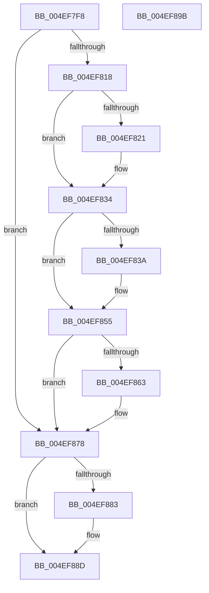

# KiComputeThreadPriorityStacking

- RVA: `0x004EF7F8`–`0x004EF89C` (길이 `164` bytes)
- VA: `0x00000001404EF7F8`
- 실행 섹션: `.text`
- PDB 이름 있음: `예`; PDB Function 태그: `아니요`
- unwind 정보 RVA: `0x00099E74`
- 디코드: `46`개 명령, `164/164` bytes 표시
- 미해석 바이트: `0` (있으면 어셈블리에 `.byte`로 보존)

> 이 문서는 커널 이미지의 기계어와 PDB 기호를 분석해 생성했습니다. 4번과 5번은 함수 원형과 자료형을 바이너리 사용 방식에서 추정한 C 해석이며 원본 소스 복구 결과는 아닙니다.

## 1. Dependencies

- 직접 호출 지점: **0**; 고유 호출 대상: **0**
- 직접 호출자로 확인된 함수: **1**
- RIP 상대 이미지 참조: **0**

### Outgoing calls
- 직접 디코드된 call 명령이 없습니다.

### Direct callers
- [KiComputeThreadPriority](../3C/KiComputeThreadPriority_function_003C45F4.md) at `0x003C461C`

### Static image references
- 디코드된 RIP-relative 메모리 참조가 없습니다.

## 2. Other-region calls and transfers

- 다른 실행 섹션으로 향하는 call: **0**
- 별도 외부 분기/꼬리 이동을 확인하지 못했습니다.

## 3. Assembly (complete function range)

```asm
004EF7F8  48 89 5C 24 10                  mov qword ptr [rsp + 0x10], rbx
004EF7FD  48 89 7C 24 18                  mov qword ptr [rsp + 0x18], rdi
004EF802  44 0F BE 89 33 02 00 00         movsx r9d, byte ptr [rcx + 0x233]
004EF80A  33 DB                           xor ebx, ebx
004EF80C  44 8B DA                        mov r11d, edx
004EF80F  4C 8B D1                        mov r10, rcx
004EF812  41 83 F9 10                     cmp r9d, 0x10
004EF816  7D 60                           jge 0x1404ef878
004EF818  8D 7B 0F                        lea edi, [rbx + 0xf]
004EF81B  41 F6 C3 01                     test r11b, 1
004EF81F  75 13                           jne 0x1404ef834
004EF821  0F B7 89 06 02 00 00            movzx ecx, word ptr [rcx + 0x206]
004EF828  23 CF                           and ecx, edi
004EF82A  41 03 C9                        add ecx, r9d
004EF82D  41 3B C9                        cmp ecx, r9d
004EF830  44 0F 4F C9                     cmovg r9d, ecx
004EF834  41 F6 C3 04                     test r11b, 4
004EF838  75 1B                           jne 0x1404ef855
004EF83A  41 8A 92 66 03 00 00            mov dl, byte ptr [r10 + 0x366]
004EF841  8A C2                           mov al, dl
004EF843  41 2A C0                        sub al, r8b
004EF846  41 3A D0                        cmp dl, r8b
004EF849  0F B6 C8                        movzx ecx, al
004EF84C  0F 4E CB                        cmovle ecx, ebx
004EF84F  0F BE C1                        movsx eax, cl
004EF852  44 03 C8                        add r9d, eax
004EF855  41 83 F9 10                     cmp r9d, 0x10
004EF859  44 0F 4D CF                     cmovge r9d, edi
004EF85D  41 F6 C3 02                     test r11b, 2
004EF861  75 15                           jne 0x1404ef878
004EF863  41 0F B7 82 06 02 00 00         movzx eax, word ptr [r10 + 0x206]
004EF86B  C1 E8 04                        shr eax, 4
004EF86E  0F B6 C8                        movzx ecx, al
004EF871  41 3B C9                        cmp ecx, r9d
004EF874  44 0F 4F C9                     cmovg r9d, ecx
004EF878  41 8B 82 58 03 00 00            mov eax, dword ptr [r10 + 0x358]
004EF87F  85 C0                           test eax, eax
004EF881  74 0A                           je 0x1404ef88d
004EF883  0F BD C8                        bsr ecx, eax
004EF886  44 3B C9                        cmp r9d, ecx
004EF889  44 0F 4C C9                     cmovl r9d, ecx
004EF88D  48 8B 5C 24 10                  mov rbx, qword ptr [rsp + 0x10]
004EF892  41 8B C1                        mov eax, r9d
004EF895  48 8B 7C 24 18                  mov rdi, qword ptr [rsp + 0x18]
004EF89A  C3                              ret
004EF89B  CC                              int3
```

## 4. C-style interpretation (structured pseudocode)

```c
__int64 __fastcall KiComputeThreadPriorityStacking(__int64 a1, int a2, unsigned __int8 a3)
{
    __int64 result;
    __int64 v_rbx;
    unsigned __int64 v_stack_p10;
    unsigned __int64 v_stack_p18;

    v_stack_p10 = v_rbx;
    v_stack_p18 = v_rdi;
    v_rbx = 0;
    if (((unsigned int)((__int8)(*(unsigned __int8 *)(a1 + 563)))) >= 16) goto loc_004EF878;
    if ((((unsigned __int8)((unsigned int)(a2))) & (1)) == 0) {
        a1 = *(unsigned __int16 *)(a1 + 518);
        a1 = (unsigned int)((a1) & ((unsigned int)(v_rbx + 15)));
        a1 = (unsigned int)((a1) + ((unsigned int)((__int8)(*(unsigned __int8 *)(a1 + 563)))));
        a4 = (__int8)(*(unsigned __int8 *)(a1 + 563));
        if (((unsigned int)(a1)) > ((unsigned int)((__int8)(*(unsigned __int8 *)(a1 + 563))))) { a4 = (unsigned int)(a1); }
    }
    if ((((unsigned __int8)((unsigned int)(a2))) & (4)) == 0) {
        a2 = *(unsigned __int8 *)(a1 + 870);
        result = (unsigned __int8)(a2);
        result = (unsigned __int8)((result) - (a3));
        a1 = (unsigned __int8)(result);
        if (((unsigned __int8)(a2)) <= a3) { a1 = 0; }
        result = (__int8)((unsigned __int8)(a1));
        a4 = (unsigned int)((a4) + ((unsigned int)(result)));
    }
    if (((unsigned int)(a4)) >= 16) { a4 = (unsigned int)(v_rbx + 15); }
    if ((((unsigned __int8)((unsigned int)(a2))) & (2)) == 0) {
        result = *(unsigned __int16 *)(a1 + 518);
        result = (unsigned int)((result) >> (4));
        a1 = (unsigned __int8)(result);
        if (((unsigned int)(a1)) > ((unsigned int)(a4))) { a4 = (unsigned int)(a1); }
    }
    if ((unsigned int)((unsigned int)(*(unsigned int *)(a1 + 856))) != 0) {
        if (((unsigned int)(a4)) < ((unsigned int)(a1))) { a4 = (unsigned int)(a1); }
    }
    return (unsigned int)((unsigned int)(a4));
}
```

## 5. (Beta) C Style

```c
int64_t KiComputeThreadPriorityStacking(void *Arg1, int32_t Arg2, uint8_t Arg3)
{
    uint8_t *arg1 = (uint8_t *)Arg1;

    int64_t result;
    int64_t local_rbx;
    uint64_t v_stack_p10;
    uint64_t v_stack_p18;

    v_stack_p10 = local_rbx;
    v_stack_p18 = local_rdi;
    local_rbx = 0;
    if (((uint32_t)((int8_t)(*(uint8_t *)(arg1 + 0x233)))) >= 16) goto loc_004EF878;
    if ((((uint8_t)((uint32_t)(Arg2))) & (1)) == 0) {
        Arg1 = *(uint16_t *)(arg1 + 0x206);
        Arg1 = (uint32_t)((Arg1) & ((uint32_t)(local_rbx + 15)));
        Arg1 = (uint32_t)((Arg1) + ((uint32_t)((int8_t)(*(uint8_t *)(arg1 + 0x233)))));
        a4 = (int8_t)(*(uint8_t *)(arg1 + 0x233));
        if (((uint32_t)(Arg1)) > ((uint32_t)((int8_t)(*(uint8_t *)(arg1 + 0x233))))) { a4 = (uint32_t)(Arg1); }
    }
    if ((((uint8_t)((uint32_t)(Arg2))) & (4)) == 0) {
        Arg2 = *(uint8_t *)(arg1 + 0x366);
        result = (uint8_t)(Arg2);
        result = (uint8_t)((result) - (Arg3));
        Arg1 = (uint8_t)(result);
        if (((uint8_t)(Arg2)) <= Arg3) { Arg1 = 0; }
        result = (int8_t)((uint8_t)(Arg1));
        a4 = (uint32_t)((a4) + ((uint32_t)(result)));
    }
    if (((uint32_t)(a4)) >= 16) { a4 = (uint32_t)(local_rbx + 15); }
    if ((((uint8_t)((uint32_t)(Arg2))) & (2)) == 0) {
        result = *(uint16_t *)(arg1 + 0x206);
        result = (uint32_t)((result) >> (4));
        Arg1 = (uint8_t)(result);
        if (((uint32_t)(Arg1)) > ((uint32_t)(a4))) { a4 = (uint32_t)(Arg1); }
    }
    if ((uint32_t)((uint32_t)(*(uint32_t *)(arg1 + 0x358))) != 0) {
        if (((uint32_t)(a4)) < ((uint32_t)(Arg1))) { a4 = (uint32_t)(Arg1); }
    }
    return (uint32_t)((uint32_t)(a4));
}
```

### 관측된 메모리 오프셋

구조체 형식이 확인되지 않은 접근은 인자 기준의 오프셋으로만 기록했습니다.

| 기준 인자 | 오프셋 표현 | 폭 (bit) | 접근 |
|---|---:|---:|---|
| `Arg1` | `+ 0x206` | `16` | `R` |
| `Arg1` | `+ 0x233` | `8` | `R` |
| `Arg1` | `+ 0x358` | `32` | `R` |
| `Arg1` | `+ 0x366` | `8` | `R` |

## 6. Execution-region graph

[열기: 2D/3D 그래프와 함수 탐색 컨트롤 패널](../../../control-panel.html?section=text&rva=0x004EF7F8&view=graph)

- 2D 그래프는 위에서 아래로 흐르고, 3D 그래프는 빈 공간을 드래그해 회전합니다. Shift+드래그는 이동, 휠은 확대·축소, 함수 노드 선택은 대상 보고서 이동입니다.

### Static fallback


