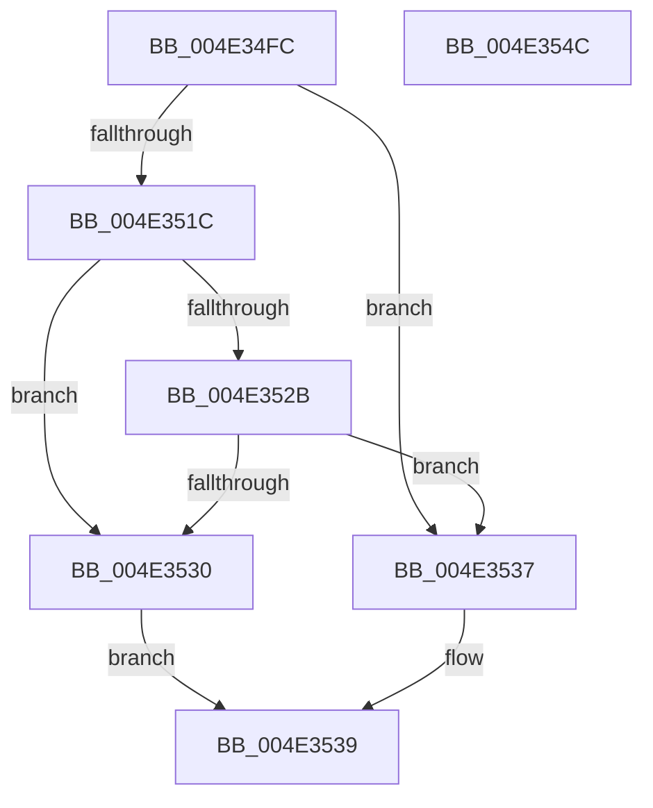

# KiDetectTsx

- RVA: `0x004E34FC`–`0x004E354D` (길이 `81` bytes)
- VA: `0x00000001404E34FC`
- 실행 섹션: `.text`
- PDB 이름 있음: `예`; PDB Function 태그: `아니요`
- unwind 정보 RVA: `0x000B64AC`
- 디코드: `27`개 명령, `81/81` bytes 표시
- 미해석 바이트: `0` (있으면 어셈블리에 `.byte`로 보존)

> 이 문서는 커널 이미지의 기계어와 PDB 기호를 분석해 생성했습니다. 4번과 5번은 함수 원형과 자료형을 바이너리 사용 방식에서 추정한 C 해석이며 원본 소스 복구 결과는 아닙니다.

## 1. Dependencies

- 직접 호출 지점: **1**; 고유 호출 대상: **1**
- 직접 호출자로 확인된 함수: **2**
- RIP 상대 이미지 참조: **1**

### Outgoing calls
- `0x004E3541` → [_security_check_cookie](../6A/_security_check_cookie_function_006AC640.md) (function, `0x006AC640`)

### Direct callers
- [KiInitializeBootStructures](../../pagelk/B6/KiInitializeBootStructures_function_00B68530.md) at `0x00B688FF`
- [KeInitSystem](../../init/C7/KeInitSystem_function_00C71660.md) at `0x00C716E3`

### Static image references
- `0x004E3502` → RVA `0x00E0A740` (`.data`; read)

## 2. Other-region calls and transfers

- 다른 실행 섹션으로 향하는 call: **0**
- 별도 외부 분기/꼬리 이동을 확인하지 못했습니다.

## 3. Assembly (complete function range)

```asm
004E34FC  40 53                           push rbx
004E34FE  48 83 EC 20                     sub rsp, 0x20
004E3502  48 8B 05 37 72 92 00            mov rax, qword ptr [rip + 0x927237]
004E3509  48 33 C4                        xor rax, rsp
004E350C  48 89 44 24 10                  mov qword ptr [rsp + 0x10], rax
004E3511  33 C0                           xor eax, eax
004E3513  33 C9                           xor ecx, ecx
004E3515  0F A2                           cpuid
004E3517  83 F8 07                        cmp eax, 7
004E351A  72 1B                           jb 0x1404e3537
004E351C  33 C9                           xor ecx, ecx
004E351E  B8 07 00 00 00                  mov eax, 7
004E3523  0F A2                           cpuid
004E3525  0F BA E3 0B                     bt ebx, 0xb
004E3529  72 05                           jb 0x1404e3530
004E352B  F6 C3 10                        test bl, 0x10
004E352E  74 07                           je 0x1404e3537
004E3530  B8 01 00 00 00                  mov eax, 1
004E3535  EB 02                           jmp 0x1404e3539
004E3537  33 C0                           xor eax, eax
004E3539  48 8B 4C 24 10                  mov rcx, qword ptr [rsp + 0x10]
004E353E  48 33 CC                        xor rcx, rsp
004E3541  E8 FA 90 1C 00                  call 0x1406ac640
004E3546  48 83 C4 20                     add rsp, 0x20
004E354A  5B                              pop rbx
004E354B  C3                              ret
004E354C  CC                              int3
```

## 4. C-style interpretation (structured pseudocode)

```c
__int64 __fastcall KiDetectTsx(int a1)
{
    __int64 result;
    __int64 v_rsp;
    unsigned __int64 v_stack_m18;

    v_rsp = (v_rsp) - (32);
    result = (*(unsigned __int64 *)(v_rip + 9597495)) ^ (v_rsp);
    v_stack_m18 = result;
    result = 0;
    a1 = 0;
    if (0 < 7) goto loc_004E3537;
    a1 = 0;
    if (condition_is_below) goto loc_004E3530;
    if ((((unsigned __int8)(v_rbx)) & (16)) == 0) goto loc_004E3537;
loc_004E3530:
    goto loc_004E3539;
loc_004E3537:
    result = 0;
loc_004E3539:
    a1 = (v_stack_m18) ^ (v_rsp);
    result = _security_check_cookie(a1, a2, a3, a4);
    v_rsp = (v_rsp) + (32);
    return result;
}
```

## 5. (Beta) C Style

```c
int64_t KiDetectTsx(int32_t Arg1)
{
    int64_t result;
    int64_t local_rsp;
    uint64_t v_stack_m18;

    local_rsp = (local_rsp) - (32);
    result = (*(uint64_t *)(v_rip + 0x927237)) ^ (local_rsp);
    v_stack_m18 = result;
    result = 0;
    Arg1 = 0;
    if (0 < 7) goto loc_004E3537;
    Arg1 = 0;
    if (condition_is_below) goto loc_004E3530;
    if ((((uint8_t)(local_rbx)) & (16)) == 0) goto loc_004E3537;
loc_004E3530:
    goto loc_004E3539;
loc_004E3537:
    result = 0;
loc_004E3539:
    Arg1 = (v_stack_m18) ^ (local_rsp);
    result = _security_check_cookie(Arg1, a2, a3, a4);
    local_rsp = (local_rsp) + (32);
    return result;
}
```

## 6. Execution-region graph

[열기: 2D/3D 그래프와 함수 탐색 컨트롤 패널](../../../control-panel.html?section=text&rva=0x004E34FC&view=graph)

- 2D 그래프는 위에서 아래로 흐르고, 3D 그래프는 빈 공간을 드래그해 회전합니다. Shift+드래그는 이동, 휠은 확대·축소, 함수 노드 선택은 대상 보고서 이동입니다.

### Static fallback


